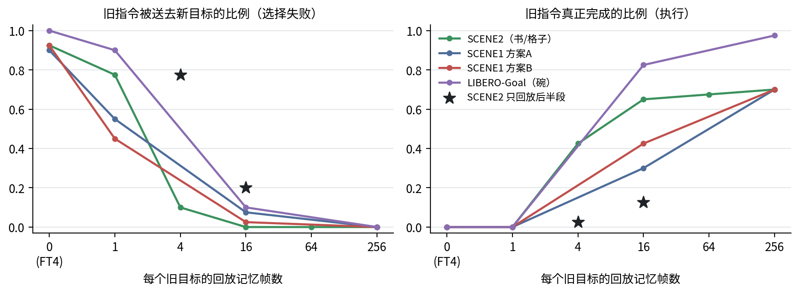

# 持续学习中的VLA：遗忘不是"忘了怎么做"，而是"目标被改道"

汇报日期：2026-10-29（周四）｜项目：cl_binding（SmolVLA持续学习）｜材料截至：2026-10-26

## 1. 一句话

机器人模型按顺序学新任务时，旧指令并不是"不会做了"，而是被执行成**最新学的那个目标**。这种改道只要极少量旧数据回放就能防住；真正需要大量记忆才能保住的，是精细执行（放准）。

## 2. 研究问题与设定

- **模型**：SmolVLA（lerobot/smolvla_base）。VLM冻结，只训练动作专家（约1亿参数）。
- **任务结构**：同一场景、同一物体，指令只改变目标位置。先联合学会两个旧目标（父模型），再只学一个新目标。
- **任务族**（三个）：
  - LIBERO-90 STUDY_SCENE2：书→收纳盒左/前格（旧），右格（新）；
  - LIBERO-90 STUDY_SCENE1：同类任务，换了一套场景；
  - LIBERO-Goal：碗→炉子/柜顶（旧），盘子（新）；另一个从未训练的目标为“打开抽屉放碗”。
- **要回答的问题**：①旧指令失败时，是选错了目标，还是执行不好？②原因是缺少旧监督，还是新任务练得太多？③防住它要多少记忆？④模型内部哪里变了？

## 3. 方法

1. **配对评测**：同一物理初态、同一场景XML、同一推理种子，比较学习前后的同一条指令，失败只计入原先成功的分母。
2. **去向分类**：不只看成功，还按逐步轨迹判断物体被送往哪里，分为成功、送到正确目标附近、送往新目标、其他。这样能把"选错目标"和"放不准"分开。
3. **匹配对照**：FT4（只练新任务）和ER（同时回放旧数据）逐步共享完全相同的新样本、噪声和flow时间，损失分母一致。两者唯一的差别是有没有旧监督。
4. **记忆预算扫描**：ER每个旧目标的记忆为256/64/16/4/1帧，嵌套抽取，只改变预算。
5. **机制分析**：固定输入下的条件响应审计，以及闭环的参数替换实验。

## 4. 主要结果

### 4.1 目标改道稳定出现，且普通回放能消除

旧指令（左、前各20回合，共40回合）被送往新目标的回合数：

| 设置 | FT4（无旧数据） | ER 256帧/目标 |
|---|---:|---:|
| SCENE2 种子1 / 2 / 3 | 37 / 36 / 36 | 0 / 0 / 0 |
| SCENE1 方案A* / 方案B | 36 / 37 | 0 / 0 |
| LIBERO-Goal | 40 | 0 |

\*方案A的父模型没过预登记门槛，门槛为事后修改，已披露；方案B换用余弦配方，按原门槛通过。

FT4和ER的新任务曝光完全相同，所以原因是**缺少旧条件监督**，不是新任务练得太多。LIBERO-Goal中ER256还同时学好了新任务（盘子18/20），旧任务（炉子20、柜顶19）甚至高于父模型（16、15），回放没有带来新旧折中。

### 4.2 新目标先于新技能接管旧指令

SCENE1方案B中，FT4自己执行新指令只成功4/20，但旧指令有37/40回合把物体送往新目标。目标选择的改道发生在新技能学会之前。

### 4.3 选择便宜，执行昂贵

- 每个旧目标只留16帧（SCENE2中约3.2 MB），改道几乎为0，但真正完成率明显下降，失败多是"送到正确格附近没放进去"。
- 只留1帧，改道又回来（18–36/40）。LIBERO-Goal中目标都是大面积区域、执行容易，16帧时完成率仍有33/40，所以两条曲线的差距随任务对精度的要求而变：越需要精细放置，执行越贵。
- **含义**：已有工作报告"小回放仍有遗忘"（Liu et al. 2026），在我们的分解下，这部分遗忘主要是执行，而不是选择。

### 4.4 选择发生在轨迹前段（预登记假设被否定）

预登记假设：同样的帧数只从示范后半段（搬运和放置）抽取，应该能改善放置。结果相反（SCENE2，种子1）：

| 每目标记忆 | 抽样方式 | 送去新目标 /40 | 左成功 /20 | 前成功 /20 |
|---|---|---:|---:|---:|
| 16帧 | 全程均匀 | 0 | 18 | 8 |
| 16帧 | 只取后半段 | 8 | 5 | 0 |
| 4帧 | 全程均匀 | 3 | 17 | 0 |
| 4帧 | 只取后半段 | 31 | 0 | 1 |

只回放后半段，放置没有变好，改道反而回来。说明**目标是在轨迹前段（接近和抓取）决定的**，记忆必须覆盖这个决策点。选择与执行不仅记忆代价不同，发生的阶段也不同。图中星号即这两组。

### 4.5 机制：编码完好，改变分布在整个动作专家

- VLM冻结，各指令的编码逐位不变；学新任务3000步后，动作专家对左/前两条指令的输出差就缩小一半，12000步后只剩约28%。
- 闭环参数替换：把父模型的"读取VLM特征"投影换回去，改道几乎不变（32/40），说明读取接口不是改道所在。换回专家的任何一半也都不能恢复，混合模型还会出现"嵌合"行为。改变是整个专家协同发生的。
- 开环指标曾提示"集中在后8层"，闭环验证没有支持，已更正。教训是机制主张必须以闭环为准。

### 4.6 评测提醒

LIBERO示范在首次成功后约10帧就截止，前格、后格示范几乎从不松爪。评估时如果关闭"成功即停"，会人为制造大量"成功后又失败"的回合。

## 5. 与已有工作的关系

| 工作 | 做了什么 | 与本工作的区别 |
|---|---|---|
| Memory Anchors（arXiv 2608.26545） | 从零训练的扩散策略在LIBERO-Goal和真机上"过度泛化到当前任务"；提出按"表示重叠、动作冲突"选回放样本 | 只做定性举例，没有在VLA上量化；没有分开选择和执行；没有预算代价曲线 |
| Liu et al.（arXiv 2603.03818） | π0/GR00T在LIBERO上用小回放就几乎不忘；组件替换认为遗忘主要来自VL主干 | 只看成功率；我们在VLM冻结时定位到动作专家，并把遗忘拆成选择和执行两部分 |
| StillGrounded（arXiv 2610.00542） | 持续模仿学习后语言接地是否保持 | 不是VLA，没有逐阶段配对，没有改道归因（该篇只读了摘要） |

## 6. 贡献与定位

**暂定标题**：*Redirected, Not Erased: What Vision-Language-Action Policies Forget in Continual Learning*

1. 能区分"选错目标"和"执行失败"的配对评测协议；
2. 遗忘的主体是目标改道，而且新目标先于新技能接管；
3. 选择与执行的回放代价曲线截然不同，并据此重新解释已有的"小回放仍遗忘"；
4. 选择在轨迹前段决定：只回放放置阶段会重新引发改道，记忆分配必须覆盖决策点（已有否定性对照实验）。

**类型**：分析型论文。目标会议：CoRL / ICLR / NeurIPS。

## 7. 现阶段缺口与计划

| 缺口 | 计划 | 资源 |
|---|---|---|
| 只有一个模型（SmolVLA） | 在π0或GR00T上复现核心对比（FT对ER，预算扫描） | 两张3090只能跑LoRA，需要更多算力 |
| 任务族偏窄 | 已覆盖3个任务族（含LIBERO-Goal），可再扩展到不同物体的目标组合 | 现有算力可完成 |
| 样本量小（每组20个初态，多数单种子） | 新初态、多种子，给出置信区间 | 约1–2周 |
| 机制停在"分布在整个专家" | 激活修补、只保护某模块的FT对照 | 约1周 |

## 8. 想请导师确认

1. 论文定位为分析型，是否认可；
2. 大模型实验的算力从哪里来；
3. 投稿目标与时间线。
