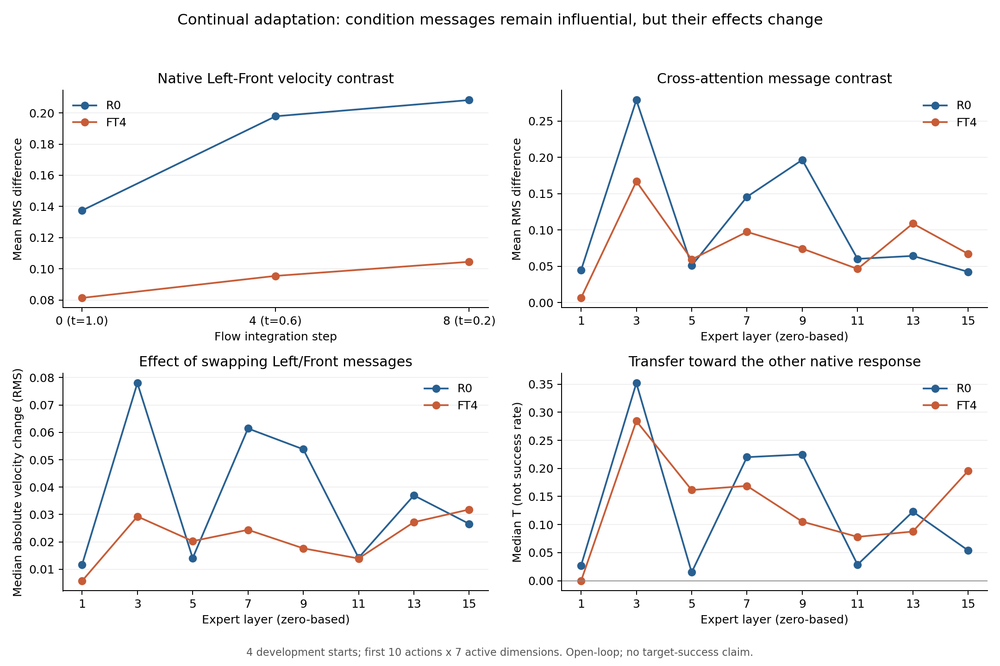

# 10/28：Cross-Attention 第 0—2 步执行与结果

> **这轮要回答：** 模型学右格后，“左”和“前”还能不能在动作专家里产生不同的消息？只把一个接口的左消息换成前消息，最终速度场会不会跟着变？我们先检查这条计算链，不让机器人执行新生成动作，不训练，也不把速度场变化直接叫作目标选择恢复。

依据：[机制检验计划](2026-10-28_动作专家Cross-Attention与语言条件失效_机制检验计划.md)第 0—2 步。日期与时间均按北京时间解释。

**最新状态：第 0—2 步已于 2026-10-29 完成，独立 CPU 审计通过。** 结果支持“条件消息仍能影响最终速度场，但各层作用及整体指令区别发生变化”；尚未证明某一层导致物理目标替代。直接看第 4—7 节。第 3 节保留先前启动与工程失败记录。

## 1. 运行前核对

2026-10-28 21:47 服务器只读检查：

- 两张 RTX 3090 均无计算占用，GPU 1 为 37 MiB，选择 GPU 1。
- 组员 stage2a 工作树为 9893833，已有未跟踪脚本保持原样。
- 环境、R0 和 FT4 权重已存在；不安装环境、不下载模型、不切换或拉取组员工作树。
- 磁盘约剩 9.6 GB，新增输出上限 512 MiB，并保留至少 2 GiB 空间。
- 实际 FT4 配置为冻结 VLM、可训练 state_proj、16 层专家、交错 CA／联合 SA、语言补齐至固定长度、10 次 flow 积分。运行时还将导出实际层图和参数差异。

本轮只使用隔离目录：

~~~text
/home/lzx/cl_binding/.server/stage2m_cross_attention_20261028_01/
~~~

## 2. 预先固定的范围

配置：[stage2m_cross_attention_20261028.json](../configs/stage2m_cross_attention_20261028.json)。

- 工程：正常起点 0、首个底噪，两模型三指令；原始／记录／自替换的速度场和动作块须通过 1e-5 门槛。
- 输入：4 个正常起点×3 个共同底噪×3 个实际 flow 时刻，共 36 固定输入组。
- 记录：两模型×Left／Front／Right，共 216 次速度场前向。
- 同模型消息交换：只用首个底噪的 12 输入组，在全部实际 CA 位置进行 Left↔Front 双向交换；若有 8 个 CA 位置，共 384 次补丁前向。
- 参考草稿由 R0 的 Left／Front 分支按固定规则平衡生成，采集成本另计。
- 动作指标主看前 10 个位置、有效 7 维，运动和夹爪分列；Right 在 R0 中仅为未学探针。

不进行跨检查点消息替换、P/C 干预、闭环评估或训练。工程失败时停止，保留证据；不因分析分数低重试或扩层。

## 3. 当前状态

已完成代码核对、5 项独立 CPU 测试、编译与差异检查，预登记提交为 924e104977287dcd8e9c566f121ad02712b1f684。

**实际派发：2026-10-28 22:07:50，GPU 1，启动器 PID 20157。** 22:08 日志显示工程阶段正在加载本地模型，尚未得到工程通过或机制结果；两份原权重保持只读。

启动前额外修正了两项记录口径：记录 P 时显式匹配原生 float32 softmax，并用 P×C 重构原读出作独立工程门槛；消息与速度场都补前 10 个动作位置的统计，避免拿全 50 步消息与前 10 步输出混比。这些是在运行前修正实现，未运行分析后挑选结果。

工程检查通过后才进入主组；若失败保留目录，不因结果分数重试。本节启动状态保留，完成结果另列。

### 3.1 首次工程停止与修正

首次工程于 10/28 22:08:23 停止，用时约 31 秒；尚未进入记录／自替换检查和主组，不能计入机制结果。失败原因是冻结图文前缀的全位置比较不一致，原记录见 [engineering_failure_v1](results/2026-10-28/stage2m_engineering_failure_v1/FAILED.json)。

源码分析发现原比较也包含了被 mask 屏蔽的语言补齐位置。完全屏蔽的 query 行在原生有限极小值 softmax 中会产生均匀权重，因此这些无效位置可能受到可训练状态投影的影响；它们不应当作实际被动作专家读取的有效图文条件。需要新诊断实测确认，不能仅据这个解释抹去失败。

修正仅限诊断：分别保存有效／屏蔽位置的数量、max／RMS及原全位置差异，并核对两模型预处理输入哈希。图文一致性核验对象纠正为 mask 有效位置，仍使用原 1e-5 阈值；不改变模型计算和评分矩阵，有效位置不一致仍停止。原目录保留，新工程使用 stage2m_cross_attention_20261028_02。

10/28 修正后、派发新工程前，工具自动审批因账户用量限制未能完成，后续操作未执行；该错误不代表操作被判不安全。10/29 用户要求继续后恢复工作。

### 3.2 已完成的权重与结构核对

首次工程虽然停止，但已完成权重和运行时结构核对：

| 检查 | 实际记录 | 解释 |
|---|---|---|
| VLM 参数 | 350,165,184 个参数元素，R0／FT4 差异为 0 | 确认冻结边界，不代表整个 prefix 都相同 |
| 动作专家参数 | 98,245,840 个元素，其中 84,914,310 个数值改变 | 说明学习发生在专家中；不是遗忘比例，也不直接定位原因 |
| state_proj | 31,680 个元素，其中 8,640 个改变 | 状态位置必须独立核对 |
| 动作输入／时间及输出投影 | 均记录到变化 | 不能预设只有 Cross-Attention 是变化来源 |
| 实际层图 | 16 层；CA 为 0-based 1、3、5、7、9、11、13、15，其余为联合 SA | 采用实际运行图，不是按默认猜层号 |

这部分已经回答“冻结了哪部分、哪些部分仍在更新”，还没有回答“是否仍区分指令、区别能否传到速度场”。

## 4. 完成规模、时间与工程结果

修正后的运行目录是：

~~~text
/home/lzx/cl_binding/.server/stage2m_cross_attention_20261028_02/
~~~

10/29 10:54:10 派发，启动器 PID 24507，使用修正提交 f8cfd6fceda3cf00b8798ed98fc5451003b0d1d2。10:55:42 全部完成：

| 阶段 | 实际规模 | worker 用时 | 状态 |
|---|---|---:|---|
| 第 0 步：工程验收 | 两模型×三指令，含各 CA 自替换、动作块一致性和读出重构 | 36.14 秒 | 通过 |
| 第 1—2 步：主组 | 36 输入组、216 基线查询、384 消息交换、1728 配对测量 | 52.87 秒 | 完成 |
| 参考草稿生成 | 12 条采样轨迹，共 120 次额外速度场前向 | 包含在主组时间内 | 已计成本 |

两阶段加载与启动成本已包含在对应 worker 时间，启动器墙钟约 92 秒。第一轮失败另计，不能从工程成本中抹去。

**没有重新训练，没有执行模型生成的仿真动作。** 环境仅按既有协议复位并执行固定 10 步零动作稳定；之后所有比较都是同一正常起点下的计算实验，不是完整任务 episodes。

第 0 步实际核对：

- 六组模型／指令的“原样—只记录—自消息替换”速度场及动作块最大误差均为 **0**。
- 使用记录的 P 与 C 重构原生 PC，两个模型的累计最大误差均为 **0**。
- 有效图像／文字位置的跨模型 K/V 最大误差为 **0**。
- 被屏蔽文字位置最大差为 **0.125**，从源码 layer 1 开始；状态位置最大差为 **2.765625**。这符合前述 padding 诊断解释，不表示有效图文编码变了，也不证明 padding 导致目标替代。
- 各模型、指令及查询的缓存独占检查通过。

本轮最小原始测量及元数据约 14 MB，归档在 [stage2m_cross_attention](results/2026-10-29/stage2m_cross_attention/analysis/manifest.json)，没有下载权重、图片或完整隐藏张量。

## 5. 发现一：最终速度场仍区分指令，但左／前区别减弱

### 通俗解释

同一个画面、同一个机器人姿态、同一个动作草稿，只把指令从 Left 换成 Front，FT4 的输出仍然会变。

所以，**“学右后完全不看语言，所有指令输出完全相同”不符合这轮结果。** 但它对左／前两条旧指令的输出区别，确实比 R0 小。

主指标为前 10 个动作位置、有效 7 维上的速度场 RMS 差，数值单位是归一化动作生成空间，不是米／秒，也不是成功率。下表每格是 12 个输入组的均值：

| flow 生成阶段 | R0 左／前区别 | FT4 左／前区别 | FT4／R0 均值比 |
|---|---:|---:|---:|
| t=1.0，初始噪声 | 0.13743 | 0.08130 | 59.2% |
| t=0.6，生成中段 | 0.19786 | 0.09543 | 48.2% |
| t=0.2，接近生成完成 | 0.20824 | 0.10446 | 50.2% |
| 全部 36 输入组 | **0.18117** | **0.09373** | **51.7%** |

36 组 FT4 的左／前区别都不为零，范围约 0.06276—0.13540。这里的 51.7% 只是该测量的均值比，不能叫“保留了 51.7% 语言理解”，也不与早期交接中的 28% 直接相减：输入、草稿及统计位置不同。

只看 FT4，三对指令的区别也都不为零：

| 指令对 | 速度场 RMS 差均值 |
|---|---:|
| Left／Front | 0.09373 |
| Left／Right | 0.06145 |
| Front／Right | 0.05742 |

**这些不同不保证运动方向正确。** 三个回答可以在数值上不同，却最终都偏向右格；需要后续闭环才知道这些区别能否控制正确目标。R0 未学 Right，其 Right 分支只作敏感度探针。

## 6. 发现二：内部消息不是所有层一起坍缩

消息 M 指专家 o_proj 的输出、加入残差之前。下表仍是同输入 Left／Front 的消息 RMS 差，取前 10 个动作位置，再对 36 个输入组平均：

| 源码层下标，0-based | R0 消息区别 | FT4 消息区别 | 观察 |
|---|---:|---:|---|
| 1 | 0.04450 | 0.00631 | 明显减小 |
| 3 | 0.27887 | 0.16679 | 减小，但仍明显不同 |
| 9 | 0.19646 | 0.07424 | 明显减小 |
| 13 | 0.06416 | 0.10874 | 增大 |
| 15 | 0.04223 | 0.06699 | 增大 |

通俗理解：

> 并不是所有“信息传递站”都不再区分左和前。有的站区别变弱，有的站反而区别更大。问题可能是传了什么、这些消息怎样配合发生变化，而不是整条语言线路统一断开。

区别增大也不等于正确目标信息增多，可能是无关变化或错误条件对应。本轮没有通过语义解码证明消息里仍保留完整正确目标。

**还要避免一个误判：** layer 1 的消息区别下降很大，但它在健康 R0 中对最终速度场的单位置传递作用原本就较小。因此不能只找“下降最大的一层”来命名病灶。

原始 C 统计包含 masked prefix 位置，不用其相近程度证明“可用语义仍被保留”；本轮主要依据实际注意力加权后的 PC、M 以及最终速度场。

## 7. 发现三：交换消息会改变速度场，作用在各层重新分布

### 交换具体是什么？

例如：接收运行仍请求 Left，保持该运行其余计算，在某个 CA 位置只换入同模型、同状态、同草稿下 Front 运行产生的 M，再观察最终速度场是否向原生 Front 回答变化。Front←Left 也做。

没有切换整个策略、没有注入最终动作，没有让生成动作进入环境。这比“消息看起来不同”更强：它直接检验了消息是否具有后续计算作用。

T 衡量补丁引起的变化沿“另一指令原生回答”的投影。T=0.35 可以理解为沿该参考区别产生约 35% 的方向投影；它不是完整接近程度、不是正确动作恢复率，也不是成功概率，数值可以为负或超过 1。

以下每格是 12 个输入组×两个交换方向，共 24 次的中位数：

| 源码层下标 | R0 的 T | FT4 的 T | R0 绝对改变量 RMS | FT4 绝对改变量 RMS |
|---|---:|---:|---:|---:|
| **3** | **0.35182** | **0.28437** | **0.07798** | **0.02928** |
| **9** | **0.22488** | **0.10530** | **0.05382** | **0.01764** |
| 15 | 0.05397 | 0.19568 | 0.02659 | 0.03183 |

第 3 层两模型的 24 次交换均沿另一指令原生响应方向变化；第 9 层 R0 为 24/24，FT4 为 23/24。这些分母都是**计算传递次数**，不是任务成功回合。

结果有两层含义：

1. **条件消息仍能传到最终速度场。** FT4 的第 3、9 层不是完全失去作用。
2. **作用发生变化，而且不是所有层统一弱化。** 第 3、9 层的绝对改变量明显降低；第 15 层的绝对改变量却略增。T 还受每个模型自身原生区别大小影响，所以必须和绝对量一起读，不能仅凭 T 增大宣布语言作用增强。

按预先固定的健康 R0 双向传递排序，开发候选是 **源码下标 3、9**，分别为第 4、第 10 个 Transformer block，并非“第 3、9 个 CA”。这是后续检查的候选，不是已经确诊的两个遗忘模块。

### 可视化

左上：最终速度场的左／前区别。右上：各 CA 的消息区别。左下：交换消息实际引起的速度场改变量。右下：相对同模型另一指令回答的 T。曲线只描述四个开发初态的计算结果，没有置信区间或闭环成功率含义。

## 8. 目前可以怎样解释目标替代？

现在最稳妥的表述是：

> 在本轮相同输入下，冻结的有效图文条件保持一致；动作专家仍对指令产生不同消息，这些消息仍能影响最终速度场。但旧指令的整体输出区别减弱，各接口的消息及传递作用也发生了不一致的变化。目标替代更值得沿“条件作用及其配合改变”追查，暂不能简化成“Cross-Attention 全部不读取语言”。

尚不能区分的两件事：

- **消息改变了：** 新 M 的幅度、方向或承载的目标相关内容已经不同。
- **使用方式改变了：** 后续网络对同样的消息改动不再产生原来的作用。

本轮换的是各模型自然生成的不同消息，上述两项都可能参与结果。M 差异不为零、交换对 v 有作用，并不证明模型内部完整保留正确目标，更不直接证明错误来自某个 Q/K 参数。

此前共同响应交换还显示，只恢复旧背景可能带回旧左格默认。当前结果没有排除共同偏移；也不能把原 CID 入口实验拼到 FT4 上，宣称完整物理失效链已闭合。

## 9. 独立核验与审计口径修正

[独立审计 v2](results/2026-10-29/stage2m_cross_attention/analysis/audit_v2.json)只读 JSON、使用标准库，不导入 worker、模型或 PyTorch：

- 核对 216 基线、384 交换、1728 配对测量及 120 次参考前向的完整矩阵，无重复／漏项。
- 从每条保存的 50×7 原始速度场重算前 10 步的 RMS、T、方向与正交变化，运动／夹爪分别检查。
- 核对共同状态、草稿、flow 时间、缓存独占、6 组工程恒等及原生读出重构。
- 核对 1152 条前缀分块测量；有效图文差为 0，masked 差异保留。
- 核对候选排名、文件字节数及 SHA。原始 P/C／隐藏张量未独立重跑，审计不代替闭环验证。

首次审计 v1 遇到注意力模态质量略超过 1，失败记录保存在 [audit_v1_failure](results/2026-10-29/stage2m_cross_attention/analysis/audit_v1_failure.json)。原因是原审计按接近精确概率的 1+1e-6 检查，但原生 softmax 后的 P 会转换为 BF16，舍入后求和可略偏离 1；工程 P×C 重构仍为 0 误差。

修正审计依据 BF16 单位舍入误差 2^-8，以及 177 个前缀位置、10 个 query 的 FP32 求和／均值误差，推导形状相关边界 0.0039280911，而非按分数挑阈值；该边界也比原总和容差 0.01 更严格。实测 77,760 个模态质量条目中，最大单组质量为 1.0015658140，最大总和偏差为 0.0015658996，符合该界。**未重新归一化或改写原数据，没有重跑模型。**

相关独立 CPU 测试现共 7 项，含有效／masked 位置边界、舍入界、有效动作维度、近零分母及重复矩阵检查，全部通过。

## 10. 下一步建议：检验消息变化还是后端使用变化

先围绕已选的 3、9 两处做下一批开环实验，不立即追加回放训练：

1. **跨检查点同语义救援／反向检查。** FT4 请求 Left 时，注入 R0 同输入的 Left 消息，并与 Front 错来源、等幅随机修正比较；反向把 FT4 同指令消息放进 R0。Front 请求对称执行。
2. **共同消息控制。** 若只有两条旧指令都恢复成左格，说明恢复旧默认，不能叫恢复条件控制。
3. **交叉传播控制。** 把旧／新两种消息差方向匹配到相同预锁幅度，分别交给新旧接收后端，开始区分“消息方向改变”和“后端响应改变”。不同模型坐标与上下文兼容性仍需保留。
4. **有目标特异信号后，才做正常起点短窗口闭环。** 只有正确来源恢复对应目标、错误来源使目标有规律改变，并超过假干预，才进一步支持这条路径参与目标替代。

当前没有启动这些下一批实验。正式确认还需要新物理初态、已通过资格的独立 R0、独立适应过程及至少另一任务设置；三组噪声不能替代它们。
