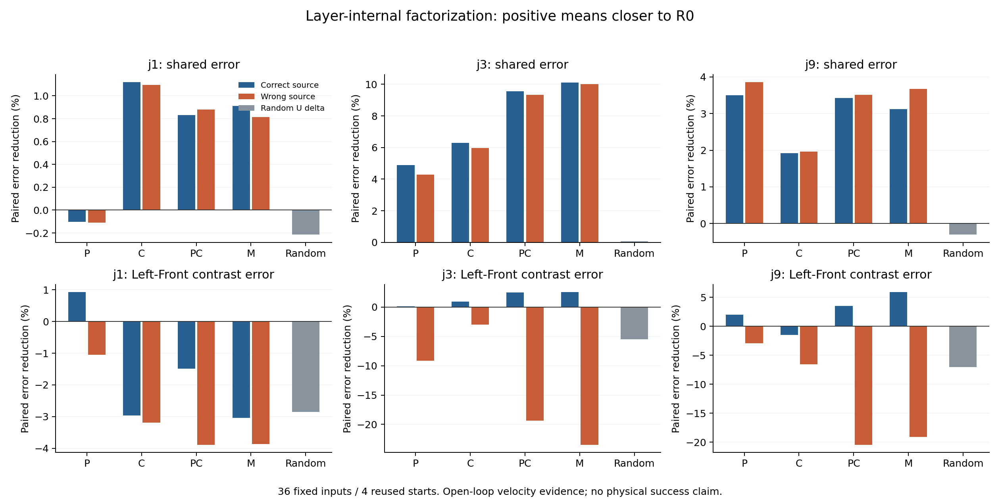
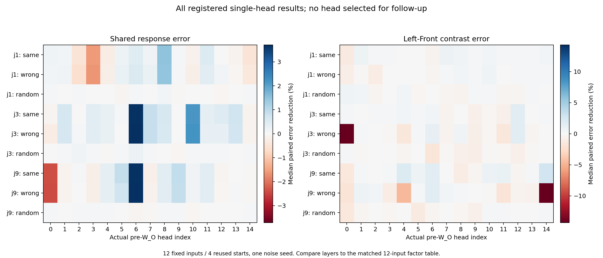

# 10/29：从整层消息走向层内读取和真实注意力头

> **通俗解释：** 上一步相当于把旧模型写好的一整封信送回新模型，发现能纠正一部分共同偏移，却只能小幅改善左／前区别。这一步打开信封：究竟是“去哪里找信息”变了，还是“找到后拿回的内容”变了？然后在整合之前，逐个更换真正的注意力头读出，检查哪些小通道会改变左／前区别。每次只动一个位置，其余计算保留。先找计算证据，再决定是否值得进行机器人动作验证。

**完成结论：第 4 层的共同补偿在投影前就已出现，读取分配与内容两边都参与；第 10 层恢复旧读取分配有小幅条件改善，单换旧内容则没有。逐头筛查也发现“共同补偿明显的头”和“来源改变会影响条件区别的头”，但尚未找到一个能充分修复损伤、可称为唯一病灶的头。**

状态：**17:48:42 派发，17:51:53 全部完成，本地与服务器独立审计通过。** 预登记提交 `0055e35`，GPU 1，启动器 PID 29842。所有时间为北京时间。第 1—6 节保留固定设计和工程记录，第 7 节起为实际结果；未追加闭环、头组合或训练。

## 1. 先澄清：已经分析过层的位置，还没有拆开层内原因

[上一轮报告](2026-10-29_Cross-Attention第3步_跨阶段消息交换.md)已比较候选下标 3、9 与固定非候选 1。它们分别对应第 4、10、2 个 Transformer block；并非发现“只有这些层重要”。

目前较突出的现象是：第 3 层无论注入正确或错误指令的旧消息，共同响应误差都降低约 10%；但正确来源让左／前区别误差降低中位 2.54%，错误来源反而增大 23.46%。第 9 层正确来源带来 5.90% 的区别误差改善。以上是计算误差变化，不是成功率。

原替换对象是 **W_O 输出之后的 M**。W_O 已经混合各头，因此先前将 720 维分成 15 个输出坐标块只用于随机修正规模记账，那些 48 维块不是注意力头。不能回头把上次的块称为忽略 Left／Front 的头。

## 2. 这次真正拆的是什么？

对一个固定 CA 位置，简写为：

```text
P：读取分配——向各个前缀位置读多少
C：可供读取的内容——专家 V 投影后的内容
U = ConcatHeads(P C)：各真实头的读出，尚未经过输出投影
M = W_O U：混合后送入动作计算的整层消息
```

P 包含查询、键、上游隐状态和位置编码的共同作用；不是单独某组 Q/K 权重。C 也包含前缀和专家变换，不能直接叫作原始词义。

图像、文字、状态位置可能已经融合条件。注意力落在图像上不证明没用语言，落在文字上也不证明能按语言选目标。关注最终速度场受干预后如何变化。

实际头维度由运行时 `U宽度 / query头数` 确认，同时核对真实 GQA 扩展次序及 o_proj 输入维度；**不用 720/15 推断头维度**。预期实际 query 头数为 15，若不一致则停止，不临时改变筛查规模。C 的 KV 头可能被多个 query 头共享；单头实验只替换展开后的 U，不误改同组其他头的 C。

## 3. 第一步：在固定层内分开替换读取分配与内容

接收模型固定 FT4，保留其当前层前的计算、W_O、后续残差／MLP／其他层。旧材料来自 R0 在相同画面、草稿和 flow 时刻的运行。

| 处理 | 通俗意思 | 对照目的 |
|---|---|---|
| P_new C_new 自重构 | 重新拼回自己的原读出 | 验证记录和重构没改变计算 |
| P_old C_new | 用旧的读取分配，读取新内容 | 分配变化是否有功能作用 |
| P_new C_old | 用新的读取分配，读取旧内容 | 内容变化是否有功能作用 |
| P_old C_old | 分配和内容一起换旧，仍用新 W_O | 两者是否需要配合 |
| 整份旧 M | 复现上轮整层替换 | 与前批结果逐项核对；作为实现及功能参照 |
| 随机 U 修正 | 在真实头／动作位置上匹配旧 U 修正幅度 | 检查一般扰动能否造成类似效果 |

三个 P/C 旧材料条件和整份旧 M 均做正确／错误指令来源。例如外部请求 Left 时，正确来源为 R0 Left，错误来源为 R0 Front；Front 对称执行。合计 **10 条路线**。

P 使用完整的自然概率矩阵，不把差分任意加回、不重归一化来凑结果。来源与接收的 token 数、mask 和头坐标必须合法对齐；不一致则停止。比较 P/C 时使用真实原生精度，先证明它们能重构原 eager 的读出。

**解释规则：**

- 旧 P 有帮助：支持旧读取分配具有功能作用，不能直接归因该层 Q/K 参数。
- 旧 C 有帮助：内容变换值得研究，不能只围绕注意力分配解释。
- P/C 单独无效、一起有效：提示配合关系，不能强行拆成独立贡献。
- 只有完整旧 M 有效：W_O 或跨阶段兼容性成为候选解释，尚未证明就是 W_O 损伤。
- 各种处理都无效或方向不一致：保留负结果，考虑其他通道或接口不兼容。

本轮不替换 W_O 权重。即使上述组合出现差异，输出投影的独立作用仍需另做固定 U 的专门实验。

## 4. 第二步：在投影前逐个筛查真实注意力头

在同样三个固定位置，对每个真实头 h，保持其余头的读出为 FT4 原值，只替换第 h 个头的 U：

1. 该头换成 R0 同指令读出。
2. 该头换成 R0 另一旧指令读出。
3. 该头加入与同指令修正逐动作位置匹配幅度的固定随机差量。

然后都经过 **FT4 原 W_O 和同一接收背景的后续计算**。实际 o_proj 输入用只读见证 hook 核对；其他头的坐标改变量必须严格为零。随机修正同时保存计划与 BF16 实际范数，明确量化误差。

这属于单头读出的功能筛查，比只看“这个头关注了哪个词”更直接，但仍不能给头贴上“专门理解 Left”的标签。同编号头来自同一检查点谱系，不等于已证明跨阶段语义完全对齐；单头效果也不保证能线性相加为整层效果。

同时记录全部头的 P 左／前差异、U 左／前差异及图像／文字／状态来源质量，作为解释线索。它们不是用于先挑最好看的头再检验，也不单独作为语言忽略证据。

## 5. 固定规模、比较方法和验收

模型、源码、输入及候选哈希沿用前批封存证据，只读复用，不下载权重、不改变组员工作树。

| 部分 | 固定规模 |
|---|---:|
| 物理初态 | 原开发初态 0、1、2、3 |
| P/C 对照 | 4 初态×3 底噪×3 flow 时刻×2 指令×3 位置×10 路线＝2160 补丁查询 |
| 逐头起步筛查 | 仅原第一个底噪，4 初态×3 时刻×2 指令×3 位置×15 头×3 路线＝3240 补丁查询 |
| 原生基础查询 | 两模型×两指令×36 输入＝144 |
| 原参考草稿采集 | 额外 120 次前向 |
| 正确／随机差量范数记录 | 2592 条，其中随机 1296 条 |
| 描述性头记录 | 36 输入×2 模型×3 位置×15 头＝3240 条 |

主矩阵合计 **5400 次补丁前向**；不是 5400 个 episodes。逐头结果只有 12 个输入组，仍来自 4 个开发物理初态，属于筛查，不给总体显著性或头的最终排名。

工程阶段另用第一个输入检查 4 条记录、6 条完整 P/C 自重构、90 条逐头自替换；还试跑各 P/C 路线。预期 100 条恒等检查，150 次补丁验收，均独立于主结果统计。所有有效输出及完整读出重构保持 1e-5 门槛，不因结果调整。

主组逐项核对上一轮输入哈希和原生速度场；整份旧 M 条件还必须复现上轮对应补丁速度场。失败保留原目录，不自动评分重跑。每个分支 batch=1、独立 KV 缓存，不进行模型生成动作的仿真执行；只复用原 reset 的固定零动作稳定过程。

**主要判断指标保持不变：** 前 10 动作位置、有效 7 维；运动／夹爪、全 50 位置辅助。每个相同输入先计算相对旧 R0 的共同误差、左／前区别误差，再算相对原 FT4 的变化，最后取中位数和改善组数。正值是计算误差降低，不是任务成功。

层内完整对照有 36 组，逐头只有 12 组。不能把不同输入规模的汇总直接当相同效果比较；正式做头与整层对照时，应限制到共同的 12 组。所有位置和全部头都报告，不能把筛查最大值当确认性结论。

自然 P/C 正确／错误来源不完全等幅，因此来源差异仍可能混合规模变化。随机条件匹配同指令 U 修正，并不消除所有兼容性问题。

## 6. 工程与运行停止规则

- [固定配置](../configs/stage2o_pc_heads_20261029.json)、[实验 worker](../scripts/stage2o_pc_heads.py)、[隔离启动器](../scripts/run_stage2o_pc_heads.py)、[标准库独立审计](../scripts/audit_stage2o_pc_heads.py)。
- 启动顺序：封存提交 → 上传到新隔离目录 → 检查模型／证据／源码哈希和空闲 GPU → 工程验收 → 固定主矩阵 → 独立审计。
- 预定目录：`/home/lzx/cl_binding/.server/stage2o_pc_heads_20261029_01`，GPU 1。若占用则停止，不抢卡、不终止组员进程。
- 输出上限 512 MiB，至少保留 2 GiB 可用空间，单 worker 45 分钟上限；出现错误不自动扩大容差或预算。
- 两模型沿用已有权重；运行结束核对模型／源码／运行工作树未变。只归档小型速度场、统计和范数证据，完整 P/C／权重留运行时，不入 Git。
- 6 项 CPU 协议检查、脚本编译、CLI 检查通过；真实 Torch／CUDA 工程自重构和 hook 验收随后通过，见下。

SSH 最初数次在身份验证前关闭连接，后续恢复。第一次服务器 CPU 检查因隔离目录缺少测试预期的 `configs/` 副本而停止，尚未启动 worker；补齐字节一致的配置副本后，全部 6 项通过。保留 `cpu_tests.log`、`cpu_tests_layoutfixed.log` 和 `deployment_layout_repair.json`，没有修改方法、门槛或预算。

17:48:42 派发后，工程 worker 耗时 33.87 秒（启动器计 35.07 秒）。4 条记录、6 条完整 P/C 自重构、90 条逐头自替换共 **100 条恒等检查最大误差均为 0**；实际为 **15 个 query 头，每头 64 维，U 宽度 960，投影后隐藏宽度 720**。全部 150 条补丁工程验收完成后，17:49:18 启动固定主组。

本轮不自动扩展闭环、头组合、额外种子、第二模型或训练。只有固定结果审计后，再判断值得验证哪条路径。

## 7. 层内结果：共同补偿并非只有 W_O 换旧才出现

主矩阵按计划一次完成：144 条基础查询、2160 条层内对照、3240 条逐头干预、2592 条正确／随机范数记录、3240 条描述性头记录，参考草稿额外 120 次前向。主 worker 152.90 秒，启动器计 154.17 秒。

以下是正确旧指令来源的逐输入误差相对改善中位数，**正值是对 R0 速度场的误差降低，负值是增大**。

| 位置 | 替换内容 | 共同误差改善 | 左／前区别误差改善 |
|---|---|---:|---:|
| 1：非候选 | 仅 P | −0.10% | +0.92% |
| 1 | 仅 C | +1.12% | −2.96% |
| 1 | PC 一起 | +0.83% | −1.49% |
| 1 | 完整 M | +0.91% | −3.04% |
| **3：候选** | **仅 P** | **+4.88%** | **+0.13%** |
| 3 | 仅 C | +6.31% | +0.92% |
| 3 | PC 一起 | +9.55% | +2.49% |
| 3 | 完整 M | +10.11% | +2.54% |
| **9：候选** | **仅 P** | **+3.50%** | **+1.98%** |
| 9 | 仅 C | +1.92% | −1.49% |
| 9 | PC 一起 | +3.42% | +3.48% |
| 9 | 完整 M | +3.12% | +5.90% |



**通俗理解第 4 层（下标 3）：** 旧的“找资料方式”与“资料内容”分别都能把两条回答一起挪回一部分；两者一起替换，在仍使用新 W_O 时，共同误差就能降低 9.55%，接近完整旧消息的 10.11%。因此，旧消息的突出共同补偿并不要求把 W_O 也换旧。但仅换 P 的左／前区别改善中位数只有 0.13%，不能把它解释为强力恢复了按语言选目标。

**通俗理解第 10 层（下标 9）：** 旧读取分配使区别误差降低 1.98%（23/36 组改善），单换旧内容反而增大 1.49%（仅 9/36 组改善）。两者一起可降低 3.48%。这提供了相对更清晰的读取分配功能线索，但仍幅度有限、可以存在相互配合和跨阶段兼容性，不能宣布 Q/K 参数就是原因。

正确来源不等于每组都有效。第 3 层仅 P／仅 C／PC 的区别改善组数分别是 18／21／25，共 36 组；第 9 层分别为 23／9／24。第 1 层也存在约 0.92% 的仅 P 改善，因此保留其作为有功能作用的对照，不能说它完全不重要。

错误来源没有相同的区别恢复：第 3 层仅 P／仅 C／PC 的区别误差分别**增大 9.16%／3.02%／19.36%**；第 9 层分别**增大 2.92%／6.54%／20.45%**。完整 M 的前批效果逐项复现、误差为 0。随机 U 修正的区别误差在两候选层分别增大 5.49%／7.07%，未得到相同收益。自然来源的 P/C 差量未全都等幅，保留幅度混杂边界。

这些组合不能相加求“P 占多少百分比、C 占多少百分比”；网络非线性，表格还是逐输入比例的中位数。PC 与 M 之间的差距也不能单独证明 W_O 受损，尤其未经固定 U 的输出投影独立干预。

## 8. 真实头筛查：共同补偿与条件作用不必落在同一类响应上

所有 15 个头都在三个固定位置上做了同指令、错误指令和匹配随机修正。以下只是帮助理解的例子，**不据此选择头继续跑，也不是独立确认的“语言头”**。完整 45 个位置／头结果见文末表和图。

| 位置／头（均为 0-based） | 正确来源共同改善 | 错误来源共同改善 | 正确来源区别改善 | 错误来源区别改善 | 随机区别改善 |
|---|---:|---:|---:|---:|---:|
| j3／h6 | +3.66% | +3.70% | +0.43% | +1.15% | −1.76% |
| j9／h6 | +3.66% | +3.71% | +1.67% | +1.53% | −0.41% |
| j9／h4 | +0.33% | +0.36% | +1.98% | −4.62% | −0.03% |
| j9／h14 | −0.03% | −0.04% | +2.70% | −14.29% | +0.15% |

**例子一：h6 主要给了共同补偿线索。** 在两个候选层，换正确／错误指令来源，共同改善都约 3.7%。所以某头让整体输出变好，并不自动说明它在传递正确的语言目标。

**例子二：j9／h14 有来源相关的条件作用线索。** 正确来源使区别误差降低 2.70%，错误来源增大 14.29%；共同响应几乎不变。它更接近我们想检查的“改变指令区别”的通道，但正确来源只在 8/12 组改善，随机来源也在 7/12 组略有改善。不能仅凭中位数就宣布它是稳定修复头，更不能把错误来源造成的破坏当成自然损伤已定位。

这两类例子提示不同头的功能影响有差别，反对把所有头都叫作“不看语言”。但没有得到“某个头被继续学习完全关闭”的证据。单头换回的条件改善仍然很小，也没有验证其能恢复任务成功。



蓝色表示对旧响应的误差降低，红色表示误差增大；左图是共同响应，右图是左／前区别。各图色标按本图全部值确定，不隐去负值。所有头只有同一底噪的 12 输入组。

同一 12 组下，第 3／9 层完整旧 PC 的区别改善为 **2.62%／7.15%**，完整旧 M 为 **2.43%／7.16%**。不能拿全 36 组的 2.49%／3.48% 直接和单头 12 组比较。单头影响可以相互抵消、协同，既不能加总，也不能用单头最大值代替整层贡献。

## 9. 现在能怎样回答“为什么坏”？

**机制线索进一步收窄了：** 在选定位置，改变读取分配和内容都能改变最终速度场；突出共同补偿的一部分在 W_O 之前的读出中就能实现。条件区别的改善较小、按层不同，第 10 层的读取分配比单换内容呈现更好的功能线索；真实头中也出现共同补偿与来源相关条件作用不同的响应。

**仍未确定自然起因：** P 改变可能由此前隐状态／Q、K 投影或它们的交互造成，C 则混合前缀与 V 投影。当前交换的是自然中间量，不是固定接收状态下只切某一组权重。它不能判定哪个参数更新最先引发损伤，也不能证明某头完整保存了正确目标知识，更没有证明闭环目标替代被修复。

后续有两种不同问题，应分开登记：若问“哪个局部计算产生变化”，做固定接收隐状态和前缀的局部 Q/K/V 变换对照，并按证据检查固定 U 的 W_O 作用；若问“这些线索能否挽回目标选择”，需要预先锁定干预和独立状态，再做有限闭环。**本轮均未自动启动。**

## 10. 审计与证据

- [主组运行清单](results/2026-10-29/stage2o_pc_heads/analysis/manifest.json)、[逐补丁速度场](results/2026-10-29/stage2o_pc_heads/analysis/patches.jsonl)、[描述性头测量](results/2026-10-29/stage2o_pc_heads/analysis/heads.jsonl)。
- [服务器审计](results/2026-10-29/stage2o_pc_heads/audit_v1.json)、[本地独立重算](results/2026-10-29/stage2o_pc_heads/audit_local_v1.json)、[全部汇总及共同12组对照](results/2026-10-29/stage2o_pc_heads/summary.json)、[归档核对](results/2026-10-29/stage2o_pc_heads/archive_manifest.json)。
- [结束后模型与环境核验](results/2026-10-29/stage2o_pc_heads/post_run_check.json)、[部署路径修复记录](results/2026-10-29/stage2o_pc_heads/deployment_layout_repair.json)。

基线复现、完整 M 前批效果复现、P/C 自重构、实际 U 注入见证的最大误差均为 0；非目标头读出改变量严格为 0。随机差量的最大逐头范数相对偏差约 0.51%，在已记录 BF16 舍入界内。

两地独立审计均通过；所有汇总完全一致，逐输入明细只有两处辅助响应 RMS 的末位浮点差异（最大 1.11×10⁻¹⁶），保留两份原审计，不改数据或容差。17:52:46 核验模型、源码和运行工作树未变，两张卡均空闲。没有新增训练或机器人生成动作执行。

结论仍限于历史未正式合格 R0、一个适应过程、4 个重复开发初态；逐头还只有一个底噪。全部结果为计算证据，不是独立场景统计或行为恢复。

## 附：全部位置／头的区别误差改善

每列均为 12 组逐输入相对改善的中位数；正值表示更接近 R0 的左／前区别。下表完整列出，不筛掉无效或负面结果。

| 层 | 头 | 正确来源 | 错误来源 | 匹配随机 | 正确来源改善组数 |
|---|---:|---:|---:|---:|---:|
| 1 | 0 | -1.31% | -0.95% | +0.61% | 3/12 |
| 1 | 1 | +0.68% | -0.14% | +0.39% | 9/12 |
| 1 | 2 | +0.22% | -1.06% | -0.35% | 6/12 |
| 1 | 3 | +0.31% | +0.03% | +0.07% | 9/12 |
| 1 | 4 | +0.08% | +0.03% | +0.36% | 7/12 |
| 1 | 5 | -0.01% | -0.03% | -0.32% | 6/12 |
| 1 | 6 | -0.56% | -0.37% | -0.07% | 5/12 |
| 1 | 7 | +0.87% | +0.27% | -0.41% | 9/12 |
| 1 | 8 | +0.51% | +0.36% | -0.46% | 7/12 |
| 1 | 9 | +0.21% | +0.25% | +0.16% | 7/12 |
| 1 | 10 | +0.39% | +0.60% | +0.18% | 9/12 |
| 1 | 11 | +0.18% | -0.02% | -0.42% | 7/12 |
| 1 | 12 | +0.13% | +0.29% | -0.38% | 7/12 |
| 1 | 13 | +0.18% | +0.31% | +0.20% | 8/12 |
| 1 | 14 | +0.44% | +0.33% | +0.00% | 8/12 |
| 3 | 0 | +0.24% | -14.30% | +0.17% | 6/12 |
| 3 | 1 | +0.03% | +0.24% | -0.22% | 6/12 |
| 3 | 2 | +0.21% | +0.01% | -0.02% | 7/12 |
| 3 | 3 | +0.22% | -0.18% | -0.04% | 8/12 |
| 3 | 4 | +0.40% | -1.62% | -0.36% | 7/12 |
| 3 | 5 | +0.24% | +0.17% | +0.08% | 7/12 |
| 3 | 6 | +0.43% | +1.15% | -1.76% | 9/12 |
| 3 | 7 | -0.49% | -0.53% | -0.18% | 4/12 |
| 3 | 8 | +0.11% | +0.49% | -0.69% | 7/12 |
| 3 | 9 | -0.78% | -0.88% | -0.91% | 3/12 |
| 3 | 10 | -0.28% | -0.31% | -0.20% | 4/12 |
| 3 | 11 | -0.67% | -1.62% | -0.33% | 4/12 |
| 3 | 12 | +1.53% | +1.46% | -0.72% | 8/12 |
| 3 | 13 | -0.01% | -0.39% | -0.15% | 6/12 |
| 3 | 14 | +0.19% | -0.09% | +0.11% | 9/12 |
| 9 | 0 | -1.49% | -1.86% | -1.47% | 1/12 |
| 9 | 1 | +0.33% | +0.76% | -0.36% | 9/12 |
| 9 | 2 | -0.01% | +0.37% | +0.03% | 6/12 |
| 9 | 3 | +0.28% | -1.08% | -0.32% | 9/12 |
| 9 | 4 | +1.98% | -4.62% | -0.03% | 9/12 |
| 9 | 5 | +0.71% | +0.26% | -1.33% | 8/12 |
| 9 | 6 | +1.67% | +1.53% | -0.41% | 8/12 |
| 9 | 7 | +0.07% | +0.42% | -0.02% | 7/12 |
| 9 | 8 | -1.06% | +0.18% | -0.30% | 2/12 |
| 9 | 9 | -0.44% | -0.04% | -0.71% | 4/12 |
| 9 | 10 | +0.88% | -0.19% | +0.14% | 9/12 |
| 9 | 11 | +0.96% | -1.88% | +0.12% | 10/12 |
| 9 | 12 | -0.41% | -0.46% | +0.04% | 2/12 |
| 9 | 13 | +0.25% | -0.57% | +0.05% | 8/12 |
| 9 | 14 | +2.70% | -14.29% | +0.15% | 8/12 |
