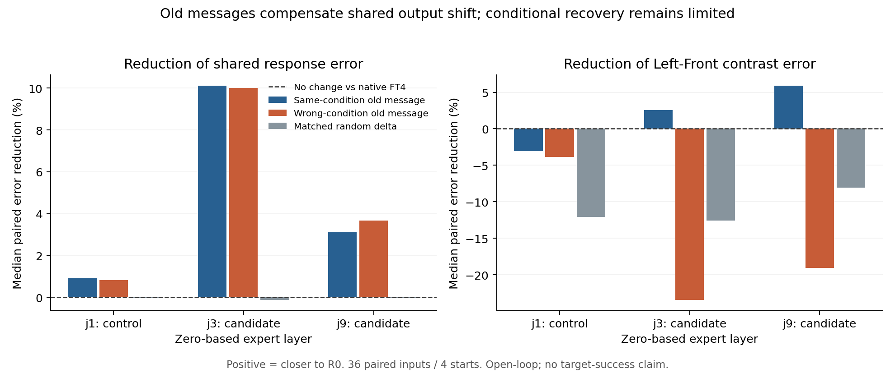

# 10/29：Cross-Attention 第 3 步——跨阶段消息交换

> **通俗解释：** 上一轮证明左／前消息仍能影响动作生成，但影响变了。这轮把旧模型在当前画面下的“左消息”送入学右后的模型，看看输出能否更接近旧模型的左回答；同时送入“前消息”和随机修正，检查是不是换什么都一样。再反过来，把新消息送进旧模型。这些都只在计算中进行，不执行生成动作。

**完成结论：正确旧消息能带来有限的左／前区别改善，错误旧消息则明显破坏区别；同时，两种来源都能补偿共同偏移。说明这个接口仍具有条件作用，但当前替换不足以恢复完整旧响应，更未验证物理目标恢复。**

状态：2026-10-29 12:15:16 派发，12:17:11 启动器结束，固定核心对照全部完成；本地与服务器独立审计均通过。所有时间按北京时间。本轮止于第 3 步核心矩阵，没有启动其条件分支或后续步骤。

## 1. 本轮只执行第 3 步的核心对照

依据[原机制计划第 3 步](2026-10-28_动作专家Cross-Attention与语言条件失效_机制检验计划.md)和[第 0—2 步结果](2026-10-28_Cross-Attention第0至2步_执行与结果.md)：

- 候选位置固定为上一轮选出的源码下标 **3、9**。
- 非候选对照固定为最小的其他 CA 下标 **1**，不按新结果选层。
- 复用原 4 个正常起点、3 底噪、3 flow 时刻，共 36 输入组；重新生成原参考草稿，并与原始哈希及速度场逐项核验。
- 只研究已获得的 Left／Front 条件。R0 没学过 Right，不将其作为正确右格教师。

不进入第 4 步的 P/C 或输出投影拆分，不进入第 5 步的闭环，不训练、不回放、不追加层或头。

原第 3 步中“出现信号后再拆共同／区别消息”和“等幅方向交叉传播”是条件分支，本轮也不自动追加。先把下面固定的核心对照完成并审计，再决定是否需要这些分支；不把核心对照完成写成所有条件归因都已解决。

## 2. 每个输入下做什么？

两个接收模型、两条请求指令、三个固定位置，各做四个条件：

| 条件 | FT4 请求 Left 时 | R0 请求 Left 时 |
|---|---|---|
| cross_same | 注入 R0 的 Left 消息 | 注入 FT4 的 Left 消息 |
| cross_wrong | 注入 R0 的 Front 消息 | 注入 FT4 的 Front 消息 |
| random_delta | 与同语义跨阶段修正匹配幅度的随机修正 | 同左，但使用该接收背景的修正幅度 |
| self | 注入自身原 Left 消息 | 注入自身原 Left 消息 |

Front 请求对称执行，所有消息都来自当前同一个状态、草稿和 flow 时刻，保持接收运行的其余计算。

主矩阵：**36×3位置×2接收模型×2指令×4条件＝1728 次补丁前向。** 基础查询 **36×2模型×2指令＝144 次**，另计 120 次参考草稿前向。它们是计算次数，不是独立环境或任务 episodes。

## 3. 随机匹配中的实际实现边界

注入位置在 o_proj 之后，原注意力头已混合。不能把输出向量的某一段直接叫原来的一个 attention head。

因此，将当前 720 维消息按实际注意力头数量 15 划为 15 个等长的 48 维**输出坐标记账块**，逐动作位置匹配修正差量的块 L2 范数。它只是明确的规模控制，不宣称隔离原始头。原计划“按头”在此按真实接口作上述澄清，模型计算不变。

float32 计划修正与跨阶段同语义修正严格匹配；转换回原生 BF16 后，实际差量可能略变。必须同时保存目标、计划、实际及转换误差的块范数；核验计划匹配与实际误差界，报告实际偏差，不重抽随机数、不按分数反复调幅。固定随机种子由输入／接收模型／目标／位置的稳定哈希生成。

实际注入消息由原补丁接口之后的只读 hook 取证，核对确实送入残差的数值，而不是只根据 CPU 上的计划值推测。隐藏消息本体不下载；块范数是运行时记录，独立审计能核其数值一致性和误差界，不能独立重跑隐藏计算。

## 4. 主要看哪些结果？

1. FT4 的同语义补丁是否使速度场更接近 **R0 同指令**的回答，且优于错误来源及随机修正？
2. 错误来源是否带来不同的条件方向，而不只是相同的旧共同偏移？
3. 新消息放进 R0，是否在计算上使它向 FT4 同指令回答变化？
4. 候选位置是否优于固定非候选对照？
5. 将补丁后的 Left／Front 响应一起看，区别是否向健康参照靠近，还是主要只改了两者平均值？

指标主看前 10 个动作位置、有效 7 维，运动和夹爪分列；全 50 步辅助。保存原始速度场，由独立标准库审计重算距离、方向投影及配对共同／区别误差。

**接近 R0 的速度场不等于正确目标选择。** 跨检查点消息也可能不兼容；正向补偿或反向输出变化不能单独证明某组参数是自然损伤起点。

不同位置的原消息幅度、修正规模和后续计算不同；非候选对照用于比较功能线索，不是严格等幅的跨层定位实验，不能据此宣布候选是唯一重要位置。

错误来源使用另一条指令的自然消息，其相对接收消息的改变量不保证与正确来源等幅；随机对照只匹配同语义跨阶段差量。因此“正确／错误来源效果不同”仍可能混合幅度与内容变化，不能单独声称隔离了纯语义因素。

## 5. 工程、环境和停止规则

- 10/29 11:59 只读检查：GPU 1 为 37 MiB、0% 利用，未见相关训练；stage2a 工作树仍为 9893833，磁盘约剩 9.6 GB。
- 只读复用现有模型和环境，不下载权重、不切换组员工作树。
- 新输出目录为 /home/lzx/cl_binding/.server/stage2n_cross_checkpoint_20261029_01。
- 先用一个输入验收 4 条基线与 12 个位置／模型／目标的自替换，原输出、读出重构及旧基线重现保持 1e-5 门槛；失败即停，保留证据。
- 主组也逐输入核验前次速度场和哈希。不能通过改变输入或扩大容差来获得好分数。
- 输出上限 512 MiB，保留至少 2 GiB，单 worker 45 分钟硬上限；耗时先按工程吞吐测量，不把上轮 53 秒直接当本轮预计时间。

配置：[stage2n_cross_checkpoint_20261029.json](../configs/stage2n_cross_checkpoint_20261029.json)。

## 6. 启动记录

实际派发为 2026-10-29 12:15:16，GPU 1，启动器 PID 27385。预登记提交 f3f7e2119fa5da22f994c1b284bc7792fbface7e，代码已推送现有工作分支。9 项 CPU 协议测试、编译、CLI 与差异检查通过。

本节仅记录启动，不预写“恢复了目标选择”或其他结果。工程／主组遇错误保留证据并停止，不自动追加或按分数重跑。

## 7. 实际完成了多少，是否可信？

工程 worker 约 31.33 秒，主矩阵 worker 约 79.39 秒；启动器含进程开销约 113 秒。工程验收后一次完成，无按结果重抽、加层或追加预算。

| 记录项 | 完成量／结果 |
|---|---:|
| 主矩阵基础查询 | 144 |
| 主矩阵补丁前向 | 1728 |
| 同语义／随机修正规模记录 | 864 |
| 生成固定参考草稿的额外前向 | 120 |
| 复现上一批同输入的速度场最大误差 | 0 |
| 自替换、实际注入见证、注意力读出重构误差 | 0 |

工程阶段另有 4 条基础查询和 12 条自替换验收，不混入主组统计。主组 36 输入仍只来自 **4 个物理开发初态**，不是 36 个独立环境，更不是 1728 个任务回合。

本地／服务器用同一独立审计源码分别重算，结果 JSON 的字段和数值内容一致。随机修正的 float32 计划块范数最大误差为 8.79×10⁻⁸；实际 BF16 注入后，逐块范数比为 0.99751—1.00342，整条消息范数比为 0.99994—1.00006。因此是记录了实际误差的近似等幅控制。10 项 CPU 协议测试通过，包括零差量控制。

15:49 结束后只读核验：两模型文件哈希、实际模型源码、运行工作树版本及未跟踪文件列表均与启动前一致；两卡利用率均为 0%，未见计算进程。未修改组员工作树或模型，没有额外训练。

## 8. 最主要的结果：共同补偿与条件区别必须分开看

### 8.1 通俗解释：两条回答一起挪，与两条回答分得更对，是两回事

把同一输入的“左回答”和“前回答”看成两根箭头。

- **共同响应**是两根箭头的平均值：两条指令都往哪个方向偏。
- **条件区别**是“左箭头减前箭头”：换指令时回答如何改变。

两根箭头一起挪近旧模型，可能让总体误差变小，却没有把左和前分清楚。反过来，两条回答的区别接近旧模型，也不直接保证动作能成功。这里的箭头是 Flow Matching 的生成速度场，不是机器人在空间里实际走出的直线；共同／区别是数学分解，不能直接命名为“纯操作能力／纯语言语义”。本轮只分解已有输出，没有新增共同／区别消息干预。

所有主结果使用前 10 个动作位置、有效 7 维。对每个相同物理初态／噪声／flow 时刻，先算替换前后的误差变化，再对 36 组取中位数：

`相对改善 = 1 − 替换后对 R0 的误差 / 原 FT4 对 R0 的误差`。

**正值表示更接近 R0，负值表示更远。它不是成功率或语言理解保持率。**

### 8.2 FT4 接收旧消息的结果

| 位置（源码下标） | 旧消息来源 | 共同误差相对改善中位数 | 左／前区别误差相对改善中位数 | 区别改善的输入组 |
|---|---|---:|---:|---:|
| 1：固定非候选 | 正确指令 | +0.91% | −3.04% | 12/36 |
| 1 | 错误指令 | +0.81% | −3.86% | 10/36 |
| 1 | 随机差量 | −0.03% | −12.05% | 2/36 |
| **3：候选** | **正确指令** | **+10.11%** | **+2.54%** | **25/36** |
| 3 | 错误指令 | +10.01% | −23.46% | 2/36 |
| 3 | 随机差量 | −0.13% | −12.58% | 1/36 |
| **9：候选** | **正确指令** | **+3.12%** | **+5.90%** | **28/36** |
| 9 | 错误指令 | +3.67% | −19.08% | 0/36 |
| 9 | 随机差量 | −0.04% | −8.08% | 4/36 |

下标 3、9 对应第 4、10 个 Transformer block。图的零线是原 FT4；柱子越高，表示对旧响应的误差降低越多。36 组来自重复开发初态，不画总体置信区间或宣称跨训练种子显著性。

**第一，共同补偿比条件恢复更突出。** 第 3 层无论注入正确还是错误的旧消息，共同误差都降低约 10%；第 9 层也有类似补偿。这解释了为什么不能把总体距离下降都称为“语言修复”。

**第二，条件来源仍有作用。** 正确来源在候选位置让区别误差小幅降低，而错误来源使其明显增大；第 9 层错误来源的 36 组全部恶化。不能说“换什么都一样”或“完全没有条件特异性”。但正确来源也并非每组改善，第 3、9 层仍分别有 11、8 组恶化。

**第三，幅度有限。** 完整旧条件响应尚未恢复；这些改变量也没有经过物理闭环验证。随机修正未得到相同收益，支持自然旧消息的方向／结构具有作用；错误来源本身未与正确来源等幅，不能据此把全部差异纯粹归因于语义内容。

统计上必须先配对再汇总。例如第 3 层区别误差，原 FT4 的组间中位数是 0.13817，正确替换后是 0.13901；直接比较这两个中位数会遗漏逐输入中位改善 +2.54% 的事实。二者来自不同排序位置，不能用“中位数的比”代替“每组比例的中位数”。上表和图统一采用后者。

### 8.3 总体距离与反向交换补充了什么？

不拆共同／区别时，定义 `G = 1 − 距离(补丁响应, R0同指令) / 距离(原FT4响应, R0同指令)`。候选 3 的正确／错误／随机 G 中位数分别为 **+10.23%／+9.03%／−0.27%**；候选 9 为 **+3.49%／+2.90%／−0.13%**。总体数容易掩盖上表里更鲜明的条件差异，不能只报 G。

反过来，把 FT4 的同指令消息送进 R0，第 3、9 层的输出在“R0→FT4 同指令响应”方向上的投影系数 T 中位数约 **0.088、0.054**，匹配随机为 0.012、0.004。说明新消息也能把旧计算部分推向新响应，但不等于重现了完整损伤。R0 的左／前区别沿原区别方向的投影由自身的 1.0 变为约 0.815、0.874；T 和这些投影都不是错目标回合比例。

## 9. 这一轮推进了哪一层机制判断？

**目前可以说：候选 CA 消息接口连接着会影响最终速度场的条件路径；跨阶段交换能改变共同响应，也能以来源相关的方式改变左／前区别。正确旧消息带来有限的条件功能改善。** 这比只观察注意力图或内部距离更进一步，因为实际改了接口并看到最终计算变化。

**还不能说：已经定位了导致目标替代的唯一故障，或者已经修好目标选择。** 单接口替换混合了消息内容、接收模型的查询及上游状态、下游使用方式和跨阶段兼容性；旧消息还可能重新提供信息。它不能单独证明 FT4 内部本来就完整保留了正确目标信息，也没有区分究竟是消息生成先变了，还是后续读取／传递变了。

这批结果为“共同偏移 + 有限条件功能变化并存”提供计算线索，不支持将机制简单归结为“所有 CA 不看语言”。固定非候选位置的改善较小，但跨层修正幅度没有严格统一，因此也不宣布第 3／9 层是唯一损伤位置。

当前边界仍是：历史探索 R0 未正式合格、单一适应过程、4 个重复开发初态、只有 Left／Front 请求；没有 Right 教师结论，没有动作执行与目标成功率。

## 10. 证据入口与本轮停止点

- [原始主组测量与运行清单](results/2026-10-29/stage2n_cross_checkpoint/analysis/manifest.json)、[全部补丁速度场](results/2026-10-29/stage2n_cross_checkpoint/analysis/patches.jsonl)。
- [本地独立审计](results/2026-10-29/stage2n_cross_checkpoint/audit_local_v1.json)、[服务器独立审计](results/2026-10-29/stage2n_cross_checkpoint/audit_v1.json)、[派生汇总](results/2026-10-29/stage2n_cross_checkpoint/summary.json)。
- [启动器与实际代码哈希](results/2026-10-29/stage2n_cross_checkpoint/launcher.json)、[结束后的模型／环境检查](results/2026-10-29/stage2n_cross_checkpoint/post_run_check.json)、[本地归档哈希](results/2026-10-29/stage2n_cross_checkpoint/archive_manifest.json)。

**第 3 步固定核心矩阵完成，到此停止。** 共同／区别消息干预、等幅方向交叉传播仍是原第 3 步的待决条件分支，本轮未执行；P/C、输出投影拆分、闭环、回放与训练均未开始。后续如继续，需要先按本轮有限信号单独登记所需对照，不能把本报告直接当成完整因果定位或方法收益。
