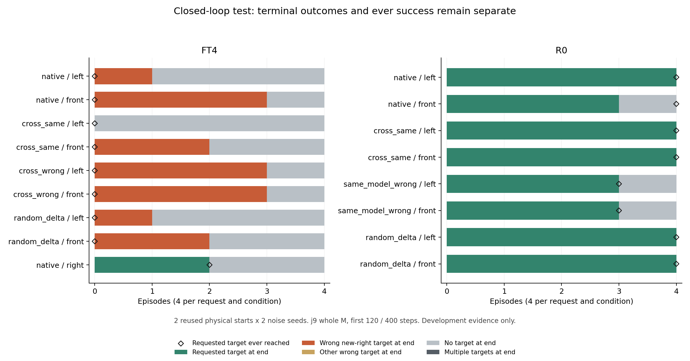

# 10/29：把内部误差改善接到实际目标成功率

> **通俗解释：** 前面只是看模型生成动作时的内部回答有没有更像旧模型。这次让机器人真的做完任务：在最开始一小段时间，把旧模型的一条内部消息接回新模型，然后撤掉帮助，检查听到“左／前”时能否做对、是否仍然去新右格。正确消息、错误消息和同幅度随机消息都要比较，防止把一般扰动、恢复抓取或两条指令都去同一格当成语言恢复。

**完成结论：本轮没有恢复旧指令成功。** 在固定第 10 个 block、仅前 120 步替换整份 M 的条件下，FT4 正确旧消息的 Left／Front 请求都为曾成功 **0/4**、最终正确 **0/4**。错右减少的回合变成了未完成，不能算目标选择修复。此前开环误差改善尚未转化为这一方案的行为收益。

状态：**2026-10-29 22:25:27 派发，22:39:49 全部完成；服务器与本地独立审计通过。** 预登记提交 `96992346d9041eec1bb9059e47cd186e5cb724d0`，GPU 1，启动器 PID 32151。本文所有时间按北京时间。第 1—6 节保留固定设计和工程记录，第 7 节起为结果汇报。

## 1. 本轮只验证一个锁定方案

选 **源码下标 9（第 10 个 block），输出投影之后的整份 M**，不选单个头，不同时干预多层。

依据是已完成的第 3 步全 36 输入组：正确旧 M 的条件区别误差改善中位数在两个预先候选中，下标 9 为 5.90%，下标 3 为 2.54%。选择依据是条件区别改善，不是共同补偿最大，也不是 12 输入逐头筛查中的最大值。此选择是开发选点，不能当成独立验证。

整份 M 的闭环验证先回答“前面的计算信号有没有行为收益”。本轮不把 P、C 或单个头单独上机，避免扩成大规模组合搜索。若整份 M 都不能改善行为，必须保留这个负结果，不能自动换层、加头或延长干预直到有效。

## 2. 固定运行表：68 个开发回合

初态 0、1；推理噪声种子 2026102801、2026102802；请求 Left、Front。每个条件为 2 初态×2 种子×2 指令＝8 回合，即每条指令只有 4 回合。

| 接收模型 | 条件 | 干预期间提供什么 |
|---|---|---|
| FT4 | native | 原模型自主执行 |
| FT4 | cross_same | R0 同一请求指令的 M |
| FT4 | cross_wrong | R0 另一条旧指令的 M |
| FT4 | random_delta | 与 R0 同指令修正匹配幅度的随机修正 |
| R0 | native | 原模型自主执行 |
| R0 | cross_same | FT4 同一请求指令的 M |
| R0 | same_model_wrong | R0 另一条旧指令的 M |
| R0 | random_delta | 与 FT4 同指令修正匹配幅度的随机修正 |

以上 64 回合，另加 FT4 原始 Right 的同 2 初态×2 种子＝4 回合，共 **68 回合**。Right 仅检查原 FT4 当前新任务表现，不使用没掌握 Right 的 R0 当右格教师，也不能据此声称干预保住了新任务。

这是原机制计划第 5 步的**开发配额**，不是正式成功率确认。两个物理初态重复两种推理噪声，不能当成四个独立初态，更不能把 pooled 68 回合当成单一成功率分母。成功／失败全部保留，不按 R0 或干预后成绩换初态。

## 3. 干预什么时候发生？

每回合固定执行 400 个仿真步，每 10 步重新生成一次动作块，共 40 次重规划。

- 仅前 120 个仿真步干预：重规划下标 0—11。
- 期间每次生成的全部 10 个 Flow Matching 步都应用干预。
- 第 121—400 步完全交回接收模型，不再注入旧消息。
- 每次生成只执行动作块的前 10 个位置，沿用当前任务动作后处理与限幅。

donor 每次都读取**该分支当前的画面、机器人状态及同一带噪动作草稿和 flow 时刻**。不借用另一条已分叉轨迹上的旧消息，不固定使用起始状态的消息。

显式噪声为 `noise_seed + 1000003 × replan_index`，用独立 CPU 随机生成器产生；同一初态和种子各分支使用相同重规划噪声序列。物理状态和随后草稿会随分支自然分叉，这不是输入配对失败。

随机差量匹配 donor M−recipient M，而不是匹配整条 M；投影后 720 维按 15 个 48 维输出坐标块逐动作位置记账，**仍不称为真实头**。记录计划／实际 BF16 差量的范数与误差界；不重抽随机数追求好结果。正确／错误自然消息的差量不保证完全等幅，保留该边界。

## 4. 主要报告什么，怎样避免误读？

每条指令单独报告分子／分母，并列出全部回合：

1. **最终请求目标正确**：400 步终态只有请求目标成立。
2. **请求目标曾成功**：过程中是否至少一次满足请求目标谓词。
3. **目标替代证据**：首次／过程中／最终是否完成新右格或其他错误目标；多目标同时成立另列，不强制归类。
4. **未完成及成功后失效**：到过正确目标但最后离开，不能与从未到达混在一起。
5. **撤除帮助后的表现**：第 120 步状态、第 121 步后是否首次完成请求目标、帮助撤除后最终是否保持正确。干预期间已经成功，不能说是学生撤除帮助后自主首次完成。

旧能力分母从同批 R0 native 的每条指令／初态／噪声实际成功条件确定；原本不会的条件不算新增遗忘。全部回合总体表和前成功子集表同时保留，不能只展示效果较好的子集。

要支持“条件路径有行为作用”，至少需要正确来源相对原 FT4 改善请求目标，并与错误来源／随机条件呈现有意义差别，而非只是都恢复抓取或都去左格。不能因为错误目标减少、未完成增多，就说修复成功。

即使正确旧消息有效，它也可能重新提供信息或补偿别处损伤；这属于**借助旧模型的诊断救援**，不是已得到无需教师的持续学习方法。成功率本身不能证明该层参数是自然病灶。

## 5. 工程门禁、成本与停止规则

- 模型、归一化、仿真环境及代码身份沿用已有检查点封存哈希，不下载权重、不训练、不切换组员工作树。
- 先在一个正常起点上，比较官方采样、手工同输入采样、逐 flow 自替换的完整 50×7 动作、后处理动作和限幅结果。最大误差不得超过 1e-5；缓存独立、hook 不混入前缀计算。
- 工程通过才运行固定 68 回合。失败保留目录与日志；不能调分数门槛、扩窗口、换状态或悄悄重跑。
- 主评测为 2720 次重规划、27200 次接收模型积分 flow 查询。随机条件需另做 1920 次接收基线查询来确定修正幅度，因此实际接收模型查询为 29120，加上 5760 次 donor 查询，共 34880 次；48 个干预回合共 5760 次补丁。额外查询只是同一条件的幅度校准，不增加回合或干预路线。
- 逐步四目标谓词和动作、重规划与噪声哈希、实际调用数及干预量保存原始证据；独立审计重新计算成功表和配对分母。
- GPU 1 启动前须空闲；单 worker 60 分钟上限，输出不超过 2 GiB，至少保留 2 GiB 空间。不抢占训练、不自动追加回合。
- 本轮优先记录完整逐步谓词和执行动作，不生成视频。汇报用行为结果表和图，不将缺少视频审看写成已经逐帧确认行为。

配置：[stage2p_ca_closedloop_20261029.json](../configs/stage2p_ca_closedloop_20261029.json)。

本轮结束后根据全部结果写汇报。正式确认仍需未用于选点的物理初态、更多回合及独立适应过程；本批不自动启动这些扩展。

## 6. 工程与启动记录

本地及服务器 10 项 CPU 协议检查通过，包含曾成功／最终成功的区分、目标替代与未完成的区分、120／121 步边界、歧义事件、重复与遗漏、原成功分母，以及相同总成功数掩盖不同配对结果的情形。

实际工程 worker 32.66 秒（启动器计 33.88 秒）；两模型×两条旧指令共 4 组、40 个逐 flow 自替换检查全部通过，完整动作块、逐动作后处理、限幅及注入见证的最大误差均为 **0**。工程额外调用单独计数，不混入 68 回合的成本。

主组按已登记顺序完成各条件；未根据中途成绩更换层、初态、窗口或结束规则。工程运行只确认采样和干预实现一致，不代表目标选择已经恢复。

## 7. FT4 的实际成功率：正确旧消息没有救回旧目标

主 worker 825.52 秒，启动器计约 826.81 秒，即 **13 分 46 秒**；加上工程验收，启动器总耗时约 14 分 21 秒。全部 68 回合按计划执行满 400 步，没有按成功提前结束或追加预算。

| FT4 条件 | 请求 | 曾成功 | 最终请求正确 | 最终错误右格 | 最终未完成 |
|---|---|---:|---:|---:|---:|
| 原始 | 左 | 0/4 | 0/4 | 1/4 | 3/4 |
| 原始 | 前 | 0/4 | 0/4 | 3/4 | 1/4 |
| 正确旧消息 | 左 | 0/4 | 0/4 | 0/4 | 4/4 |
| 正确旧消息 | 前 | 0/4 | 0/4 | 2/4 | 2/4 |
| 错误旧消息 | 左 | 0/4 | 0/4 | 3/4 | 1/4 |
| 错误旧消息 | 前 | 0/4 | 0/4 | 3/4 | 1/4 |
| 匹配随机 | 左 | 0/4 | 0/4 | 1/4 | 3/4 |
| 匹配随机 | 前 | 0/4 | 0/4 | 2/4 | 2/4 |

本表没有其他错误格或多目标歧义；每行“最终请求正确＋最终错误右格＋未完成＝4”。曾成功是过程记录，不与终态相加。

两条旧请求合看，原始、正确旧消息、错误旧消息、随机条件的最终右格分别为 **4/8、2/8、6/8、3/8**，未完成分别为 **4/8、6/8、2/8、5/8**；请求目标曾成功和最终正确全部为 0/8。

**通俗解释：** 正确旧消息有时让机器人不再完成右格，但也没有让它完成左格或前格，只是变成了没完成。这是结果分布改变，不是语言选择恢复。条件间一两个回合的差别，在两个重复开发初态上也不能当作稳定效果。

这次的失败不只是“先去了对的地方，后来又弄坏”：**FT4 在正确旧消息条件下从未满足请求目标谓词**。但没有视频逐帧审看，不能把全部未完成进一步归成抓取失败、操作遗忘或某个特定动作根因。

绿色是终态请求目标正确，橙色是终态错误右格，灰色是未完成，空心菱形是请求目标曾成功的数量。native 条件没有干预；Right 仅为 FT4 原始新任务检查。每条请求／条件只有 4 回合，来自同 2 物理初态×2 噪声，不是 4 个独立初态。

## 8. 反向对照：新消息也没有在旧模型中复现目标替代

| R0 条件 | 左：曾成功／最终正确 | 前：曾成功／最终正确 | 任一错误目标曾成功 |
|---|---:|---:|---:|
| 原始 | 4/4、4/4 | 4/4、3/4 | 0/8 |
| FT4 同指令消息 | 4/4、4/4 | 4/4、4/4 | 0/8 |
| R0 另一旧指令消息 | 3/4、3/4 | 3/4、3/4 | 0/8 |
| 匹配随机 | 4/4、4/4 | 4/4、4/4 | 0/8 |

R0 原始前格有 1 回合曾成功后失效，其余原始成功保持。FT4 同语义消息与随机都使这组前格终态从 3/4 变为 4/4，不能称为来源特异的收益。

R0 错误旧消息条件的前格仍是 3/4，**但并不意味着逐状态没有变化**：

- 初态 0、噪声 2026102802：原来前格最终正确，替换后从未到前格。
- 初态 1、噪声 2026102802：原来第 151—189 步曾到前格、后来失效；替换后第 141—400 步保持前格。

即总数相同，但“丢一个、补一个”。最终成功率是主结果，仍需配对轨迹来理解损伤类型。错误消息造成的失败也没有转为另一个错误目标，不能称为复现目标替代。

**新任务原始检查：FT4 Right 曾成功 2/4，最终正确 2/4，另外 2/4 未完成。** 当前不能把 FT4 描述为操作能力稳定完好、只有目标选择这一项出了问题。本轮 Right 未施加救援，也没有得到“干预同时保住新能力”的证据。

## 9. 真正的旧能力损伤分母与撤除帮助后的表现

同批 R0 原始模型的终态成功条件为 **Left 4 个、Front 3 个**。因此严格按“原本最终正确”的配对分母：

- FT4 原始保持为 Left **0/4**、Front **0/3**。
- 正确旧消息、错误旧消息、随机修正也均为 Left **0/4**、Front **0/3**。

只看这 7 个原终态成功条件，原 FT4→正确旧消息的最终右格是 **3→2**、未完成 **4→5**，依然没有恢复。全 8 条旧请求中右格减少的另一条来自 R0 原本前格终态失败条件，不能混进严格保留分母。

按窗口看，R0 原始左格首次成功为第 **100、101、103、104 步**，均在干预窗口内；前格为第 **123、129、139、151 步**，均在撤除后。R0 其他条件的前格成功也都首次出现在撤除后；FT4 各干预下的旧请求在窗口内外都未成功。

这说明前格的完成阶段未被本轮 120 步干预覆盖，**不证明关键目标选择也发生在 120 步后**，更不能据此确定失败根因就是窗口太短。左格在原 R0 中能于窗口内完成，FT4 整消息替换仍无成功；当前保留窗口、接收背景和单接口不足等竞争解释，不临时延长直到有效。

## 10. 对此前机制结论应怎样调整？

**得到的明确负结果：** 开环中约 5.90% 的条件区别误差改善，在当前层 9、前 120 步的整消息交换下，没有转化为旧指令闭环成功；反向把 FT4 同语义消息放进 R0，也未诱发错右。当前没有证据把这个单接口称为足以救援或足以复现目标替代的病灶。

前面仍可保留的结论是“局部消息能够改变计算响应，来源及层内组成会影响结果”。需要撤掉任何更强的推断：**内部响应接近旧模型不等于正确目标控制，不构成已经修复的依据。**

本轮未排除的解释包括：

1. **单层贡献不足／其他路径协同。** 其余 CA、联合 SA、残差、MLP、动作输入／输出等计算仍属于接收模型；单条消息可能不足以改变完整策略。
2. **干预窗口只覆盖部分过程。** 本轮只检查了前 120 步，不能代表所有时刻；但窗口不足还没有阳性对照支持，不能直接作为解释。
3. **当前分支状态与旧模型自然轨迹不同。** donor 确实读取当前正确同态，但旧模型在自身原始轨迹上成功，不保证其单层消息在 FT4 到达的全部状态上都能有效补偿。
4. **操作质量与目标选择混合变化。** 新右仅 2/4，未完成不能仅凭成功表就归因语言或抓取；本轮也没有证明“正确目标信息仍完整可读”。

这些是待区分的竞争解释，不是已证实的原因。一次单层救援失败不能推广为“Cross-Attention 无关”“语言信息已不存在”，也不能据小样本选择另一个头后直接宣称找到机制。

## 11. 下一步建议与本轮停止点

**优先建议：先补一个另行预登记的小规模整模型阳性对照，而不是立即开始新的回放方法或扩大头搜索。** 例如保持相同前 120 步窗口，借用旧模型完整动作生成响应，随后仍交回 FT4，再与本轮整 M 比较：

- 若完整旧响应也不能恢复，有限窗口或状态／后续策略的解释就需要优先区分；不能简单怪某一个 CA 接口。
- 若完整旧响应可以恢复、单层 M 不行，才更有依据说当前单接口不足，继续检查计算路径的配合。

完整旧响应的干预比单消息更广，这只是诊断阳性对照，不是新的可部署方法；其成败也不能单独确定唯一原因。具体回合、匹配初态、作用时刻和停止规则应另行登记，**本轮未启动该对照，也未延长窗口或增加层／头**。

此前 2K 的完整旧响应曾有成功结果，但其作用窗口、输入／噪声设置与本轮不同，不能直接代替“相同前 120 步窗口”的匹配阳性对照。

若之后出现可重复的行为救援，再用未参与选点的物理初态、更充分的回合及独立适应过程确认；然后才围绕相应路径设计回放／蒸馏，检验新旧任务折中。当前首先需要补齐行为与机制之间的证据连接。

## 12. 验收与证据入口

主组执行了 **27200 个物理步、2720 次重规划**；记录含 reset 的 27268 行四目标谓词／动作事件。实际接收查询 29120（含随机校准 1920）、donor 查询 5760，共 34880；5760 次补丁、1920 条随机范数证据全部齐全。实际消息注入见证误差为 0，34880 次自定义查询均核对缓存独立。

服务器／本地独立审计从逐步谓词重新计算全部结果、窗口事件、动作限幅、初态／XML／噪声配对和计算预算，**两份审计 JSON 内容完全一致**。随机实际差量范数最大相对偏差约 0.288%，满足已记录原生舍入界，没有改数据、容差或重跑评分。

22:41:05 只读核验两模型及实际模型源码哈希、运行工作树身份／状态均未变，两卡利用率均为 0%，未见计算进程。未新增训练，未生成或审看视频。

- [运行清单与原始文件哈希](results/2026-10-29/stage2p_ca_closedloop/evaluation/manifest.json)、[全部回合](results/2026-10-29/stage2p_ca_closedloop/evaluation/episodes.jsonl)。
- [逐步四目标事件与动作](results/2026-10-29/stage2p_ca_closedloop/evaluation/events.jsonl.gz)、[重规划与噪声／调用数](results/2026-10-29/stage2p_ca_closedloop/evaluation/replans.jsonl.gz)。
- [服务器独立审计](results/2026-10-29/stage2p_ca_closedloop/audit_v1.json)、[本地独立重算](results/2026-10-29/stage2p_ca_closedloop/audit_local_v1.json)、[全部汇总及逐状态配对变化](results/2026-10-29/stage2p_ca_closedloop/summary.json)。
- [结束后的模型与环境核验](results/2026-10-29/stage2p_ca_closedloop/post_run_check.json)、[归档核对](results/2026-10-29/stage2p_ca_closedloop/archive_manifest.json)。

本批仍只有两个重复开发初态、两种推理噪声、一个适应过程，旧 R0 的正式独立资格未升级。报告中的回合比例是本批观察值，不是现象总体概率或已经可靠估计的正式成功率。
