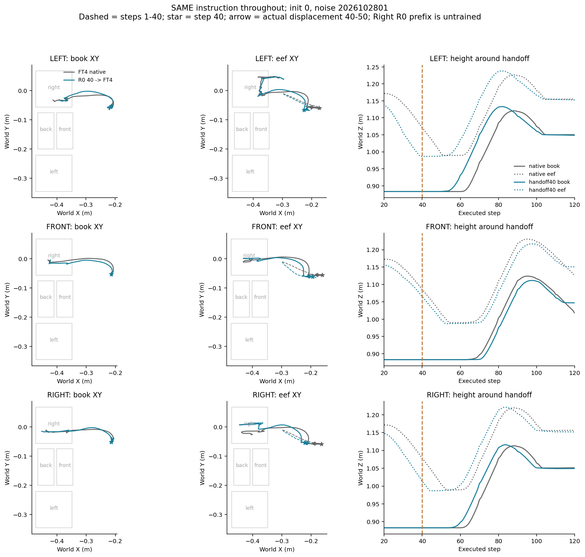
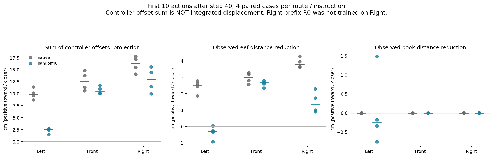

# 同指令40步交接：与全程FT4的控制和轨迹比较

> 将80步流程提前到40步，左、前、右各自全程不换指令。比较FT4全程与R0前40步后交给FT4，核对控制命令、末端与书本路径、抓持及目标到达。尚未搬起书时，向目标中心的瞬时投影不能独立代表目标选择，因为可能仍在抓取。

事前固定24条：三指令×两路线×两原初态×两噪声；20条封存轨迹核验重放，新增Right交接4条。统一400步，40步交接后记录10/20/40步窗口。Right的R0未学过该任务，仅作探索性前段；没有交接后换指令、训练或CA干预。

工程六组采样一致性门禁、20条重放位置与谓词复现、原生控制器目标见证、全部视频400帧解码、模型与源码哈希核验。24条原视频及12条并排对照保存本地video，证据入Git。配置stage2t_same_instruction40_20261030.json；目录/home/lzx/cl_binding/.server/stage2t_same_instruction40_20261030_01。主worker40分钟、控制器60分钟上限，失败保留不按成绩更改实验。

**完成：15:44:53派发，15:49:43结束；24条完成，服务器及本地数值审计通过。** 3项CPU协议测试通过，未训练或注入CA消息。

## 结果与80步并排看

| 全程指令 | 全程FT4首次正确 | 40步交接首次正确 | 80步交接首次正确 | 最终In：全FT4／40／80 |
|---|---:|---:|---:|---:|
| 左 | 0/4 | 0/4 | 2/4 | 0／0／0 |
| 前 | 0/4 | 0/4 | 0/4 | 0／0／0 |
| 右 | 4/4 | 4/4 | 2/4 | 2／4／0 |

40步交接下，左、前均4/4首先到右，且从未到请求格；Right4/4首先到右且最终正确。Right到右是正确，不是目标替代。其R0前段未训练过Right，小样本终态改善不能推广成可靠教师收益。80步分数引用前一已审计批次，没有增加独立样本。

## 轨迹对比图：路径细节改变，旧目标分流没有恢复

灰线全程FT4，蓝线R0前40步→FT4；虚线是前40步，星号是交接，箭头为40—50步实际位移。以下代表原初态0、噪声2026102801，书本XY、末端XY及高度分别展示。

[全部4组书本配对轨迹](results/2026-10-30/stage2t_same_instruction40/all_pairs_book.png)、[全部末端配对轨迹](results/2026-10-30/stage2t_same_instruction40/all_pairs_eef.png)。有的路线抓取／抬起更早或更晚，不能把轨迹不重合叫作目标恢复：左、前最后首次仍全部到右。

## 控制命令与实际运动

第40步左交接书本只抬高约0—0.52cm，前和右基本未抬起；这与80步R0左前段已抬高约20—23cm很不同。

交接后最初10步：LEFT四条原生抓持步数为0、0、0、3；FRONT和RIGHT均0/10。书本多数尚未移动，末端却在运动，表明还在接近／抓取阶段。因此，不能仅凭这时命令朝某格中心的投影就断言模型选了该格。首10步的几何方向只作描述，必须结合后续完整路径。

固定窗口的方向相似度中位数如下。1表示与第40步书本指向该格中心的方向一致，-1相反；控制偏移之和不是实际位移。

| 指令／路线 | 41—50步：请求／右方向 | 41—80步：请求／右方向 | 41—80步书本到请求中心距离变化 |
|---|---:|---:|---:|
|left／native|0.583／0.990|0.048／0.908|-1.12cm|
|left／handoff40|0.466／0.992|0.091／0.925|1.24cm|
|front／native|0.848／0.980|0.531／0.966|-1.24cm|
|front／handoff40|0.862／0.976|0.611／0.981|0.18cm|
|right／native|0.986／0.986|0.930／0.930|1.43cm|
|right／handoff40|0.983／0.983|0.911／0.911|3.54cm|

最后一列正值表示靠近、负值表示远离。即使左交接组到左中心距离中位数缩短约1.24cm，仍0/4到左；标量距离不能替代目标到达。40步窗口中右方向相似度仍较高，但包含抓取与抬起，不能独立当作内部意图证据；后续4/4错右与它共同构成行为判断。全部10／20／40步逐回合数据保留在[directions.csv](results/2026-10-30/stage2t_same_instruction40/directions.csv)。

## 与80步结果共同揭示的机制线索

R0左前段40步交接时，书本Y约-0.052到-0.030，仍在原来的桌面位置附近；FT4接手走到80步，Y约-0.012到-0.004，继续走到右格。R0完整执行到80步时，书本Y则已为-0.256到-0.234，落在左格Y带中。40步与80步帮助的区别，不只是多运行40次控制，而是R0是否已经提供了不同的横向位置和操作阶段。

因此，40步帮助没有提供足以让FT4恢复左／前分流的物理状态；80步LEFT的部分收益与R0已形成横向预定位相符。结果进一步支持“前段状态能改变后续到达，但旧目标分流没有普遍恢复”。它没有证明40—80是精确的神经决策窗口，也没有排除速度、姿态、抓持和剩余时间等共同变化。

结合此前同状态R0续跑对照，旧策略能从40步状态继续正确左／前，FT4不能，故也不能只归咎于状态不可纠正。当前更值得分析的是抓取到搬运期间，旧策略如何形成目标相关横向运动，新策略如何偏离。没有据此定位某个CA或断言语言信息消失。

## 视频与验收

本地 `video/2026-10-30_同指令40步对比/README.md` 为播放索引：24条原视频＋12条并排视频，左屏全FT4、右屏40步交接，约第2秒交接，指令全程不变。全部400帧完整解码并核对下载哈希。视频不入Git。

六组工程采样误差0；20条历史重放位置误差0、目标谓词一致；4条新增Right日程核验通过。主组9600执行步、1600次新增Flow查询。服务器与本地原件／数值审计一致，本地校验全部视频哈希，完整解码在服务器完成。权重、源码及运行工作树结束检查通过。

[服务器审计](results/2026-10-30/stage2t_same_instruction40/audit.json)、[本地审计](results/2026-10-30/stage2t_same_instruction40/audit_local_v1.json)、[结果CSV](results/2026-10-30/stage2t_same_instruction40/results.csv)、[并排视频核验](results/2026-10-30/stage2t_same_instruction40/comparison_manifest.json)。两个开发初态×两个噪声、单一历史适应过程；重放不新增独立样本。没有追加训练或其他干预。
