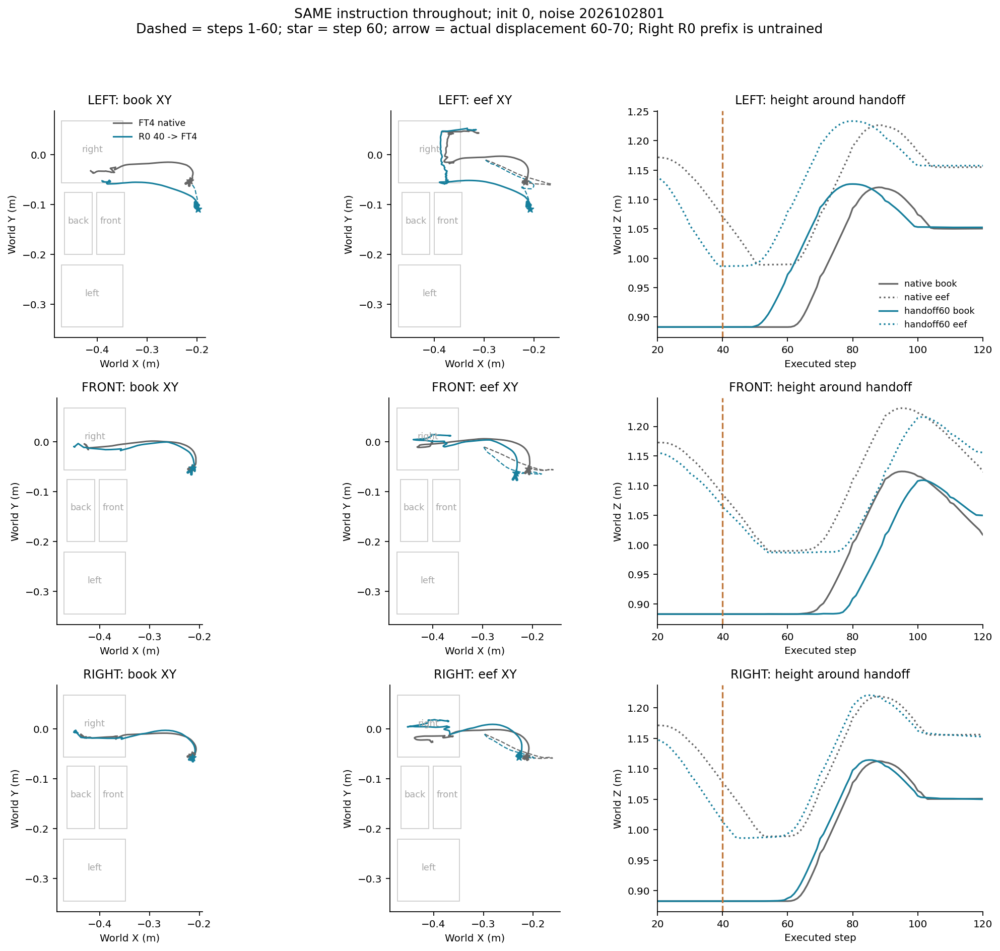
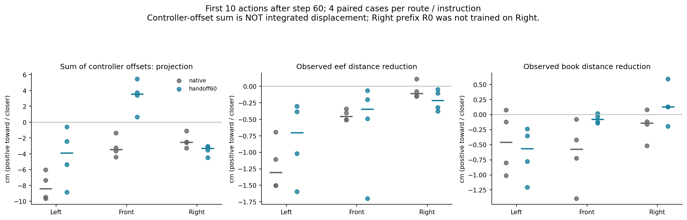

# 同指令60步交接：抓住书仍不足以恢复旧目标路线

> 三条指令全程不变，比较全程FT4与R0前60步→FT4。LEFT虽在接手后持续抓着书，还是4/4先到右；与80步LEFT部分到达不同，说明早段抓持帮助和横向定位帮助需要分开。

24条完成，12条原生核验重放、12条交接新增，统一400步，新增4800次Flow查询，无训练或CA干预。服务器与本地数值审计一致，24原视频与12并排均完整解码及下载哈希核验。Right的R0未学过该任务，仅作探索。事前版本47d2104及运行前修正5d97841，实际代码哈希记录于launcher/manifest；编译、配置与24条件矩阵检查通过。

## 结果与40、80步对照

|指令|全程FT4首次正确|40步|60步|80步|最终In：原生／40／60／80|
|---|---:|---:|---:|---:|---:|
|左|0/4|0/4|0/4|2/4|0／0／0／0|
|前|0/4|0/4|0/4|0/4|0／0／0／0|
|右|4/4|4/4|4/4|2/4|2／4／4／0|

60步左、前分别4/4首先到右，且未到请求格。Right去右是正确，不是替代。跨时间结果为固定开发条件比较，不是独立初态总体成功率。

## 同版式轨迹图

虚线前60步，星号第60步，箭头为60—70步真实位移。灰线全FT4，蓝线交接。代表图使用原初态0、噪声2026102801。

[全部书本路径](results/2026-10-30/stage2u_same_instruction60/all_pairs_book.png) · [全部末端路径](results/2026-10-30/stage2u_same_instruction60/all_pairs_eef.png)。路线会有抓取、抬起时序差异，但左前最终仍先到右，不能把轨迹变化叫成目标修复。

## 控制命令、实际运动与抓持

以下为交接路线的四条中位数。方向相似度以第60步书本到格子中心为参照；偏移合向量不是实际位移，不是隐藏意图读数。

|指令|窗口|请求／右方向相似度|到请求中心距离缩短|抓持成立步数（四条）|
|---|---|---:|---:|---|
|left|10步|-0.377／0.692|-0.57cm|[10, 10, 10, 10]|
|left|20步|0.291／0.991|1.72cm|[20, 20, 20, 20]|
|left|40步|0.520／0.993|4.62cm|[39, 40, 40, 40]|
|front|10步|0.720／0.997|-0.08cm|[0, 0, 3, 0]|
|front|20步|0.239／0.822|0.28cm|[4, 7, 13, 7]|
|front|40步|0.440／0.933|2.57cm|[24, 27, 33, 27]|
|right|10步|-0.486／-0.486|0.13cm|[10, 9, 10, 9]|
|right|20步|0.340／0.340|2.27cm|[20, 19, 20, 19]|
|right|40步|0.995／0.995|14.79cm|[40, 39, 40, 39]|

LEFT接手后前10步全部10/10抓持，前20步全部20/20抓持，但仍先右4/4。因此当前旧目标失效不能全用没抓住书解释。前10步请求方向相似度中位数为负，40步合方向则明显更对齐右，结合后续实际错右，支持搬运阶段的旧目标控制仍有损伤。

FRONT前10步多数还未稳定抓持，阶段与LEFT不同，不把首块指向格子中心的投影单独当作选择意图。RIGHT前10步方向相似度中位数为负，随后40步接近+1且最终4/4正确，说明短时回撤／调整也可能服务后续正确任务，不能只用一个动作块定性。

## 机制解释与边界

40步通常尚未抓起，60步LEFT已能稳定抓持，但都未救回旧目标；80步LEFT已有左侧横向预定位，才出现部分正确到达。这进一步支持“抓取帮助不足以替代目标分流，前段位置／姿态条件影响后段路线”。它不证明60—80是精确决策窗口，也没有分离位置、速度、抓持姿态等因素，更未定位CA或严格区分共同偏移与语言条件损伤。

## 证据与视频

本地 `video/2026-10-30_同指令60步对比/README.md`，约第3秒交接。24原视频、12并排均400帧完整解码（服务器）与本地哈希核验。核验发现原工具两项旧标签：新LEFT/FRONT视频副字幕NEW RIGHT HANDOFF为沿用描述，顶部Instruction及文件名正确；CSV的pretarget_at40字段在本批实际按60步计算。保留原件，不默改原始证据；这些显示标签不改变实际执行指令或分数。

[结果CSV](results/2026-10-30/stage2u_same_instruction60/results.csv) · [方向CSV](results/2026-10-30/stage2u_same_instruction60/directions.csv) · [服务器审计](results/2026-10-30/stage2u_same_instruction60/audit.json) · [本地审计](results/2026-10-30/stage2u_same_instruction60/audit_local_v1.json)。完整视频解码在服务器，本地无av，仅另核对视频哈希及全部数值。

仅两个开发初态、两种噪声、单一适应过程；Right前段未资格化。没有额外训练或其他干预。
