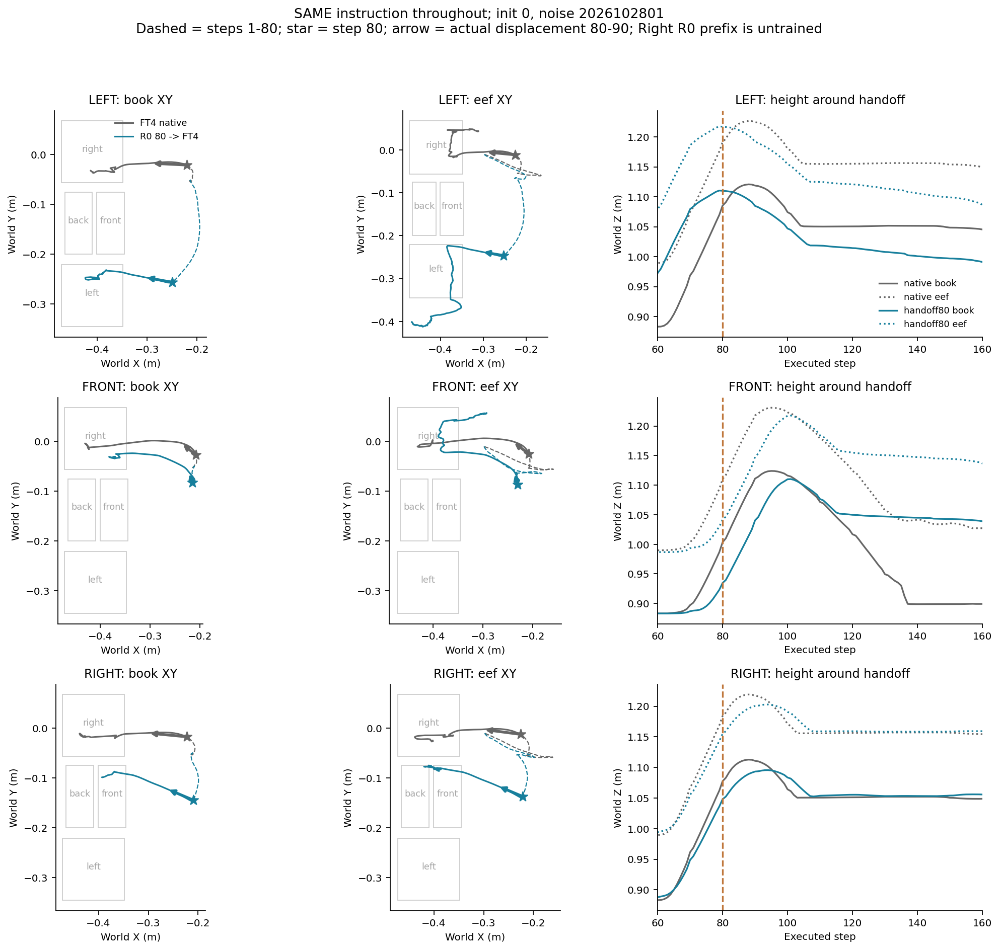
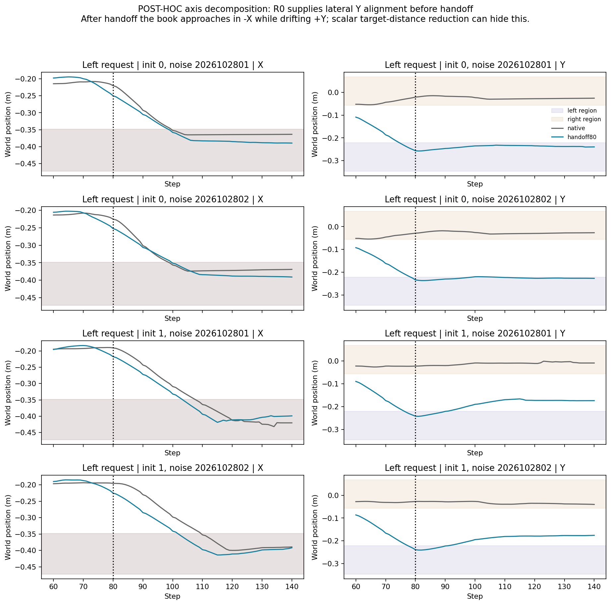
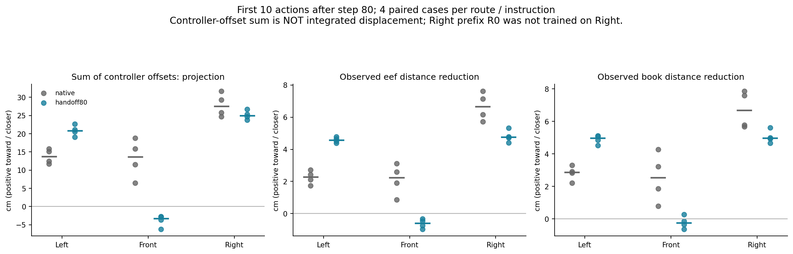
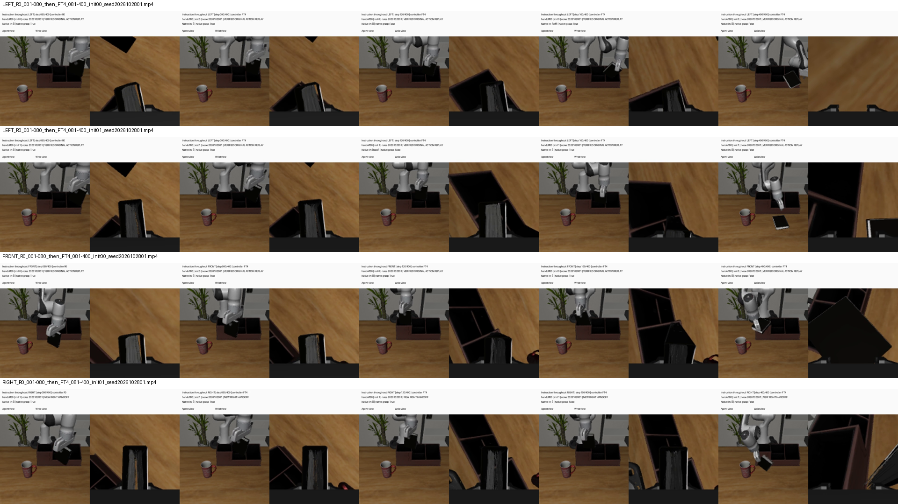

# 10/30：同指令80步交接——FT4主动改向，还是书本被前段状态带过去？

> **通俗解释：** 左、前、右各自全程只用一句指令。比较“FT4从头做”与“R0先做80步，再交给FT4”。除了看书最后经过哪个格，还检查接手后FT4发出的第一块控制目标朝哪里、机械臂和书本实际朝哪里走。如果控制仍朝右，但书本滑落在旧格附近，就不能叫主动选择旧目标。

**完成：北京时间14:35:49派发，14:40:39全部24条轨迹完成，服务器与本地日志审计通过。**没有训练或CA消息干预。

## 1. 固定流程与比较范围

```text
相同原初态、相同整回合指令、相同绝对重规划噪声日程
    ├─ FT4执行1—400步
    └─ R0执行1—80步 → FT4执行81—400步
```

左／前／右三条指令，各路线2原初态×2噪声，共24条轨迹，统一400步。不使用交接后换指令。20条已有封存轨迹核验重放：全程FT4三指令12条、同指令左／前交接8条。新增右指令交接4条，包含R0的右指令前段生成。20条重放不算新增独立样本。

R0没有学过Right。右组是探索性前段干预，不是已合格旧教师示范。按本次保持指令一致的要求，Right是“R0听右80步→FT4继续听右”；它与“R0听左80步→FT4改听右”不是同一个诊断，不能用不同交接状态的Right成功直接证明原R0左80步状态的右目标可达性。

两路线的第80步状态本来就不同。因此这批比较的是完整前段干预效果，不是同状态只替换模型的效应，也不是旧语言能力已独立恢复。

## 2. 如何检查主动控制方向

只观察、不改变原生OSC控制器的`set_goal`。在它原本设置目标后，记录它使用的末端参考位置和目标位置，二者差即本次世界坐标平移目标偏移。所有重放必须仍与原位置／目标谓词一致，验证记录器没有改变执行。

固定分析交接后10／20／40步（81—90、81—100、81—120）：

- 控制目标：逐步世界坐标平移偏移之和，相对第80步书本→请求格、书本→右格方向的投影和夹角。
- 实际运动：末端、书本到请求格／右格的XY距离变化。
- 抓持：原生抓持检查、书本接触、抓手开合、书本与末端相对位置变化。
- 全程轨迹：书本与末端XY路径、第80步位置、交接后的首10步方向；原生FT4同样在第80步做标记和计算，便于并排比较。

“控制偏移之和”不是积分后的真实位移，夹角也不是内部目标意图的直接读数。只有命令、末端和书本运动方向一致，且抓持状态支持时，才将其解释为主动朝某方向控制的证据。若不一致，则保留滑落、接触约束、姿态和控制执行变化等解释，不把不去右直接叫语言恢复。

## 3. 行为指标与视频

沿用已固定移动口径：书本比第一执行帧抬高>3cm，中心进入格子XY投影连续5步。分别记全程首次目标、请求格曾到、交接后首次目标和第400步原生In。第80步已经到目标的状态单独标明。

每条视频保留400帧、20fps、双视角，字幕含整回合指令、控制模型、步数、初态与噪声。24条都保存；另计划生成每组原生FT4／交接的并排视频，共12条。视频只放本地video目录，核验证据入Git。

## 4. 资源、停止规则与证据

复用现有权重和环境，GPU1空闲后串行运行。工程先验证两模型三指令的官方采样、原生采样及自替换一致性，共6组。主组只有新增Right4条需要模型推理，共1600次Flow查询；其余直接重放原动作采集观测与视频。主组40分钟、控制器60分钟上限，至少保留3GiB磁盘；失败保留原件，不按成绩改路线。

配置：`configs/stage2s_same_instruction80_20261030.json`。输出：`/home/lzx/cl_binding/.server/stage2s_same_instruction80_20261030_01`。第5节起为已验收结果。


## 5. 完成与结果：三条指令都没有切换

控制器共4分49秒；工程37.42秒，主组246.35秒，审计3.87秒。6组采样一致性检查最大误差0。主组9600执行步，20条封存轨迹重放的位置及目标谓词一致，位置最大误差0；4条新增Right交接共1600次Flow查询，没有CA补丁、训练或权重更新。

| 全程指令 | 路线 | 首次请求正确 | 首次到右 | 曾到请求格 | 第400步原生In正确 |
|---|---|---:|---:|---:|---:|
| 左 | 全程FT4 | 0/4 | 4/4 | 0/4 | 0/4 |
| 左 | R0同指令80→FT4 | **2/4** | **0/4** | 2/4 | 0/4 |
| 前 | 全程FT4 | 0/4 | 4/4 | 0/4 | 0/4 |
| 前 | R0同指令80→FT4 | 0/4 | 4/4 | 0/4 | 0/4 |
| 右 | 全程FT4 | 4/4 | 4/4 | 4/4 | 2/4 |
| 右 | R0同指令80→FT4 | 2/4 | 2/4 | 2/4 | 0/4 |

Right行“首次到右”是正确行为，不是目标替代。全部第80步状态满足预登记的尚未到目标条件，但已经具有不同的抓持、速度和空间位置。

**改善成立，但只在左请求上得到部分首次到达收益。** 左的另外两条首先到前格，不能把错右消失叫成全部选对。前请求没有首次目标改善。Right前段来自未学过Right的R0，成绩下降只说明这个未经资格化的前段干预不能保证收益，不用它评价“合格教师的帮助上限”。

## 6. 全程轨迹确实不同，但不同不等于重新理解指令

下图为原初态0、噪声2026102801的代表性对照。灰色全程FT4，蓝色同指令交接；虚线为1—80步，星号标80步，粗箭头为80—90步实际位移。前三列分别为书本XY、末端XY和交接附近高度。



所有4组配对均保留：[全部书本轨迹](results/2026-10-30/stage2s_same_instruction80/all_pairs_book.png)、[全部末端轨迹](results/2026-10-30/stage2s_same_instruction80/all_pairs_eef.png)。代表图只用于讲解，没有用它替代其他初态。

左请求的路线明显从右侧搬运带变到了左／前侧；前请求两路线仍最终首先到右；右请求虽然接手后朝右推进，部分轨迹首先经过前格。这说明单看“首先经过哪个格”还不够解释控制意图，必须结合原生控制器命令和抓持执行。

## 7. 最关键的解释：R0预先对齐了横向位置，FT4继续的搬运方向仍很相似

当前布局中，世界X主要描述书向收纳盒靠近，世界Y区分左／前／右区域。语义“左格”不等于世界-X：左格中心Y约-0.2835，右格中心Y约+0.0054。

左格XY投影范围为：X约[-0.4722,-0.3482]，Y约[-0.3456,-0.2213]。**R0左前段在80步已把书带进左格对应的Y带，但X尚未进入格子。** 全程FT4在80步则把书带到右格Y带附近，同样X还没进入格子。

以下为左请求80—90步书本坐标，单位m：

| 原初态／噪声尾号 | 原生FT4第80步Y | 交接第80步Y | 交接后ΔX | 交接后ΔY | 后续首次目标 |
|---|---:|---:|---:|---:|---|
| 0／01 | -0.0209 | -0.2563 | -0.0552 | +0.0100 | 左，第99步 |
| 0／02 | -0.0287 | -0.2336 | -0.0538 | +0.0038 | 左，第107步 |
| 1／01 | -0.0225 | -0.2423 | -0.0544 | +0.0212 | 前，第103步 |
| 1／02 | -0.0273 | -0.2388 | -0.0595 | +0.0164 | 前，第102步 |

**FT4接手后不是简单静止等待惯性：它持续发出搬运命令，末端与书本也实际移动。** 但四条都是显著-X靠近，同时+Y漂移，未看到朝左格中心的-Y纠偏。两条成功在进入X范围时仍处于或重新进入左格Y范围；两条失败则在X进入收纳盒前已漂向前格Y范围。原初态0的第二条有短暂Y越界再返回，不能把一次越界当作单向临界点。

更直接地比较世界坐标控制向量：第一块10动作的平移目标偏移合向量，原生FT4与交接FT4的方向余弦分别为 **0.980、0.991、0.944、0.940**，夹角约7.5—19.9度。主要-X搬运成分仍然相似，交接没有表现为整套相反方向的新控制策略。

一个与数据一致的具体解释是：**R0先把书放到合适的横向位置，FT4继续近似共同的靠近／搬运动作，就可能经过左格；若接手后横向漂移较大，则经过前格。** 这支持前段空间预定位的重要贡献，尚不能定量分摊每个状态因素，也不能宣称FT4重新建立了语言目标选择。



本节是看到原始命令与轨迹后做的**事后轴向解释**，没有修改预登记的首次目标分数或筛选回合。公开[轴向数据](results/2026-10-30/stage2s_same_instruction80/axis_motion.csv)与[世界命令方向对照](results/2026-10-30/stage2s_same_instruction80/paired_command_vectors.csv)。

## 8. 交接后第一块命令与真实运动：逐条看，不能只看靠近距离

原生控制器的每步目标偏移合计不是机器人真实位移。相似度1表示与“第80步书本→对应格中心”方向一致，-1表示相反；这些参照方向也随交接状态而改变。因此相似度提高本身不能解释为语言权重提高。

### 8.1 左：原初态0较对齐左，原初态1仍有更强的右向分量

| 原初态／噪声尾号 | 原生控制：左／右相似度 | 交接控制：左／右相似度 | 交接书本到左中心距离缩短 | 抓持成立步数 |
|---|---:|---:|---:|---:|
| 0／01 | 0.543／0.996 | 0.913／0.718 | 5.11cm | 10/10 |
| 0／02 | 0.501／0.997 | 0.858／0.729 | 4.85cm | 10/10 |
| 1／01 | 0.576／0.999 | 0.806／0.883 | 4.53cm | 10/10 |
| 1／02 | 0.631／0.991 | 0.826／0.847 | 5.08cm | 10/10 |

原初态0有更贴近左方向的控制及真实靠近，支持主动搬运确实存在；原初态1的合命令仍更贴近右方向，随后先到前格。四条到左中心的距离都缩短，却只有两条先到左，正说明标量距离会隐藏Y方向偏移。

第一块抓持检查均10/10成立，书本／末端相对位置变化约0.19—0.44cm，因而不能把最初10步的全部运动解释为已脱离抓手后的自由滑落。但这不排除惯性贡献或更后段的滑移、姿态和接触变化；抽查后段帧可见抓持标记间歇改变，未在本轮唯一确定最终失败根因。

### 8.2 前：接手后首10步仍没有主动朝前的几何证据

前请求交接的四条首10步控制与前目标方向相似度均为负（约-0.23至-0.52），与右方向为正（约0.18至0.50）；末端到前格中心距离均增加约0.32—0.97cm。书本三条离前更远，一条仅靠近0.26cm，抓持均10/10成立。随后到120步的40动作合方向与右格相似度接近1，四条首先到右。

因此，前请求的失败不只是“书已经掉了，没有机会执行正确选择”；至少早期控制本身就没有指向请求的前格。仍需注意先做抓取调整、曲线路径等可能性，不能只用第一块方向单独判定内部目标；这里是命令、后续轨迹和首次错右共同支持的判断。

### 8.3 右：主动右向命令存在，但最终轨迹仍不保证到右

Right交接四条首10步命令与右方向相似度约0.981—0.999，末端及书本均实际靠近右目标，书本距离缩短约4.67—5.61cm，抓持10/10成立。然而只有2/4首先到右，另两条首先到前且未到右。

这提供了一个重要反例：**首先进入错误格，并不自动证明策略内部选择了错误目标。** 它还可能受到已有位置、行进路径、姿态与接触约束影响。本轮仍按原协议记录到达结果，但机制解释不能只靠一个首次目标标签。

Right来源R0未学过Right，且与左前段不是同一交接状态。因此这里不能用来证明“原R0左80步状态能根据右指令去右”。本轮遵守不切换指令的范围。



完整10／20／40步逐回合明细：[directions.csv](results/2026-10-30/stage2s_same_instruction80/directions.csv)。前10步只是最直接的起始分析，较长窗口全部保留，没有挑选最有利窗口。

## 9. 目前能形成的机制结论

1. 左请求首次到达的部分改善真实存在，不能因最终未放好而抹掉；但它不等于两条旧任务都恢复。
2. 前段的横向预定位与接手后相似的靠近运动，能够解释一部分到达变化。正确到达可以包含教师带路与通用动作延续的贡献。
3. 交接后有主动控制，不能把所有改观都叫纯惯性或自由掉落；但主动执行搬运，也不等于主动根据语言重新选中了旧目标。
4. 标量目标距离和首次经过格子，都不足以独立判定内部目标。命令方向、XYZ轨迹、抓持与后续过程需要共同判断。
5. 本轮始终同指令，输入状态又因前段不同而改变，尚不能分离语言作用与状态线索；更没有定位CA或其他参数路径，也没有严格区分Shared Bias与Language Collapse。

当前最值得继续验证的假说，是新旧任务共享的通用靠近动作仍可执行，但按语言形成或维持不同横向目标的控制更脆弱。这个解释只针对当前布局，尚未通过轴向干预、换布局或新初态验证，不能当作通用原理。

## 10. 视频、证据与限制

本地文件夹：`video/2026-10-30_同指令80步对比/`。README按指令、原初态、噪声列出12条并排视频，左屏全程FT4，右屏R0前80步→FT4；另有raw目录24条原视频。共36条，每条20秒；所有原视频与并排视频均在服务器完整解码400帧，下载SHA256与大小核验通过。



[原始事件与动作](results/2026-10-30/stage2s_same_instruction80/evaluation/events.jsonl.gz)、[6行结果](results/2026-10-30/stage2s_same_instruction80/results.csv)、[服务器审计](results/2026-10-30/stage2s_same_instruction80/audit.json)、[本地审计](results/2026-10-30/stage2s_same_instruction80/audit_local_v1.json)、[并排视频核验](results/2026-10-30/stage2s_same_instruction80/comparison_manifest.json)。

本地完整核验原件哈希、24条动作轨迹、20条历史复现、4条新增Right的模型／噪声日程、命令偏移恒等式与所有方向统计，数值内容与服务器一致；本地未安装av，完整视频解码在服务器完成，本地另核对全部视频哈希。权重、模型源码与运行工作树的结束检查通过。3项CPU协议测试通过；视频按用户要求留本地，不入Git，模型权重没有下载。

仅两个开发原初态、两种噪声、一个适应过程；20条是历史数据复核，不新增独立样本。起点未正式独立资格化。视频只抽帧核查部分案例，未逐帧给全部回合判定具体物理根因；原生抓持标记也不等于稳定抓取力的完整测量。没有额外训练、停顿试验、换指令、组合CA或回放。
