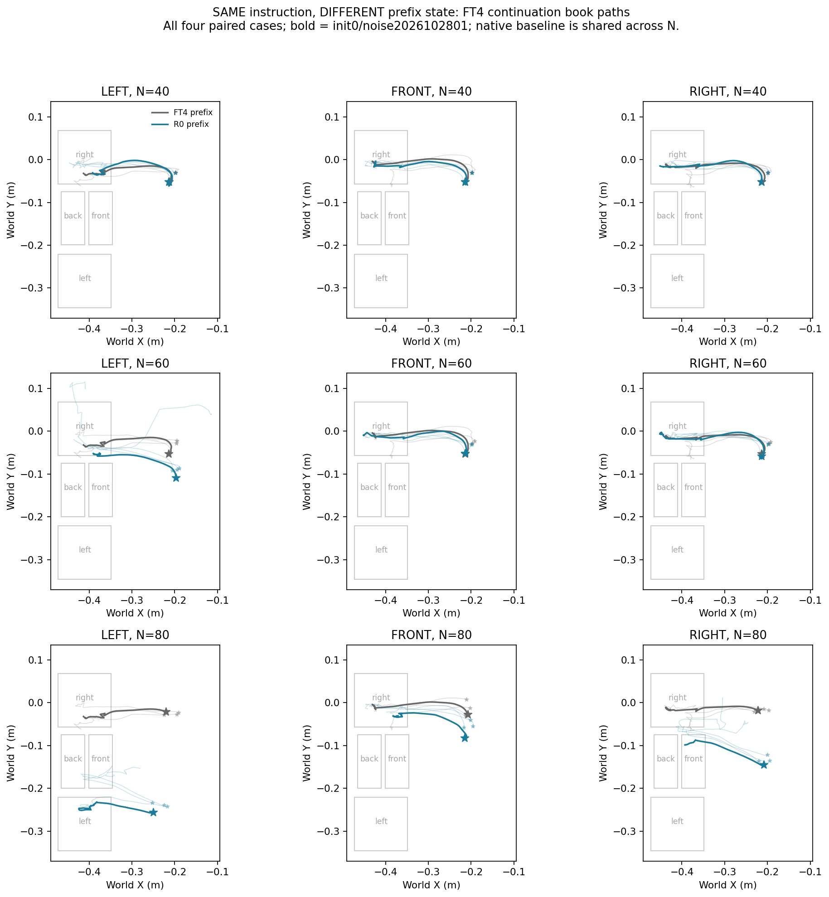
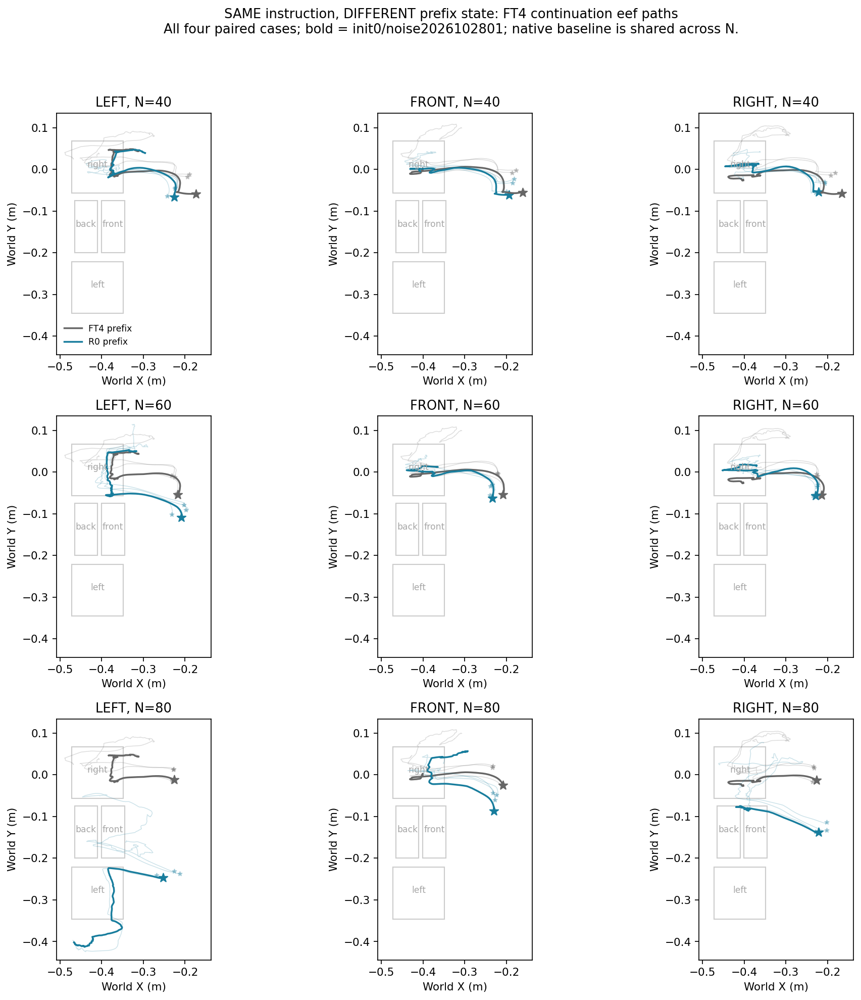

# 同一指令、不同交接状态：40／60／80步联合对照

> **通俗解释：** 同样告诉FT4“搬到左格”，先让它自己走一段，或者让旧模型R0走一段，再交给FT4。这样问的是：FT4为什么从自己走出的状态总去右，从某些旧模型走出的状态却能到左？答案目前更接近“旧模型把书提前摆到了有利位置”，还不能说FT4恢复了听语言选目标的能力。

本次按**前段与接手指令保持一致**理解用户要求。核查发现，这组实验的40／60／80步三批都已经完成，因此直接联合复核封存原始记录，新增配对状态表和联合轨迹图。**本次新增推理回合0，训练更新0，没有重新占GPU重复运行。** 若前段要求两种模型都固定听Left，再让后段分别听三种指令，那是另一组交叉实验，本文没有混入。

## 1. 这个对照合理，但能回答的问题需要分清

固定指令、改变前段状态，检验的是**接手状态对FT4后续结果的影响**。它本身不能检验语言敏感性，因为语言没有变化。

“如果同一状态下FT4仍然对语言敏感，更支持条件化旧技能保留”需要补充一个条件：不同指令应使模型可靠地去往各自正确目标。仅仅动作有数值差异、轨迹略有不同，说明指令影响了输出；尚不足以说明“左／前／右”正确控制目标选择。

本轮与上一轮是互补对照：

| 对照 | 固定什么 | 改变什么 | 主要回答什么 |
|---|---|---|---|
| 同状态、不同指令 | 完整交接状态与噪声 | FT4接手指令 | 当前语言是否影响动作，以及是否正确控制目标 |
| 同指令、不同状态（本文） | 全程指令、原初态、噪声日程、后段FT4 | 前段由R0还是FT4执行 | 前段产生的状态是否改变后续目标到达 |

## 2. 实际流程：没有中途换指令

对每个指令g＝Left／Front／Right，每个N＝40／60／80：

```text
同一个原初态，同一推理噪声日程，全程都给指令g
  ├─FT4执行1—N步 → 状态S_FT4(g,N) → FT4继续执行g，到400步
  └─R0 执行1—N步 → 状态S_R0(g,N)  → FT4继续执行g，到400步
```

例如Left行两条路线从开始到结束都听“左”。Front行一直听“前”，Right行一直听“右”。第N步后的状态确实不同，不能把它们叫成同状态对照。

每个条件2个开发原初态×2个噪声日程＝4条。三个N共享相同的12条原生FT4轨迹。本次逐步核对三批原生轨迹的执行动作、末端与书本位置、目标谓词，完全一致。

因此有36个“原生状态vs旧模型状态”配对比较，涉及**12条公共原生轨迹＋36条交接轨迹＝48条不同条件轨迹**。不能把三份重复的原生记录算成72个新样本；更不能把两个原初态的噪声重复当成四个独立场景。

后段模型和总400步上限固定；交接时使用FT4重新构造当前图文条件，没有R0隐藏状态或剩余动作队列传入。前段来源同时改变位置、速度、姿态、接触、抓持和操作阶段，所以本轮只能归因到**前段状态整体**，不能单独归因到某个坐标或某个神经模块。

## 3. 主要结果：先看有没有搬向正确格子

主指标沿用此前“首次目标”：书本中心进入目标世界XY投影区、相对起始抬高超过3cm、连续5步成立。它衡量到达目标区，不要求完成放置。最终原生In单独报告，不与首次到达混为一谈。

| 全程指令 | 全程FT4：首次正确 | R0前40步→FT4 | R0前60步→FT4 | R0前80步→FT4 |
|---|---:|---:|---:|---:|
| Left | 0/4 | 0/4 | 0/4 | **2/4** |
| Front | 0/4 | 0/4 | 0/4 | 0/4 |
| Right | 4/4 | 4/4 | 4/4 | 2/4 |

Left在全程FT4、40步和60步交接中均4/4先到右；80步交接后两条先左、两条先前，首次到右降为0/4。Front四种路线均4/4先到右。

Right是正确目标对照，先右不叫目标替代。**R0没有训练过Right**，因此该行R0前段是探索性状态干预，不能视为合格的旧教师。

| 全程指令 | 全FT4：最终原生In | 40步交接 | 60步交接 | 80步交接 |
|---|---:|---:|---:|---:|
| Left | 0/4 | 0/4 | 0/4 | 0/4 |
| Front | 0/4 | 0/4 | 0/4 | 0/4 |
| Right | 2/4 | 4/4 | 4/4 | 0/4 |

这里主要研究首次搬运方向；最终In保留用于避免把经过正确格子写成完整任务成功。

## 4. 差异具体发生在哪里？

下表列出Left指令两种前段在交接处的实际状态差。距离是同一原初态／噪声的书本三维位置差，范围覆盖四条。

| 交接步数 | 两种前段书本位置差 | R0前段交接时抓持 | R0前段后的书本Y | FT4接手后前10步书本Y变化 |
|---|---:|---:|---:|---:|
| 40 | 0—0.52cm | 0/4 | 约−0.052至−0.030m | −1.21至+0.68cm |
| 60 | 7.78—10.92cm | 4/4 | 约−0.109至−0.086m | +0.55至+2.31cm |
| 80 | 20.68—23.86cm | 4/4 | 约−0.256至−0.234m | +0.38至+2.11cm |

40步时书本接近原位，虽然末端位置已有约8.23—11.25cm差异，最终仍都先右。60步时R0已经抓住书，接手后此前审计也确认前10／20步维持抓持，但仍先右。**因此“帮它抓起来”本身不足以恢复左目标。**

80步时R0已经把书的Y摆进左格投影带（约−0.3456至−0.2213m），X尚未进入左格。原生FT4此时书本Y则约−0.029至−0.021m，位于右格投影带。FT4从R0状态接手后，四条都继续朝+Y漂移；原初态0的两条在X进入目标区时尚处于左格Y带，先到左；原初态1的两条已经向前格Y带漂移，先到前。

所以“Left80有两条到左”的现象，更符合**继承有利横向位置，再执行靠近运动**这一解释。它支持状态依赖，但尚未证明FT4主动根据“左”修正了横向目标。位置作用仍与高度、姿态和操作阶段耦合，尚未做单因素因果拆分。

Front80的R0前段书本Y约−0.080至−0.037m；大部分已经在前格Y带外朝右一侧，FT4接手后仍+Y运动，最后四条先右。故“同样80步”不是同样的操作阶段或同样有利的目标位置。

## 5. 联合轨迹图

灰色＝FT4自己执行前N步，蓝色＝R0执行前N步；两者从N以后均由同一个FT4接手同一指令。星号为交接位置，图中只画N以后的路径。每格四条配对轨迹，粗线固定原初态0／噪声2026102801，细线为其余三条；各子图使用相同世界坐标尺度。





末端移动不等于书本搬运；书本进入区域也不等于稳定放置。两图需要结合抓持和目标记录判断，不能用二维线条形状单独解释模型内部意图。

## 6. 与上一轮同状态三指令合起来，能得到什么？

上一轮固定的是**R0听Left执行80步的同一完整状态**，给FT4三种接手指令；这与本文Front80、Right80状态来源不同，不能混在同一行统计。

上一轮四份状态中，原初态0的两个噪声给Left／Front／Right分别先到左／前／左；原初态1三个指令都先到前。首块动作确实随指令改变，所以不能说语言对输出绝对没有影响；但Right0/4曾到右，全组三指令均正确0/4，Left／Front成对正确也只在同一个原初态成立。

联合证据支持：

1. **旧目标失败具有状态依赖。** 相同Left指令、相同后段FT4，改变前段状态可改变首次目标；这是已观察到的行为结果。
2. **当前指令仍能影响动作，但正确目标控制不稳定。** 这比“完全忽略所有语言”更准确。
3. **尚不足以确认条件化旧技能保留。** Left80收益有前段预定位的解释；同状态三指令也没有可靠实现三个目标。
4. **尚未定位损伤路径。** 本轮不是Shared Bias与Language Collapse的最终区分，更不是某个CA层导致损伤的证据。

这些是两个开发原初态、单一历史适应过程下的探索性结论，不能称为总体显著效应。40／60失败、80部分改善，也不能推出存在一个精确的第80步决策窗口。

## 7. 下一步真正缺的对照是什么？

若要进一步区分“状态已经告诉模型去哪”和“当前语言仍可控制目标”，更完整的是**状态来源×接手指令**交叉：

```text
前段统一听Left，N＝40／60／80
  ├─FT4走出的完整状态 ─┬─FT4听Left
  │                    ├─FT4听Front
  │                    └─FT4听Right
  └─R0走出的完整状态  ─┬─FT4听Left
                       ├─FT4听Front
                       └─FT4听Right
```

这能在每个来源内看语言效应、在每个接手指令内看状态效应，并观察两者是否相互依赖。它与本文“前后一直同一个指令”不是同一实验，需明确另立批次并复用已审计的匹配分支。

仍应预先要求：同状态三分支完整签名一致、同噪声；看请求正确和错误目标，而非只看路径有无数值差异。失败状态需要同快照的合格可达性阳性控制，避免把物理／操作限制误判为语言丢失。原生FT4和同模型续跑是工程控制，不能替代该阳性控制。本文没有自动启动这一新交叉批次。

## 8. 证据与复现

新增分析脚本：`scripts/analyze_stage2w_state_provenance.py`。复现命令（项目根目录）：

```bash
python scripts/analyze_stage2w_state_provenance.py --base docs/results/2026-10-30 --output docs/results/2026-10-30/stage2w_state_provenance
```

脚本检查三批原始manifest完结、源文件SHA256、服务器审计、运行后完整性检查、模型／场景哈希一致、配对初态哈希一致，以及三批12条原生动作／位置／目标记录逐步一致。归档[联合审计](results/2026-10-30/stage2w_state_provenance/analysis_audit.json)、[36组配对状态](results/2026-10-30/stage2w_state_provenance/paired_states.csv)、[18个条件结果](results/2026-10-30/stage2w_state_provenance/results_by_state_source.csv)。60步源文件旧字段名`pretarget_at40`实际计算于60步，本次仅在派生表统一命名为`pretarget_at_boundary`，未改原始证据。

原始三批：[40步汇报](2026-10-30_同指令40步交接_控制方向与轨迹对比.md)、[60步汇报](2026-10-30_同指令60步交接_控制方向与轨迹对比.md)、[80步汇报](2026-10-30_同指令80步交接_控制方向与轨迹对比.md)。同状态对照见[三指令快照报告](2026-10-30_同状态三指令_80步快照实验.md)。

本地视频仍在`video/2026-10-30_同指令40步对比/`、`video/2026-10-30_同指令60步对比/`、`video/2026-10-30_同指令80步对比/`，每批有24条原视频和12条并排对照，索引见各目录README。没有新增或改写视频，没有下载模型权重。
