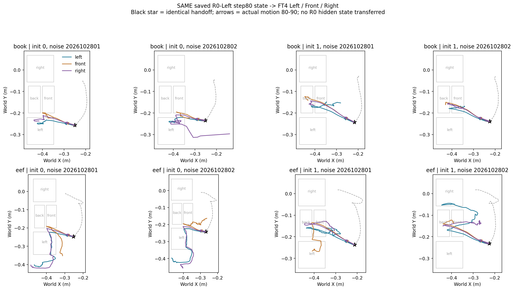
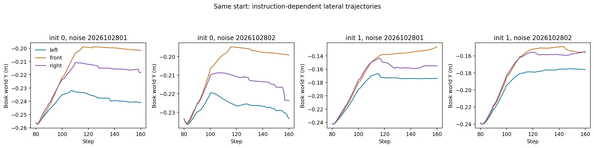

# 同状态三指令：R0 Left80快照

> R0先听左执行80步，保存完整仿真、控制器、观测及随机状态；复制恢复同一快照，FT4分别听左、前、右。目标是把当前指令作用与前段状态分开。

固定两个开发原初态×两个噪声，4个交接快照×3指令＝12分支。每条统一执行到原第400步。先重放原Left前段用于视频，然后明确从保存快照恢复再接手；三分支状态/控制器/策略观测签名必须一致。每次构造新的图文前缀，无R0隐藏状态传递；噪声沿用同一绝对日程。

Left/Front共8条需复现此前同状态结果，Right4条新增；全部续跑重新推理，合计3840次Flow查询。此前“R0听Right80→FT4听Right”是不同状态，不混入本批。

保存12条视频、完整命令/位置/接触。以当前指令评价首次目标、曾到、终态，并比较10/20/40步命令及实际运动。先到前或左不自动代表模型内部目标，需要结合轨迹和指令差异。只在4个开发快照成立不代表从初态保留旧技能；不训练。

配置stage2v_same_state_three_20261030.json。输出/home/lzx/cl_binding/.server/stage2v_same_state_three_20261030_01。等待实际结果与审计，不预写结论。

## 正式结果：三分支完整起点一致，Right没有恢复

_02批次北京时间18:04:58—18:08:57完成，约3分59秒。12条都重新推理续跑；Left/Front八条与此前轨迹完整复现，Right四条为新增同状态反事实。4个快照各三分支的仿真、控制器与策略观测签名一致，恢复时物理状态和两相机／末端／抓手观测误差均0。六组官方采样工程门禁通过，3840次Flow查询，无训练或CA干预。

|FT4接手指令|首次请求正确|曾到请求目标|首次右格|最终原生In正确|
|---|---:|---:|---:|---:|
|Left|2/4|2/4|0/4|0/4|
|Front|4/4|4/4|0/4|0/4|
|Right|0/4|0/4|0/4|0/4|

Right在这批是已学过右任务的FT4接手；R0前段始终Left，不能套用此前“R0未学过Right前段”的限制。此前同指令Right80数据不是本批同状态对照。

### 逐快照首次到达

|原初态／噪声|给Left|给Front|给Right|
|---|---|---|---|
|0／2026102801|左，99步|前，116步|左，175步|
|0／2026102802|左，107步|前，110步|左，157步|
|1／2026102801|前，103步|前，106步|前，104步|
|1／2026102802|前，102步|前，104步|前，102步|

原初态1的三种指令都先到前，后到后格；原初态0虽Left/Front随指令到达对应区域，但Right没有去右，而后来到左。三指令均正确的状态组为0/4；仅Left/Front成对正确2/4，都来自同一个原始初态的两个噪声重复。当前两个原始初态不能算成4个独立场景。

### 当前指令是否有影响？有，但影响未形成可靠的三个目标控制

在原初态0、噪声2026102801的同一状态下，第一块10动作的原生世界平移目标偏移合计（单位cm）：

|接手指令|X分量合计|Y分量合计|
|---|---:|---:|
|Left|-21.83|+5.62|
|Front|-17.58|+7.33|
|Right|-20.61|+7.81|

同观测、同噪声生成的首块动作不同，说明语言确实影响输出；但这些是逐步控制目标偏移之和，不是实际移动了这些厘米，更不是内心目标的直接读数。三者仍共享明显-X靠近及+Y分量，Right命令没有产生可靠的右格到达。

Left/Front/Right首10步均10/10抓持成立，全部方向与抓持明细保存。初态1各指令路径尤其相近，说明状态对结果的约束很强；不能只看“输出有区别”就认定语言接地完整。

### 本轮能回答和不能回答的

1. 排除了三分支初态不同、推理噪声不同和R0隐藏状态传递这些解释；本轮确实只改变FT4当前指令。
2. 排除了“在这些状态下语言对动作完全没有任何影响”的绝对说法，但不证明正确语言条件控制完整保留。
3. 此前同状态Left/Front部分成功不能推广成三个目标都可按指令选。Right即使被请求也未到达，所以“不去右”本身不是修复证据。
4. Right失败仍不能证明右格物理不可达。可能有状态外分布、姿态／接触执行限制、控制方向及语言利用问题，需要可达性阳性对照才能区分。
5. 当前支持的是“状态对路径有强影响，语言仍能调制动作，但不能稳定指定正确目标”的行为结论；尚未分解共同偏移与条件损伤，更没有定位某个CA或参数病灶。

下一步若继续，应从相同快照核对Right命令在接近收纳盒后的执行与抓持，区分控制不足和物理约束，并与合格的可达性阳性控制比较。不要直接把这12条当作可部署修复方法或恢复旧语言能力。此次没有自动开展其他实验。

## 恢复故障、元数据和证据

首次_01于第81步观测差约2mm而停，0条完整分支计入结果；原件留服务器。诊断同动作下一步物理状态差为0，遗漏的是传感器采样时钟／缓存；补齐后物理与位置观测均0。_02保存并恢复Observable时钟、当前观测数组和_obs_cache，保持原阈值，Left/Front完整复现通过。这是工程修正，不是按分数重选。

原审计末尾的两条limits文字和配置的right_teacher_status沿用旧同指令模板，不适用于实际分支；已用audit_metadata_v2更正说明，并确认每个数值与原审计相同，原件保留。以实际固定R0 Left前段、快照签名和当前FT4指令为准。

[更正文字后的服务器审计](results/2026-10-30/stage2v_same_state_three/audit_metadata_v2.json)、[本地数值审计](results/2026-10-30/stage2v_same_state_three/audit_local_v2.json)、[结果表](results/2026-10-30/stage2v_same_state_three/results.csv)、[方向明细](results/2026-10-30/stage2v_same_state_three/directions.csv)。本地数值与原件哈希验收通过；视频完整400帧解码在服务器，本地另校验哈希。结束时权重、源码与运行工作树检查通过。

视频索引：`video/2026-10-30_同状态三指令80步/README.md`。12条单视频＋4条三屏对照均保存。四份完整NPZ／JSON快照在同目录snapshots及服务器原目录；快照／视频不入Git，manifest保存哈希。没有模型权重下载。
