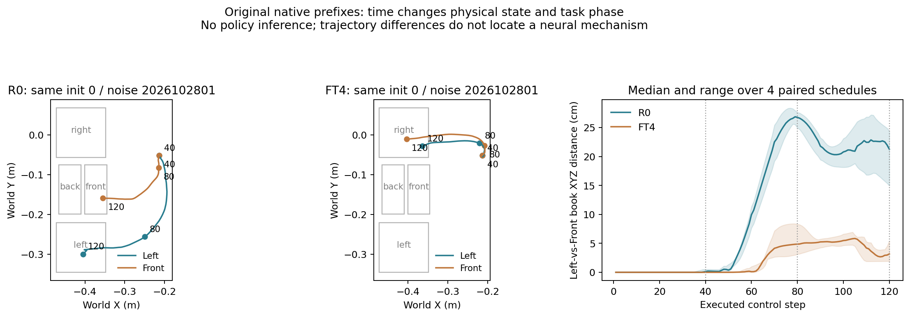
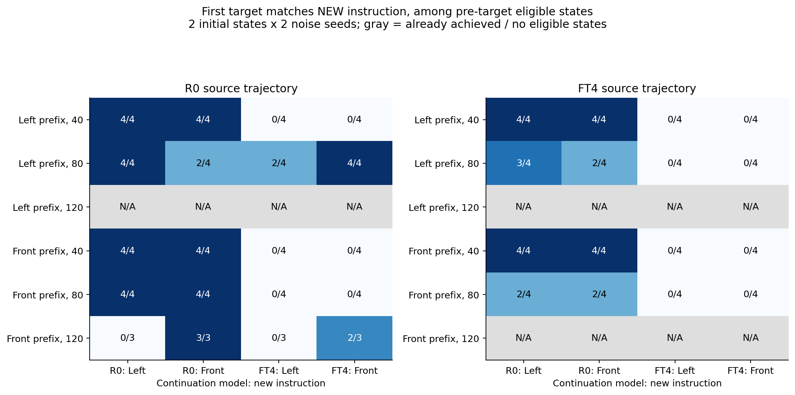
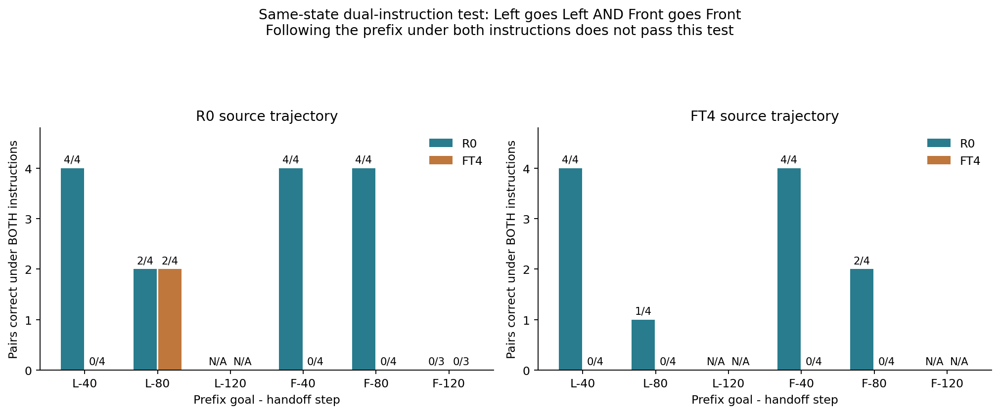

# 10/30：提前交接、临时换指令——FT4会重新选目标，还是只沿旧路走？

> **通俗解释：** 昨天让旧模型先做120步，新模型接手后经常能完成旧任务。但这可能只是旧模型已经把书带到了正确格附近，新模型顺着做完。今天提前在40、80步交接：同一个机器人姿势、同一个书本位置，分别告诉接手模型“去左格”和“去前格”。如果它能据此走向不同的正确目标，才有更强的证据说明它还会用指令选目标；如果两条指令都沿原路走，就不能把交接后的成功当成语言能力恢复。

**完成状态：北京时间12:57:28派发，13:27:11全批结束；192/192分支完成，服务器、本地完整日志审计及独立滑窗移动重算通过。** 第1—7节保留事前问题、操作与判据；第11节起为正式结果与机制解释。没有训练、CA替换、回放或蒸馏。本轮对应用户授权的“第二步”，没有启动多CA组合实验。

**结果先读这三句：** 40步交接，R0从相同状态按左／前指令首次正确32/32，FT4则32/32先去右。80步时，FT4仅在R0左前段、原初态0的两个噪声重复中实现左去左／前去前，最终原生In仍全部失败。120步同指令最终7/8的成绩得到复现，但大多已被R0带到目标附近，不能据此认定FT4独立保留了目标选择能力。

## 1. 我们已经知道什么，仍不知道什么

上一批420回合中，FT4原生左／前各4条均先搬到新右格。逐个替换8个CA接口的正确旧消息，分别帮助120或400步，所有单层条件的首次正确仍0/4。完整R0控制前120步再交给FT4，左首次搬对及最终原生In均4/4，前均3/4，两条旧指令首次错右从8/8变为0/8。

但Left在第97—101步就已进入正确格上方，仍在R0控制中；Front三条正确到达为119、127、130步。因此120步交接不能单独证明FT4独立完成了目标选择，也不能证明它完整保留了所有旧入口操作能力。它面对的已经是R0改变过的状态。

从原批原生轨迹的五步移动口径看，40和80步时R0／FT4的左／前均尚未进入任何目标；120步时R0已有4/8进入目标，FT4已有8/8进入右格。**40／80用于更早的选择检验，120用于识别“已经带好路”的参照。** 即使没进入格子，也可能已经形成运动方向，不能把几何到达时间直接当成内部决策时刻。

## 2. 这里的40、80、120到底是什么步数

是机器人已执行的仿真控制步，既不是训练更新步，也不是Flow Matching积分步。

- 每10个控制步重新生成一块动作，只执行该块前10个动作。
- 每次生成内部使用10个Flow Matching计算步。
- 交接40步表示前40个动作来自原前段；第41步起由接手模型生成动作。
- 所有路线统一在原第400步结束。40步交接还有360步，80步还有320步，120步还有280步；不会让晚交接路线再多跑400步。
- 交接后沿用绝对重规划下标及相同噪声日程，不因为换指令、换模型或换交接点而另换随机噪声。

本轮固定三个时间点，不按中途效果移动交接点，也不把某个成功点自动称为精确的“目标决策临界点”。

## 3. 四条分支如何区分“选目标”和“沿原路走”

例如，R0先听“左格”走到第80步。然后从**完全相同的交接状态**分别运行：

| 接手模型 | 接手后指令 | 要观察什么 |
|---|---|---|
| R0 | 左格 | 原模型正常继续，核对实现与原任务可达性 |
| R0 | 前格 | 旧模型在这个状态是否本来就能改选前格 |
| FT4 | 左格 | 新模型是否能沿旧方向继续 |
| FT4 | 前格 | 新模型是否真的能根据指令改选另一旧目标 |

只看到FT4接手后搬左成功，不足以回答目标选择；还要看同状态下给“前”是否能去前。若R0自己也无法从这个状态改选，就不能把FT4改选失败直接判作语言失效，可能是当前状态已很难改变动作。

前段还会换成R0先听“前格”，以及FT4先听“左／前”。后者通常带出朝右的轨迹，用于反向检查：旧模型能不能纠正新模型带出的方向，FT4的表现是否依赖前段状态来源。

## 4. 固定矩阵与资源

2种前段来源（R0／FT4）×2条前段指令（左／前）×3个交接点×2个接手模型×2条接手指令×2个原初态×2个噪声＝**192条分支**。

共有48个模型／指令／时间／初态／噪声定义的交接状态，每个状态有上述四分支。它们来自两个原始物理初态的重复轨迹，不是48个独立场景；两个噪声也不能当成两个新初态。

主组共76800个执行步，其中15360步为已保存前段动作的重放，61440步为接手策略新生成动作；6144次重规划、61440次Flow速度查询。不调用donor，不注入CA消息，不更新参数。复用现有权重与环境，使用空闲GPU1，工程失败停止，不抢占组员任务。

初估主组15—35分钟，具体以实测吞吐为准。控制器总时限90分钟，主worker最多60分钟；输出上限1GiB，至少保留3GiB磁盘。失败保留原件，不自动加预算或重选回合。

## 5. 怎样保证真的是同一个状态

不只复制机器人和书本的位置，也不只恢复qpos。每条分支都从相同原初态，按上一批保存的完整执行动作重新走到指定步数；控制器、抓手和仿真过程随原动作一起重建。

随后核对交接时的完整仿真状态哈希、控制器数值状态哈希、两路相机图像哈希，以及末端位置／姿态和抓手观测。四分支必须与对应工程参照完全一致。前段逐步物体／末端位置误差要求≤1e-7，原生目标谓词一致。

前段动作的指令叫“前段指令”；接手后新给的指令叫“接手指令”。若前段是左、接手指令换前，后段就按“前”评分，不能按原来的左评分。

接手模型只接收当前两路图像、机器人观测和当前接手指令。运行时固定单帧观测，每次重规划重建图文前缀与KV；不把R0的隐藏状态、原语言缓存或剩余动作队列传给FT4。因此“前段来源影响”首先指前段造成的物理／观测状态及控制器状态影响，不是把R0内部知识直接交给FT4。如果同一个FT4在不同来源状态下表现不同，也不能直接解释为模型参数在交接时变好了。

工程首先检查48个交接状态的同模型同指令下一动作块能否复现原批，动作最大误差≤1e-5。主组另外完整核对48条不换模型、不换指令分支能否复现原生轨迹，以及8条R0-120→FT4同指令能否复现上一批阳性对照。后两项是实现复现检查，不是额外增加的独立成功样本。

## 6. 怎么评分，避免“之前已经成功”混进答案

主要移动口径保持不变：书本中心进入原生格子世界XY投影、相对第1个执行帧抬高超过3cm、连续5步。不要求接触、松爪或终态放稳。8cm唯一最近邻只作辅助；第400步原生In另外记录。

每条分支分开记录：

1. 前段是否已经到过某格、交接瞬间是否正处于某格上方、是否曾满足原生成功。
2. 交接后首先进入哪个格、是否曾到新请求目标、最终原生In是否正确。
3. 全程轨迹，用于防止漏掉前段已经发生的错误选择。

**“尚未到目标”的严格有效状态**要求：前段从未连续5步到任何格、从未满足任何原生In，且交接瞬间不正抬着书处于某格投影内。固定时间点全部保留，不因不满足条件而补采；不合格状态单列，不进入“新做目标选择”的分母。

最关键的成对判据是：**同一个交接状态、同一个接手模型，给左首次去左，给前首次去前。** 一左一前都正确才计为一对指令选择成功。两次都去原来的左格，只能说明沿原方向；两次都去右格，是当前新目标偏向的行为模式；没有到任何格另记操作失败，不能叫目标替代。

120步时已经完成的旧目标，即使接手后继续保持，也不能算作重新选择成功。表格会同时列全部4条及严格有效分母，避免混淆。

## 7. 我们预先考虑的机制与可区分预测

| 假说 | 预期看到什么 | 能支持到哪一步 |
|---|---|---|
| FT4仍可依据语言选择，但高度依赖前段状态 | 在同一尚未到目标的R0状态，FT4给左去左、给前去前；在FT4带出的状态可能较差 | 支持状态相关的条件选择保留，仍不是普遍完整保留 |
| 120步成绩主要来自R0已带好路 | 同指令继续较好，换指令仍沿前段目标；早交接明显变差 | 支持轨迹依赖的行为解释，须与R0换指令能力对照 |
| FT4对新右目标的偏向持续压过旧指令 | 40／80步同状态下，FT4左前都首先去右，而R0可分别去左前 | 支持FT4旧目标条件控制受损，尚未定位内部参数路径 |
| 任务在当前姿态已经难以改向 | R0和FT4从同状态都无法按新指令改选 | 不能只怪FT4语言使用；需检查动作／状态可达性 |
| 普通操作失败混入 | 不到任何格、掉书或其他动作失效，且没有首先进入错误格 | 与目标替代分开，不把所有失败归为语言问题 |

“更晚交接更好”并不自动说明模型越晚越懂语言：晚交接时教师做了更多工作，书的位置、抓取质量、已有运动方向和剩余时间都改变。交接步数只是这些过程的观察窗口。真正有区分力的是同一状态下改变指令，并同时比较R0和FT4的反应。

这些是假说，不是当前已经证实的机制。即使得到强行为差别，本轮仍不能直接指认Cross-Attention、某个头、Q/K或动作输出层是病灶。

## 8. 结果、发现与结论的填写规则

本节为事前登记的汇报顺序。主组已完成，正式结果见第11节起；全部条件和负结果均保留：

- 工程与完整性：48个交接状态、同策略复现、前批120步交接复现、权重与源码哈希。
- 时间与来源表：40／80／120步下的有效状态数、同指令继续、换指令改选、首次错右和最终成功。
- 同状态双指令对：两条均随指令、两条都沿前段目标、两条都去右、无到达。
- 机制解释：哪些预测符合、哪些被削弱、哪些仍无法区分；不把时间相关直接称作某层因果。
- 下一步：有确切行为证据后再决定状态依赖分析或内部路径干预，不在本轮追加训练与多CA组合。

配置为 `configs/stage2r_early_handoff_20261030.json`；服务器目录为 `/home/lzx/cl_binding/.server/stage2r_early_handoff_20261030_01`。只在控制器完成、主组完整和独立日志审计通过后填写正式结果。


## 9. 实际启动与工程结果（保留启动时记录）

北京时间2026-10-30 **12:57:28**派发，控制器PID **51518**，事前封存提交 `b04fa3c`。先检查GPU1空闲、权重与模型源码哈希、运行工作树和磁盘，再运行工程与固定主组；没有切换服务器工作分支、重装环境或打断组员任务。

工程48个交接状态的原前段位置最大误差 **0**，同模型同指令下一动作块最大误差 **0**。工程worker耗时约69.46秒。主组首次确认4/192分支、1600执行步，按原队列继续；这些只说明运行推进，不作为完整机制结论。

需要特别强调：本轮是**中途改变指令的诊断实验**，与从初态保持同一指令的标准持续学习成功率不同。R0换指令对照不可省略；新指令不可达或R0也改不动的状态，不能据此单独声称FT4发生了语言坍缩。


## 10. 原轨迹提供的时间背景：尚未到格，不等于尚未带出方向

以下只重算上一批已封存的原生轨迹，不是本轮新实验结论。将同初态、同噪声下的左／前请求配对，比较同一时刻书本中心的三维距离，单位cm：

| 已执行步数 | R0左／前书本距离：中位数（范围） | FT4左／前书本距离：中位数（范围） | R0已抬高>3cm | FT4已抬高>3cm |
|---|---:|---:|---:|---:|
| 40 | 0.12（0.00—0.52） | 0.00（0.00—0.00） | 0/8 | 0/8 |
| 80 | 26.76（24.94—27.63） | 4.87（3.13—8.31） | 6/8 | 8/8 |
| 120 | 21.26（14.95—24.42） | 3.17（1.92—5.45） | 8/8 | 8/8 |

这些数描述书本位置，不直接描述模型内部语言表示。40步时书还没有明显抬起；80步虽然都还没满足到格判据，R0在左／前请求下带出的书本位置已经相差很大，而且两条任务的抓取／搬运进度也不同。因此80步交接时“正确方向已经形成”完全有可能，不能因为还没入格就默认此时从零开始选择目标。

FT4左／前轨迹也有几厘米的差异，所以更准确的问题是“指令差异是否能够改变最终目标选择”，而不是先断言语言对动作完全没有影响；原生两条请求仍首先去右格。



这些时间背景解释了为什么本轮必须做同状态换指令：只有前段、物体、抓手、观测全部相同，仅改变接手指令，才能把“不同的前段状态”与“当前指令的作用”分开。它仍不是内部神经路径的定位。


## 11. 正式验收：192分支全部完成，三套核对一致

北京时间 **12:57:29—13:27:11**，控制器耗时 **29分41秒**。工程进程70.74秒，主评测1705.74秒（28分26秒），日志审计3.37秒；主worker记录计算段1704.52秒。没有追加预算、换状态或更新权重。

- 主组192分支、76800个执行步：15360步重放原前段，61440步由接手策略新生成；76992行含reset事件、6144次重规划、61440次模型速度查询，无donor和CA补丁。
- 48组交接配置对应48个不同仿真状态哈希，每组四分支的仿真、控制器和策略观测签名一致。这些仍只来自两个原始物理初态及两种噪声，不是48个独立测试场景。
- 工程前段位置和下一动作块最大误差0。主组48条同模型同指令完整续跑与原生轨迹一致，8条R0-120→FT4同指令与前批阳性对照一致；最大动作、位置误差均0，逐步原生目标谓词一致。
- 本地对下载原件核对SHA256，完整重跑日志审计，内容与服务器完全相同；另外用独立的连续五步滑窗实现重算全部前段／后段／全程到格时间、有效分母和96个双指令对，一致通过。
- 结束时权重、模型源码、运行目录HEAD及dirty列表核对通过。GPU任务结束，没有启动多CA组合、训练、蒸馏或回放。

5项本轮CPU协议测试、21项既有阶段协议测试通过。测试不能代替独立初态的能力资格。

## 12. 最清楚的结果：40步交接时，状态可纠正，FT4仍统一去右

40步的全部交接状态均满足严格“尚未到目标”条件。下表每格分母4＝两个原始初态×两种噪声；分开运行左、前新指令：

| 前段来源／原指令 | R0接手：左／前首次正确 | FT4接手：左／前首次正确 | FT4两指令首次错右 | R0／FT4双指令均正确 |
|---|---:|---:|---:|---:|
| R0／左 | 4/4／4/4 | 0/4／0/4 | 8/8 | 4/4／0/4 |
| R0／前 | 4/4／4/4 | 0/4／0/4 | 8/8 | 4/4／0/4 |
| FT4／左 | 4/4／4/4 | 0/4／0/4 | 8/8 | 4/4／0/4 |
| FT4／前 | 4/4／4/4 | 0/4／0/4 | 8/8 | 4/4／0/4 |

合计R0首次正确32/32、FT4首次正确0/32且首次右格32/32；同状态双指令R0为16/16对，FT4为0/16对。这些是重复开发条件的汇总，不是32个独立初态。R0最终原生In为30/32，FT4为0/32。

**通俗解释：** 同一时刻、同一个姿势，把模型换成R0，给左就能去左、给前就能去前；换成FT4，则两句话都去右。包括FT4自己带出的40步状态，R0也能纠正。因此这批早期失败不能仅解释成“前面已经走错，谁来也改不了了”。此时接手策略对旧指令的条件控制确实受损。

这仍不等于已证明语言表示不可读、CA不工作或某一组参数是原因；也可能是读出的指令影响较弱，被共同动作偏向或后续动作生成过程压过。

## 13. 80步：FT4局部还有指令相关到达，但非常依赖状态

80步的全部交接状态也满足严格有效条件。此时没有到格，但R0左前段已带出明显的左向姿态与书本位置；R0前前段的搬运进度不同，不能只按相同步数把二者视作同一操作阶段。

| 前段来源／原指令 | R0接手：左／前首次正确 | FT4接手：左／前首次正确 | FT4两指令首次错右 | R0／FT4双指令均正确 |
|---|---:|---:|---:|---:|
| R0／左 | 4/4／2/4 | **2/4／4/4** | **0/8** | 2/4／2/4 |
| R0／前 | 4/4／4/4 | 0/4／0/4 | 8/8 | 4/4／0/4 |
| FT4／左 | 3/4／2/4 | 0/4／0/4 | 8/8 | 1/4／0/4 |
| FT4／前 | 2/4／2/4 | 0/4／0/4 | 8/8 | 2/4／0/4 |

全部80步条件合计：R0首次正确23/32、双指令正确9/16对、最终In16/32；FT4首次正确6/32、双指令正确2/16对、首次右格24/32、最终In0/32。

**不能把R0左前段这一行的错右0/8叫作完整恢复。** 其中6条首次到请求格，另外2条左请求首先到前格；最终原生In仍为0/8。它同时存在局部正确到达、旧目标之间的混淆及后续完成失败。



### 13.1 唯一两对FT4双指令正确，发生在哪里

都来自 **R0左前段、80步、原初态0** 的两个噪声重复；不是两个新初态。保持交接状态不变，分别给新左／新前指令：

| 原初态 | 噪声 | 新左：首次到左 | 新前：首次到前 | 两条最终In |
|---|---|---:|---:|---:|
| 0 | 2026102801 | 第99步 | 第116步 | 均失败 |
| 0 | 2026102802 | 第107步 | 第110步 | 均失败 |

新前指令下，书本没有首先进入原前段的左格，说明按当前五步移动口径，接手指令确实改变了到达目标，不能把这两对都解释成被动沿原左路走。两对也没有后来进入右格；一条新前分支在第370步又到左格，所有后续序列均保留。这里没有视频审看，不进一步把最终失败指定为某一种抓取／碰撞根因。

原初态1的两个噪声下，FT4新左与新前均先到前格，随后到后格，不通过双指令选择判据。因此这种局部条件作用没有跨当前两个原初态稳定成立。

**还要防止总数掩盖变化：** 这一行R0和FT4虽然同为双指令2/4，但成功集合相反。R0在原初态1的两种噪声下通过，在原初态0两条指令均先去左；FT4在原初态0通过，原初态1两条均先去前。所以不能说“FT4保留了与R0相同的两对能力”，更不能据此认定旧技能整体保留。它支持的是：FT4在少量状态仍有当前指令相关的正确到达，行为映射已发生改变。



## 14. 120步：原先的高同指令成功，主要能说明什么

120步不是统一的“还没开始选目标”。严格有效状态只剩 **R0前前段3/4**：

| 前段来源／原指令 | 严格有效状态 | FT4新左／新前首次正确（全4条） | FT4双指令正确（有效状态） | 怎么解释 |
|---|---:|---:|---:|---|
| R0／左 | 0/4 | 4/4／0/4 | 不适用 | 已到过左目标，两个新指令均首先留在左 |
| R0／前 | 3/4 | 0/4／3/4 | 0/3 | 有效子集中新前2/3正确，新左0/3；两对都先前，一对均无到达 |
| FT4／左 | 0/4 | 0/4／0/4 | 不适用 | 交接前已到右，不能当作新的目标选择 |
| FT4／前 | 0/4 | 0/4／0/4 | 不适用 | 同上 |

R0前前段还有一条在交接瞬间已处前格投影内，虽前段尚未连续满足五步，也从严格新选择分母排除。全4条的同前指令3/4正确，与有效子集2/3不能混用。

**R0自己在晚交接时也有相同的可达性边界：** R0左前段120步后，新左／新前都首先在左；R0前前段120步后，新左／新前都首先在前。R0前前段三个有效状态的双指令正确也为0/3。因此，晚期改选失败并不是FT4独有，不能把120步时“无法改指令”全算成语言损伤。

本轮准确复现上一批同指令交接：R0先左120步→FT4继续左，最终4/4；R0先前120步→FT4继续前，最终3/4。但这个7/8回答的是“旧策略先带出轨迹后，同指令能否完成”，不是“FT4能否重新在左和前之间选择”。

## 15. 步数和目标替代之间，目前能建立什么机制解释

### 15.1 步数首先改变的是到达的状态和任务阶段

从40到80到120步，教师已做的工作增加，末端姿态、书本位置、抓取关系、已有运动方向及剩余时间都改变。FT4参数完全没有变化，也没有接收R0隐藏记忆。

因此，晚交接改善同指令表现，可以来自“给FT4提供了更容易继续的状态”。不能把它解释为FT4在第80或120步突然重新学会了语言。不同前段的同一步数也不保证同一阶段：R0左80步能提供一些局部条件反应，R0前80步仍全部错右，就是直接例子。

### 15.2 结果支持早期旧目标条件控制受损，也支持少量状态下残留条件作用

40步同状态中R0全部可按新指令分流，FT4全部去右，说明早期新右替代不能仅归咎于状态已无法纠正。80步少量状态里FT4能给左到左、给前到前，说明不能把损伤概括为“任何状态都完全没有语言影响”。

两项证据合在一起，支持**目标条件控制的表现具有明显状态依赖**。原有目标替代与少量局部条件反应可以并存，保留少量条件反应并不代表从初态执行旧任务合格。

### 15.3 仍有操作损伤，不能只做目标选择的单因解释

80步FT4有6/32首次到正确旧格，但最终In为0/32；R0为23/32首次正确、16/32最终成功。当前主指标仍是搬到正确格，不因最终未完成而抹掉已发生的正确到达；同时，最终失败也说明后段能力不能默认完整。

这把两个问题分开：有的状态下先选错目标，有的状态下能到正确格但后续没有完成。要靠逐步状态、接触与动作分析进一步解释后者，不能从最终失败表直接指定为步数不够或某个CA故障。

辅助失败类型表，分母均32条开发分支；“其他错目标”与“没有到达”不混入错右：

|交接步数／接手模型|首次正确|首次错右|首次其他错目标|无到达|最终In正确|
|---|---:|---:|---:|---:|---:|
|40／R0|32|0|0|0|30|
|40／FT4|0|32|0|0|0|
|80／R0|23|0|4|5|16|
|80／FT4|6|24|2|0|0|

### 15.4 对内部原因的下一层猜测，仍是待验证假说

一个符合当前模式的假说是：持续适应破坏了新旧任务共同经过的早期状态中的指令分流，而某些旧分支状态上还残留局部指令作用；晚期画面和抓取姿态提供的目标线索，又能让新策略顺势继续。

但本轮没有直接测量这些固定状态下的共同速度偏移、条件区别幅度或图文消息传递，尚不能严格判定是Shared Bias、Language Collapse，还是二者并存；也没有定位CA、SA、MLP、状态输入或动作输出映射中的具体路径。新数据定位的是**哪些状态值得做内部机制对照**，而不是已经找到参数病灶。

## 16. 这一步回答了什么，下一步如何接上

我们现在可以回答：

- 早期目标替代不是纯粹“状态走错后谁也救不了”：R0能从相同40步状态纠正，FT4不能。
- 120步的高同指令成绩不能单独证明FT4保留重新选目标能力；晚期连R0也常无法改选。
- FT4存在少量指令相关旧目标到达，但未跨两个原初态稳定成立，且成功状态集合与R0不同。
- 正确到达与完成能力可分离，目前两者都有受损迹象。

下一步应优先比较本轮固定状态：40步“R0可分流、FT4统一右”，80步“FT4局部可分流”，以及同为80步但仍统一右的状态。在这些状态里接回已有共同／区别、P／C和消息路径分析，检查语言差异有没有形成、能否传到动作速度、是否被共同偏移压过。保持同态比较，避免再次拿开环平均误差改善代替闭环目标恢复。多CA组合也应有明确的状态和来源对照，不在本轮自动启动。

对后续回放的启发是：优先寻找“相似共享状态下需要语言分流、旧模型能分流而新模型不能”的样本。只回放已靠近旧目标的容易状态，可能保护了继续操作，却没有保护早期按指令选路。这个选择原则尚需回放训练与新任务折中实验验证，本轮没有训练验证。

## 17. 证据、复核与限制

[48行逐条件CSV](results/2026-10-30/stage2r_early_handoff/results.csv)、[24行双指令汇总](results/2026-10-30/stage2r_early_handoff/instruction_pairs.csv)、[全部192条分支](results/2026-10-30/stage2r_early_handoff/evaluation/episodes.jsonl)、[服务器审计](results/2026-10-30/stage2r_early_handoff/audit.json)、[本地完整审计](results/2026-10-30/stage2r_early_handoff/audit_local_v1.json)、[独立移动重算](results/2026-10-30/stage2r_early_handoff/movement_independent_v1.json)、[运行完整性](results/2026-10-30/stage2r_early_handoff/post_run_check.json)。

本地原始事件与重规划压缩日志全部归档，没有新权重下载。仿真状态、控制器和图像签名是运行时见证，完整动作复现提供进一步支持；仅凭哈希仍不能重建隐藏神经激活。独立滑窗实现复核主要格子投影口径，辅助8cm未做第二套独立实现。

限制继续保留：只有两个原始开发初态、两种推理噪声、一个历史适应过程；R0没有正式独立资格评估。中途改指令是功能诊断，不是标准从初态任务保留率。各时间点有状态与阶段差异，不能当成同一状态下只操纵“步数”。少量局部阳性与最终失败都没有视频逐帧定因，不能据此升级成唯一内部机制或可部署修复方法。

本地复核命令（已有审计原件保留，不覆盖）：

```bash
python -c "import sys,json; from pathlib import Path; sys.path.insert(0,'scripts'); from audit_stage2r_handoff import audit; r=Path('docs/results/2026-10-30/stage2r_early_handoff'); assert audit(r,Path('docs/results/2026-10-30/stage2q_all_ca')) == json.loads((r/'audit.json').read_text()); print('passed')"
python -c "import sys; from pathlib import Path; sys.path.insert(0,'scripts'); from verify_stage2r_movement import verify; print(verify(Path('docs/results/2026-10-30/stage2r_early_handoff')))"
```
