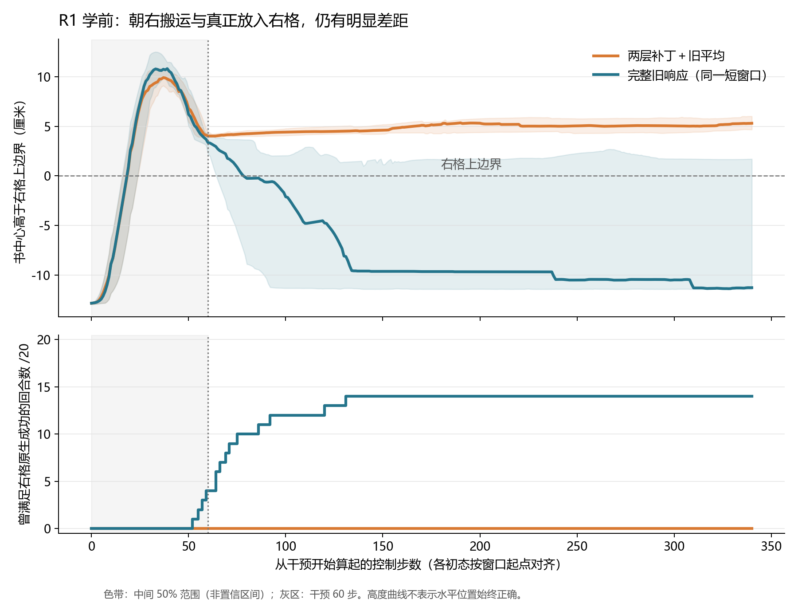

# 目标替代机制链分析报告

> **后续实现校正（2026-11-07）：** 对历史闭环钩子的核验确认，两处补丁捕获了原地残差相加后的累积状态，而非纯模块输出。本文实测轨迹与输出级 μ／d 结果保留；两层局部信息归因须按[深层机制与实现校正](2026-11-07_μd替换有效性的深层机制与实现校正.md)收紧。修正捕获版本尚未闭环重评。

**核心问题：旧指令为什么仍能影响动作，却难以把旧任务完整做完？**

日期：2026-11-07。本报告结合已有训练检查点、动作专家内部测量和闭环干预，并新增了对 **320 条旧指令回合、128000 个轨迹步**的离线复算。320 条来自已完成的 K13，并非新增评估；另 20 条原生 Front 回合仍作为新任务水平的既有参照。本轮没有新增模型训练，也没有把下一阶段计划中的实验算作结果。

## 1. 目前最有根据的解释

**当前证据支持：持续学习后，旧指令仍能让模型产生不同动作，但这些差异与整体动作响应的配合变差了；前段动作又改变了后段接手的物理状态。因此，恢复“往哪边搬”，并不一定恢复“怎样放进去、怎样保持住”。**

可以把它理解为：机器人原来会根据指令完成一整串配合好的动作。续训后，不只是最后去向可能变化，抬书、转向、对准和下降之间原有的配合也可能被改变。局部修正能够把书带向正确的一侧，却未必把整段配合一起找回来。

这里的“配合变差”是目前最合理的机制框架，不能直接等同于已经找到某个坏掉的神经模块。尤其是，“哪类训练监督、经哪些参数更新写入了这些变化”，还缺直接的训练因果检验。

```text
只用新任务继续训练，共享的动作生成网络继续更新
   ↓ 已确认旧指令响应随训练改变；具体更新来源尚未定位
旧指令的平均动作响应靠近新任务，指令间的有效差异减弱
   ↓ 平均响应与条件差异的交叉干预支持其行为作用
旧指令难以稳定分路；补回一部分差异后，可以恢复搬运方向
   ↓ 本轮轨迹复算显示：前段已形成不同状态，后段结果继续分化
有些回合停在正确格上方，有些入格后又失效
```

本报告将三种证据分开：**直接测到的变化、干预能够改变的结果、仍待验证的原因解释**。

## 2. 第一环：新任务的训练更新，改了什么？

R0 线路原来联合学左、前，随后只学右；R1 线路原来联合学左、右，随后只学前。续训数据直接要求新任务做对，没有直接要求两条旧指令继续做对。

视觉语言骨干被冻结，但实际仍在更新的是动作专家，以及机器人状态输入、动作输入／输出、去噪时间等投影。核对 R1 学前的训练参数清单，可以确认更新范围并不只有我们后来打补丁的两层。父子模型的动作归一化则保持一致。

通俗地说：**负责把“看到什么、听到什么、机器人现在在哪里”变成动作的共享系统仍然在学习。** 冻结视觉语言骨干，并没有冻结指令到动作的整条映射。

这提供了一条合理路径：为了拟合大量新任务示范，共享系统改变了动作生成规则；旧指令虽然不参与训练，查询它们时得到的动作也会随共享参数一起改变。但仅凭这点，还不能解释优化为什么选择了损害旧任务的更新，而没有找到兼容新旧任务的解。

### 训练中已经能看到变化，并非仅在最终检查点才出现

R0 学右线路已有五种监督设置的时间测量，包括原句、改写和动作监督遮蔽。在同一批固定观测和动作草稿上，统计旧左／前区别沿原方向保留多少：

| 续训步数 | 原句分支保留的旧方向分量 | 五种监督设置的范围 |
|---|---:|---:|
| 3000 | 27.2% | 24.3%–27.7% |
| 6000 | 24.2% | 17.2%–25.9% |
| 9000 | 19.4% | 15.6%–22.4% |
| 12000 | 20.6% | 13.5%–24.4% |

“保留 27%”指动作区别向量沿旧方向的分量，**不表示只剩 27% 的语言理解能力**。原句分支的平均响应也逐渐接近新右格响应，到了最终检查点，两条旧指令的动作中心已很接近它自己执行 Right 的更新。

这支持“续训过程正在改写旧条件动作响应”。但最早测量只有第 3000 步，那时两种变化都已出现，因此不能判断平均偏移和区别衰减谁先发生。五种设置也不是五个独立训练种子。

**证据范围：这段训练时间线来自 R0 线路。R1 目前主要有训练前后端点和闭环干预，不能把两条线路拼成同一个模型的完整时间线。**

来源：[训练检查点固定输入测量](../.tmp/supervision_probe_20261105_01/evaluations/fixed_probe.json)、[监督与冻结核验](../.tmp/supervision_probe_20261105_01/evaluations/training_audit.json)、[R1 实际可训练参数清单](results/2026-11-07/mechanism_chain/r1_front_trainable_parameters.json)。

## 3. 第二环：旧指令的动作响应怎样改变？

“共同趋势”是两条旧指令响应的平均，“指令区别”是两条响应之间的半差。它们用于比较相同图像、机器人状态、带噪动作草稿和去噪时刻下的输出。

可以将前者理解为两条指令共同使用的动作中心，后者理解为换一句指令后动作怎样相对这个中心分开。两者都可能包含搬运、姿态和夹爪控制，不能直接命名为“无语言习惯”和“纯语言语义”。这里测的是动作生成中的更新，也不是直接给机械臂发出的物理速度。

### 一方面，旧指令的动作中心向新任务靠近

在 R1 学前的 40 份固定输入中，续训模型两条旧指令的平均响应，到它自己 Front 响应的距离，中位数只有旧模型相应距离的 **17.9%**。这表示旧指令输出的中心已经很接近新任务输出。

它与目标替代相符，但“向量很像”本身不是因果证明。因果证据来自改变平均响应或区别后，实际闭环结果发生变化。

### 另一方面，旧指令的差异仍在，但变弱了

同一批 R1 输入上，左右区别的幅度约为旧模型的 **33.7%**，方向相似度为 **0.877**。原先区分左右的方向并非完全消失，更明显的是有效强度下降。

正确的 CA-7、MLP-9 补丁，把区别沿旧方向的分量从约 **28.9% 提高到 41.1%**，仍低于完整旧响应。两处分别是动作专家零起算第 7 层注意力输出、第 9 层 MLP 输出；补丁改的是推理时激活，没有把整个网络换回旧模型。

旧共同背景下，正确补丁恢复 **18/20** 对左右首次运动分流，而反向和等幅随机补丁均为 **0/20** 对。这支持所注入差异具有目标相关的控制作用。

但“完整旧区别比两层补丁有效”，仍有两种解释：旧区别可能包含额外的重要结构，也可能只是总体更强，或二者兼有。早期 K1 已表明，在旧平均背景下放大新模型残留区别，也能恢复很多分流。因此，当前还不能把两层补丁的收益全部解释为找回特殊语义内容。

来源：[K13 同输入读数与对照](results/2026-11-07/k13_r1_front_20/summary.json)、[K1 既有幅度控制](results/2026-11-07/mechanism_chain/k1_existing_evidence.md)、[两处候选位置的筛选依据](2026-11-05_K10_固定输入四格与定向干预.md)。

## 4. 必须区分：少做错目标，与重新做对旧任务

本轮复算需要收紧此前一个容易误解的表述：“首次进入某格水平区域”不等于“真正放入该格”。书从前格上方经过，也可能随后移到别处。

下表将 R1 线路的几种结果分开。每行均为旧 Left／Right 各 20 次，共 40 回合。

| 条件 | 首先进入前格水平区域 | 曾真正满足前格成功条件 | 最终完成请求的旧任务 | 最终停在新前格 | 最终为其他错误或未完成 |
|---|---:|---:|---:|---:|---:|
| 原生续训模型 | 28/40 | 16/40 | 7/40 | 15/40 | 18/40 |
| 只恢复旧共同趋势 | 27/40 | 1/40 | 7/40 | 1/40 | 32/40 |
| 旧共同趋势＋两层正确补丁 | 0/40 | 0/40 | 9/40 | 0/40 | 31/40 |
| 窗口内完整旧响应 | 0/40 | 0/40 | 31/40 | 0/40 | 9/40 |

因此，“只换共同趋势几乎没有减少前格替代”，**只对首次水平到格的代理口径成立**。按照真正完成前格的判据，它已经使前格成功大幅减少；但右格仍没有恢复，旧任务最终正确总数也没有增加。

这不是改动旧实验数字，而是把不同指标对应的机制含义分清。只看“新目标替代减少”，可能将“机器人不再做新目标，但也没完成旧目标”误当作恢复。两层补丁解决了更多运动分流，距离完整旧能力仍有明显差距。

原生 R1 在同协议下最终为左 **19/20**、右 **18/20**，说明这批状态并非普遍无法完成旧任务。续训模型原生 Front 最终为 **15/20**，也确实学到了新任务。

来源：[本轮严格结果复算](results/2026-11-07/mechanism_chain/analysis.json)中的 `r1_strict_outcome_profile`。

## 5. 第三环：控制在什么环节表现出失败？

两层补丁下，左、右两条指令并不是以同一种方式失败：

| 两层补丁＋旧共同趋势 | 首次到达正确格水平区域 | 曾真正满足请求格成功 | 最终仍成功 |
|---|---:|---:|---:|
| Left | 20/20 | 20/20 | 9/20 |
| Right | 18/20 | 0/20 | 0/20 |

Left 已经全部真正到过左格，但有 **11 条后来失效**；Right 则主要停留在朝右搬运，没有一次真正放入右格。这将失败分成了三个可观察环节：**朝正确区域搬运、真正入格、保持成功状态**。

这比单一成功率更接近机制。它说明恢复了一部分目标相关运动，并不等于恢复了全部条件控制；对不同旧指令，剩下的缺口也不同。

但要注意：**失败在哪个环节显现，不等于网络最早在哪个环节受到损伤。** 例如抬书姿势或水平对准稍有不同，后面才会表现为下不去或入格后失效。现有数据还不能把三个环节分配给三个独立神经模块。

### 新增复算：排除“只是没看清它有没有到右边”

选出两层补丁和完整旧响应都曾进入右格水平区域的 **同一批 18 个初态**，按每条轨迹首次进入该区域的时刻对齐。这里只用于观察已到达回合的后续过程；全部 20 回合的成功率仍按原分母报告。

| 从首次进入右格水平区域算起 | 两层补丁：书高于格口 | 完整旧响应：书高于格口 |
|---|---:|---:|
| 再过 20 步 | 约 4.2 cm | 约 1.1 cm |
| 再过 60 步 | 约 4.5 cm | 约 −6.8 cm，即低于格口 |

表中为各自高度的中位数。到第二行时，两层补丁组仍有 **16/18** 条在右格水平范围内，但 **0/18** 条当时满足原生右格成功；完整旧响应组 **18/18** 条在水平范围内，其中 **11/18** 条当时已满足原生成功。

也就是说，局部补丁的主要问题确实不只是“没有往右搬”，而是搬到右边后，没有继续形成正确的入格过程。当前位置数据能确认高度缺口，但没有书的完整姿态和接触记录，尚不能区分下降控制、对准、姿态或夹爪配合中的具体原因。

下图展示全部 20 条 Right 回合，不能与上表的 18 条配对到达子集混用。上图只有高度，不代表书始终在右格水平范围；下图使用真正的右格成功判据。



来源：[本轮轨迹复算](results/2026-11-07/mechanism_chain/analysis.json)中的 `right_arrival_matched_subset` 和 `trajectory_groups`。

## 6. 一个关键中间环节：前段动作改变了后段的起点

完整旧响应组只在短窗口内使用 R1 的动作更新。窗口结束后，两组都交回 **Front-12000，且仍接收实际 Right 指令**，不是把指令改成 Front。后续噪声规则相同。

在完整旧响应组全部 20 条右指令中，14 条曾真正入格；其中 **10 条的第一次成功发生在干预结束之后**，只有 4 条在窗口内已经成功。

这说明，短时旧响应可以通过准备更合适的接手状态，对后续过程产生持续影响，不需要之后一直由旧模型控制。这个状态包含书和夹爪的位置、姿态、速度以及控制器状态；不能将其简化为一张图。

本轮还比较了同初态、同 Right 前缀的两条轨迹：

| 比较时刻 | 两层补丁相对完整旧响应的差异，中位数 |
|---|---|
| 干预开始 | 前缀完全一致，书的位置差为 0 |
| 干预后 40 步，仍在窗口内 | 书的水平位置已相差约 4.3 cm |
| 干预结束 | 水平位置相差约 4.0 cm；两层补丁的书约高 0.6 cm |
| 干预结束后再过 40 步 | 两层补丁的书约高 6.6 cm |

因此，差距并非到最后才突然出现。两组在窗口内已经形成不同状态，随后同一个续训策略在这些状态上走出了不同结果。

这为机制链补上一个重要中间环节：**早期动作变化，可以通过改变物理状态，影响后面的入格与保持。** 但还不能认定某 4 cm 位移就是唯一原因；姿态、动量或接触也可能参与。10 条窗口后成功也不意味着续训模型完整保留了旧技能，有些完成可能受到既有运动状态或重力等因素帮助。

另外，早期 K11 在相同健康抓稳快照上，旧模型能按旧指令分流，受损模型仍倾向新目标。这又说明全部问题不能只归因于“先前走到了坏状态”：**同状态下的动作控制退化，与前段诱导的状态变化，两者都需要考虑。**

来源：[本轮逐时刻配对比较](results/2026-11-07/mechanism_chain/analysis.json)中的 `paired_joint_vs_oracle_by_offset_after_start`；[K11 同快照实验](2026-11-06_目标替代机制_共同趋势与指令差异闭环干预.md)。

## 7. 现在可以怎样把整条机制链讲清楚？

下面是一条与现有证据相容的解释。括号中说明它目前达到的证据程度。

**第一，新任务续训改变了共享的动作生成规则。** 训练只直接监督新目标，旧指令到动作的映射没有被直接要求保持。旧响应确实随续训变化，但哪类监督通过哪些更新造成变化，还未查清。（训练记录与检查点支持，具体优化原因待验证。）

**第二，旧指令还能调节动作，但调节与整体响应不再像以前那样配合。** 平均响应接近新任务，旧条件差异的有效强度下降。只改变其中一部分，有时能抑制新目标完成，却仍不足以完成旧目标。（同输入测量和交叉干预支持。）

**第三，局部修正可以找回搬运去向，却未必找回整段动作配合。** R1 正确补丁恢复了大量左右运动分流，但右格没有真正入格，左格也有多次入格后失效。差异可能不够强，也可能不够完整，或与当前状态不匹配。（行为差距已确认，具体解释需等幅和时长对照。）

**第四，这些前段差异会改变后段接手条件。** 同一个续训模型在不同前段形成的状态上，有的继续入格，有的长期悬在格口上方。因此最终失败不仅取决于“当前这一步有没有读到方向”，还取决于前面已经把书和夹爪带到了什么状态。（已有受控轨迹证据，具体状态因素需交换／分通道实验。）

用一句更直白的话说：**旧指令的影响没有完全消失，但已经难以连续组织一整串正确动作；前段没有配合好的部分，又会成为后段的新困难。**

这个解释没有要求“左／右词义全部被删除”，也没有要求“只有最后下降功能坏了”。它同样不排除部分条件信息确实受到侵蚀。

## 8. 机制创新最值得集中在哪里？

### 8.1 从“某层能修好”推进到“条件控制为什么失效”

目前真正值得研究的是，旧指令的控制究竟属于哪种变化：残留响应只需增强就能重新工作，还是增强之后仍缺少完成动作所需的结构。前者是控制强度问题的重要证据，后者才进一步支持条件信息损伤。

这需要把原有区别和补丁区别匹配到相同幅度，并验证当前输入文本能否在不借助外部目标标签加减号的情况下控制结果。现有正确补丁仍由程序给 Left 加、Right 减，不能直接宣称接收模型已自行恢复抽象语义理解。

### 8.2 将动作响应变化与后续状态联系起来

本轮新增分析不只看到“最后没成功”，还看到两种早期干预如何形成不同接手状态，以及效果如何在补丁停止后继续显现。潜在增量在于解释**持续学习导致的控制变化，如何沿真实执行过程传递成不同错误**。

这里还需直接分离状态因素。比如在同一份目标上方快照上，保持共同趋势和后续预算一致，仅改变条件响应的来源。如果结果仍不同，就能缩小“只是前面姿势没准备好”的解释；若差距消失，则前段状态准备是更重要的环节。

### 8.3 最终把“怎样救援”推进到“哪些训练更新造成损伤”

共同位移分析已有前例，[相关语言模型论文](https://arxiv.org/html/2610.08718v1)已经通过消除共同变化研究遗忘；[VLA 因果接口论文](https://arxiv.org/html/2610.20750v1)也已有内部替换和目标相关行为验证。因此，均值差分、交换激活或找到关键层，不单独作为创新。

更强的贡献应是：在早期检查点预先发现某类条件控制正在失效，再用匹配的训练更新操控，按预测改变对应的目标替代、入格失败或保持失败。**“训练更新—条件响应—到达状态—具体失败”能被逐环节干预和验证，才构成更完整的机制解释。**

目前只建立了其中若干环节；训练来源和严格的阶段归因尚未闭合。也尚未证明幅度衰减、内容损伤和持续时间不足三者都独立存在。

## 9. 下一步只补哪些关键证据？

| 优先级 | 要补的证据 | 为什么这一步最有区分力 |
|---|---|---|
| 第一 | 续训模型生成共同快照，比较同幅度原区别、两层补丁区别与完整旧区别 | 分开状态差异、强度不足和内容缺失，检验两层补丁是否超过简单放大 |
| 第二 | 共同趋势持续时间固定，只改变条件修正维持 60 步还是到结束；再在同一目标上方状态比较下降／旋转／夹爪相关差异 | 分开短窗口、前段准备和后段条件信息不足 |
| 第三 | 补 0–3000 步的更早检查点，从同一权重、优化器和数据流做短程更新对照 | 验证哪些监督和更新写入了变化，而不仅是在最终模型上补偿它 |

正式确认应使用未参与选择的初态、指令改写和独立续训随机流。现在 20 个初态共享多条指令和多种干预，不能把它们当成数百个独立样本。两条训练线路的训练历史和数据也不完全相同，不能直接把差异全部归因为格子的空间位置。

具体组别和进入条件见[下一阶段实验计划](2026-11-07_下一阶段机制实验与创新点计划.md)。

## 10. 结论与证据边界

**当前已较有把握的机制认识，是旧指令对动作的控制退化及其闭环后果，而不是完整的训练病因。** 平均响应与条件差异的配合会改变运动去向；恢复去向后，入格和保持仍可能失败；早期响应通过改变后续状态，把影响带到补丁结束之后。

本轮新增复算同时修正了一个重要解释风险：少完成新目标，不等于恢复旧目标；经过正确格上方，也不等于真正完成放置。把这些结果分开，才知道干预究竟修复了机制链的哪一段。

下一阶段最有价值的突破，是用同状态、同幅度和受控时长排除简单解释，再把剩下的功能损伤追到实际训练更新。做到这一点，论文贡献才能从“观察到遗忘并能部分救援”，推进到“解释遗忘怎样形成、怎样传递成具体失败”。

## 数据与复现入口

| 材料 | 文件 |
|---|---|
| 本轮离线分析数据、逐回合指标与源文件哈希 | [analysis.json](results/2026-11-07/mechanism_chain/analysis.json) |
| 新增轨迹图，可用于汇报 | [PNG](results/2026-11-07/mechanism_chain/right_placement_trajectory.png) · [SVG](results/2026-11-07/mechanism_chain/right_placement_trajectory.svg) |
| 离线复算脚本 | [analyze.py](results/2026-11-07/mechanism_chain/analyze.py) |
| K13 原始逐回合指标 | [episodes.jsonl](results/2026-11-07/k13_r1_front_20/episodes.jsonl) |
| 全量轨迹位置与哈希 | [artifacts.json](results/2026-11-07/k13_r1_front_20/artifacts.json) |
| R1 训练配置与继承关系 | [训练 manifest](../.tmp/r1_then_front_review/training/manifest.json) |
| R0 训练中的固定输入测量 | [fixed_probe.json](../.tmp/supervision_probe_20261105_01/evaluations/fixed_probe.json) |

复算脚本只读取已有数据，不加载模型、不执行机器人。图中高度以右格上边界为零；负数不自动等于入格成功，原生成功仍须同时满足空间条件。阴影色带表示 20 个初态中间 50% 的范围，并非置信区间。轨迹按干预起点对齐，表中第 400 步终态指标仍使用各回合的真实终点。
