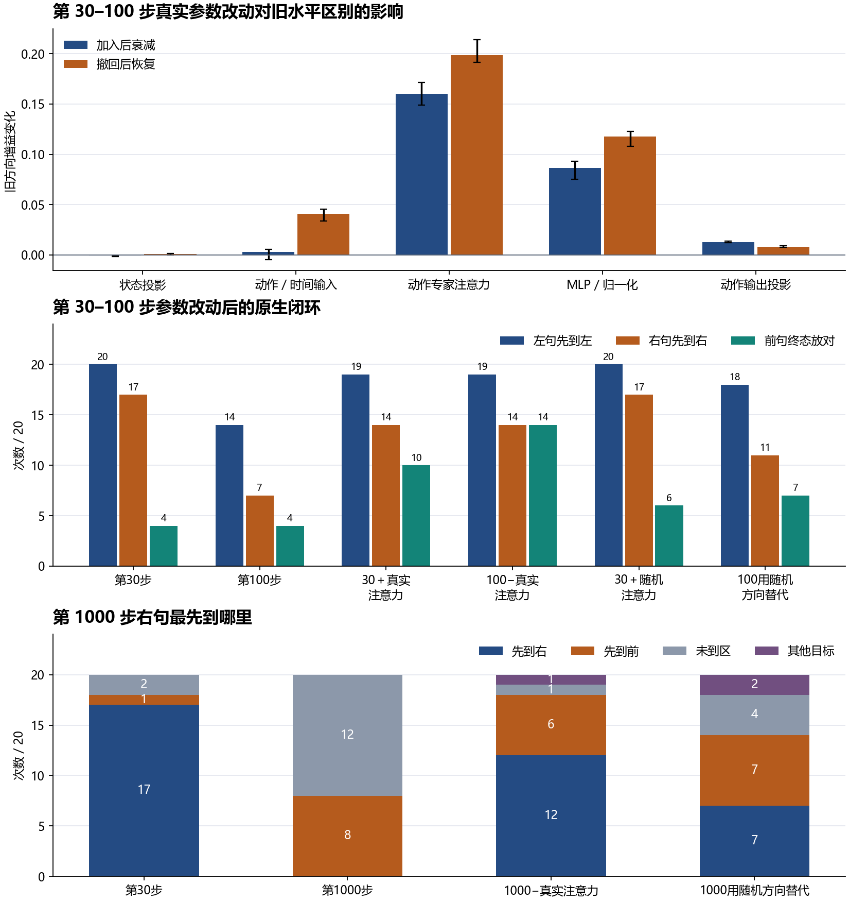

# K18-C 实验报告　Front 续训怎样改变动作专家对旧指令的读取

2026-11-11 · R1（Left＋Right）→ Front

**这次找到了一段具体的训练机制。Front 续训改动了共享动作专家的注意力权重，削弱旧指令对水平动作的控制。** 真实注意力改动加入早期模型会压小左右区别，撤回则恢复一部分区别，并让机器人在原生执行中更常按右句先到右格。进一步定位时，交叉注意力用来读取上下文的 K/V 投影是两个时间窗里最强的注意力子组。

第 1000 步只撤回这组注意力改动，右句先到右从 **0/20** 升至 **12/20**，等范数随机方向替代为 **7/20**。原先先去前格的 8 次中，有 4 次改为先去右格。右句终态只恢复到 **1/20**，前句终态由 **15/20** 降至 **10/20**。真实训练改动由此与一部分目标替代连起来，也显示了单独恢复路线后的放置瓶颈。

## K18 为什么要从动作响应追到参数

K14–K17 在执行时改变了模型输出，说明旧区别和共同响应确实有功能作用。K18-A 在原配方续训中找到这些变化出现的时间。第 30 到 100 步，旧方向上的总体增益从 0.916 降到 0.619，水平增益从 0.915 降到 0.601。视觉语言模型权重保持冻结，两个旧指令共用的动作网络已经发生改变。K18-B 在同一个 Front 批次上实际执行 AdamW。起步时，8 个测试批次各做一步都削弱旧区别。第 30 步清掉当批梯度仍会下降约 0.557 个百分点，接近完整更新的 0.585 个百分点。这说明此时较早 Front 批次积累的动量足以延续变化。

K18-C 干预的是训练存下来的权重。以第 30 步为早端、第 100 步为晚端，把 155 个可训练张量分成状态投影、动作与时间输入、动作专家注意力、动作专家 MLP 与归一化、动作输出投影。每次只把某组换成晚端值，或在晚端只把这一组退回早端。模型收到的仍是原来的句子，后续去噪与动作都由该模型自己生成。

同一组另做等范数随机方向。对每个坐标尝试翻转权重差的符号，若原 BF16 或 FP32 精度下无法表达同等幅度的反方向，就保留该坐标原符号。这样对照在实际存储精度下保持逐张量范数，并额外核验它和真实更新方向的余弦。首轮实现曾在权重读取和精度检查处退出，正式运行按检查点原精度处理，通过后才产生有效记录。

## 哪组参数在压低左右区别

固定相同画面、状态、动作草稿和去噪时刻，分别输入原左句和右句。(d=(v_L-v_R)/2) 是换指令产生的动作区别，(mu=(v_L+v_R)/2) 是两句共享的动作响应。主要指标是前 10 个动作位置的水平区别在 R1 原方向上还剩多少。每个场景的 6 个输入先取中位数，再用同一场景配对比较，最后汇总 20 个场景。数值 0.60 表示沿旧方向的修正约为 R1 的 60%。

| 第 30→100 步参数组 | 只加入该组造成的水平增益下降 | 只撤回该组带来的水平增益回升 |
|---|---:|---:|
| 状态投影 | −0.001 | +0.001 |
| 动作／时间输入 | +0.003 | +0.041 |
| 动作专家注意力 | **+0.160** | **+0.199** |
| 动作专家 MLP／归一化 | +0.086 | +0.118 |
| 动作输出投影 | +0.013 | +0.008 |

完整第 30 到 100 步的水平增益配对下降中位数为 **0.307**。注意力在加入和撤回两个方向都是 **20/20** 个场景同向变化。第 30 步原模型的水平增益中位数为 **0.915**，加入真实注意力改动后为 **0.753**，加入等范数随机改动后为 **0.897**。第 100 步原模型为 **0.601**，撤回注意力改动为 **0.794**，把真实注意力改动换成随机方向为 **0.767**。同一组真实改动同时把水平、高度和旋转的共同响应往晚端推，撤回时这些共同响应也改变了。

注意力约占这一段总权重变化平方范数的 **29%**，MLP／归一化约占 **66%**。按输出读数选参数时，注意力的作用排在首位。MLP／归一化同样有清楚贡献。两个方向的分叉都保留，避免把一个分支的读数当成每组独立、可以相加的份额。

在第 30→1000 步窗口，注意力仅加入和撤回的配对效应分别是 **0.141** 和 **0.148**，MLP／归一化分别是 **0.127** 和 **0.155**。两个区间用同一条训练线路，较长时间窗验证了注意力的作用仍能测到，MLP／归一化的相对作用也更明显。

### 注意力里哪部分有作用

进一步在固定输入上把动作专家的自注意力与交叉注意力拆开。模型在去噪时交替使用两者。交叉注意力的 K/V 投影在动作专家里将视觉语言模块保存的上下文重新映射，供当前动作草稿查询和读取。上下文里同时有图像、句子和状态信息。

| 第 30→100 步注意力子组 | 加入后的水平增益下降 | 撤回后的水平增益回升 |
|---|---:|---:|
| 自注意力全部 | 0.035 | 0.063 |
| 交叉注意力全部 | **0.113** | **0.141** |
| 交叉注意力 K/V | **0.090** | **0.106** |
| 交叉注意力 Q/O | 0.020 | 0.037 |

第 30→1000 步，交叉注意力 K/V 加入和撤回的对应效应为 0.074 和 0.080，交叉注意力整组为 0.113 和 0.113。

这个结果让「共享动作网络变了」更具体。视觉语言模块的权重冻结，动作专家读取上下文的规则可以被 Front 训练改变。固定同一画面和草稿时，只换旧句子的效果变小，交叉注意力 K/V 的参数改动对这种变化有直接贡献。K/V 是在多层合起来测试的，单轴、单层或特定 token 的责任需要另外验证。

## 旋转监督和注意力之间已经连上哪一段

上一轮的「旋转损失」是训练误差的来源，这一轮的「注意力权重」是误差更新后可能改变的位置。为区分两者，在 0、30、300 步复用上一轮各 8 个批次、噪声和 AdamW 状态。分别实际执行完整更新和去掉旋转损失的更新，再在两个一步结果之间只交换注意力参数。这样可以直接测：当批旋转监督经由注意力变化，会怎样影响旧水平区别。

| 锚点 | 完整更新相对去旋转的影响 | 只加回该注意力变化 | 从完整结果撤回该变化时移除的影响 |
|---:|---:|---:|---:|
| 0 | −0.437（7/8） | −0.046（5/8） | +0.086（1/8） |
| 30 | −0.279（6/8） | −0.235（6/8） | −0.066（5/8） |
| 300 | −0.624（7/8） | −0.260（5/8） | −0.406（6/8） |

单位为水平增益变化乘以 1000，负值表示压低旧区别，括号是负向批次数。第 30 和 300 步，确实能在注意力里看到旋转监督影响水平区别的局部路径。第 0 步完整旋转效应清楚，但把注意力的改动单独拿出来时效应很小，说明起点的效应还依赖其他参数组或它们的配合。三个锚点各看真实的一步，仍需训练全过程对照来检验累积效应。

## 把这组参数改动放进真实闭环

共新增 480 个闭环回合。每个新配置对左、右、前各用 20 个初态。旧指令从同一份共同抓持状态接手，前句从复位运行。每个配置整段由该组权重原生生成动作。「先到」以书连续五步满足区域几何判据为准，终态按任务成功判据计算。

### 第 30→100 步的主要闭环

注意力整组是在看干预闭环之前，按固定输入的加入与撤回效应排名选出。

| 配置 | 左句先到左 | 右句先到右 | 右句先到前 | 右句未到区 | 本目标终态成功 左／右／前 | 两旧句都先到对格 |
|---|---:|---:|---:|---:|---:|---:|
| 第 30 步原模型 | 20 | 17 | 1 | 2 | 14／8／4 | 17 |
| 晚端原模型 | 14 | 7 | 2 | 11 | 5／0／4 | 7 |
| 第 30 步＋真实注意力改动 | 19 | 14 | 3 | 3 | 8／2／10 | 14 |
| 晚端撤回真实注意力改动 | 19 | 14 | 2 | 4 | 10／4／14 | 14 |
| 第 30 步＋等范数随机改动 | 20 | 17 | 1 | 2 | 13／5／6 | 17 |
| 晚端用等范数随机方向替代 | 18 | 11 | 5 | 4 | 8／1／7 | 11 |

只加入真实注意力改动，右句先到右由 17 次降到 14 次，终态放对由 8 次降到 2 次。等范数随机加入仍有 17 次先到右，终态为 5 次。两者相比，真实改动让接手后 60 步朝右格的水平推进少 **1.73 厘米**，配对中位数，20 个场景里有 19 个同向。这把固定输入上测到的水平区别变化和搬运早期的实际动作连了起来。

从第 100 步撤回真实注意力改动，右句先到右由 **7/20** 回到 **14/20**。增加的 7 个场景里，6 个原先未到区，1 个原先先到前格。配对差为 +35 个百分点，开发初态的配对 bootstrap 区间为 +15 至 +55 个百分点。随机替代回到 11/20。这个早期窗口的主要变化是能否稳定走到目标。

### 第 30→1000 步的追加闭环

第 100 步的失败多为未到区。为直接检验已经出现的右转前目标替代，追加第 1000 步的撤回和随机替代。表中的两档未修改模型复用同协议基线。以下两种修改的右句还分别有 1 次和 2 次先到后格。

| 配置 | 左句先到左 | 右句先到右 | 右句先到前 | 右句未到区 | 本目标终态成功 左／右／前 | 两旧句都先到对格 |
|---|---:|---:|---:|---:|---:|---:|
| 第 30 步原模型 | 20 | 17 | 1 | 2 | 14／8／4 | 17 |
| 晚端原模型 | 16 | 0 | 8 | 12 | 12／0／15 | 0 |
| 晚端撤回真实注意力改动 | 19 | 12 | 6 | 1 | 7／1／10 | 11 |
| 晚端用等范数随机方向替代 | 18 | 7 | 7 | 4 | 6／0／11 | 7 |

- **一部分目标替代被直接反转。** 撤回前先到前格的 8 次中，4 次改成先到右格。原先未到区的 12 次中，另外 8 次改成先到右格。还有 2 次由未到区改为先到前，所以先到前格的总数从 8 降到 6。配对回合比只看前格总数更能说明改动改变了哪些路线。
- **随机替代也能恢复一部分。** 它换掉了真实更新方向，右句恢复到 7/20。完全撤回是 12/20，比随机替代多 5 次，配对区间为 +10 至 +45 个百分点。实际改动的方向与右句路线有关。
- **走对和放好仍然分开。** 撤回时，右句有 12 次先到右格，终态只有 1 次成功。左句先到左从 16 增至 19，终态却从 12 降至 7。前句 20 次都先到前格，终态成功从 15 降至 10。这组参数在原模型中同时参与多条路线和放置过程。

## 机制结论与下一步

目前的证据把训练和执行接起来了。Front 批次改变共享动作网络，历史 AdamW 动量在早期延续了变化。真实权重改动中，动作专家注意力贡献显著。交叉注意力的 K/V 是所测最强的注意力子组，它改变动作草稿从同一个上下文中能读到什么。旧句子产生的水平修正变弱，两句共享的动作响应也移动了。闭环的结果还受执行状态和后续反馈影响，因此要看真实权重干预改变了哪些具体回合。

下一轮应从 R1 和新优化器出发，做完整 Front 监督、去旋转监督、同量随机遮蔽、实际参数步长匹配四组短程训练。保留 30、100、1000 步检查点，沿途测注意力及交叉 K/V 的真实更新方向、水平区别和共同响应，再用独立训练随机流和新初态做闭环。最有区分力的结果是，去旋转组在保持 Front 放置能力的同时，减少注意力方向上的有害改动，并保住右句先到右的回合。若只保住固定输入读数，应继续追共同响应与实际执行状态。

## 核验范围

两窗各核验 155 个可训练张量恰好覆盖五组，345 个其余模型张量完全一致。各自重新拼接的两端权重与原检查点逐张量相同，固定输入读数复现 K18-A。各随机方向逐张量范数误差为 0。受 BF16/FP32 表示限制，不能对称翻转的坐标占注意力改动平方范数的约 18%（第 30→100 步）和 36%（第 30→1000 步），其更新沿原方向保留，因此随机向量与真实方向的余弦约为 0.18 和 0.36。这个对照保持了参数位置和幅度，也保留了一部分方向重叠。

主要闭环依固定输入排名选注意力整组，额外 1000 步闭环是看到第 100 步失败构成后的探索性延伸。交叉 K/V 子组只做固定输入测试。全部结果使用一条 R1→Front 训练线路和相同 20 个开发场景。旋转来源对照复现 K18-B 的一步损失、梯度范数和探针读数。闭环结果按完整模拟计算，每 10 步记录一次位置、姿态和接触供复核。

[结果与复算入口](results/2026-11-11/k18_parameter_groups/README.md) · [配对汇总](results/2026-11-11/k18_parameter_groups/summary.json) · [K18-A/B 报告](2026-11-11_K18_早期训练时间线与监督更新归因.md)
