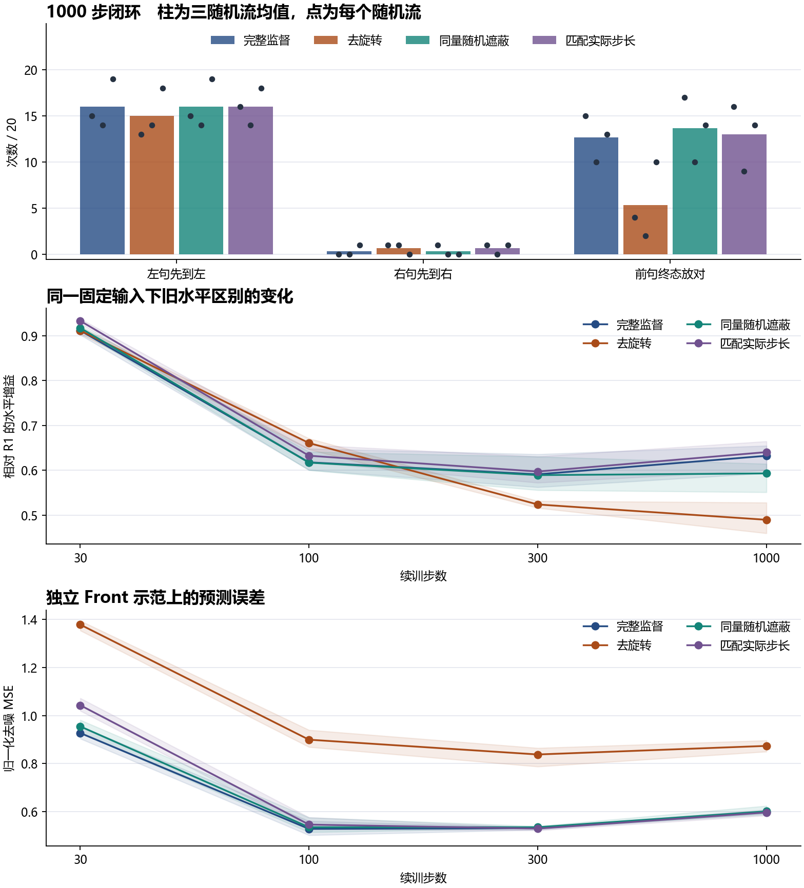

# K18 完整总结　Front 训练怎样造成旧目标替代

2026-11-11 · R1（Left＋Right）→ Front · A–D 主线验收

**K18 找到了一条真实参与目标替代的机制。Front 训练很早就改变共享动作专家的权重，尤其影响它通过交叉注意力读取上下文的方式。旧句子对水平动作的控制随之减弱。撤回真实注意力更新，可以使一部分原本先到前格的右句回合重新先到右格。**

去旋转的三随机流对照确认，旋转监督确实贡献了早期交叉注意力 K/V 的一部分改动。它同时有助于学习 Front 的放置动作。从头去掉旋转监督只短暂保住一点旧水平区别，后续仍出现严重分流失败。K18 证实了共享动作专家中的一条因果路径，完整行为仍受其他训练更新、共同动作响应和搬运后的状态影响。

## K18-A　旧区别什么时候开始被改写

从学过左和右的 R1 出发，按原配方复现 Front 续训。6000 步逐步日志、权重、AdamW 状态和随机状态与历史记录完全一致。固定画面、机器人状态、动作草稿和去噪时刻，只换旧左右指令。两句平均响应是共同响应 (mu)，两句响应差的一半是指令区别 (d)。

第 30 步沿旧方向的整体增益为 **0.916**，第 100 步降到 **0.619**，水平增益从 **0.915** 降到 **0.601**。共同响应在同一早期窗口也漂移。第 12000 步，区别总长度约为 R1 的 **38%**，沿旧方向的有效响应约为 **31%**。这两个数字描述同一输入上的动作输出。第 1000 步的旧右句在原开发初态中从先到右 19/20 降至 0/20，其中 8 次先到前、12 次未到区。训练改变先出现在固定输入响应，随后也能在原生闭环中测到。

[早期时间线与历史复现](2026-11-11_K18_早期训练时间线与监督更新归因.md)

## K18-B　为什么旧指令没有参加训练也会改变

新 Front 数据更新了三句指令共用的动作网络。以 R1 为起点，8 个 Front 批次各执行真实一步 AdamW，旧区别在 8 批里都变弱。第 30 步，完整一步使增益下降 **0.585 个百分点**，显式把当前梯度清零、保留优化器历史，仍下降 **0.557 个百分点**。权重衰减在原精度下不足以产生该效果。这说明当时较早批次积累的动量已经能延续衰减。

旋转损失在第 0 和第 300 步是条件边际影响最明显的动作通道，去掉它均有 7/8 批次少压低一些旧区别。到第 100 步，完整一步在 8/8 批次里短暂推回了一点区别。一步的旋转作用随参数状态和优化器历史变化，需要用多步训练检验是否能保住旧分流。

[AdamW 分叉原始记录](results/2026-11-11/k18_training_cause/README.md)

## K18-C　哪些权重变化真的参与了目标替代

将第 30 到 100 步真实参数差分拆成五组。只加入动作专家注意力改动，水平增益由 **0.915** 降至 **0.753**，等范数随机加入为 **0.897**。从第 100 步只撤回这组改动，水平增益由 **0.601** 回到 **0.794**，右句先到右由 **7/20** 回到 **14/20**。第 30 到 1000 步也观察到同向的固定输入效应。MLP 与归一化有额外贡献。

注意力细分里，两个时间窗最强的子组都是交叉注意力的 K/V 投影。K/V 位于动作专家读取视觉语言模块上下文的位置。续训冻结视觉语言权重，同时改变动作端读取这些信息的规则。第 30 和 300 步的一步实验也测到旋转损失可以经由注意力整组影响旧水平区别。

第 1000 步撤回注意力改动，在原开发初态中让右句先到右从 **0/20** 回到 **12/20**，等范数随机替代为 **7/20**。原来 8 次先到前格里，4 次改为先到右格。右句终态只回到 **1/20**，前句终态由 **15/20** 降到 **10/20**。这支持实际权重改动参与一部分路线替代，也说明终态还依赖搬运状态与放置控制。K/V 子组的直接证据来自固定输入，闭环使用的是注意力整组。

[注意力参数与闭环反事实](2026-11-11_K18-C_注意力参数与旧目标分流.md)

## K18-D　从 R1 重训，旋转监督是不是能单独解释目标替代

每组从同一 R1 权重、原归一化和新 AdamW 出发，续训 1000 步。三个随机流内的四组使用相同示范批次和去噪随机流。四组均按同一分母计算损失。

| 训练组 | 实际做法 |
|---|---|
| 完整监督 | 直接学习水平、高度、旋转、夹爪共 7 个有效维度 |
| 去旋转 | 每个有效动作位置移除三维旋转误差，模型仍生成全部动作维度 |
| 同量随机遮蔽 | 每个有效动作位置随机移除 3 个维度，保留与去旋转组相同数量和权重的监督 |
| 匹配实际步长 | 用完整监督计算 AdamW 更新，再匹配同一步去旋转组的实际参数改动范数 |

步长控制在 BF16／FP32 原精度下测量实际权重差。需要缩放时，BF16 使用固定种子的随机舍入并搜索最接近的实际步长，AdamW 矩仍由完整监督产生。这样控制了整步参数改动量，仍保留完整监督的优化历史。量化会让实现方向与原提案有所偏离，实际余弦也一并记录。

新初态由固定的新随机种子生成，和既有起点及原示范起点做了向量去重。48 个候选全部通过固定 Front-12000 的抓持资格检查，按预定顺序锁定前 20 个。每个新模型每条指令 20 回合，左和右从同一个抓持状态接手，前句从复位开始。R1 在这些新状态中左、右首次正确为 **20/20、19/20**。主试验共 12 条 1000 步训练和 **780 个闭环回合**，包括 R1 参照的 60 回合。前序开发状态用于固定输入探针，闭环确认使用锁定的新物理状态。Front 预测误差来自十条与训练不重叠的验证示范，并按三个执行阶段和四个动作通道记录。

另做预设检查点上的近似同拟合比较。每个随机流在完整监督的 30、100、300、1000 步里，选 Front 验证 MSE 最接近去旋转 1000 步的点，差距在 10% 内才做追加闭环。该比较检验示范预测误差接近时，闭环里是否也保住了相近的 Front 学习质量。

### 旋转监督确实参与早期 K/V 改写，作用延伸不到整段行为

下表按三个随机流取平均。K/V 投影衡量各组从自己的第 30 步到第 100 步，在历史第 30→100 步交叉注意力 K/V 更新方向上走了多远。历史完整训练在该方向的投影为 1。水平增益则衡量相同输入下左右动作区别沿 R1 原方向的强度。

| 训练组 | 100 步 K/V 投影 | 100 步水平增益 | 1000 步水平增益 | 1000 步 Front MSE | 1000 步 Front 旋转 MSE |
|---|---:|---:|---:|---:|---:|
| 完整监督 | 0.841 | 0.618 | 0.632 | 0.599 | 0.830 |
| 去旋转 | **0.408** | **0.661** | **0.490** | **0.874** | **1.548** |
| 同量随机遮蔽 | 0.831 | 0.617 | 0.593 | 0.602 | 0.848 |
| 匹配实际步长 | 0.718 | 0.633 | 0.641 | 0.597 | 0.831 |

去旋转在三个随机流里都比两个对照少写入一部分沿历史方向的 K/V 更新。等量遮蔽保留了接近完整监督的该方向分量，步长控制也没有降到去旋转的水平。**旋转监督对这段参数变化有来源特异性贡献。** 三条步长控制共 3000 步，最大范数相对误差低于 0.75%，相对提案的方向余弦中位数约 0.977，各流最小值约 0.70–0.77。

去旋转在第 100 步略微保住了水平区别。到第 1000 步，它的水平区别反而是四组中最低，Front 示范上的旋转误差接近完整监督的两倍。由此可见，在多步续训中，只压低一个历史 K/V 更新方向，旧动作区别仍会继续改变。单步归因找得到一条监督作用路径，累积训练和执行效果还取决于其他更新以及共享动作响应。

### 1000 步闭环结果

每组 60 回合由三个随机流各 20 回合组成。同一批 20 个初态在各流和各组内配对使用。下表是计数汇总，三流的分开结果随后列出。

| 训练组 | 左句先到左 | 右句先到右 | 右句先到前 | 右句未到区 | 右句终态放对 | 前句终态放对 |
|---|---:|---:|---:|---:|---:|---:|
| 完整监督 | 48/60 | 1/60 | 25/60 | 34/60 | 0/60 | 38/60 |
| 去旋转 | 45/60 | 2/60 | **43/60** | 15/60 | 0/60 | **16/60** |
| 同量随机遮蔽 | 48/60 | 1/60 | 19/60 | 40/60 | 0/60 | 41/60 |
| 匹配实际步长 | 48/60 | 2/60 | 25/60 | 33/60 | 1/60 | 39/60 |

去旋转只比完整监督多 1 次先到右，仍无一次最终放进右格。三个随机流中，右句先到前的次数全部增加。相对完整监督，去旋转让失败构成从更多未到区，转为更多先到前格。两种对照的 Front 终态都接近完整监督，去旋转少了 22 次 Front 放置成功。去旋转的早期 K/V 效果因此有明确的训练源指向，整段训练效果则体现出学习取舍。

#### 每条随机流的逐组结果

下表每格按相应指令的 20 回合计算。

| 训练流 | 监督 | 左句先到左 | 右句先到右 | 右句先到前 | 右句未到区 | 本目标终态 左／右／前 |
|---:|---|---:|---:|---:|---:|---:|
| 20261021 | 完整监督 | 15 | 0 | 2 | 18 | 10／0／15 |
| 20261021 | 去旋转 | 13 | 1 | 11 | 8 | 3／0／4 |
| 20261021 | 同量随机遮蔽 | 15 | 1 | 2 | 17 | 8／0／17 |
| 20261021 | 匹配实际步长 | 16 | 1 | 3 | 16 | 9／1／16 |
| 20261121 | 完整监督 | 14 | 0 | 7 | 13 | 5／0／10 |
| 20261121 | 去旋转 | 14 | 1 | 12 | 7 | 11／0／2 |
| 20261121 | 同量随机遮蔽 | 14 | 0 | 5 | 15 | 7／0／10 |
| 20261121 | 匹配实际步长 | 14 | 0 | 6 | 14 | 4／0／9 |
| 20261122 | 完整监督 | 19 | 1 | 16 | 3 | 12／0／13 |
| 20261122 | 去旋转 | 18 | 0 | 20 | 0 | 15／0／10 |
| 20261122 | 同量随机遮蔽 | 19 | 0 | 12 | 8 | 11／0／14 |
| 20261122 | 匹配实际步长 | 18 | 1 | 16 | 3 | 10／0／14 |

### 示范误差接近时，结论仍成立

三个随机流中，去旋转第 1000 步最接近的完整监督检查点都是第 30 步，Front 示范误差相差约 3.3%–8.6%。针对右句和前句新增 120 回合，去旋转第 1000 步复用主闭环。

| 随机流 | Front 示范 MSE　完整 30／去旋转 1000 | 右句先到右　完整 30／去旋转 1000 | 前句终态放对　完整 30／去旋转 1000 |
|---:|---:|---:|---:|
| 20261021 | 0.904／0.875 | 19／1 | 5／4 |
| 20261121 | 0.923／0.850 | 17／1 | 5／2 |
| 20261122 | 0.955／0.897 | 18／0 | 7／10 |
| 合计 |  | **54／2** | **17／16** |

这个追加比较没有控制训练步数，只将验证误差相近的预设检查点拿来对照。两侧的 Front 终态总数也相近，右句分流仍相差很大。可见，相同的 Front 整体误差会对应不同的旧任务表现。模型经过怎样的更新、把误差降在哪些动作通道，同样重要。

## K18 可以下什么结论

1. **目标替代的一条因果路径已经找到。** Front 更新经由共享动作专家改变旧指令的动作响应。时间线上，旧水平区别在热身期已经下降。第 30 步的历史动量可以继续推动衰减。参数反事实证明注意力整组的真实改动参与了旧目标失效，并改变了部分闭环回合先去哪。交叉注意力 K/V 在固定输入上是贡献最大的注意力子组。
2. **旋转监督是早期 K/V 改写的一个来源。** 去旋转在三流中都压低了历史 K/V 更新方向上的分量，且效果超过等量遮蔽和等步长控制。该操作到第 1000 步仍压不住目标替代，Front 放置也变差。整段替代机制涉及多个监督和共享更新。
3. **路线与放置有不同的瓶颈。** 第 1000 步撤回注意力，旧右句在开发状态中从 0 次先到右恢复到 12 次，终态只增加 1 次。D 中去旋转的前句先到前为 54/60，终态为 16/60。水平指令区别、共同搬运响应以及最终摆放能力需要各自的读数。

A–D 的主线已验收。结论范围是这条 R1→Front 线路。三条随机流共享同一父模型，新物理初态提供了闭环确认。注意力整组有闭环因果证据，交叉 K/V 子组已有固定输入因果证据。D 没有找到能同时保住旧分流和 Front 放置的选择性监督源，因此原计划的 R0→Right 迁移确认没有选出合格的训练干预。

验收时，历史随机流完整监督的 1000 步损失、裁剪前梯度范数、批次和学习率逐步一致，30、100、300、1000 步各 155 个可训练张量逐项一致。归档包含 49 组固定输入和验证示范测量、780 个主闭环回合及 120 个追加回合。追加拟合脚本的首次汇总模块导入冲突在实际追加评估前修正。第一次归档读取遇到自动审批额度限制，额度恢复后已下载并在本地复核。

[结果图与复算入口](results/2026-11-11/k18_training_controls/README.md) · [主汇总](results/2026-11-11/k18_training_controls/summary.json) · [拟合对照](results/2026-11-11/k18_training_controls/fit_summary.json)
