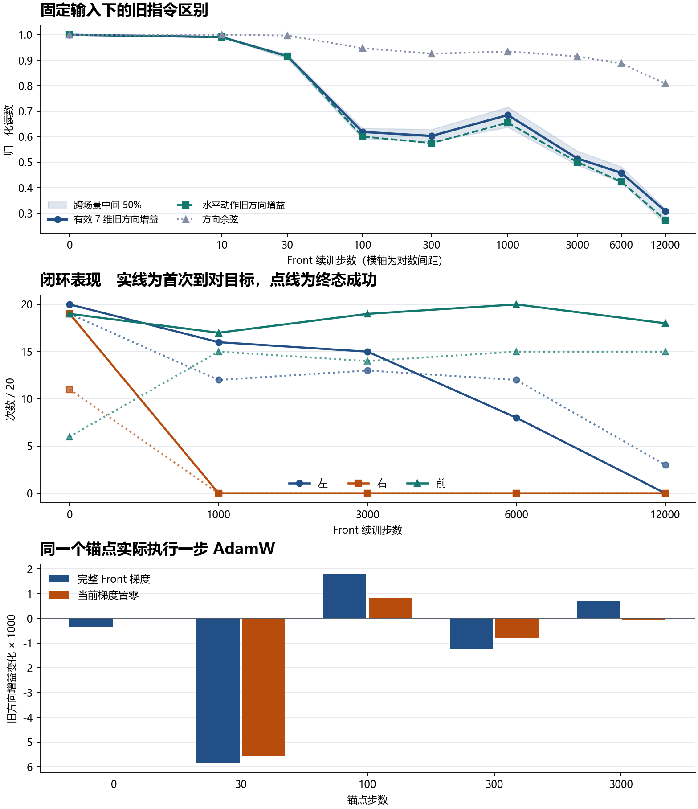

# K18 实验报告　Front 续训怎样改写旧指令的动作响应

2026-11-11 · R1（Left＋Right）→ Front · 早期训练时间线与监督归因

## 现在知道了什么

**续训起步时，只用 Front 的数据更新一步，就会削弱旧左右指令在固定输入上的动作区别。到第 30 步，早先 Front 批次积累的 AdamW 动量已经能让区别继续变小。** 这一结果补上了 K14–K17 之前缺失的一段证据。旧模型的响应可以在执行时救回部分旧任务，而 K18 直接观察了原 Front 监督怎样通过训练更新改变这份响应。

**最明显的早期下降落在第 30–100 步。** 相同抓持画面下，换一句话对水平动作的影响，沿着原先左右分流的方向从约 92% 降到约 60%。共同响应也已漂移，第 30 步就看得到。第 1000 步实测右句 20 次都没有先到右格，其中 8 次先到前格，12 次没有满足首次到区判据。左句这时仍有 16 次先到左格。同一条续训线路上的左右退化速度不同。

**旋转监督是目前最值得追的候选之一。** 起始状态下，删掉当批旋转损失通常会减轻一步更新对旧区别的压缩。第 30 步的局部衰减主要跟随历史动量，到了第 100 步，同样的一步完整更新反而会把一部分区别推回来。接下来要定位哪组共享参数承载了这股变化，以及对这些参数或早期监督做反事实干预后，右句能否恢复分流。



## 实验怎么做

1. **按原配方复现。** 从学过左和右的 R1（24000 步）出发，使用原 Front 数据、随机种子、归一化、每批 6 个训练样本、100 步学习率热身和原 AdamW。Front 续训新建优化器，视觉语言模型冻结，动作专家和相关投影可训练。只额外保存早期检查点，6000 步以后用历史的 Front-12000 作终点。
2. **固定模型输入，测旧响应。** 对同一张画面、机器人状态、动作草稿和去噪时刻，分别送入原左、右指令。记两条响应为 (v_L,v_R)。共同响应 (mu=(v_L+v_R)/2) 记录两句共享的动作倾向，条件区别 (d=(v_L-v_R)/2) 记录换一句话会让动作去噪响应怎样改变。每个检查点复用 20 个共同抓持快照，每个快照两条父模型草稿路径各取三个去噪时刻。表里先对同场景取中位数，再跨 20 场景取中位数。
3. **另测真实示范与闭环。** 独立验证集每个任务抽 4 条示范，每条取 3 个帧位和 3 个加噪时刻。闭环每个检查点每条指令 20 次，共 300 回合。左右从同一个共同抓持状态接手，Front 从复位开始。接手后的控制由对应检查点自己生成。首次进入目标区域与最终满足成功判据分别计数。
4. **分叉执行真实的一步训练。** 每个归因锚点用 8 个 Front 批次。在每个批次内，所有分叉使用同样的权重、输入、噪声、学习率和 AdamW 历史状态。完整损失、只留某项、扣掉某项和显式零梯度各做一步。每步前后复测 6 个固定共同快照，先在每批里对 6 个结果取均值，再跨 8 批取中位数。六个快照复用作同一把测量尺。
5. **监督按未来动作的位置拆。** H 是两维水平，Z 是高度，R 是三维旋转，G 是夹爪。40 条 Front 示范的 6097 个动作位置与原始动作按 offset=1 逐项核对。按抬起、水平推进和接近成功位的几何阈值标出抓取/提起 3214、搬运 1350、接近/放置 1533，unknown 为 0。抽查了六条原始示范的关键帧。接近/放置组可能包含对准和停留，标签提供的是粗略执行阶段。损失分叉保持原有分母与 padding 处理。

两个容易混淆的量可以用下面的关系区分。

```text
左句响应 = 共同响应 μ + 区别 d
右句响应 = 共同响应 μ − 区别 d

旧方向增益 = 新 d 在旧 d 方向上的投影 ÷ 旧 d 长度
区别总强度 = 新 d 长度 ÷ 旧 d 长度
```

增益从 1 降到 0.62，表示在同一个输入上，换句子产生的响应沿旧方向只剩原来的约 62%。共同响应如果同时变化，两句的动作起点也一起移动。这两个量都在模型预测的归一化动作响应上测量。闭环中的路线和放置还会经过多次去噪、执行和观测反馈。

## 训练时什么时候开始变

| Front 步数 | 前 10 个动作位置的增益 | 全 50 个位置的增益 | 区别总强度 | 方向余弦 | 水平增益 | 共同响应漂移 H／Z／R／G |
|---:|---:|---:|---:|---:|---:|---:|
| 0 | 1.000 | 1.000 | 1.000 | 1.000 | 1.000 | 0.000／0.000／0.000／0.000 |
| 10 | 0.991 | 0.991 | 0.991 | 1.000 | 0.990 | 0.028／0.034／0.042／0.009 |
| 30 | 0.916 | 0.916 | 0.918 | 0.997 | 0.915 | 0.205／0.145／0.480／0.056 |
| 100 | 0.619 | 0.640 | 0.650 | 0.947 | 0.601 | 0.589／0.443／0.840／0.138 |
| 300 | 0.603 | 0.617 | 0.648 | 0.926 | 0.575 | 0.521／0.565／0.971／0.189 |
| 1000 | 0.685 | 0.678 | 0.721 | 0.934 | 0.655 | 0.412／0.647／1.131／0.146 |
| 3000 | 0.514 | 0.529 | 0.583 | 0.915 | 0.500 | 0.445／0.445／1.258／0.148 |
| 6000 | 0.458 | 0.426 | 0.507 | 0.887 | 0.423 | 0.560／0.633／1.535／0.124 |
| 12000 | 0.308 | 0.290 | 0.384 | 0.809 | 0.273 | 0.528／0.866／1.819／0.106 |

区别总强度、方向余弦、水平增益和共同响应漂移用前 10 个动作位置计算。这是每次出手实际执行的动作段。共同响应漂移是相对 R1 的归一化响应均方根差，数值不能换算成厘米或角度。主指标只用有效 7 维。额外的 25 个填充维也有间接漂移，12000 步共同响应漂移为 0.179，原损失没有直接监督这些维度。

- **最初主要是幅度压缩。** 第 30 步方向余弦 0.997，第 100 步仍为 0.947。第 100 步水平增益已降到 0.601。R1 的前 10 个动作位置里，旧区别约 87% 的平方范数在水平通道，因此整体增益下降确实对应水平区分变弱。旧区别从第 300 到第 1000 步有回升。
- **共同响应也在早期移动。** 第 30 步，水平、高度和旋转的共同响应已经漂移。现在的采样点只能确定两种变化都很早出现，还无法判定哪一个先触发了另一个。早期各通道的漂移大小也无法单独判定哪个通道决定终态。
- **末期仍可测到旧方向，也出现了更多方向偏离。** 第 12000 步区别总长度约为原来的 38%，沿旧方向的投影约为原来的 31%，方向余弦 0.81。前两个百分比用的是不同读数，都只描述所测动作响应。
- **独立示范支持早期变化。** 第 100 步，左、右验证示范上的全有效动作位置增益分别为 0.602 和 0.557。Front 验证误差从 1.681 降至 0.563，第 12000 步为 1.095，说明训练学到 Front 动作的同时，旧方向已减弱。该误差来自加噪示范输入，不能直接换算成闭环成功率。

## 闭环里先丢掉的是哪条指令

每条指令每档都是 20 回合。「首次」以连续 5 步满足区域几何判据为准，记该段的第一步。「曾成功」和「终态成功」用任务成功判据计算。最后一列要求同一初始场景的左、右两回合都先到各自的目标。

| 续训步数 | 左句首次 左／右／前／无 | 右句首次 左／右／前／无 | 前句首次 左／右／前／无 | 本目标曾成功 左／右／前 | 本目标终态成功 左／右／前 | 两条旧句都先到对格 |
|---:|---:|---:|---:|---:|---:|---:|
| 0 | 20／0／0／0 | 0／19／1／0 | 0／0／19／1 | 20／11／6 | 19／11／6 | 19 |
| 1000 | 16／0／0／4 | 0／0／8／12 | 0／0／17／3 | 17／0／17 | 12／0／15 | 0 |
| 3000 | 15／0／5／0 | 0／0／16／4 | 0／0／19／1 | 17／0／14 | 13／0／14 | 0 |
| 6000 | 8／0／12／0 | 0／0／18／2 | 0／0／20／0 | 14／0／15 | 12／0／15 | 0 |
| 12000 | 0／0／18／2 | 0／0／16／4 | 0／0／18／2 | 3／0／17 | 3／0／15 | 0 |

右句先失去正确分流。第 1000 步，右句 0/20 先到右，8/20 先到前，12/20 未达到任一区域。第 6000 步，右句有 18/20 先到前，左句也有 12/20 先到前。到第 12000 步，左、右句分别有 18/20 和 16/20 先到前，两条旧句各自都是 0/20 先到本目标。终态上仍有 3 次左句最终放到左格，右句 0 次最终放到右格。把首次到区和放置结果混在一起，会漏掉左句这部分后续修正，也会把未到区误记成目标替代。

R1 在前句下已有 19/20 先到前格，终态只有 6/20 成功。到第 1000 步，前句终态成功达到 15/20。旧任务的分流明显变差和前句放置能力提高，可以在同一训练阶段同时出现。第 1000 步固定输入的区别读数较第 300 步反弹，但右句闭环仍失去分流。旧区别的整体增益提供了机制线索，单个增益数值不足以预测每个方向的闭环结局。

## 哪些 Front 监督通过更新写进了旧响应

下表用全 50 个动作位置。读数是增益变化乘以 1000，负数表示旧区别沿旧方向变弱。配对差先在同一批次相减，再对批次取中位数。

| 锚点 | 完整更新 | 当前梯度清零 | 配对差 | 完整更新使区别减弱 |
|---:|---:|---:|---:|---:|
| 0 | −0.330 | 0.000 | −0.330 | 8/8 |
| 30 | −5.847 | −5.573 | −0.274 | 8/8 |
| 100 | +1.789 | +0.810 | +0.979 | 0/8 |
| 300 | −1.249 | −0.796 | −0.453 | 8/8 |
| 3000 | +0.697 | −0.045 | +0.741 | 3/8 |

从 R1 刚出发时优化器没有历史动量。八个 Front 批次在各自的一步分叉里都压低了旧区别。在第 30 步，清掉当批梯度也有 8/8 批次测得相同的下降方向，完整更新约让增益少 0.585 个百分点，清零后约少 0.557 个百分点。这个清零对照中的衰减由历史动量驱动。原配方的权重衰减系数为 (10^{-10})，最高学习率 (10^{-4})，单步权重衰减乘数在参数精度下等于 1。第 30 步的零梯度更新也让水平、高度、旋转三个共同响应沿各自通往 Front-12000 的方向继续移动。第 100 步，完整更新在八批里都增强了部分旧区别，表明每一步对旧响应的影响随训练状态而变。

用「完整更新减去扣掉某监督后的更新」看该监督的条件边际。下表每格是配对中位数，括号内是使区别下降的批次数，单位与上表一致。

| 损失来源 | 第 0 步 | 第 30 步 | 第 100 步 | 第 300 步 |
|---|---:|---:|---:|---:|
| 水平 H | +0.090（3/8） | −0.416（5/8） | +0.161（3/8） | −0.098（4/8） |
| 高度 Z | +0.146（2/8） | +0.056（3/8） | +0.665（2/8） | −0.029（5/8） |
| 旋转 R | −0.349（7/8） | −0.257（5/8） | +0.313（3/8） | −0.411（7/8） |
| 夹爪 G | −0.153（7/8） | −0.062（6/8） | +0.116（3/8） | −0.035（5/8） |
| 抓取／提起 | −0.212（7/8） | −0.175（5/8） | +0.720（1/8） | −0.454（7/8） |
| 搬运 | −0.171（5/8） | −0.162（5/8） | +0.160（4/8） | +0.118（3/8） |
| 接近／放置 | −0.159（6/8） | −0.205（5/8） | +0.277（3/8） | +0.176（3/8） |

第 0 步和第 300 步，扣掉旋转监督对保住区别的帮助在四个动作通道里最明显。旧方向增益分别少降了 0.000349 和 0.000411，两个锚点都是 7/8 个批次减弱压缩。第 0 步只留旋转时，7/8 个批次也压低了区别。水平损失只留时也有 7/8 个批次压低区别。把水平损失从完整损失中扣掉时，条件边际方向在多数批次相反。两种分叉各自依赖不同的损失组合，AdamW 的实际更新与输出响应都不能按损失项直接相加。

这些结果让旋转监督和抓取／提起阶段成为候选。旋转监督作用在可被三种指令共用的参数上，有机会改变最后生成的水平动作。要判定究竟是哪些参数传递了作用，需要直接干预这些训练更新。各损失分量保留了原监督权重，某类监督的维度数和出现频次也会影响结果。

追加的阶段×通道交叉拆分只在起点做。抓取／提起的旋转项在 6/8 批次里压低区别，条件边际中位数是 −0.160。同一阶段的夹爪项是 −0.136（6/8），搬运高度项是 −0.164（5/8）。只留抓取／提起的旋转项时，只有 4/8 批次压低区别。现有一步实验没有找出某个稳定独占的动作阶段。

## 机制走到了哪里

Front 数据只要求共享动作网络把前句对应的动作预测得更准。左、右句没有参加这轮续训。它们在执行时仍会经过同一组动作专家和投影，因此那些参数按 Front 的误差改变后，两条旧指令的输出也一起变了。

可以把旧模型看成每次出手都会算两件事。一件是眼下这本书通常该怎么搬，对应共同响应 (mu)。另一件是听到「左」或「右」后，应该在当前草稿上加怎样的修正，对应区别 (d)。K18 看到这两件事在热身期就开始变。共同的出手方式在漂移，句子能施加的左右修正也变小。历史动量让修正的变小在部分时段连续发生。到了真实闭环里，右句比左句更早失去首次到对格的能力。部分回合甚至没稳定到任何格，部分才是转去前格。

视觉语言模型被冻结，变化已经能由共享动作部分的训练产生。一次 Front 更新能改变旧区别的证据来自真正执行的一步 AdamW。哪组参数中介了这个影响、哪一类监督反复累积后造成了闭环目标替代，仍需短程反事实验证。这也留下了一个清楚的区分。某个旋转响应在推理时能帮放置，和 Front 训练中的旋转损失在某些时段压缩旧区别，是两种实验结果。K18 把它们放进了同一条可检验的链。

## 下一步怎么把原因钉住

1. **先定位第 30–100 步的参数改动。** 将这段真实参数差分按状态投影、动作与时间输入投影、动作专家注意力、动作专家 MLP／归一化、输出投影分组。在第 30 步只加一组，在第 100 步只撤一组，同时做等范数随机对照。先看水平区别和共同响应是否随同一组改变，再用最有信息的几组做右句闭环。这样可以追到训练更新落在模型哪里。
2. **再从 R1 起跑做训练反事实。** 优先比较完整 Front 损失、去掉早期旋转监督、去掉同量随机监督三条短程分支，匹配有效损失量并核查实际更新范数。先验收 30／100 步的水平区别，再用多个种子做到 1000 步，按每条指令 20 回合比较。抓取／提起阶段可作为第二项分支，交叉结果支持保留全部旋转项作为首轮候选。
3. **判定标准同时看旧分流和新任务。** 如果特定训练干预减少了水平区别衰减、恢复右句首次到右，同时 Front 终态能力与完整训练接近，就可以把这一段监督、参数改动和旧目标替代连起来。如果固定输入读数恢复而右句依然失败，应继续追共同响应和动作执行状态这条路径。

## 核验与边界

- 6000 步复现的批次索引、学习率、损失和裁剪前梯度范数逐步与历史记录完全一致。6000 步权重的 SHA-256 与历史检查点一致，AdamW、调度器和随机状态也逐项一致。12000 步使用已训练完成的历史检查点。6000 步复现从启动到通过保存校验约 32 分钟。
- 归因的五个锚点与起点交叉拆分中，历史批次的完整分叉均复现下一步损失、裁剪前梯度范数、学习率和样本索引。损失重构绝对误差小于 (10^{-5})，各分量相加与完整裁剪前梯度的最大相对 L2 差约 0.85%。这些对照直接执行了一步实际更新。共 48 组批次分叉，执行 848 次局部 AdamW 更新。每个锚点的 8 批是同一训练线路的局部重复。
- 固定输入探针曾在父模型自校验中发现 BF16 自动混精会舍入点积。归因和正式探针使用 FP32 逐元素积与归约，观测快照也做深拷贝后再测。父模型增益回到 1，共同响应漂移为 0。首次失败的探针读数未进入统计。
- 闭环使用 20 个既有场景，旧指令从已抓稳且尚未到达目标的共同状态接手。记录了首次到区、曾成功和终态。R1 和 Front-12000 的左右共 80 个端点回合与 K14 的首次目标、首次时刻、曾成功和终态逐项一致。补测分通道探针的主读数也与原探针逐项一致。此轮未导出全步轨迹。结论适用于这条 R1→Front 线路和这组场景，参数组定位和多种子闭环反事实仍待验证。

[原始记录与复算入口](results/2026-11-11/k18_training_cause/README.md) · [汇总数据](results/2026-11-11/k18_training_cause/summary.json) · [训练复现核验](results/2026-11-11/k18_training_cause/replay_audit.json) · [闭环与探针核验](results/2026-11-11/k18_training_cause/native_audit.json)
