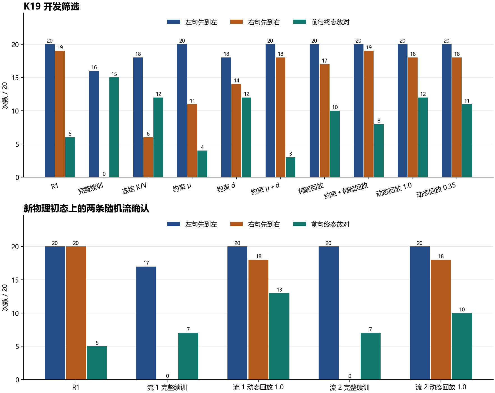

# K19 实验报告　让 R1 学 Front，同时保留旧指令控制

2026-11-11 · R1（Left＋Right）→ Front · 开发筛选与独立初态确认

**每步混合旧任务的动态监督回放，在两条新训练流上同时保住了大部分旧分流，并提高了 Front 的放置成功。** 训练每步看 6 个 Front 动作块，再各看 1 个 Left 和 Right 动作块，把新任务的平均损失和旧任务的平均损失等权相加。新初态上，右句先到右由完整续训的 **0/40** 提升到 **36/40**，先到前从 **29/40** 降到 **1/40**。Front 最终放对由 **14/40** 提升到 **23/40**。右句最终放对为 **7/40**，仍低于 R1 在同一批状态上的 7/20。

冻结 K/V 或直接约束 μ 都可以改变训练后的响应，但在这轮开发比较中没有达到同样平衡。机制诊断发现，μ 的漂移分布在注意力和多个 MLP／归一化层段。d 在早期主要失去的是有效增益。早期的共享参数梯度冲突确实存在，实际 AdamW 的历史状态也能在当前梯度清零后继续推高旧任务误差。

## 实验如何区分参数约束、共同响应和指令区别

R1 已学会 Left 和 Right。每条新训练从同一 R1 权重和新 AdamW 出发，保持 K18 完整 Front 续训的批次顺序、学习率和 1000 步预算。所有模型在评估时都原生运行。K/V 冻结覆盖动作专家交叉注意力的 16 个 K/V 投影张量，其他可训练参数仍按 Front 损失更新。

两条指令在同一旧画面、同一动作草稿、同一去噪时刻的响应记作 (v_L,v_R)。共同响应 (mu=(v_L+v_R)/2) 表示两句共享的动作倾向，条件区别 (d=(v_L-v_R)/2) 表示换句子给动作带来的修正。约束组每步从旧训练示范中抽一对输入，用 R1 教师给出这两个量的参考。μ 组、d 组和联合组的惩罚系数各为 4，只比较有效动作位置和 7 个有效动作维。旧训练示范来自 80 条 Left/Right 轨迹、240 个配对输入。输入中的状态、画面、噪声和时间一样，两个输入只换指令。回放组用同一输入里匹配旧示范的真实指令动作损失，联合回放还加上 μ/d 惩罚。

全量动态回放组是开发阶段追加的对照。每个更新仍看 6 条 Front 动作块，同时在所有旧训练帧中各抽一条 Left 和 Right，使用重新采样的流匹配噪声和时间。旧两条的平均损失和 Front 的平均损失等权相加。另追加相同采样、旧损失权重为 0.35 的对照。旧采样及噪声用独立随机流。教师和回放都只使用旧训练划分。

开发筛选沿用 K18 的 20 个共同抓持初态。三个首要读数是左句先到左、右句先到右和前句最终放对。开发候选须在两个旧指令首次到对上分别距 R1 不超过 4/20，且 Front 终态距完整续训不超过 2/20。满足后按三项参考比例中的最小值排序，旧任务终态作并列参考。终态是独立于首次到区的任务判据。

### 开发筛选结果

8 个方法共新增 480 个闭环回合。下面每行每个指令为 20 回合。R1 与 1000 步完整续训复用 K18 的同前缀基线。

| 模型 | 左句先到左 | 右句先到右 | 右句先到前 | 本目标终态 左／右／前 | 两条旧句都先到对格 |
|---|---:|---:|---:|---:|---:|
| R1 | 20 | 19 | 1 | 19／11／6 | 19 |
| 联合约束 μ/d | 20 | 18 | 1 | 19／7／3 | 18 |
| 联合约束加稀疏回放 | 20 | 19 | 1 | 15／11／8 | 19 |
| 仅约束 d | 18 | 14 | 3 | 14／5／12 | 13 |
| 冻结 K/V | 18 | 6 | 9 | 13／0／12 | 6 |
| 完整续训 | 16 | 0 | 8 | 12／0／15 | 0 |
| 仅约束 μ | 20 | 11 | 7 | 15／2／4 | 11 |
| 稀疏监督回放 | 20 | 17 | 3 | 17／6／10 | 17 |
| 动态回放，权重 1 | 20 | 18 | 1 | 19／9／12 | 18 |
| 动态回放，权重 0.35 | 20 | 18 | 1 | 18／7／11 | 18 |

冻结交叉 K/V 让右句从 0 次先到右变为 6 次，终态仍是 0，Front 从 15 次放对降到 12 次。这个参数块可以被限制，但它同时服务于新动作学习，且其他共享层仍会改变 μ 和 d。

仅约束 μ 明确压低了漂移。与完整续训相比，水平、高度、旋转三个分量的归一化漂移由约 **0.412／0.647／1.131** 降到 **0.293／0.280／0.382**。右句先到右增至 11/20，Front 终态只有 4/20。仅约束 d 在固定输入上把水平区别拉到 R1 的 106%，右句先到右 14/20，Front 终态 12/20。联合约束保留了更多旧分流，Front 终态只有 3/20。它的 Front 示范 MSE 为 0.524，低于完整续训的 0.606，闭环却更差，说明示范去噪误差不能替代真实放置验收。

权重 1 的动态回放在开发集最均衡。每步用 6 个 Front、1 个 Left、1 个 Right 动作块，两个旧样本平均后作为一个监督项与 Front 平均损失等权相加，合计 8 个样本。它让水平、垂直和旋转 μ 漂移降到约 **0.277／0.212／0.269**，旧水平区别为 R1 的约 **103%**。开发闭环左、右首次正确为 20/20、18/20，旧终态左、右为 19/20、9/20，Front 终态 12/20。原预设 Front 门槛为 13/20，候选差 1 个回合。低权重 0.35 对照保持同样的 20/20、18/20 旧分流，Front 终态为 11/20。仅从这一训练流看，降低旧监督权重并未改善闭环平衡。

保留开发门槛和原始排名，另将最接近目标的权重 1 动态回放送入探索性确认。新初态在开发排序之前已由固定物理条件锁定。比较两条新的 Front 随机流，并在同一新初态上评估各自的完整续训与 R1。

### 两条新随机流的独立初态确认

48 个新物理候选均通过固定的抓持条件，按预定顺序锁定前 20 个，和既有初态、原训练示范及 K18-D 候选向量做过去重。左、右从完全相同的已抓稳状态接手，Front 从复位开始。每行每个指令 20 回合，共新增 300 回合。两条随机流复用相同的物理初态，所以 40 表示两个训练流各 20 回合。

| 模型 | 左句先到左 | 右句先到右 | 右句先到前 | 本目标终态 左／右／前 | 两条旧句都先到对格 |
|---|---:|---:|---:|---:|---:|
| R1 | 20 | 20 | 0 | 18／7／5 | 20 |
| 20261121 完整续训 | 17 | 0 | 10 | 8／0／7 | 0 |
| 20261121 动态回放，权重 1 | 20 | 18 | 0 | 15／3／13 | 18 |
| 20261122 完整续训 | 20 | 0 | 19 | 13／0／7 | 0 |
| 20261122 动态回放，权重 1 | 20 | 18 | 1 | 14／4／10 | 18 |

- 完整续训的左、右首次正确合计为 **37/40、0/40**。动态回放是 **40/40、36/40**。两个随机流都得到 18/20 的右句正确分流。
- 完整续训的 29 次右句先到前中，配对后有 **26 次**在回放条件下改为先到右格。另有 10 次从未到区转为先到右格，回放组只剩 1 次先到前。
- Front 放置成功在两流分别由 **7/20 到 13/20** 和 **7/20 到 10/20**。这组新初态上，Front 学习和旧分流同时改善。开发初态上 Front 是 12/20，对应完整续训的 15/20。
- 旧终态仍有差距。左句合计由 **21/40 到 29/40**，右句由 **0/40 到 7/40**。R1 每 20 回合最终放对左、右分别为 18、7 次。回放保住了大部分听指令选目标的能力，旧放置技能的保留有限。
- 两条确认训练的水平旧方向增益分别为 **1.020、1.061**，方向余弦约 **0.985、0.986**。旧任务共同响应仍有适度变化，旋转漂移约 **0.352、0.305**。这与开发流的结果一致，支持保留可执行的旧控制可以允许 μ 有一定变化。

## 问题一　哪些训练更新推动了 μ 漂移

用原 Front 训练的第 30、100、1000 步权重，固定同一输入后逐组加入和撤回真实参数改动。比较 (mu) 沿完整训练实际漂移方向的投影。比如 0.42 指这一干预单独把响应沿该方向推进了约 42% 的参考距离。加入、撤回和不同模块的读数各自处在不同参数背景下，不能相加成责任百分比。

| 第 30→100 步加入的真实改动 | 水平 μ | 高度 μ | 旋转 μ |
|---|---:|---:|---:|
| 动作专家注意力整组 | 0.419 | 0.502 | 0.504 |
| 动作专家 MLP／归一化整组 | 0.351 | 0.192 | 0.273 |
| 动作草稿／时间输入投影 | 0.147 | −0.108 | 0.073 |
| 动作输出投影 | 0.088 | 0.087 | 0.035 |
| 状态投影 | 0.004 | −0.005 | 0.008 |

注意力和 MLP／归一化都参与共同响应的漂移。水平漂移尤其分散在 MLP／归一化的多段层。第 30→100 步，索引 4–7 的 MLP／归一化块加入与撤回的水平效应分别约为 **0.089、0.091**，索引 0–3 块为 **0.080、0.081**。高度的较强单层组出现在交叉注意力 **K/V 第 15 层**，加入和撤回分别为 **0.166、0.139**，第 13 层也有清楚作用。旋转在短窗里有多个 MLP 层块参与，较长窗第 30→1000 步则以 **MLP／归一化第 12–15 层**较强，加入和撤回分别为 **0.121、0.174**。这里的层号是代码中的 0 基索引。每个时间窗都在相同的 20 个场景上比较每组参数。

这解释了为什么只冻结 K/V 有局限。它确实削弱了一部分注意力读入的改变，其他注意力投影、MLP 和归一化仍在共享地更新。K18 的一步监督拆分还显示，Front 的旋转误差能沿历史旋转 μ 漂移方向产生小的边际推动，尤其在第 30 和 300 步。水平和高度监督的边际方向会随锚点改变。

## 问题二　d 是偏了方向，还是失去了力度

把续训模型的 (d) 沿 R1 的 (d_0) 投影。投影增益约等于长度比乘方向余弦。增益 1 表示换句子在旧动作方向上还能产生原来的修正量。

| Front 步数 | (d) 长度比 | 方向余弦 | 旧方向有效增益 |
|---:|---:|---:|---:|
| 30 | 0.918 | 0.997 | 0.916 |
| 100 | 0.650 | 0.947 | 0.619 |
| 1000 | 0.721 | 0.934 | 0.685 |
| 12000 | 0.384 | 0.809 | 0.308 |

早期主要是力度下降。第 100 步方向仍较接近 R1，区别长度却已减少约三分之一。后期还发生了更明显的方向偏转。第 12000 步有约 38% 的总区别长度，沿原方向能用的分量约 31%。这些是固定输入下的动作模型读数，旧任务闭环还会受 μ、姿态和执行反馈影响。

## 问题三　干扰来自梯度冲突，还是优化器

在同一历史检查点和 Front 批次上，另取匹配的旧 Left/Right 示范。比较原始 Front 梯度与旧任务监督梯度，也分别比较 Front 梯度与 μ、d 教师保持损失的梯度。然后真正执行原 AdamW、当前梯度清零但保留历史、从空动量开始的 AdamW 三种一步更新，并重新测旧误差。每个锚点 8 个批次。

| 锚点 | Front／旧监督原始梯度余弦中位数 | 余弦为负 | 实际一步让旧误差上升 | 零当前梯度一步让旧误差上升 |
|---:|---:|---:|---:|---:|
| 0 | −0.019 | 4/8 | 2/8 | 0/8 |
| 30 | −0.091 | 5/8 | 8/8 | 8/8 |
| 100 | +0.085 | 1/8 | 8/8 | 8/8 |
| 300 | +0.198 | 2/8 | 5/8 | 5/8 |

第 30 步交叉 K/V 中，Front 与旧监督梯度相斥为 **7/8**；Front 与 μ、d 保持梯度在该组中也各为 **7/8**。MLP／归一化里，Front 与 d 保持梯度相斥为 **8/8**。早期确实有同一组权重被不同目标推往不同方向的情况。

到第 100 步，原始的整体 Front 与旧监督梯度已经大多同向，真实更新仍使旧任务误差在 8/8 批次上升。保留历史状态且清空当前梯度也能重现上升，幅度中位数 **0.01476**，完整一步是 **0.01730**。这个对照把 AdamW 历史的作用单独测出来了。新建优化器的一步有不同的行为，第一步坐标缩放也不同。第 100 步实际参数改动范数中位数为 0.151，清零当前梯度为 0.137，空历史 AdamW 为 1.087。重置优化器和清零当前梯度是两种不同干预。

## 验收范围

8 条开发训练和 2 条新确认训练均从 R1 出发，各做 1000 步。与同随机流完整续训的 Front 样本索引、学习率逐步一致，首步 Front 损失一致。10 条训练都通过冻结参数检查。开发新增 480 回合，确认新增 300 回合。开发使用过的初态与新确认初态分开。

动态回放的独立确认属于开发门槛未通过后的探索性确认。原门槛、开发排名和确认原因已保留。两个确认流支持该方法在所测新初态上有效，旧指令从复位开始的完整抓取流程还需另作评价。层组定位基于相同输入的真实权重反事实，优化器诊断来自每锚点 8 个配对批次。开发汇报中稀疏回放的 Front 一度按未齐数据读为 9 次，最终读数为 **10/20**。

[结果图、逐回合记录与复算入口](results/2026-11-11/k19_retention/README.md) · [K19 机器可读汇总](results/2026-11-11/k19_retention/summary.json) · [K18 完整机制报告](2026-11-11_K18_完整机制与训练反事实总结.md)
