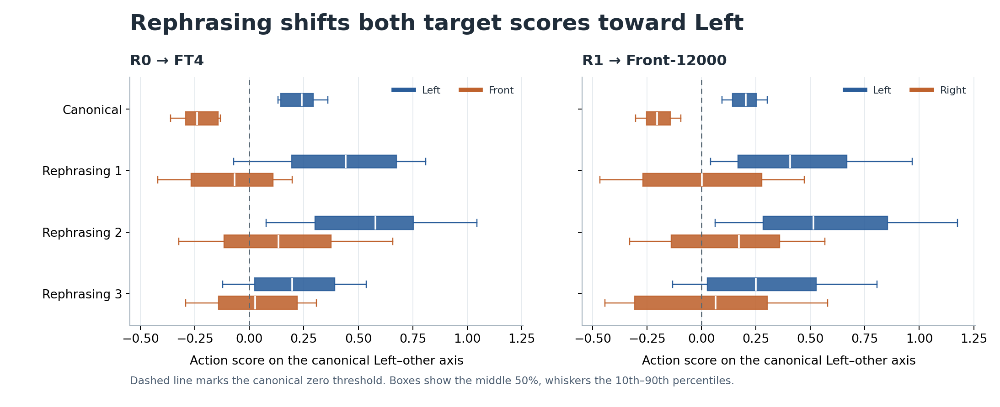
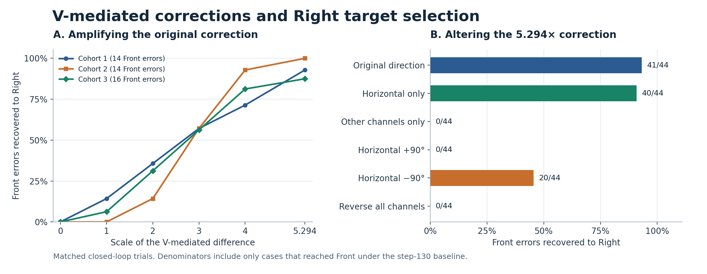

# 持续学习怎样让旧指令失去目标控制

K 系列实验综合报告 · 2026-11-21 · SmolVLA／LIBERO 仿真

## 摘要

持续学习的视觉语言动作模型有时会把旧指令执行成刚学的新任务。同一本书、同一格架，原模型能听「放左」和「放右」分别搬运，续训 Front 后，书却常常先到前格。这类错误叫**目标替代**。它和书没有被搬到任何格、书已到正确格子上方但没有放好，是三个不同的结果。

我们把同一输入上两条旧指令产生的动作响应拆成**共同响应 μ**和**指令区别 d**。续训会同时改变两句共享的搬运方式，削弱或扭曲指令原本能施加的动作修正。两条旧规范句的输出中仍可读出与目标对应的方向。能否让机器人选对目标，取决于修正力度、修正方向以及它叠加在怎样的共同动作上。方向到对以后，高度、旋转和后续控制还会影响能否完成放置。

训练反事实把这条链向上追到了实际权重更新。动作与时间融合及 MLP 写回会改变交叉注意力用来发起查询的动作状态。共享 V 内容的变化经过两句话各自的读取权重，也会改写最终的指令区别。恢复任一通路都能改变一部分实际去向。在同一续训模型的 μ 上，把自然 V 回滚产生的区别修正放大，三批共救回 **41/44** 个原本 Right→Front 的回合。自然幅度救回 **3/44**。这同时量出了该通路的控制力与实际训练变化的因果范围。

论文的核心贡献是**把旧指令仍可辨识、动作能否按指令分流、能否最终放好这三个问题，用同初态的反事实连到真实训练更新**。补验发现，改写会平移投影得分的中心，使规范句的固定零阈值失准。两条额外训练流也复现了 V 和 MLP 的关键作用。机制分析由此给出两种恢复办法。推理时可利用父模型的动作参考和续训模型留下的条件信号。训练时可约束旧指令的行为余量，让新任务继续更新共享参数。两种办法的证据范围由各自的闭环结果限定。

## 1. 先证明发生的是目标替代

实验使用 SmolVLA，主要场景是 LIBERO `STUDY_SCENE2`。桌上的书、格架与相机保持一致，任务只改指令中的目标格。视觉语言骨干保持冻结，动作专家及输入／输出投影接受续训。这样可以在相同的可完成场景里比较听不同句子之后的动作。

| 线路 | 父模型学习的目标 | 续训目标 | 代表性的续训后现象 |
| --- | --- | --- | --- |
| R0 → FT4 | Left、Front | Right | 从复位开始运行 FT4，旧 Left、Front 各 20 次，合计 **36/40** 先到新右格，两句旧目标首次正确均为 0。新 Right 首达 19/20，终态 14/20。 |
| R1 → Front-12000 | Left、Right | Front | K13 的 20 个初态上，父模型 R1 的 Left／Right 首达为 **20/20、19/20**。续训后只剩 **2/20、0/20**，合计 **28/40** 先到新前格。新 Front 首达 18/20，终态 15/20。 |

R0 的左＋前开发终态分别为 19/20、16/20，同初态两句都最终正确的有 15/20。R1 使用左右联合训练 24000 步检查点，在同一套开发协议下左、右终态为 19/20、17/20，同初态两句都正确有 16/20。K13 又在自己的初态上跑了 R1 原生参照。论文引用这些成绩时，应一并标出初态来源和评估阶段。 [R1 基座训练与四指令评估](2026-11-04_R1_左右双目标基座_训练与四指令评估.md) · [R0 线路闭环与 R1 线路复验](2026-11-06_目标替代机制_共同趋势与指令差异闭环干预.md) · [K13 原生与干预结果](2026-11-07_K13_R1学前_共同趋势与区别干预.md)

测试句式的对照进一步说明，**触发搬运与决定目的地可以分开**。在书场景 SCENE2 的 FT4，保留常见句式、把目标词换成 Back，10/10 仍先到新右格。无关句和乱码各 10 次均未进入目标区，其中仍有夹住或抬起书的尝试。碗场景则有 8/10 的乱码回合先到新盘子。两者记录的是不同的触发模式，后面的精细参数因果链主要以书场景为对象。 [K3-E2 的指令控制](2026-11-02_K3-E2_换测试指令的捕获实验.md)

### 1.1 三个行为指标怎样读

- **首次去向**看抬起物体后，它先进入哪一格的判定区域。书场景按高度与水平区域的持续条件打分，例如抬高超过 3 厘米并在相应水平范围连续 5 步。它衡量书最先被带向哪里。
- **成对分流**要求同一物理初态上，两句旧指令分别首达各自正确的格子。一个条件下的 17/20 表示 17 个初态的两句都对，包含 40 个物理仿真回合。它比把两句正确数平均更能区分模型有没有根据句子改道。
- **最终放置**检查第 400 步的环境成功判据。另记过程中是否曾成功。书可以先到右格上方、始终没放进去，也可以进入后又失去成功状态。

逐回合核对时，先分 **正确目标、去新目标、去另一格、未到区**，再看终态。只见到「去新目标」减少，还要追踪同一个初态究竟改到了正确格，还是搬到中途停住。新任务能力用新指令从复位开始单独量。

## 2. 把速度场拆成共同行为与条件修正

SmolVLA 每次先生成一块带噪声的动作草稿，动作专家做多次去噪，最后只执行一段，再根据新的观察规划。典型设置生成 50 个动作位置，去噪 10 次，执行前 10 个控制步。下面的 `v` 指模型在一次去噪中给草稿的归一化更新，最终物理位移还要经过采样、解码和实际执行。草稿有 32 维，实际控制执行前 7 维。K22 的整块旧轴投影使用有效维度。K25 的水平读数多看前 10 个动作位置的 `x/y`，部分输出干预则作用于完整草稿。不同论文图的比例应同时标出它的窗口和通道。

在同一画面、机器人状态、动作草稿 `x` 和去噪时刻 `t` 上，只换输入指令。记两条旧句 A、B 的更新为 `vA`、`vB`。

```text
μ = (vA + vB) / 2          两句共用的动作响应
d = (vA − vB) / 2          换一句话时发生的动作修正

vA = μ + d                vB = μ − d
```

例如 A=Left、B=Right，`μ` 描述这对句子共享的搬运安排，`d` 描述两句使动作向各自路线分开的程度。`μ` 和 `d` 每次都随当前输入重算。换一对旧句，定义也随之改变。为说明某份 `d` 还剩多少控制力，用父模型在**同一个输入**上的 `d旧` 当参照。长度比是幅度读数，余弦是方向读数，有符号投影 `〈d新,d旧〉/‖d旧‖²` 则衡量新模型沿原来那条动作方向还能施加多少修正。旧方向之外的分量可以另行移除、替换或旋转。

实验用了三种互补口径。**固定输入探针**把物理状态和草稿钉住，观察内部响应究竟哪里变了。**同快照闭环**让机器人按统一指令抓稳书，在未进入目标区时分叉，消除不同试验组自己抓出的状态差异。**从复位闭环**把抓取也纳入评估，检验方法在独立执行中还能恢复多少。干预时每次重规划都根据实际观察重算。两组行动以后，观察会分叉，固定输入里的数值比例应与实际路线分别报告。

### 2.1 续训后的共同响应和区别怎样变

K10 在 R0→FT4 上固定草稿，把动作专家的层栈与最后的动作输出投影交叉组合。用 FT4 层栈，即使保留 R0 输出投影，仍只读出 **24%** 的旧方向分量。相反，R0 层栈配 FT4 投影保有 **88%**。完整 FT4 的旧方向分量约 **21%**。同一探针里，两句旧指令平均响应与 FT4 听 Right 时响应的距离，降到旧平均与它距离的 **10%**。在这对模型上，共同响应明显靠向新任务，旧区别同时变弱且偏轴，较大的改动已发生在最后投影之前。 [K10 层栈×输出投影四格](2026-11-05_K10_固定输入四格与定向干预.md)

R1→Front-12000 的区别也缩短。K14 在所用草稿上的 `d新` 长度约为 `d旧` 的 **0.38**，方向余弦约 **0.75**。这表示动作修正变小而且有偏转，原方向仍留有分量。模型内部的语言理解程度需要用能否读出和能否执行各自验证。 [K14 固定输入结论与原数据复算](2026-11-09_K14研读_机制结论修正与下一步.md)

## 3. 共同动作和指令区别怎样共同决定去向

### 3.1 同样的旧区别要放在合适的共同动作上

R0→FT4 的两类反事实给共同响应定位。K11 在 R0 生成的 9 个共同抓持快照上，将 FT4 的共同响应用到有健康旧区别的控制组合中，Front 的 **9/9** 和 Left 的 **4/9** 首次去了右格。K12 则从复位起先让 FT4 自己执行，两句原来共 **36/40** 次先到右。进入窗口后只恢复旧共同响应，首次去右变为 **0/40**，成对分流恢复到 **15/20**。这条线路的剩余区别，已经能在旧共同背景上控制不少回合。 [K11 反向干预与 K12 的 20 初态复验](2026-11-06_目标替代机制_共同趋势与指令差异闭环干预.md)

R1→Front 上，仅换旧 μ 时 Right 首达仍为 0。K14–K15 从同一份 Front-12000 产生的抓稳且未入格的状态接手，补齐「共同响应来源 × 条件修正力度」四格。两条句子共用固定的增益 **2.959**，增益来自开发草稿上旧、新区别的尺度比。运行时把实际句子 `q` 交给续训模型，使用 `v新(q)−μ新` 作为残差。程序统一放大这个残差，由模型自己的反应决定路线。

| 共用背景和残差强度 | Left 首次到左 | Right 首次到右 | 同初态两句都对 | 两句首次去 Front | 两句最终放好 |
| --- | ---: | ---: | ---: | ---: | ---: |
| 新 μ，原强度 | 0/20 | 0/20 | 0/20 | 34/40 | 3/40 |
| 新 μ，2.959 倍 | 8/20 | 0/20 | 0/20 | 11/40 | 10/40 |
| 旧 μ，原强度 | 10/20 | 0/20 | 0/20 | — | 5/40 |
| 旧 μ，同样 2.959 倍 | **20/20** | **17/20** | **17/20** | 2/40 | **24/40** |

在相同输入上，两行放大组让两句之间的动作差完全相同。共同响应一变，实际去向大幅改变。保留新 μ 的放大组里，原先去 Front 的 23 个回合改道，8 个到了正确左格、15 个没有进入任何目标区。这是区分「抑制错误」与「恢复正确」的直接例子。相同增益配旧 μ 后才同时出现左、右路线。由两条线路对比可见，共同响应占优时，先移走偏置就能分开不少路线。残留区别较弱时，还得恢复足够的条件修正。 [K15 四格、配对转移与区间](2026-11-10_K15_共同背景与固定增益对照.md)

用一条左右轴可以直观看出原因。令 `m` 为两句的平均位移，`a` 为两句位移的半间距，则左句走 `m−a`，右句走 `m+a`。如果两侧分别需要至少向左走 `τL`、向右走 `τR`，两句都能达到要求时，`m` 必须落在 `[τR−a, a−τL]`。`a` 太小时区间会消失。`a` 足够大时，共同位移也可能偏到区间之外。实际机器人还要满足二维格子几何与抓持姿态，闭环结果以实际进入哪个格为准。 [K20 位移的共同项、半差与几何示意](2026-11-12_K20_补实验_μd与行为分流.md)

### 3.2 整段放大为什么会遇到反例

K21 的迁移试验显示，其他检查点和抓持状态上，全量放大残差会一起放大偏离旧路线的成分。于是 K22 把残差投影到父模型的 `d旧`，分开「沿旧动作方向」和「朝其它方向」两个部分。协议扩展到 **7 条父子模型线、3 个任务族**，从复位起干预前 150 个控制步，总回合 400 步。模型随后按同一句回到原生续训控制。每条线同一批 20 个初态。这里的主要终点是成对首达。

| 模型线 | 原生续训 | 新背景只放大 | 旧背景整段放大 | 旧背景只留旧方向 | 旧背景只取方向符号 | 全程父模型 |
| --- | ---: | ---: | ---: | ---: | ---: | ---: |
| R0 书架学右 | 0 | 0 | 15 | 16 | 18 | 18 |
| 书架学右，独立种子 A | 0 | 0 | 13 | 20 | 19 | 19 |
| 书架学右，独立种子 B | 0 | 0 | 9 | 14 | 12 | 12 |
| 第二书架场景 | 0 | 0 | 3 | 12 | 15 | 17 |
| 碗学盘子 | 0 | 0 | 1 | 11 | 12 | 12 |
| 碗学盘子，独立种子 | 0 | 0 | 0 | 14 | 15 | 15 |
| R1 书架学前 | 0 | 0 | 20 | 19 | 19 | 19 |
| 描述性合计 /140 | **0** | **0** | **61** | **106** | **110** | **112** |

只留旧方向比盲目放大整段更稳定。这里的恢复有意使用旧 μ 和父模型在当前状态下给出的 `d旧` 方向，验证的是旧信号还能驱动哪个方向。数字来自不同父子模型，部分线路共用同一套物理初态，汇总用于描述覆盖范围。投影的原始幅度或最佳增益仍可能依赖模型对和任务。K23 跨种子互换锚点时，四个强锚点组合用符号恢复 **18–19/20**，两个弱锚点组合约 **11/20**，与各自锚点的能力相符。六组沿用投影幅度时只有 **0–6/20**。所以要分别检验「可辨识的方向」和「执行所需的幅度及背景」。 [K21–K22 迁移与残差拆分](K21_K22_生死测试与残差拆解_20261113.md) · [K23 跨种子锚点实验](K23_探索报告_20261117.md)

## 4. 旧指令还能读出什么

这里的「可读」有一个可复算的定义。固定父模型的规范旧句半差作为参考轴，计算续训模型对当前句子的响应偏离其规范句平均的量，在父模型参考轴上是正还是负。若 A、B 的符号能区分，还可以交给父模型的共同响应和动作方向去执行。它检验的是**动作输出中能否读出这个旧目标的条件身份**。

K22 的规范句在七条线上符号一致率最低为 **99.4%**。这个数字度量规范句的旧轴对齐，因为两条规范句也参加了平均和参考的定义。K14 用统一增益、真实输入句子和固定规范句背景，三个近模板改写的成对分流为 **15/20、18/20、15/20**，这些措辞都经过父模型资格筛选。用未参与均值与轴计算的改写做固定输入读出、再在仿真中把读出的符号交给旧响应执行，是进一步检验条件身份和执行作用能否分开的办法。 [K22 符号口径](K21_K22_生死测试与残差拆解_20261113.md) · [K14 的近模板对照](2026-11-09_K14研读_机制结论修正与下一步.md)

### 4.1 补验把改写和参考轴分开

在 R0→FT4 和 R1→Front-12000 上，继续用父、子模型的规范句计算参考轴和均值。新测三种英文改写，例如 `Please put the book in the caddy's right compartment.`。改写句只作为续训模型的实际输入，不参与定义均值、参考方向或定标。每条线固定测 20 个物理初态。每个初态用两条父模型草稿和三个去噪时刻，统计目标对应符号的比例。闭环统一用第一种改写，从复位起前 150 步，用回归到旧轴上的符号选父模型的动作分支。另跑原生改写、将模型读出的符号取反，以及用真实标签选择同一父模型动作的参照。选择哪种改写和初态发生在看结果之前。 [改写的探针与闭环执行脚本](../scripts/k25/held_phrasing_readout.py)

| 输入措辞 | FT4 Left／Front 符号正确 | Front-12000 Left／Right 符号正确 | 每条线同输入比较，两句排序正确 |
| --- | ---: | ---: | ---: |
| 规范句 | 100%／100% | 100%／100% | 120/120 |
| 改写 1，请将书放进格子 | 87.5%／61.7% | 91.7%／50.0% | 120/120 |
| 改写 2，拿起书并把它放下 | 91.7%／36.7% | 93.3%／36.7% | 120/120 |
| 改写 3，把书移动到格子里 | 79.2%／42.5% | 76.7%／44.2% | 120/120 |

每行每句每条线有 120 个固定输入读数，来自 20 个物理状态。规范句中 Left 的分数为正，另一条旧句为负。改写后，**同一草稿上的 Left 分数始终比另一条旧句高**。同时两个分数往正侧一起移动，固定用规范句的零点，另一条旧句就容易越到正侧。这件事也能用 μ/d 解释。将改写两句的分数取平均，它正是「改写共同响应相对规范句共同响应」在旧轴上的投影。改写 2 的这个共同偏移中位数是 **+0.343、+0.326**，而两句半差分别约 **0.196、0.199**。因此即使同一输入能够辨识哪句话更偏 Left，固定的符号阈值仍可能把两句都读成 Left。这里观察到的是两种目标词在所测改写上的相对排序和绝对符号，覆盖范围比一般语言理解更具体。



| 第一种改写，从复位执行 | R0 线 Left／Front 首达正确 | R0 线成对分流 | R1 线 Left／Right 首达正确 | R1 线成对分流 |
| --- | ---: | ---: | ---: | ---: |
| 续训模型原生执行 | 0／0 | 0/20 | 3／0 | 0/20 |
| 按续训模型实际读出的符号接入旧动作 | **19／15** | **14/20** | **20／19** | **19/20** |
| 把读出的符号反过来 | 0／0 | 0/20 | 0／0 | 0/20 |
| 用真实目标标签接入相同旧动作 | 19／19 | 18/20 | 20／19 | 19/20 |

每个条件每句各 20 个回合，两条线合计新增 **320 个**。读出组的旧句首次到新目标在两条线上均由原生的 **22/40、15/40** 降至 **0/40**。R0 线读出组最终在两句各放好 **17/20、9/20**，合计 26/40。R1 线各为 **20/20、11/20**，合计 31/40。反号组在 R0 线把 **19 次 Left** 送向 Front，并把 **19 次 Front** 送向 Left。R1 线的 **19 次 Left** 改去 Right，**16 次 Right** 改去 Left。两条线都表明，动作跟随的是读出符号选择的分支。R0 线与真实标签参照相差 4 个成对分流，反映固定零阈值下的措辞损失仍然存在。

这个符号也随闭环状态变化。以 R1 线的改写 Right 为例，复位观测上的固定草稿探针有 **50.0%** 的符号正确。在用读出决定动作的实际闭环中，前 50 个控制步对应的查询中 **89.3%** 读对，接下来的 50 步为 **100%**，最后 50 步为 **74.5%**。这些动态查询对应不同的物理状态和更新后的草稿。固定输入上的相对可辨识性、固定阈值的可靠性和执行中的成对分流，应同时报告。 [320 个回合、固定读出与各阶段符号](results/2026-11-21/k_series_replication/phrasing_summary.json)

## 5. 为什么到了正确格子上方，仍可能放不进去

K13 中，补充方向性响应让 Right **18/20** 先到右格，最终放置却 **0/20**。这些回合进入右格水平范围时，书的位置仍高于右格容纳区上界。同样的前缀和 60 步窗口内，完整恢复父模型响应，Right 首达 **20/20**、终态 **12/20**。这说明前一组合找回了足够的搬运方向，完整旧响应还提供了有助于落位的动作内容。K14 则在已到格上方的 26 个回合里切换旧控制，救回 3 个、损伤 2 个。末段控制仍然会改变结局，效果取决于此前搬运形成的状态。 [K13 的完整旧响应参照](2026-11-07_K13_R1学前_共同趋势与区别干预.md) · [K14 末段交换的配对复算](2026-11-09_K14研读_机制结论修正与下一步.md)

K16–K17 把共同响应分成水平 `H`、高度 `Z`、旋转 `R`、夹爪 `G`。所有组都保留同一公式下 **2.959 倍**的残留区别，在同一抓持快照上只按通道改变 μ 的新旧来源。16 格覆盖了各类通道的添加和移除。下列是能解释不对称性的条件。

| 取旧 μ 的通道 | Left 首次到左 | Right 首次到右 | Left 最终放好 | Right 最终放好 |
| --- | ---: | ---: | ---: | ---: |
| 都取新 μ，仅放大区别 | 8 | 0 | 10 | 0 |
| 水平 H | 19 | 4 | 15 | 1 |
| 高度、旋转、夹爪，保留新 H | 5 | 10 | 2 | 0 |
| 水平 H＋旋转 R | 20 | 11 | 19 | 6 |
| H＋R＋高度 Z | 20 | 17 | 14 | 10 |
| H＋R＋Z＋夹爪 G | 20 | 17 | 14 | 10 |

表中每句 20 回合。旧 H 给左边带来最多的首达收益，也为右侧完成放置提供了条件。保留新 H 时，非水平组合能让 10 次 Right 到右格上方，这些书仍高出容纳区上界约 2.1–5.1 厘米，终态均为 0。固定旧 H，加入旧旋转把右终态从 **1 提高到 6**。在全组合移除旋转，右终态从 **10 降到 1**。高度使右侧多恢复几个完成，同时让 5 个左句在曾成功以后退出成功状态。该组合的夹爪来源改回新值，40 次的三个行为端点逐回合一致。

旋转与水平也会在模型内部相互影响。第一段十步动作还没有开始执行时，只换旋转 μ，40/40 个回合生成的水平命令已经变了。去噪会反复重读整份草稿，所以动一个通道会沿后续采样改变其他通道。实际姿态和接触又会影响下一次看见的状态。**共同响应和区别是对动作生成作用的拆分，挑中哪个格与完成放置都可能同时受它们影响。** [K17 全通道组合与几何复核](2026-11-10_K17_S组拆分_高度旋转夹爪与左右不对称.md)

## 6. 续训怎样造成这些变化

### 6.1 干扰从续训早期开始

K18 沿 R1→Front 的检查点反复测量同一批旧输入。第 30 步的**全动作旧轴**增益为 **0.916**，到第 100 步降为 **0.619**。第 100 步的方向余弦为 **0.947**，区别长度降到原来的 **0.650**。到第 12000 步，区别长度剩 **0.384**，余弦降至 **0.809**，旧轴有效增益为 **0.308**。同一早期窗口内，旧句的平均响应也开始漂移。**前期主要是沿旧方向的修正变小，持续训练之后还看到更明显的方向改变。** 这些数值来自同一测量协议。K14 的共同快照则提供另一组动作草稿上的复现。 [K18 时间线](2026-11-11_K18_完整机制与训练反事实总结.md) · [K19 方向与优化器检查](2026-11-11_K19_训练保留与μd机制报告.md)

只训练 Front 仍会改到旧句的响应，因为它们共用动作专家。K19 匹配旧示范做梯度检查。第 30 步，交叉 K/V 中 Front 与旧任务监督的梯度在 **7/8** 个批次相斥，MLP／归一化中 Front 与旧 `d` 保持方向在 **8/8** 个批次相斥。第 100 步，整体原始梯度多数已同向，实际 AdamW 更新仍在 **8/8** 个批次推高旧误差。清空当前梯度、保留优化器历史，仍在 **8/8** 个批次推高旧误差，增量中位数 **0.01476**，完整一步是 **0.01730**。这说明历史动量能延续已经形成的干扰。梯度相似度只能反映当步的一部分过程。重置优化器还会改变实际步长，因此应按实写参数后的效果来解释。 [K19 梯度与 AdamW 反事实](2026-11-11_K19_训练保留与μd机制报告.md)

### 6.2 一部分训练来源可以追到旋转监督

K18-D 从同一 R1 出发，在三条随机流上比较完整监督、去旋转、同量随机遮蔽、匹配实际步长。用同一批次、同一去噪随机流把不同训练选择隔开。在第 30 到 100 步，交叉 K/V 沿历史更新方向的投影，去旋转组是 **0.408**，完整、随机遮蔽、等步长分别是 **0.841、0.831、0.718**。旋转监督参与了早段沿这个方向的参数改写。

但旋转也参与学会 Front 的落位。在 1000 步终点，去旋转组的三流 Right 首达仅 **2/60**，43/60 首次去 Front，Front 终态 **16/60**。完整监督组是 Right 首达 **1/60**、25/60 首次去 Front、Front 终态 **38/60**。K25V2 进一步把两种单步训练产生的参数差拆开，只把旋转监督造成的 V 差加回去，第 30、100 步分别有 **8/8、6/8** 个批次让旧轴增益变小，第 100 步的整步监督净效应却可以朝另一方向。**监督对一个通路的作用有条件，累计训练的行为结果由多条共享路径共同决定。** [K18 三随机流训练对照](2026-11-11_K18_完整机制与训练反事实总结.md) · [K25V2 旋转监督到 V 的一步归因](K25V2.md)

### 6.3 参数回滚为什么比相关性更强

取早晚两个真实检查点。给早模型只加某一组实际晚期改动，给晚模型只撤掉同一组，再在相同输入上测输出并实际执行。前者问这组更新能否使响应退化，后者问当前失效依赖这组更新到什么程度。再把回滚模型产生的 `d` 单独移入未改权重的模型，或者把坏 `d` 放回被救好的模型，就能检验**权重改变能否经由动作区别传递到行为**。

K24 在第 30→130 步窗口得到三段配对证据。完整续训 Right 首次到右 **2/20**，只回滚交叉注意力是 **9/20**。在完整续训参数上只借回滚模型的 `d`，得到 **8/20**。在已回滚的模型上只放回晚期 `d`，正确回落到 **2/20**，其中四个原本先到右的回合转去 Front。只回滚 MLP 得到 **11/20**，所以还需追问 MLP 的作用经过什么计算。 [K24 权重与响应正反互换](results/2026-11-17/k24_final_window/README.md)

K25 将比较范围缩到交叉层 13、15 的 K/V，以及 12–15 的 MLP。主探针的水平旧轴增益从早锚点 **0.894** 到完整续训的 **0.591**。单回滚深层 K/V 是 **0.629**，深层 MLP 是 **0.621**，联合是 **0.660**。联合回滚的 Right 首达 **8/20**，只换回晚期 `d` 后降为 **2/20**，五个先到右的回合变成先到 Front。后段权重确实经 `d` 参与了选错格。联合组只填回部分增益，也为继续追踪读取位置与更上游状态留下了可量的缺口。 [K25 深层回滚与目标选择](2026-11-18_K25.md)

同一套参数分组还解释了 `μ` 为何漂移。注意力和 MLP 更新都参与了早期漂移。K24 在第 130 步撤回 `action_time_mlp_out`，固定输入的水平 μ 偏差下降 **0.058**。撤回整个动作与时间组下降 **0.096**，撤回动作输出投影下降 **0.064**。高度 μ 对深层交叉 K/V 较敏感，旋转 μ 对深层专家自注意力也很敏感。**改变共同动作的权重与改变旧方向增益的权重分布有重合，也各有侧重。** 不同背景下加入和撤回的读数，采用各自的反事实作为分母。 [K19 共同响应的分层归因](2026-11-11_K19_训练保留与μd机制报告.md) · [K24 短窗的 μ 与 d 参数地图](results/2026-11-17/k24_final_window/README.md)

## 7. 两条内部通路怎样把变化传到旧动作

交叉注意力的查询 `Q` 表示当前动作状态要读什么。`K` 是用于匹配的上下文键，`P` 是匹配后给各位置分配的读取权重，`V` 是按这些权重取出的内容。读出可以简写为 `Y=P·V`。当前研究在 `P` 的查询输入和 `V` 的内容更新两处，都做了可以闭环验证的干预。

### 7.1 V 的共有内容变化，怎样改写两句之间的区别

只回滚八个交叉注意力层的 V 权重，其余参数用第 130 步，分别读取同一输入下的 Left 和 Right 速度场变化。两份变化的半差就是 **`ΔdV`**。它衡量真实 V 回滚通过整套接收网络传到最终动作的指令区别。两份变化的平均则是 `ΔμV`。二者只有经过模型后续计算，才成为速度场输出的变化。

把单层 V 的回滚变化写成两句共有的 `C` 与两句相反的 `D`。固定该层当前的 `P_L`、`P_R`，就能将读出变化中两句的半差拆成以下两项。

```text
(P_L − P_R) × C / 2     两句用不同权重读取同一份内容变化
+ (P_L + P_R) × D / 2   两句直接收到不同内容变化
```

这给出一个具体机制。共享更新把某些位置上的内容改了一样多。由于 Left 和 Right 原先给这些位置的权重不同，改完得到的动作区别就可能变大或变小。多层执行时，早层写回还会改变后层的输入。K25V3-V 在八层分别注入这两种真实内容变化，再只取最后输出中的区别，验证了前一项的实际作用。第三批只恢复共有 V 时，水平区别增益 **+0.0547**，整份回滚是 **+0.0542**，方向余弦 **0.9993**。放大共有 V 诱导的输出区别，恰好救回与放大完整 V 相同的 **14/16** 个原 Front。只恢复两句内容不同的变化，救回 **0/16**。K25V2 对 MLP 的 `up_proj` 也见到相似现象，共有内容经过两句各自的门控，可以带来不同的动作输出。 [K25V2 共有内容与条件门控](K25V2.md) · [K25V3-V 来源拆分](K25V3-V.md)

### 7.2 自然 V 贡献和放大后的控制力各有多大

回滚 V 每次提供的水平修正和完整旧方向很接近。第三批方向余弦是 **0.973**，自然大小约占完整修正 **17.8%**。K25V3-V 沿三批共 60 个固定抓持初态，锁定增益扫过 **0、1、2、3、4、5.294**。运行时保留同一输入下的晚期 μ，只给 Left 加 `s·ΔdV`，给 Right 减 `s·ΔdV`。这样能直接测「只增加这份区别有多大作用」。

| 输出区别干预 | 原 Front 改到 Right | Right 首达总数 | Right 最终放好 |
| --- | ---: | ---: | ---: |
| 原生晚期 | 0/44 | 6/60 | 0/60 |
| 原幅度 | 3/44 | 16/60 | 0/60 |
| 2 倍 | 12/44 | 26/60 | 4/60 |
| 3 倍 | 25/44 | 40/60 | 9/60 |
| 4 倍 | 36/44 | 51/60 | 13/60 |
| 5.294 倍 | **41/44** | **56/60** | **29/60** |
| 5.294 倍，只保留水平两维 | **40/44** | 55/60 | 31/60 |
| 5.294 倍，只保留其余维度 | 0/44 | 5/60 | 0/60 |
| 5.294 倍，水平转 +90°／−90° | 0/44、20/44 | 0/60、32/60 | 1/60、4/60 |

三批原幅度在 60/60 个初态改善了首段的相对右向领先量，救回三个 Front 错格。沿同一方向放大，头十步的领先量每多一个自然修正单位约提高 **2.0–2.3 毫米**。路线分批改正，因为各初态的错误偏置不同。等范数旋转显示了方向的作用。原方向让书直接更靠近 Right。`−90°` 主要压低朝 Front 的运动，因此也有间接收益。这个实验在**保持晚期 μ**时仍能把书送到对格，与 K15 的四格互相补充。K15 是固定 2.959 倍放大整份残留区别、两句都要分流。这里选取以水平为主、经 V 提取的修正，核对三个批次的 Right。第三批用 5.294 倍后 Left 首达 **20/20→15/20**，成对分流 **3/20→14/20**，所以选倍数要对两句分别验收。 [K25V3-V 的剂量、旋转和 Left 对照](K25V3-V.md)



其中的因果范围由自然幅度检验限定。K25V3 原两批在原生 V 回滚基底上，只撤回自然大小的 `ΔdV`，Right 首达从 **6/20 到 2/20** 和 **3/20 到 1/20**，其中三个原来先到右的回合直接改去 Front。仅把晚期 V 权重放回早锚点，在原先先到 Right 的 38 个回合里造成一个 Right→Front。同窗口恢复完整 `P` 后，再恢复 `V` 能多救回四个 Front，`P＋V` 合计救回 **11/28**。这些读数检验真实训练幅度下的作用。高倍数试验则检验这条通路还有多少控制潜力。 [K25V3 的原生权重和输出双向对照](K25V3.md)

第三批把 V 权重本身向旧值的方向外推 5.294 倍。原生执行外推权重，Right 首达 **19/20**，终态 **3/20**。从**同一外推**只提取它给动作带来的 `d`，继续保留第 130 步 μ，首达是 **20/20**，终态是 **14/20**，逐初态有 11 个新增终态成功。直接动 V 会同时改变共同与区别。选择路线的修正很有用，积累出的共同搬运方式还要能支持后续放置。 [K25V3-V 的 V 权重外推及终态配对](K25V3-V.md)

### 7.3 查询输入的变化来自入口嵌入与逐层写回

K25V3 将 `P` 的变化拆成查询 `Q` 和键 `K`。在两批原先去 Front 的 28 个回合中，恢复查询分别救回 **4/14、3/14**，单独恢复 `K` 两批均为 **0/14**。第二批只换进入 Q 投影之前、已归一化的动作隐状态，Right 首达 **1/20→4/20**。只换 Q 的投影矩阵，逐初态首次去向一致。模型读取改变的来源主要在送进查询投影的动作状态。 [K25V3 的 P、Q 与 K 对照](K25V3.md)

K25V4 将这个状态记为 `h_q`，把第 30→130 步实际权重差拆成六组，逐个回滚与加入，共 64 种。每一组在 32 种其他组背景上比较，分别量了它对 `h_q` 偏移的影响，以及只把它产生的 `h_q` 交给晚期接收模型还能恢复多少 `d`。这一筛选定位到两处作用入口。

- **动作时间融合层 `action_time_mlp_out`。** 动作草稿和去噪时刻先被编码，再生成动作专家收到的第一份嵌入。只把这两张输出参数产生的嵌入换回来，可以逐值复现权重回滚给八个交叉层查询和最终速度场造成的变化，差异从第 1 层交叉注意力起就出现。
- **MLP 下投影 `down_proj`。** 每层把 MLP 内容写回当前动作状态，后面的层用这份状态继续读上下文。只重算相同层的残差写回，能逐值复现参数回滚结果。第 0–7 层对经过查询的水平区别作用较大，其中第 4–7 层的分段探针最强。层号从 0 开始。

两组完整回滚在两批固定输入上沿旧方向拉回 **53%–54%** 的查询偏移，恢复 **56%–57%** 的注意力读取变化。只回滚上述两处的 18 张参数拉回 **28%–29%**。把两组真实晚期参数加回第 30 步锚点会制造 **10 个 Right→Front**。保留这些权重，只换回早期 `h_q`，能救回其中 **3 个**。此时 Q 投影、K、V 和其余网络保持接收端的参数。这个对照把更上游的实际权重改动、读取改变、水平动作区别和真实首次去向接了起来。

MLP 写回还有一条查询之外的作用。用完整续训模型接手，前三组都只干预同样的前 60 步。原生 MLP 回滚救回 **11/28** 个原 Front，只借用该回滚形成的 `h_q` 救回 **1/28**。在 MLP 仍回滚的情况下，让查询复用同输入的晚期 `h_q`，原救回的 11 个里还有 **9 个**正确。把最后第 15 层的 MLP 下投影单独回滚，八处查询逐值相同，固定草稿的水平区别仍能改变。这给查询之外的残差写回提供了结构上的验证。两条通路合起来解释了为何只修早期读取时，路线收益小于整组 MLP 回滚。 [K25V4 权重组、逐值钩子和同窗口正反对照](K25V4.md)

### 7.4 补验换了两条完整训练随机流

前面的 V 和查询细粒度实验，主要用一条真实训练轨迹第 30→130 步的参数差。补验从 K18 的完整监督中取两条此前未用于 K25 细拆的随机流 `20261121` 和 `20261122`。它们共享 R1、示范集与动作模型配置，各自使用不同的训练批次和随机流。对照固定第 30 和第 100 步，逐份核对实际可训练权重的哈希。评估共用 20 个已锁定的抓持初态 600–619，V 的放大倍数沿用 **5.294**。Left、Right 原生参照从同一抓稳快照接手，旧 Right 的干预均用同样的前 60 步。新 Front 指令从场景复位起执行。

| 固定输入指标 | 随机流 20261121 | 随机流 20261122 |
| --- | ---: | ---: |
| 旧水平轴增益，第 30 步→第 100 步 | 0.914→0.634 | 0.901→0.603 |
| 自然 V 修正占完整水平修正 | 21.3% | 21.3% |
| V 修正与完整水平修正的方向余弦 | 0.971 | 0.962 |
| 动作时间组＋MLP 整组回滚，查询偏移拉回 | 约 50% | 约 46% |
| 只回滚融合输出和 MLP 下投影，查询偏移拉回 | 约 26% | 约 24% |

两条线上都能在新的权重差中看到「V 方向对、原幅度小」和「动作时间组与 MLP 提供较大的上游查询改动」。所测窗口比原 K25 短 30 步，表中比例作为独立复制的读数。 [跨训练随机流的检查点与干预脚本](../scripts/k25/replicate_training_streams.py)

| Right 闭环条件 | 流 20261121 首次到右 | 该流 15 个原 Front 中改到 Right | 流 20261122 首次到右 | 该流 4 个原 Front 中改到 Right |
| --- | ---: | ---: | ---: | ---: |
| 第 30 步原生参照 | 18/20 | 14/15 | 19/20 | 3/4 |
| 第 100 步原生 | 0/20 | — | 2/20 | — |
| 只加自然大小的 V 区别修正 | 4/20 | 4/15 | 4/20 | 1/4 |
| 固定 μ，放大 V 区别 5.294 倍 | **16/20** | **15/15** | **13/20** | **4/4** |
| 同幅度反号 | 0/20 | 0/15 | 0/20 | 0/4 |
| 原生 MLP 回滚，前 60 步 | 7/20 | 7/15 | 10/20 | 2/4 |
| MLP 回滚，同时查询换回晚期 | 5/20 | 5/15 | 10/20 | 2/4 |
| 只移入 MLP 回滚产生的查询输入 | 1/20 | 1/15 | 3/20 | 0/4 |

两条流原生失败构成很不同，第二流第 100 步有 **14/20 未到区**。保持原来锁定的 V 倍数，仍分别救回全部 15 个和 4 个原 Front，Right 终态为 **6/20、8/20**。在两条流的 40 个初态中，放大组的首段右格相对 Front 领先量都大于反号组。原生 MLP 回滚救回的 9 个 Front 错格里，有 **7 个**在接入晚期查询后仍然改对，只有查询恢复时共改对 **1 个**。两条流都在同等 60 步内复现了 MLP 写回通过查询之外影响路线的现象。

原生 Left 首达分别由第 30 步的 **19/20、19/20** 降至第 100 步的 **12/20、8/20**。从复位起测 Front 终态则分别是 **3→4/20、6→2/20**。这个早期窗口用于检验参数对旧控制的因果作用，Front-12000 与 1000 步训练对照承担新任务技能的验收。 [480 个新增回合、两条随机流及全部逐回合转移](results/2026-11-21/k_series_replication/training_summary.json)

## 8. 机制怎样转成恢复方法

### 8.1 推理时，把旧条件的方向和旧动作的执行分开

对实际输入句子 `q`，先算续训输出 `v新(q)`。用两条规范旧句算出当前输入下的 `μ新`，让残差 `r(q)=v新(q)−μ新` 提供条件信息。父模型或可完成同一对旧目标的参考模型提供 `μ参考` 和 `d参考`。也可以从真实权重回滚中提取具体通路的输出修正，在固定 μ 时调整动作区别。

| 组合方式 | 执行公式 | 已验证的作用 |
| --- | --- | --- |
| 旧共同背景＋保留在旧轴上的残差 | `μ参考 + α·proj_{d参考}(r(q))` | 用同一个增益 α 加强有用的旧方向，同时过滤偏轴变化。 |
| 只向续训模型读取分支 | `μ参考 + sign(〈r(q),d参考〉)·d参考` | 由实际句子的续训输出决定正负，再用参考模型执行。跨种子时依赖参考模型本身的执行水平。 |
| 固定晚期 μ，只增强经 V 得到的区别修正 | 对这对规范句使用 `μ新 ± (d新+s·ΔdV)` | 只操控 V 来源的动作部分，适合测方向和剂量。 |

前两式的 `q` 进入模型参与读出。第三式用成对规范句定义和施加修正，因果意义在于测量 V 通路的能力。三种做法使用明确的参考模型、旧参数或旧响应，验收包含目标去向和终态。论文可以用这些**机制引导的恢复方法**说明每次干预的成分、时段和作用范围。 [K22 跨任务恢复](K21_K22_生死测试与残差拆解_20261113.md) · [K25V3-V 剂量控制](K25V3-V.md)

参考模型的执行能力也是方法的条件。K23 把两条学右线的参考换成各自续训第 250 步的检查点，旧句符号仍可读，锚点自身和依据它恢复的成对分流均为 **0/20**。跨种子可用和续训后的任意检查点可用，是两件要分别验收的事。 [K23 参考模型的训练时点对照](K23_探索报告_20261117.md)

### 8.2 训练时，保护路线的可行范围

最直观的训练做法是给 `(μ,d)` 加父模型教师损失。K19 用较强的 `L = L_Front + 4(L_μ + L_d)`，在开发初态保住 Left／Right 首达 **20/20、18/20**，Front 最终放对却只有 **3/20**，完整续训为 **15/20**。权重降到 0.5，同开发批 Front 回到 **12/20**。这个实验表明，逐项把共同响应和区别贴回旧值，可能连新任务需要的动作调整也压住。动态旧动作回放作为基准，保留每步 6 个 Front 动作块，另取 Left、Right 各一个真实旧动作块。在两条新训练流合计，Right 首达 **0/40→36/40**，Front 终态 **14/40→23/40**。回放说明旧动作监督提供了较强参照，论文可以用它比较新旧能力的取舍。 [K19 联合约束与独立回放确认](2026-11-11_K19_训练保留与μd机制报告.md) · [K20 弱约束对照](2026-11-12_K20_分流余量训练与闭环验收.md)

K20 改为保护模型实际生成动作时的**目标进度和领先量**。对一条旧指令，各估计前十步让书朝每格的距离缩短多少。正目标的缩短量叫进度。它减去最强竞争格的缩短量叫领先量。两项均设置为该场景父模型读数的 **55%**，跌破时才加损失。训练每三步查询一个旧状态和一句旧指令，完整做 10 次去噪，对末两次反传。这样训练保留 Front 原损失，也允许旧 μ、d 重新配合，只要每句仍有足够的动作优势。

| 1000 步后的原生模型，两组描述性合计 | Left 先到左 | Right 先到右 | Right 先到 Front | Right 最终放好 | Front 最终放好 |
| --- | ---: | ---: | ---: | ---: | ---: |
| 完整续训 | 33/40 | 0/40 | 18/40 | 0/40 | 22/40 |
| 旧动作回放基准 | 40/40 | 36/40 | 1/40 | 12/40 | 25/40 |
| 弱 μ/d 约束，权重 0.5 | 40/40 | 37/40 | 2/40 | 14/40 | 18/40 |
| 分流余量 | **35/40** | **27/40** | **1/40** | **11/40** | **24/40** |

分流余量中，原先去 Front 的 18 个回合有 **15 个直接改去 Right**。两组 Right 首达分别恢复到 **18/20** 和 **9/20**，Front 各自的变化是 **15→13**、**7→11**。两组同时换了训练随机流和测试初态，合计概括观察，个体稳定性须看分组。回放的 Right 首达在两组都为 18/20，是本轮表现稳定的基准。 [K20 闭环与配对转移](2026-11-12_K20_分流余量训练与闭环验收.md)

这和 μ、d 的关系也做过实测。把同一状态上两句的实际首段位移拆成平均和半差，余量训练让两条路线拉开，同时让共同位移少向左偏。在确认流，只按旧轴保护 `d` 的训练把固定输入的水平增益提到 **1.096**，大于原分流余量的 **0.897**。可它的共同位移仍向左偏 **33.1 毫米**，余量组只偏 **9.1 毫米**。Right 首达是 **3/20 对 9/20**。原余量组的头十步真实优势也并非保证走完后半段。这解释了为何合理目标是**保护每句能走通的动作组合**。单独追一个 `d` 指标越高，行为收益仍取决于共同背景。 [K20 从 μ/d 到实际位移的桥接实验](2026-11-12_K20_补实验_μd与行为分流.md)

### 8.3 主动控制 AdamW 实际写入的参数步

K24 把相同思路从额外损失推进到优化器候选步。先按 Front 的完整损失提出一个 AdamW 更新，用旧查询的一阶导数估计这个更新会怎样改进度和领先量。这个位移代理的导数通过最后两次去噪计算。若接近旧路线下限，就找离原步最近的修正方向。实际写入后重新完整采样验收，必要时缩步。这样既能保留推进 Front 的更新，又把一阶预估和真实结果放在同一个对照中。

单步试验显示为什么要复测。第 100 步直接线性投影后，留出的 16 个查询仍 **16/16** 低于约束下限。投影后实写复测、必要时缩步，留出违例为 **2/16**，原方向只按规则缩步为 **6/16**。另一组近等范数对照也看到，允许向全参数空间修正比只在 K/V 与第 4–7 层 MLP 调整更能保护留出查询。这样得到的是局部行为代理的可控性，个别单步原生闭环没有出现首次去向差异。 [K24 单步预测、投影与复测](results/2026-11-17/k24_update_feasibility/README.md) · [训练来源和全空间对照](results/2026-11-17/k24_update_attribution/README.md)

把控制延伸到历史第 30→130 步，四组继续使用同一 Front 批次、噪声、学习率。保护组 100 步中有 34 步查旧路线。结果是原生 Right **2/20→8/20**，成对分流 **2/20→7/20**。近似等步幅、固定冻结 K/V 和第 4–7 层 MLP 分别只有 **2/20、3/20** 的成对分流。保护组 Front 示范误差 **0.5419**，完整续训 **0.5444**，Front 原生终态分别 **3/20、4/20**。近似等步幅有少数步骤的实际范数相差较大。当前结果支持根据行为预测改写部分训练更新，并经旧响应测到部分中介作用。新任务终态的统计等效以及长期训练效果，需要用独立训练和更大的样本评估。 [K24 连续窗口、对照和响应互换](results/2026-11-17/k24_final_window/README.md)

## 9. 论文应如何组织证据

```text
新任务监督与优化器历史
       ↓
共享动作专家的真实参数更新
       ├─ 动作时间融合、MLP 写回 → 查询状态 → 注意力读法 P
       ├─ 共享 V 内容变化 × 两条旧指令各自的读法
       └─ MLP 写回等查询以外的计算
       ↓
共同动作响应发生变化，旧指令的有效动作修正缩小或偏转
       ↓
同一物理状态换一句话，首段的目标领先量可能不足
       ↓
先去新目标／另一目标／未到目标区
       ↓
若先到对格，高度、旋转、对准、后续进格与保持仍须满足
```

1. **现象图用成对轨迹和去向分布。** 主图区分先到新目标、未到区和先到对格但终态失败。两条书架续训线路展示不同旧任务对下的替代，三任务族用于说明覆盖面。
2. **机制图用同一物理状态的四格。** 把 K15 的相同增益对照放在核心位置，再放 K22 的全量、旧轴、符号三组。配上独立改写的读出闭环，读者能看出可辨识和可执行分别怎样测。
3. **训练成因图按一条实际参数差闭合。** 先画 K18 的前 30–100 步和旋转监督对照，再画 K25 的参数回滚、V 幅度与符号、`h_q`正反替换。相同量纲的配对指标才放在同一轴。独立随机流复验的固定响应和行为结果并列呈现。
4. **方法图用可恢复的路线与代价。** 推理侧画“读出条件 → 参考动作”，显示首达和放置分别恢复多少。训练侧同时画原生 Front、旧 Right 与回放基准。把 1000 步余量训练和短窗投影作为机制指导的训练实证，保留其预算、随机流和初态差异。

论文的贡献可以落在两项可验证命题上。第一，**目标替代是一种可干预的条件动作控制退化**。从仍可辨识的旧指令中取出的信号，经过背景、方向与增益校正，能重新选择目标。第二，**真实共享更新能通过不同内部通路改变这种控制**。可以在同一个体系里测出 V 内容怎样被不同条件读取、查询由哪些更上游参数改变，以及这些作用能改对多少回合。μ/d 的均值半差是分析工具，核心证据来自统一输入、同初态、实写权重和反向对照构成的因果链。

### 9.1 证据范围和正文取舍

- **跨场景的结果以功能机制为主。** K22 覆盖两类书场景和碗场景。训练监督到具体动作专家参数的细粒度归因集中在 SmolVLA 的书场景。两个补充训练随机流共享 R1，但批次和训练随机过程不同。
- **不同指标各有分母。** 固定草稿的六次读数先在物理初态内汇总。一次行为计数以同初态配对。对头十步的相对优势、首次到区和第 400 步放置分别给结论。采用前缀抓稳的实验只解释抓取后的阶段，从复位的结果承担完整执行参照。
- **正反结果按各自晚期背景解释。** 回滚只在指定参数或响应位置起作用。父模型的旧轴是逐输入参照。多少固定输入投影被拉回，与多少闭环错格被救回使用不同分母。V 与查询造成的变化会交互，不能简单叠加到一个统一责任比例。
- **层位证据使用校正后的实验。** 历史 CA-7／MLP-9 的钩子读数带有原地残差累积。其行为结果只作为阶段例子。本文的层级归因采用已做逐值核验的实际权重、注意力、查询输入及输出交换。 [早期实现复核](2026-11-07_μd替换有效性的深层机制与实现校正.md)

主要因果链已经可以逐段干预。仍有三个范围待更直接的证据。第一，交叉查询之外的 MLP 收益已经隔离出来，各个后续层的份额仍未分清。第二，通道干预已经验证旋转与高度会影响放置，具体有多少经过实际姿态、接触和后段控制，有多少来自内部采样联动，仍待分解。第三，训练保护结果集中在 R1→Front 的短窗和 1000 步。长期的新旧任务共同保留、与回放的等预算比较、以及其它架构的泛化都还是独立的论文主张。

## 10. 新增复验的数据与复算

本文补了两项证据。跨训练随机流复验复用 K18 的已训练检查点，使用 20 个锁定抓持状态，新增 480 个闭环回合。独立措辞复验复用两条书架线的父、子模型和 K22 的复位协议，固定测试三种改写，其中第一种进入四组闭环，新增 320 个闭环回合。两项共 800 个新回合。固定草稿的重复读数、逐值门禁、哈希和各回合完整记录均另存，统计单位仍是物理初态。

- [两条训练流的固定输入与行为配对](results/2026-11-21/k_series_replication/training_summary.json)
- [独立改写的符号、排序与闭环结果](results/2026-11-21/k_series_replication/phrasing_summary.json)
- [复算程序](../scripts/k25/summarize_replication.py)

```powershell
python scripts/k25/summarize_replication.py docs/results/2026-11-21/k_series_replication
```
