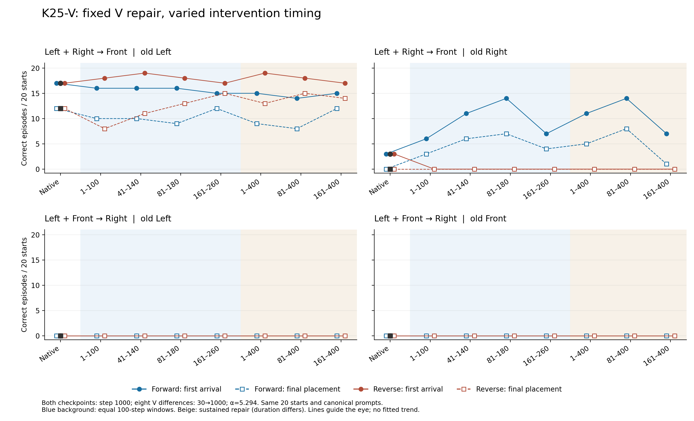
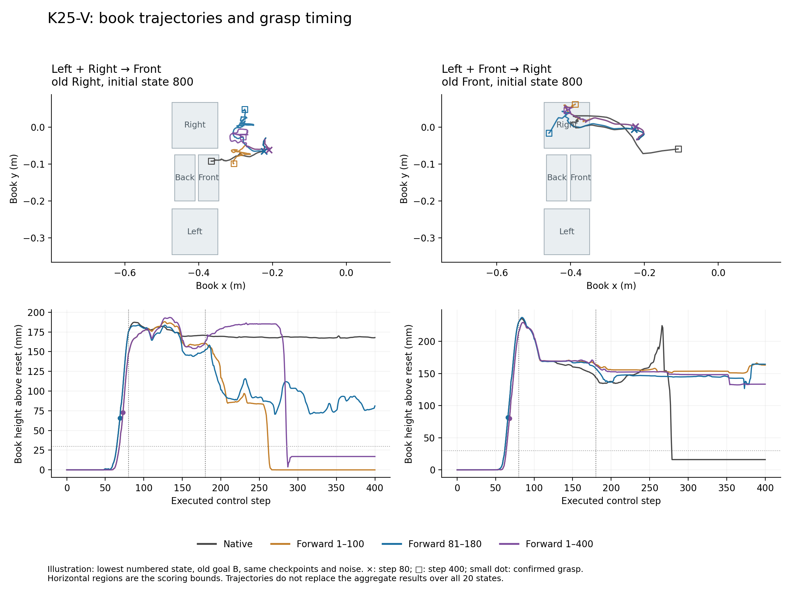

# K25-V：Early-V 与 Delayed-V 的配对时间窗实验

2026-11-22 · SmolVLA／LIBERO Scene2 · 接续 K25-final 与 K25-order-validation

本轮实际完成 **1200 个完整 400 步回合**，按固定方案比较七个时间窗及正反修正。主要发现是：**介入阶段确实影响修复，但把修正从第 1 步一直开到第 400 步，仍不能恢复 Left＋Front→Right 的旧任务。因此，不能把跨学习组合的失效全归因于第 81 步介入太晚。**

Left＋Right→Front 的旧 Right 首达／终态从原生 **3／0**，变为早期 1–100 的 **6／3**、延后 81–180 的 **14／7**、全程 1–400 的 **11／5**，各 /20。七个正向窗口均未同时保持原生 Left 的 17/20 首达与 12/20 终态。Left＋Front→Right 的旧 Left、Front，在全部七个窗口、两种符号下，首达与终态均为 **0/20**。

## 问题与控制

上一轮不同学习组合都只在第 81–180 步修正。因此，Left＋Front→Right 未恢复旧任务，还不能排除“第 81 步以前已经走错，修正来得太晚”。本轮直接改变时间掩码，检查从复位就修正、等长中段插入、以及持续至回合末尾的结果。

比较 **Left＋Right→Front** 与 **Left＋Front→Right** 两条续训线的第 1000 步模型。加号表示旧任务联合训练，箭头表示之后只训练一个新目标。本轮不训练、不换检查点、不换措辞、不重标定增益：各线固定自己的第 30→1000 步八张交叉注意力 V 权重差、α=5.294038631688923、规范句、噪声、20 个初态、400 步长度、动作裁剪和评分。

真实指令完整输入续训模型 F，由 F 在当前观察上读出 A／B／N 并生成动作。A／B 在 Front 续训线为 Left／Right，在 Right 续训线为 Left／Front。正确目标只用于事后评分；父模型不执行修复回合。每十步重规划一次，干预块在第一轮去噪读出符号，在十轮去噪中重算 V 区别修正：

$$
v_{\rm exec}(q,o,x,t)=v_F(q,o,x,t)+m_w(k)\,\alpha\,p\,\hat{s}_F(q,o,x_0,1)\,\Delta d_{V,F}(o,x,t),
$$

$$
\Delta d_{V,F}=\frac{[v_F^{V_{30}}(A)-v_F(A)]-[v_F^{V_{30}}(B)-v_F(B)]}{2}.
$$

$m_w(k)$ 是唯一改变的时间掩码；$p=+1/-1$ 是每个时间窗配套的正／反对照。$v_F^{V_{30}}$ 仅临时恢复动作专家层 1、3、5、7、9、11、13、15 的八张 V，其他权重均为第 1000 步。修正保留当前 F 的共同响应 μ；这不是父模型执行或整套历史动作替换。

“同一条修正”指每条训练线内的权重差、算法和强度固定；Δd 随当前观察、动作草稿和去噪时刻重新计算。时间窗使状态自然分叉后，Δd 的数值可以不同。两条训练线的父模型、旧目标组合和归一化本来不同，本实验没有把这些差异单独隔离，所以不能把跨线差异唯一归因于指令顺序。

| 类别 | 一基控制步时间窗 | 修正步数 | 回答的问题 |
| --- | --- | ---: | --- |
| 原生 | 无 | 0 | 原始能力与干预前状态 |
| 等长窗 | 1–100、41–140、81–180、161–260 | 各 100 | 相同作用时长，移动介入阶段 |
| 持续窗 | 1–400、81–400、161–400 | 400、320、240 | 从不同起点持续到结束 |

1–400 与 81–180 同时改变开始时间和作用长度，不能单独称为“提前”的效果。另用 1–100 对 1–400、81–180 对 81–400、161–260 对 161–400 比较撤除修正：每一对在停止前逐值相同，之后才分叉。全部七个窗口均报告正向和反向，不依据中途结果挑选窗口。每个窗口对两条旧指令相同，不把不同目标各自最好的窗口拼成一个已验证策略。

## 样本与事件定义

本轮网格为 2 条训练线 × 20 初态 × 2 旧指令 ×（1 原生＋7 窗口×2 符号）＝**1200 个回合**。每个目标、每个条件的分母为 **20**。这些是上一轮的 800–819 初态，本轮属于针对时间混杂的机制检验，不能当作新留出集。200 条已有条件在本轮完整复跑，用于核对复现一致性；不算新增独立证据。

首达要求书本抬高超过 3 厘米，连续五步处在某格的水平区域，并且最早稳定段只对应目标格。终态使用第 400 步的 LIBERO 放置判据；“曾放好”表示回合内至少一步满足判据，不能代替终态。抓取要求双指接触并抬高，连续五步稳定。干预前首达／抓取只有五个确认步全部位于干预前才计入，第 78–82 步的事件不能声称第 80 步已经确认。

每个回合保存 400 步书本／夹爪 XYZ、实际裁剪后动作、接触及几何判据。另核对十步边界的物理、控制器与图像签名。全局首达一旦在介入前发生，后续转向不能把它改写；因此另外统计介入后是否到达正确格、以及是否最终救回正确放置。没有先到错格，也不能自动排除此前已有错误运动趋势。

规范句本身参与读出参考，零距离匹配不是措辞泛化证据。距离并列时沿用 A、B、N 的固定次序，未用真实标签强制修正读出。共同响应守恒是同一输入上规范 A／B 获得相反修正的代数性质，不代表闭环轨迹平均守恒。

## 完整首达与最终放置

每格为 **首达／第 400 步终态成功**，所有数字的分母均为 20。成对成绩要求同一物理初态分别复位执行两条旧句，两个回合都正确。反向只改变修正符号，首次观察、噪声与读出距离逐回合相同。

### Left＋Right→Front，续训第 1000 步

| 时间窗 | 正向 Left | 正向 Right | 正向成对 | 反向 Left | 反向 Right | 反向成对 |
| --- | ---: | ---: | ---: | ---: | ---: | ---: |
| 原生 | 17／12 | 3／0 | 3／0 | — | — | — |
| 1–100 | 16／10 | 6／3 | 6／1 | 18／8 | 0／0 | 0／0 |
| 41–140 | 16／10 | 11／6 | 10／4 | 19／11 | 0／0 | 0／0 |
| 81–180 | 16／9 | 14／7 | 13／3 | 18／13 | 0／0 | 0／0 |
| 161–260 | 15／12 | 7／4 | 6／2 | 17／15 | 0／0 | 0／0 |
| 1–400 | 15／9 | 11／5 | 10／3 | 19／13 | 0／0 | 0／0 |
| 81–400 | 14／8 | 14／8 | 11／2 | 18／15 | 0／0 | 0／0 |
| 161–400 | 15／12 | 7／1 | 6／1 | 17／14 | 0／0 | 0／0 |

### Left＋Front→Right，续训第 1000 步

| 时间窗 | 正向 Left | 正向 Front | 正向成对 | 反向 Left | 反向 Front | 反向成对 |
| --- | ---: | ---: | ---: | ---: | ---: | ---: |
| 原生 | 0／0 | 0／0 | 0／0 | — | — | — |
| 1–100 | 0／0 | 0／0 | 0／0 | 0／0 | 0／0 | 0／0 |
| 41–140 | 0／0 | 0／0 | 0／0 | 0／0 | 0／0 | 0／0 |
| 81–180 | 0／0 | 0／0 | 0／0 | 0／0 | 0／0 | 0／0 |
| 161–260 | 0／0 | 0／0 | 0／0 | 0／0 | 0／0 | 0／0 |
| 1–400 | 0／0 | 0／0 | 0／0 | 0／0 | 0／0 | 0／0 |
| 81–400 | 0／0 | 0／0 | 0／0 | 0／0 | 0／0 | 0／0 |
| 161–400 | 0／0 | 0／0 | 0／0 | 0／0 | 0／0 | 0／0 |



图中蓝色背景为等长 100 步窗口，米色背景为持续窗口；连线仅帮助阅读，不是时间回归或最优窗口拟合。

### 等长窗口：直接的 Early-V／Delayed-V 配对

以既有 81–180 为参照，下表统计移到其他 100 步窗口后，Right 的逐初态获益／损失，不能把净变化当成所有回合统一变好或变坏。

| 新窗口相对 81–180 | Right 首达获益／损失 | Right 终态获益／损失 | Left 首达获益／损失 |
| --- | ---: | ---: | ---: |
| 1–100 | 1／9 | 1／5 | 1／1 |
| 41–140 | 0／3 | 2／3 | 1／1 |
| 161–260 | 3／10 | 2／5 | 0／1 |

提前到 1–100 后，Right 首达有 1 个新增正确、9 个失去正确，净少 8 个；终态有 1 个获益、5 个损失。Left 的总首达虽同为 16/20，实际也有一得一失，不能声称逐回合保住 Left。41–140 的 Right 首达为 11/20，161–260 为 7/20。这里支持时间阶段会改变有效性，不支持越早越好。

### 同一起点：继续修正还是停止

以下配对在停止时刻前的状态和动作逐值相同。表中获益／损失均指从短窗口改为持续到 400 步。

| 持续组相对短组 | Right 首达获益／损失 | Right 终态获益／损失 | Left 首达获益／损失 | Left 终态获益／损失 |
| --- | ---: | ---: | ---: | ---: |
| 1–400／1–100 | 5／0 | 4／2 | 0／1 | 2／3 |
| 81–400／81–180 | 0／0 | 3／2 | 0／2 | 0／1 |
| 161–400／161–260 | 0／0 | 0／3 | 0／0 | 0／0 |

1–400 相比 1–100，把 Right 首达从 6/20 提高到 11/20，终态从 3/20 到 5/20：早期短窗确实遗漏了仍有价值的后续修正。但它仍低于 81–180 的 14/20 首达、7/20 终态，且 Left 从短窗的 16／10 降为 15／9。1–400 对 81–180 同时改变起点与时长，不能据此单独估计提前效应。

81–400 相比 81–180，Right 首达保持 14/20，终态从 7/20 到 8/20；这个净增 1 实际包含 3 个获益和 2 个损失，Left 首达从 16/20 降到 14/20。161–400 相比 161–260，Right 首达同为 7/20，终态却从 4/20 降到 1/20，三个原本最终成功的回合全部丢失。后段持续修正会改变放置结果，不能用首达成功替代放置验收。

## 第 80 步前发生了什么

全部 20 个初态、两条训练线和两条旧句，在第 80 步前均没有确认首达任何格；第 40 步前也均未确认稳定抓取。第 80 步时已经存在抓取后的运动差异：

| 学习组合 | 旧指令 | 第 80 步前确认抓取 | 抓取确认后至第 80 步，旧向减新向接近量中位数 mm | 第 160 步前已确认首达 |
| --- | --- | ---: | ---: | --- |
| LR→Front | left | 18/20 | 25.436（n=18） | left 13；none 7 |
| LR→Front | right | 13/20 | -2.315（n=13） | none 16；front 4 |
| LF→Right | left | 17/20 | -39.392（n=17） | right 17；none 3 |
| LF→Right | front | 15/20 | -11.040（n=15） | right 17；none 3 |

接近量是书本到格中心的水平距离缩短之差；负数表示相对更接近新格，计算从抓取稳定的确认步开始，只包含表内 n 个已抓起回合。它是几何趋势，不是对策略意图的直接读出。**没有首达错格，不代表第 80 步前没有偏航。** Right 续训线的旧 Left／Front 已表现出朝新 Right 的相对运动偏向，因此需要直接控制介入时间来检验。

因此，不能仅凭第 80 步时尚未进格，断言延后干预没有来晚。直接反事实是 1–400：它从抓取前就持续修正，旧任务仍全部为零。被排除的是“同一修正只要提前或延长便能恢复”的解释，而不是“早期原生动作可能已偏”的事实。

### 很晚介入时，区分既成首达和后续转向

Front 续训线的 Right 在第 160 步前已有 4/20 首先到 Front。后续转向不能擦掉这些全局首达，因此另外报告介入后行为：

| 正向窗口 | 全局首先到 Right | 介入后首次稳定到达为 Right | 介入后曾稳定到达 Right | Right 最终放置 |
| --- | ---: | ---: | ---: | ---: |
| 161–260 | 7 | 9 | 10 | 4 |
| 161–400 | 7 | 9 | 11 | 1 |

Right 续训线的两条旧句在第 160 步前各有 17/20 已首达新 Right；两个晚窗在介入后到达旧格、最终放置旧格仍均为零。本批所有正向窗口中，都没有出现“介入前已经确认错首达，最后仍成功放到正确旧格”的回合。



图示固定使用最小编号 800，展示两条线的旧 B 指令；它是例图，不按成功挑选。该 Front 旧句在 1–400 的 40 个动作块中均读出 B，检出稳定抓取，仍先到新 Right。全体判断依据上面的 20 初态统计。

## 失效并非没有抓起或没有真正施加修正

全部时间窗、两条线、正反两组，两条规范旧句均有 20/20 回合在每个干预块读出正确，首次无距离并列。此结果只说明规范参考匹配一致，不能独立证明措辞或语义泛化。

Front 续训线原生两条旧句均有 20/20 检出抓取；从第 1 步介入的两个窗口，Right 为 19/20，其余正向窗口仍为 20/20。早期与延后组 Right 首达相差 8 个，不能全部用少抓起 1 个回合解释。

Right 续训线原生 Left／Front 检出抓取为 17／17。1–100 和 1–400 的正向组为 18／17，且分别有 18／17 首达新 Right；其余正向窗口为 17／17 抓取及 17／17 首达新 Right。全部正向窗口均没有一次满足旧格放置判据，既不是只在第 400 步丢失成功，也不是普遍没有抓到书。

上一轮同批初态上，该线父模型的 Left、Front 首达／终态分别为 17／16、20／14；续训模型的新 Right 为 17／13。这些是[上一轮资格参照](K25-order-validation.md)，本轮没有重跑，不计入 1200。

| 训练线／旧句 | 首个修正块起点 | αΔd 的场 RMS 中位数 | 相对原生的实际动作 RMS 差 | 十步后夹爪位置差中位数 mm |
| --- | ---: | ---: | ---: | ---: |
| LR→Front／left | 1 | 0.15400 | 0.01948 | 5.080 |
| LR→Front／right | 1 | 0.15563 | 0.01613 | 3.816 |
| LR→Front／left | 81 | 0.23977 | 0.04110 | 11.698 |
| LR→Front／right | 81 | 0.23010 | 0.04362 | 12.393 |
| LF→Right／left | 1 | 0.11699 | 0.00906 | 2.374 |
| LF→Right／front | 1 | 0.11007 | 0.00858 | 2.225 |
| LF→Right／left | 81 | 0.22285 | 0.02109 | 4.125 |
| LF→Right／front | 81 | 0.18252 | 0.03132 | 6.306 |

场 RMS 先在首个干预块的十次去噪内取均值，再取 20 回合中位数，单位为归一化动作场；实际动作 RMS 使用送入仿真器的裁剪后 7D 控制，位置差为物理坐标。两线归一化不同，这些数值不能单独用于归因学习顺序；它们表明补丁非零，且确实改变了执行。1–400 与 1–100 的首 100 步逐值相同，因此共享第 1 步的这些量。

## 反向对照的含义

Front 续训线所有窗口的反向 Right 首达／终态均为 0／0，但不能把未到达都称为改去了 Front。只看正向已经首先到 Right 的配对回合：

| 窗口 | 正向 Right 首达数 | 反向后首先到 Front | 反向后无稳定首达 |
| --- | ---: | ---: | ---: |
| 1–100 | 6 | 3 | 3 |
| 41–140 | 11 | 4 | 7 |
| 81–180 | 14 | 7 | 7 |
| 161–260 | 7 | 7 | 0 |
| 1–400 | 11 | 5 | 6 |
| 81–400 | 14 | 8 | 6 |
| 161–400 | 7 | 7 | 0 |

161–260 和 161–400 的正向 Right 成功回合各有 7/7 在反向后改到 Front；81–180 则是 7/14 改到 Front、7/14 未到达。符号能改变该线旧 Right 的路线，但其后果随窗口不同。反向 Left 的首达达到 17–19/20，与正向的 14–16/20 形成明显不对称；对称区别修正没有自动成为对两条旧任务都合适的控制。

Right 续训线所有反向条件也都没有恢复旧 Left／Front。1–100 和 1–400 的反向组，两句各有 18/20 首达新 Right；其余窗口为 17/20。这里不存在可报告的旧目标符号恢复。

## 可以回答与尚未定位的原因

这批数据支持分开解释两个现象：

1. **Front 续训线存在阶段依赖。** 等长窗的介入阶段影响 Right；从 1–100 延续到 1–400 能救回部分路线，而持续到太晚又能破坏最终放置。时间决定同一个区别修正作用于抓取、搬运还是放置状态。保留 μ 也不保证闭环控制或 Left 逐回合无损。
2. **Right 续训线不只是延后窗口没赶上。** 原生动作在第 80 步前已经出现偏向新 Right 的几何趋势，但从第 1 步一直修正到末尾、提前到 41 步、或不同中段插入，都没有恢复旧任务。规范读出与动作变化真实存在，固定的历史 V 区别修正规则在这些状态下仍不足以给出旧目标控制。

本轮没有修改 μ、历史锚点或增益，所以**没有证明 μ 是唯一故障源，也没有证明 V 通路在所有强度和锚点下都不可修复**。尚需隔离的因素包括第 30 步锚点是否仍有旧任务控制资格、该 V 差在当前状态下的方向／幅度，以及保留的共同响应是否仍支持两条旧路线。两线父模型、旧任务集合和归一化也不同，不能把全部差异单独命名为顺序的因果效应。

本轮完善的是方法的适用边界：在所测晚期模型、固定增益、规范句与这 20 个初态下，V 区别修正可恢复部分 Right 路线，时间窗会改变收益和代价；尚无一个共同窗口同时恢复 Right 并保住原生 Left 的首达与最终放置。任何后续选窗或改锚点，都需要另锁定初态确认，不能把本表挑出的数值当作新的留出验证。第 130 步和改写句的既有结果仍按上一轮单列，本轮不外推。

## 数据、代码与复算

全部 **1200 条回合／480000 控制步**均由密集轨迹重算通过。另通过 **4480** 组共用前缀、**560** 组首次正反配对、**28** 个实际项目依赖的核验；200 条旧条件的目标、首达时间、终态、抓取与第 80 步签名一致。16 个分片均完成，队列失败列表为空。V 局部重算与只换八张 V 的响应逐值等价，权重恢复、新目标零注入逐值一致；双精度规范 A／B 共同响应守恒，转换回执行精度后的闸门最大均值 RMS 差为 **0.000640913**。这不是物理轨迹平均守恒。六项时间／事件边界单元测试通过。

原始压缩轨迹、日志、源码快照、指纹与方案见[数据及重跑说明](results/2026-11-22/k25_v_timing/README.md)；全部配对变化、读出与抓取表见[统计明细](results/2026-11-22/k25_v_timing/tables.md)。两张图均有同名 PDF 矢量版本。模型、训练示范与缓存留在服务器，本目录保存实验记录。

```powershell
python -m unittest discover -s tests -p test_k25_v_timing.py -v
python scripts/k25/summarize_v_timing.py docs/results/2026-11-22/k25_v_timing --check
```
