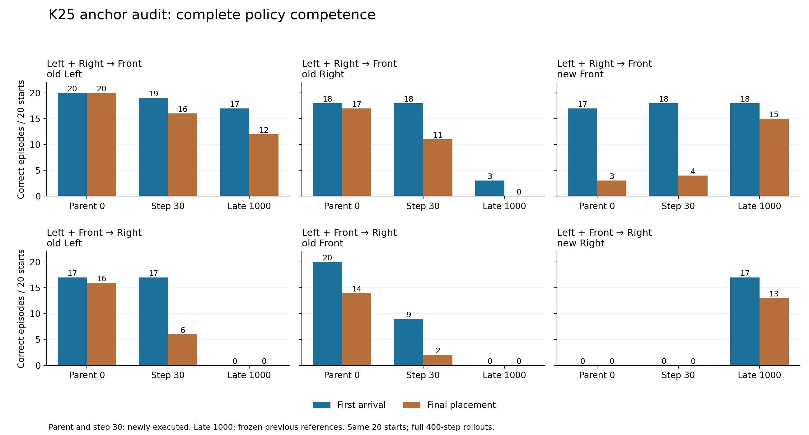
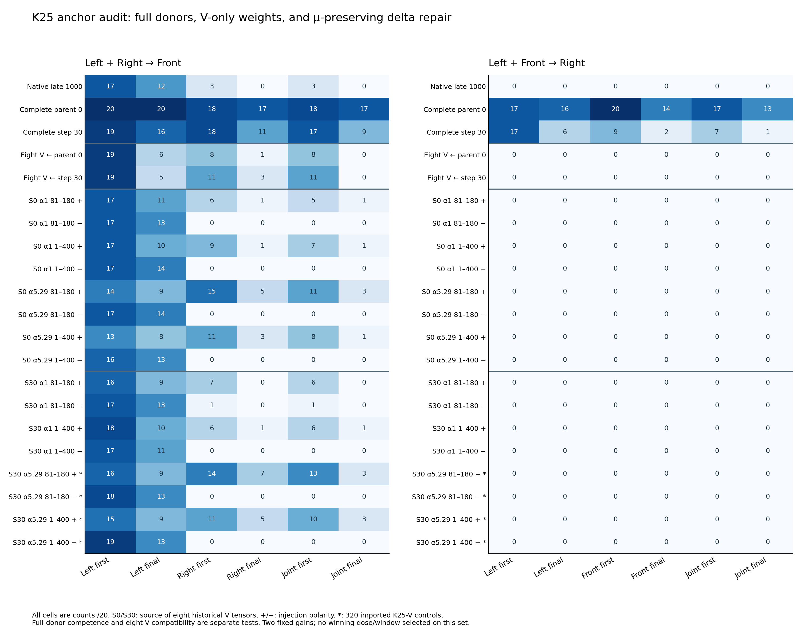

# K25-anchor：第 0／30 步 V 锚点资格与适用范围审计

2026-11-23 · SmolVLA／LIBERO Scene2 · 接续 [K25-V](K25-V.md)

本轮把第 30 步锚点与新任务续训前的父模型直接对照，分别检验完整策略、八张 V 的兼容性和保留晚期 μ 的区别修复。**更换为第 0 步锚点后，Left＋Front→Right 的旧 Left、Front 在两档增益、两个时间窗及正反符号下，首达和最终放置仍全部为 0/20。第 30 步的选择缺少跨路线资格证明，但失败不能只归因于选错第 30 步。**

本轮形成 **1360 条完整网格回合**，加上 K25-V 的 **320 条既有对照，共 1680 条网格记录**。另列 120 条既有晚期原生参照。中断恢复的 8 次完整技术复验不计入统计样本；实际新完成的 400 步执行共 1368 次。全部条件仍配对复用 20 个物理初态，不能把回合总数当成独立样本量。

## 第 30 步从哪里来，是否选错了文件

第 30 步来自最初 Left＋Right→Front 的 **30→130 局部训练退化窗口**。历史 K24 中，第 30 步旧 Right 从已经抓起书的交接状态有 18/20 首达，续训至第 130 步降为 2/20；这支持用它分析该窗口内的参数改动，不等于证明它从复位起能抓取并保住两个旧任务，也没有证明它优于续训前父模型。历史记录没有给出将“第 30 步”作为跨学习组合通用恢复锚点的验收规则。见[原始窗口记录](results/2026-11-23/k25_anchor/history/K24-final-window.md)和[后续方法记录](results/2026-11-23/k25_anchor/history/K25-final.md)。

本轮所说的 **第 0 步／原生父模型**，是各线已经训练过两项旧任务、尚未开始新任务续训的模型：LR 的 R1-24000 与 LF 的 R0-12000。它不是未微调的 SmolVLA 基础模型；第 0、30、1000 均为新任务续训的相对步数。未微调基础模型也须先验证 Scene2 旧任务能力，不能仅凭它更早就赋予恢复资格。

来源核验通过：两份训练初始化清单的路径与 SHA256 均匹配本轮父模型；两个第 30 步文件的步数、重载或完成标记均匹配。LR 的 345 个冻结张量与父模型逐值相同；LF 第 30 步为 155 个可训练张量的部分检查点，按原训练冻结不变记录继承父模型其余参数。八张 V 的层名、形状、差值指纹及实际赋值都经过核验。因此这里需要质疑的是**行为资格和晚期兼容性**，没有发现拿错检查点的证据。详见[初始化审计](results/2026-11-23/k25_anchor/initialization_audit.json)、[协议](results/2026-11-23/k25_anchor/protocol.json)。

## 三层检验，其他条件固定

两条路线均固定第 1000 步执行模型、规范真实句、每线自己的归一化、噪声、动作裁剪、400 步长度和 800–819 初态。本轮不训练新模型，不重新选择增益。跨线比较固定的是方法和剂量规则，每线的历史权重差均由该线自身的 0／30 与 1000 模型计算。A／B 在 LR 线为 Left／Right，在 LF 线为 Left／Front；N 为之后续训的新目标。

1. **完整策略资格**：第 0／30 步模型自己从复位执行 A、B、N，共 240 回合。
2. **V 的兼容性**：第 1000 步只把八张 V 换为第 0／30 步的值，全程执行两条旧任务，共 160 回合；其余晚期参数保持不变。
3. **单模型区别修复**：锚点 0／30 × α=1／5.294038631688923 × 81–180／1–400 × 正／反符号 × 两条旧任务 × 20 初态 × 两条路线，共 1280 条，其中 320 条来自已完成的 K25-V，960 条在本轮执行。

八张 V 为动作专家奇数层 1、3、5、7、9、11、13、15 的交叉注意力 V 投影。设 U 是其余参数，F=(U₁₀₀₀,V₁₀₀₀)，锚点 a∈{0,30}，则：

$$
\Delta d_a=\frac{[v_{(U_{1000},V_a)}(A)-v_F(A)]-[v_{(U_{1000},V_a)}(B)-v_F(B)]}{2},\qquad
v_{\rm exec}(q)=v_F(q)+m_w\,\alpha\,p\,\hat s_F(q)\,\Delta d_a.
$$

所有项都在同一个当前观察、动作草稿和去噪时刻上计算。真实指令完整输入 F，由 F 自己读出方向并生成动作；目标标签只用于事后评分。父模型不执行修复回合。正反组只翻转 p，首次观察、噪声、读出距离相同。每十步重新规划，干预块内十次去噪都重算 Δd。

完整供体测的是 (Uₐ,Vₐ)，V 替换测的是 (U₁₀₀₀,Vₐ)，主修复进一步只保留该替换引起的动作区别变化，仍使用晚期共同响应 μ₁₀₀₀。因此完整父模型有能力，不保证它的八张 V 或区别分量单独具备恢复能力。

首达使用书本抬高超过 3 厘米、连续五步稳定处于目标格的最早唯一事件；最终放置使用第 400 步 LIBERO 判据。两旧任务成对成绩要求同一初态分别复位执行两句都正确。下表每格均为 **首达／最终放置，分母均为 20**；曾放好、抓取与读出另外保存，不混入最终成绩。

## 完整供体：第 0、30、1000 步的旧任务能力

### Left＋Right→Front

| 完整执行策略 | Left | Right | 新 Front | 两旧任务成对 |
| --- | --- | --- | --- | --- |
| 父模型 0 | 20／20 | 18／17 | 17／3 | 18／17 |
| 第 30 步 | 19／16 | 18／11 | 18／4 | 17／9 |
| 第 1000 步（既有参照） | 17／12 | 3／0 | 18／15 | 3／0 |

### Left＋Front→Right

| 完整执行策略 | Left | Front | 新 Right | 两旧任务成对 |
| --- | --- | --- | --- | --- |
| 父模型 0 | 17／16 | 20／14 | 0／0 | 17／13 |
| 第 30 步 | 17／6 | 9／2 | 0／0 | 7／1 |
| 第 1000 步（既有参照） | 0／0 | 0／0 | 17／13 | 0／0 |

LF 的旧 Front 从父模型 20／14 降至第 30 步 9／2；旧 Left 从 17／16 变为 17／6。LR 的旧 Right 首达虽然同为 18/20，最终放置却从 17/20 降到 11/20。第 30 步在两个组合上都不能直接视为与父模型等同健康的完整策略，尤其 LF 的旧 Front 已明显退化。

父模型与第 30 步的比较均为本轮完整自主回合。LF 父模型的 40 条旧任务条件还与上一轮档案逐回合核对；LR／LF 第 30 步均未借用已抓取状态替代复位执行。首达尚可而最终放置下降，仍表示完整动作控制已受损，不能用首达一项发放恢复资格。

因此，在本批“旧策略是否健康”的资格参照上，续训前父模型比固定第 30 步有更直接的依据；目前没有支持优先选择第 30 步作为通用恢复供体的证据。但完整策略更健康不保证它产生的 Δd 更有效，必须由下面的晚期模型对照决定。

## 只恢复八张 V，能否带回父模型能力

| 学习组合 | V 来源 | 旧 A 首达／终态 | 旧 B 首达／终态 | 成对 | A 首达获益／损失 | B 首达获益／损失 |
| --- | --- | --- | --- | --- | --- | --- |
| Left＋Right→Front | 0 | 19／6 | 8／1 | 8／0 | 3／1 | 5／0 |
| Left＋Right→Front | 30 | 19／5 | 11／3 | 11／0 | 3／1 | 8／0 |
| Left＋Front→Right | 0 | 0／0 | 0／0 | 0／0 | 0／0 | 0／0 |
| Left＋Front→Right | 30 | 0／0 | 0／0 | 0／0 | 0／0 | 0／0 |

LF 线即便全程恢复父模型第 0 步的八张 V，两条旧任务的首达和最终放置仍为 0/20。这个对照允许 V 同时改变共同项与区别项，比只加 Δd 更宽，但仍没有把完整父模型的能力带回来。因此不能把失效仅解释为“第 30 步供体已经坏了”。

进一步固定 V₀，对比完整父模型 (U₀,V₀) 与晚期只换 V 的 (U₁₀₀₀,V₀)：LF 旧 Left 为 17／16 对 0／0，旧 Front 为 20／14 对 0／0。同一复位、指令、采样与 V₀ 下，改变八张 V 之外的参数背景造成明显能力差异。这为其余 147 个可训练张量的联合变化／交互作用提供了直接对照；不代表每个张量都分别必要，也没有把作用唯一定位到 μ。完整回退父模型还会失去其原本不会的新任务，不能当成保留续训能力的单模型修复。

## 保留晚期 μ：全部锚点、剂量、窗口及反向对照

### Left＋Right→Front

| 锚点 | α | 控制步 | 正 Left | 正 Right | 正成对 | 反 Left | 反 Right | 反成对 |
| --- | --- | --- | --- | --- | --- | --- | --- | --- |
| 0 | 1 | 81–180 | 17／11 | 6／1 | 5／1 | 17／13 | 0／0 | 0／0 |
| 0 | 1 | 1–400 | 17／10 | 9／1 | 7／1 | 17／14 | 0／0 | 0／0 |
| 0 | 5.294 | 81–180 | 14／9 | 15／5 | 11／3 | 17／14 | 0／0 | 0／0 |
| 0 | 5.294 | 1–400 | 13／8 | 11／3 | 8／1 | 16／13 | 0／0 | 0／0 |
| 30 | 1 | 81–180 | 16／9 | 7／0 | 6／0 | 17／13 | 1／0 | 1／0 |
| 30 | 1 | 1–400 | 18／10 | 6／1 | 6／1 | 17／11 | 0／0 | 0／0 |
| 30 | 5.294 | 81–180 | 16／9 | 14／7 | 13／3 | 18／13 | 0／0 | 0／0 |
| 30 | 5.294 | 1–400 | 15／9 | 11／5 | 10／3 | 19／13 | 0／0 | 0／0 |

### Left＋Front→Right

| 锚点 | α | 控制步 | 正 Left | 正 Front | 正成对 | 反 Left | 反 Front | 反成对 |
| --- | --- | --- | --- | --- | --- | --- | --- | --- |
| 0 | 1 | 81–180 | 0／0 | 0／0 | 0／0 | 0／0 | 0／0 | 0／0 |
| 0 | 1 | 1–400 | 0／0 | 0／0 | 0／0 | 0／0 | 0／0 | 0／0 |
| 0 | 5.294 | 81–180 | 0／0 | 0／0 | 0／0 | 0／0 | 0／0 | 0／0 |
| 0 | 5.294 | 1–400 | 0／0 | 0／0 | 0／0 | 0／0 | 0／0 | 0／0 |
| 30 | 1 | 81–180 | 0／0 | 0／0 | 0／0 | 0／0 | 0／0 | 0／0 |
| 30 | 1 | 1–400 | 0／0 | 0／0 | 0／0 | 0／0 | 0／0 | 0／0 |
| 30 | 5.294 | 81–180 | 0／0 | 0／0 | 0／0 | 0／0 | 0／0 | 0／0 |
| 30 | 5.294 | 1–400 | 0／0 | 0／0 | 0／0 | 0／0 | 0／0 | 0／0 |

在 LR、α=5.294、81–180 中，仅把锚点从 30 换为 0，Right 从 14／7 变为 15／5，Left 从 16／9 变为 14／9。这说明“完整供体策略更健康”并不能单调排序它产生的晚期区别修正效果；Right 首达的小幅增加也不能掩盖最终放置或另一旧任务的损失。

锚点 30、α=5.294 的四个符号／窗口组合每线 160 条，两线共 320 条引用 K25-V；其余表格回合在本轮执行。引用前验证原始文件哈希、权重差指纹和 160 次同输入首块动作／读出探针；密集轨迹也重新评分。每线 8 个正向配置均保留报告，没有为两条旧任务分别挑选最优时间窗再拼接结果。

### 反向到底去了哪里

以原方法 α=5.294 为例，下表报告旧 B 的完整首达分布。`none` 表示没有稳定首达，不能计为去了新目标。每个正反配对的首次状态与读出距离相同；后续状态分叉后，读出和 Δd 可自然不同。

| 学习组合 | 锚点 | 控制步 | 正向旧 B 首达分布 | 反向旧 B 首达分布 |
| --- | --- | --- | --- | --- |
| Left＋Right→Front | 0 | 81–180 | {"none": 5, "right": 15} | {"front": 14, "none": 6} |
| Left＋Right→Front | 0 | 1–400 | {"none": 9, "right": 11} | {"front": 8, "none": 12} |
| Left＋Right→Front | 30 | 81–180 | {"none": 6, "right": 14} | {"front": 11, "none": 9} |
| Left＋Right→Front | 30 | 1–400 | {"none": 9, "right": 11} | {"front": 7, "none": 13} |
| Left＋Front→Right | 0 | 81–180 | {"none": 3, "right": 17} | {"none": 3, "right": 17} |
| Left＋Front→Right | 0 | 1–400 | {"none": 7, "right": 13} | {"none": 2, "right": 18} |
| Left＋Front→Right | 30 | 81–180 | {"none": 3, "right": 17} | {"none": 3, "right": 17} |
| Left＋Front→Right | 30 | 1–400 | {"none": 3, "right": 17} | {"none": 2, "right": 18} |

## 换锚点的逐初态获益与损失

下表固定剂量、窗口和正向符号，仅将第 30 步锚点换为第 0 步。每格为正确数的**获益／损失**，不是总成功率。逐初态编号、完整首达转移、正反对照转移均在 summary.json 中保存。

| 学习组合 | α | 控制步 | A 首达 | A 终态 | B 首达 | B 终态 |
| --- | --- | --- | --- | --- | --- | --- |
| Left＋Right→Front | 1 | 81–180 | 1／0 | 2／0 | 1／2 | 1／0 |
| Left＋Right→Front | 1 | 1–400 | 1／2 | 4／4 | 3／0 | 1／1 |
| Left＋Right→Front | 5.294 | 81–180 | 0／2 | 1／1 | 1／0 | 2／4 |
| Left＋Right→Front | 5.294 | 1–400 | 0／2 | 0／1 | 1／1 | 2／4 |
| Left＋Front→Right | 1 | 81–180 | 0／0 | 0／0 | 0／0 | 0／0 |
| Left＋Front→Right | 1 | 1–400 | 0／0 | 0／0 | 0／0 | 0／0 |
| Left＋Front→Right | 5.294 | 81–180 | 0／0 | 0／0 | 0／0 | 0／0 |
| Left＋Front→Right | 5.294 | 1–400 | 0／0 | 0／0 | 0／0 | 0／0 |

## 能否同时恢复、是否有跨路线共同配置

锁定分析计划要求：同一锚点、剂量、窗口应用于两条旧任务；逐项报告首达和最终放置，不能用 Right 的提升抵消 Left 的下降。原计划的“旧 B 两指标提升且四个旧指标总数不低于原生”只是候选筛查，LF 的原生旧 A 为零，不能把仍为零视为恢复成功。为避免这个零基线误判，报告另加两项描述性核对：所有相对父模型已退化的旧指标是否都严格改善，以及是否达到父模型的四项旧任务计数。这两项补充判据不是原计划预先指定的验收阈值；全部比较均为本批描述，未做独立选参验证。

| 学习组合 | B 改善且四项总数无下降 | 全部退化指标都改善 | 达到父模型四项计数 |
| --- | --- | --- | --- |
| Left＋Right→Front | 无 | 无 | 无 |
| Left＋Front→Right | 无 | 无 | 无 |

两条路线共享且所有退化指标都改善的配置：**无**。达到两条路线父模型四项旧任务计数的共享配置：**无**。总数不下降仍不保证每个初态都保留成功，具体获益／损失另表报告。

## 八张 V 的差异与实现核验

| 学习组合 | (V₀−V₁₀₀₀) 与 (V₃₀−V₁₀₀₀) 参数空间余弦 |
| --- | --- |
| Left＋Right→Front | 0.995912 |
| Left＋Front→Right | 0.997107 |

两个源锚点到晚期的 V 差方向很接近。这是参数空间描述，不能把相近程度解释成行为保留率，也不能据此跳过行为检验。源张量的逐层范数、总体范数与 SHA256 见 weights_inventory.json。

全部 16 个分片共完成 64 组闸门：确认只有一个 F 执行、局部重算与实际八张 V 替换相等、原权重恢复、规范 A／B 修正反对称、读出 N 时零注入。μ 在 float64 代数检验中保留；转回执行 dtype 后最大成对均值残差 RMS 为 0.0011603879。这不等于两条闭环轨迹的平均运动守恒。

已逐一核对 1280 条区别修复记录的干预前原生前缀、640 对正反组的同首次读出，以及 1360 条本轮轨迹和 320 条引用轨迹的密集动作与评分。规范句本身参与参考读出，零距离匹配不构成措辞泛化证据；并列按既有 A、B、N 次序处理。完整首次读出、并列块数、Δd 大小、抓取、曾成功及反向首达分布见[补充表](results/2026-11-23/k25_anchor/supplementary_tables.md)。

LF 的全部规范句条件均有 20/20 回合在所有干预块读出对应旧目标，并列块数为零；各条件首块 Δd RMS 中位数为 0.020792–0.048340（速度场七个执行维度，未乘 α）。因此不是读出 N 而使修正未开启。这里验证的是本批规范句的注入分支和非零响应，仍不构成旧目标语义或改写句泛化已经恢复的证明。

本轮没有为修复条件新增 N 的完整闭环评估。N 零注入闸门只证明在模型读出 N 时本次修正为零，不能代替新任务保持率，也不能证明所有 N 指令都被正确读出。

## 对方法叙事的修正

1. **第 30 步不是经过证明的通用恢复锚点。** 它最初有单路线局部归因用途；将相对训练步数直接迁移到另一条路线，缺少旧任务能力验收。第 0／30 步必须先逐任务、逐指标比较，再分别检验 V 的晚期兼容性。
2. **父模型会旧任务，不意味着八张 V 能独立保存完整恢复能力。** 完整父模型、晚期 V 替换与保留 μ 的 Δd 修复在本轮被分别测试；这三者不能互相替代资格。
3. **时间、供体与执行背景需要分别检验。** K25-V 已发现全程 1–400 仍失效，本轮又加入第 0 步供体。即便二者都失败，也只能排除这两个具体解释足以解决问题，不能把剩余原因唯一定位到 μ、某个未测模块或表征完全消失。
4. **当前适用范围应收窄。** 单路线改善与反向转向可以构成该路线上的局部机制证据；只有共享配置在不同路线都恢复已退化指标、保住另一旧任务，并经独立初态和训练重复验证后，才可主张通用续训修复。

本批只含两条已有学习组合和各自既有训练轨迹，旧任务集合、父模型与归一化也有差别，尚非完整反平衡的纯顺序因果实验；这个限制不能抹去 LF 路线上实际观察到的修复失败。每格只有同一批 20 初态，没有新的措辞或独立留出集。未检验其他增益、更多锚点、其他参数块或整策略恢复，不能将本批零改善推广为所有修复都不可能。

## 原始记录与中断恢复

首次运行在写最终张量指纹时触发 BF16→NumPy 序列化错误，队列停止。804 条已经完整执行的 400 步记录全部保留并按源文件与 JSON 行哈希核验；未完成回合不计入样本。修复仅将张量哈希改为读取存储字节，并增加保留／续跑入口，物理网格、推理、剂量、检查点和评分均未改变。恢复运行补齐 556 条缺失条件，在八个原活动分片各完整复跑一条已有区别修正回合，全部通过 400 步轨迹、状态、动作哈希及读出逐值相同检查。

归档保留第一次源码、方案、部分原始 gzip 和错误日志，以及第二次全部 16 个完成标记。部分旧 gzip 因停止而无结束标记，恢复程序只接受可完整解码且可重评分的行。没有按成功与否重抽样或删除完整失败回合。服务器五项测试通过，包括真实 BF16 字节指纹和旧 float64 差值哈希一致性；本地纯协议测试通过，模型相关测试在服务器环境执行。

[数据、源码与复算说明](results/2026-11-23/k25_anchor/README.md) · [完整统计](results/2026-11-23/k25_anchor/summary.json) · [恢复来源清单](results/2026-11-23/k25_anchor/recovery_manifest.json) · [字节归档清单](results/2026-11-23/k25_anchor/artifact_manifest.json)
