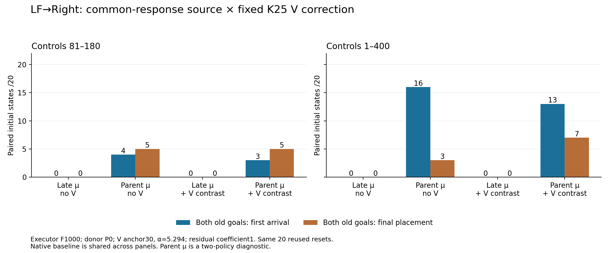
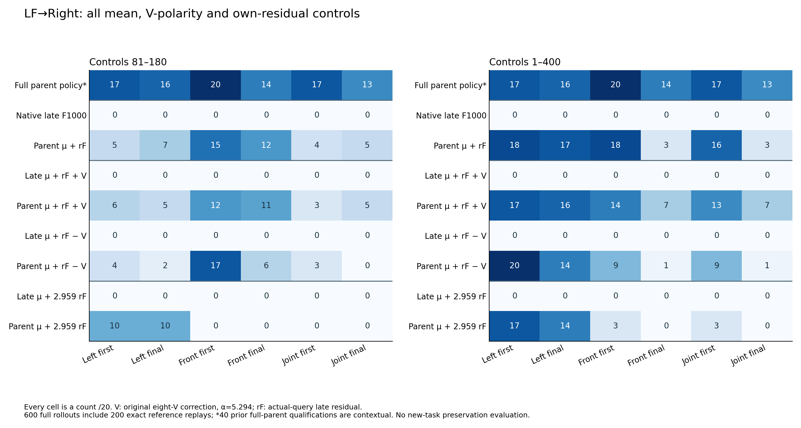

# K25-mu：在 LF→Right 上直接替换共同动作响应

2026-11-23 · SmolVLA／LIBERO Scene2 · 接续 [K25-V](K25-V.md)、[K25-anchor](K25-anchor.md)

本轮直接检验：K25 在 LF→Right 上失败，是否与它保留续训第 1000 步的共同响应 μF 有关。主对照只将 μF 换成旧任务父模型第 0 步的 μP；执行模型、真实指令、历史八张 V 差、强度、残差、符号、初态和噪声保持不变。另测只换 μ，以及 K14 式的 2.959 倍实际条件残差。

**本批最关键的结果：在第 1–400 步全程替换时，不加 V、不额外放大残差，仅用父 μ＋续训实际残差，已恢复 16/20 成对首达，成对终态为 3/20。** 再加入原 K25 正向 V 项后，成对首达为 13/20、终态为 7/20。因此首次分流的主要恢复来自共同项替换；V 的追加呈现首达与终态之间的取舍。以下保留全部配置，不将这项双来源诊断称为单模型修复。

**K25 正向、81–180：**晚期 μ 的 Left／Front／成对成绩为 0／0、0／0、0／0；换父 μ 后为 **6／5、12／11、3／5**。这里每格是首达／第 400 步终态，分母均为 20。

**K25 正向、1–400：**晚期 μ 的 Left／Front／成对成绩为 0／0、0／0、0／0；换父 μ 后为 **17／16、14／7、13／7**。这里每格是首达／第 400 步终态，分母均为 20。

这轮共完成 **600 次完整 400 步执行**，其中 **400 条为新条件、200 条为既有原生／K25 条件的完整复跑**。另引用 40 条完整父模型资格记录。全部使用同一批 20 个物理初态，不是 600 个独立样本，也没有新留出集。

## 先核对 K14／K15 的成功条件

K14 第 5 节使用 **μ旧＋2.959×[v续训(q)−μ续训]**，真实 q 直接进入续训模型，旧模型只提供固定规范 Left／Right 平均，不提供当前 q 的区别符号。K15 补齐同强度的新／旧 μ 对照：晚期 μ＋2.959 残差的左右成对首达为 0/20，旧 μ＋同一残差为 17/20；旧 μ 组 Left／Right 首达为 20/20、17/20，终态为 14/20、10/20。这里的 17/20 是固定增益 S_canon，不能与逐输入匹配幅度的 16/20 混用。见[历史说明](results/2026-11-23/k25_mu_swap/history/K15-report.md)、[实际公式代码](results/2026-11-23/k25_mu_swap/history/k14s5.py)。

历史设置为 R1→Front-12000，从 Front 模型已抓稳书的 20 个共同快照接手，边界在 70–110 步，干预 60 步后交还续训模型，评估至 400 步。本轮是 **LF→Right-1000，从复位开始自主抓取**，使用另一批初态和 100／400 步窗口；因此是对共同背景假说的跨路线检验，不是原 K15 的同设置复现。2.959 在本轮沿用固定值，没有按 LF 结果重新优化。

K25 后续保留 μF，因此早期干预和更换 V 锚点的失败，并未直接检验“换成父 μ 是否有效”。这正是本轮补上的反事实。

上一轮仅将八张 V 换回父模型值时，其余参数仍是续训第 1000 步；那个模型的共同响应是 μ(U1000,V0)，仍不等于完整父模型的 μ(U0,V0)。因此“换回 V0 仍失败”并未排除本轮直接替换完整父 μ 的可能作用。

## 只改共同响应，保留哪些条件

执行端 F 固定 LF→Right 第 1000 步；父模型 P 固定 LF 旧 Left／Front 联合训练结束的 R0-12000（新任务续训相对第 0 步）。V 锚点仍为本线第 30 步，α=5.294038631688923，使用同一八张交叉注意力 V 差。主 K25 条件不额外放大原有残差，β=1。

$$
\mu_F=\frac{v_F(A)+v_F(B)}2,\quad
\mu_P=\frac{v_P(A)+v_P(B)}2,\quad
r_F(q)=v_F(q)-\mu_F,
$$
$$
\Delta d_V=\frac{[v_F^{V_{30}}(A)-v_F(A)]-[v_F^{V_{30}}(B)-v_F(B)]}{2},
$$
$$
v_{\rm exec}(q)=\mu_b+\beta r_F(q)+\alpha p\,\hat s_F(q)\,\Delta d_V,\qquad \mu_b\in\{\mu_F,\mu_P\}.
$$

A／B 在本轮是 **Left／Front**。父 μ 始终由这两句固定规范指令的平均给出；P 的单句区别不进入执行公式，也不由当前 q 选择父模型单句输出。实际完整 q 送给 F，由 F 提供实际条件残差和 K25 的方向读出。所有响应都在同一当前观察、动作草稿 x 和去噪时刻 t 上计算，每次去噪重算。均值替换作用于完整 32 维速度场，最后执行前 7 维，与既有响应计算口径一致。

K25 正反对照只翻转追加的 V 项，保留原有 rF 和共同项。K14 式对照令 α=0、β=2.959，单独比较 μF／μP；没有同时把 2.959 与 V 修正相乘。只换 μ 为 α=0、β=1。干预窗口外全部交还原生 F；窗口分别固定为控制步 81–180、1–400。

2.959 与 5.294 分别乘在 rF 和 ΔdV 上，不能直接按系数大小比较两种干预的强弱。本轮没有匹配这两种算法的最终区别范数；可以严格比较的是各自算法内部、同剂量下的 μ 来源，以及父 μ 下有／无 V 的差异。

**这是两个模型来源参与的机制诊断。** P 虽不提供当前句子的条件区别，仍参与生成共同响应。因此正向结果不能直接称为单模型 K25 已修复；修复条件的新 Right 保持率本轮也未测。

## 完整首达、最终放置和成对分流

首达要求书本抬高超过 3 厘米、连续五步稳定在最早唯一目标格；终态采用第 400 步 LIBERO 放置判据。成对成绩要求同一初态分别复位执行两句都正确。每格为 **首达／最终放置，各 /20**。“曾放好”和“抓取”另外报告，不能替代终态。

| 完整策略参照 | Left | Front | 成对 |
| --- | --- | --- | --- |
| 完整父模型 P（既有 40 条） | 17／16 | 20／14 | 17／13 |

### 控制步 81–180

| 条件 | Left | Front | 同初态两句成对 |
| --- | --- | --- | --- |
| 原生 F：μF＋rF | 0／0 | 0／0 | 0／0 |
| 只换共同项：μP＋rF | 5／7 | 15／12 | 4／5 |
| 原 K25：μF＋rF＋V | 0／0 | 0／0 | 0／0 |
| 只换 K25 的 μ：μP＋rF＋V | 6／5 | 12／11 | 3／5 |
| K14 式：μF＋2.959rF | 0／0 | 0／0 | 0／0 |
| K14 式：μP＋2.959rF | 10／10 | 0／0 | 0／0 |

### 控制步 1–400

| 条件 | Left | Front | 同初态两句成对 |
| --- | --- | --- | --- |
| 原生 F：μF＋rF | 0／0 | 0／0 | 0／0 |
| 只换共同项：μP＋rF | 18／17 | 18／3 | 16／3 |
| 原 K25：μF＋rF＋V | 0／0 | 0／0 | 0／0 |
| 只换 K25 的 μ：μP＋rF＋V | 17／16 | 14／7 | 13／7 |
| K14 式：μF＋2.959rF | 0／0 | 0／0 | 0／0 |
| K14 式：μP＋2.959rF | 17／14 | 3／0 | 3／0 |

原生 F 在两个面板中是同一批 40 条回合，不重复计数。完整父模型属于独立资格参照，不向本轮提供当前 q 的完整动作。完整父模型与“只提供其平均响应”不能混作同一条件。

## 固定修正，仅把晚期 μ 换成父 μ：逐初态获益／损失

每格是配对的**新增正确／失去正确**，不是成功率。成对指标以 20 个物理初态为单位，单句指标也分别以 20 为单位。全部初态编号保存在 summary.json。

| 窗口 | 保持的残差／V 条件 | Left 首达 | Left 终态 | Front 首达 | Front 终态 | 成对首达 | 成对终态 |
| --- | --- | --- | --- | --- | --- | --- | --- |
| 81–180 | 无 V，β=1 | 5／0 | 7／0 | 15／0 | 12／0 | 4／0 | 5／0 |
| 81–180 | K25 V＋，父 μ | 6／0 | 5／0 | 12／0 | 11／0 | 3／0 | 5／0 |
| 81–180 | K25 V−，父 μ | 4／0 | 2／0 | 17／0 | 6／0 | 3／0 | 0／0 |
| 81–180 | 2.959 倍自身残差，父 μ | 10／0 | 10／0 | 0／0 | 0／0 | 0／0 | 0／0 |
| 1–400 | 无 V，β=1 | 18／0 | 17／0 | 18／0 | 3／0 | 16／0 | 3／0 |
| 1–400 | K25 V＋，父 μ | 17／0 | 16／0 | 14／0 | 7／0 | 13／0 | 7／0 |
| 1–400 | K25 V−，父 μ | 20／0 | 14／0 | 9／0 | 1／0 | 9／0 | 1／0 |
| 1–400 | 2.959 倍自身残差，父 μ | 17／0 | 14／0 | 3／0 | 0／0 | 3／0 | 0／0 |

## 父 μ 恢复后，V 是否还带来额外收益

下面固定父 μ 和 β=1，只比较 V 正／反追加与“父 μ＋原残差，无 V”。若父 μ 单独已经救回成绩，不能把全部收益归给 V；正向若继续改善、反向又损害分流，会提供更强的符号特异证据。

| 窗口 | V 符号 | Left 首达 | Left 终态 | Front 首达 | Front 终态 | 成对首达 | 成对终态 |
| --- | --- | --- | --- | --- | --- | --- | --- |
| 81–180 | 正向 | 1／0 | 2／4 | 0／3 | 1／2 | 0／1 | 2／2 |
| 81–180 | 反向 | 0／1 | 0／5 | 2／0 | 1／7 | 0／1 | 0／5 |
| 1–400 | 正向 | 0／1 | 0／1 | 1／5 | 4／0 | 1／4 | 4／0 |
| 1–400 | 反向 | 2／0 | 0／3 | 0／9 | 0／2 | 1／8 | 0／2 |

## 反向对照的成绩与实际去向

每个正反配对在干预前使用相同状态、噪声和 F 首次读出。之后只翻转 V 追加项；原有 rF 并未翻转，所以不预设反向一定将所有回合完全交换到另一旧格。未稳定到格单列为 none。

| 窗口 | 共同项 | 反向 Left | 反向 Front | 反向成对 | 反向 Left 句首达分布 | 反向 Front 句首达分布 |
| --- | --- | --- | --- | --- | --- | --- |
| 81–180 | 晚期 μ | 0／0 | 0／0 | 0／0 | {"none": 3, "right": 17} | {"none": 3, "right": 17} |
| 81–180 | 父 μ | 4／2 | 17／6 | 3／0 | {"front": 13, "left": 4, "none": 3} | {"front": 17, "none": 3} |
| 1–400 | 晚期 μ | 0／0 | 0／0 | 0／0 | {"none": 2, "right": 18} | {"none": 2, "right": 18} |
| 1–400 | 父 μ | 20／14 | 9／1 | 9／1 | {"left": 20} | {"front": 9, "left": 9, "none": 2} |

所有正向／反向逐初态转移以及原有残差放大配对，见[补充表](results/2026-11-23/k25_mu_swap/supplementary_tables.md)。

## 对共同背景假说，能得出什么结论

在 81–180，K25 同一 V 正向修正的成对首达／终态从 0／0 变为 3／5。父 μ 不加 V 为 4／5；在它之上追加正向 V，成对首达净变 -1，成对终态净变 +0。父 μ＋2.959 倍自身残差为 0／0，这是不使用 V 的独立控制。

在 1–400，K25 同一 V 正向修正的成对首达／终态从 0／0 变为 13／7。父 μ 不加 V 为 16／3；在它之上追加正向 V，成对首达净变 -3，成对终态净变 +4。父 μ＋2.959 倍自身残差为 3／0，这是不使用 V 的独立控制。

在这批固定输入和闭环回合中，改变共同响应来源确实改善了至少部分旧任务端点。这为共同背景兼容性的解释提供了直接支持，但不等于 μ 单独解释全部失败。V 是否有额外收益仍须与“父 μ，无 V”比较；具体恢复程度以上表两个目标、两个端点及逐初态损失为准。

V 的额外作用应由“父 μ＋V”相对“父 μ，无 V”的逐初态收益和反向对照判断。本轮报告了两个窗口全部结果，未选择某个最优窗口作为已独立验证的恢复策略。

更具体地看全程 1–400：父 μ 无 V 的 Left／Front 是 18／17、18／3；加正向 V 后为 17／16、14／7。成对首达从 16 到 13，逐初态为 1 个获益、4 个损失；成对终态从 3 到 7，为 4 个获益、0 个损失。Front 终态由 3/20 到 7/20，不能把 V 说成完全没有作用；同时不能把 16/20 的无 V 首达恢复归给 V。这里的终态收益并未唯一定位到后段放置控制，也可能由前段状态准备介导。

无 V 的父 μ＋rF 条件中，方向读出不参与执行修正，输出的指令区别直接来自真实 q 所引出的续训残差。它恢复 16/20 成对首达，支持旧指令相关控制仍可在合适共同背景下发挥作用。父 μ＋2.959rF 的全程成对成绩却只有 3／0：K14 的共同背景原则有参考意义，固定 2.959 倍并未在本批 LF 设置中直接迁移。

这些是**响应层面的因果对照**：同一输入上，共同项来源改变，原有条件残差及 V 规则固定。它们不把遗忘的全部原因唯一归到 μ，也不定位产生 μ 漂移的具体权重模块。执行后状态和动作草稿自然分叉，之后重算的 rF、ΔdV 和 μ 数值可以不同，不能说整条闭环上的实际区别向量始终相同。

## 核验与统计边界

全部 40 个初态×真实句单元完成，每个 15 条、400 步；200 条原生／原 K25 参考的密集轨迹、动作哈希、41 个状态签名、读出与端点逐值复现。其余 400 条为本轮新条件。所有 600 条重新计算书本区域、稳定首达、抓取及终态标记；40 条父模型资格记录也按同一几何重新评分。

核对 560 条干预前原生前缀、240 对改变 μ 来源后的同首次读出和 160 对正反同首次读出。40 个单元各有四组 μ／区别代数闸门，另有 V 通路闸门，确认 V 局部重算等于实际八张 V 替换。运行前后两套模型参数均保持原值。

同输入代数验证使用 float64；实际执行保留原 BF16 输出类型。均值替换闸门中，转回执行类型后的最大成对均值残差 RMS 为 0.0019441596。局部规范句均值守恒不等于两条闭环轨迹平均运动守恒。规范句本身参与参考读出，距离零匹配不是措辞泛化证据。

主 K25 对照固定第 30 步 V、原强度及 β=1；2.959 只在无 V 的独立条件中使用。未重新选择最优增益，也未在父 μ 下新增第 0 步 V 锚点或其他 V 剂量。两个时间窗同时覆盖延后和从复位全程替换，但 81–180 与 1–400 的对比同时改变起点及长度，不能将差异全部称为提前介入的效果。

新 Right 的修复条件未在本轮执行。原 K25 的 V 项在读出 N 时零注入，不意味着追加父 μ 后整体输出对 N 也不变。不能从旧任务成绩推断新任务被保住。父模型响应的参与也意味着这仍不是独立单模型修复；后续若要回到单模型主线，需要另行实现和验证共同项校正的来源。

统计单位为复用的 20 个物理初态，所有配置、失败及配对损失保留。没有新的改写句、独立初态留出或训练种子重复；不能将本批条件效果提升为所有学习顺序、所有背景或所有强度下的结论。

[数据与复算说明](results/2026-11-23/k25_mu_swap/README.md) · [完整统计](results/2026-11-23/k25_mu_swap/summary.json) · [原方案](results/2026-11-23/k25_mu_swap/analysis_plan.json) · [字节清单](results/2026-11-23/k25_mu_swap/artifact_manifest.json)
