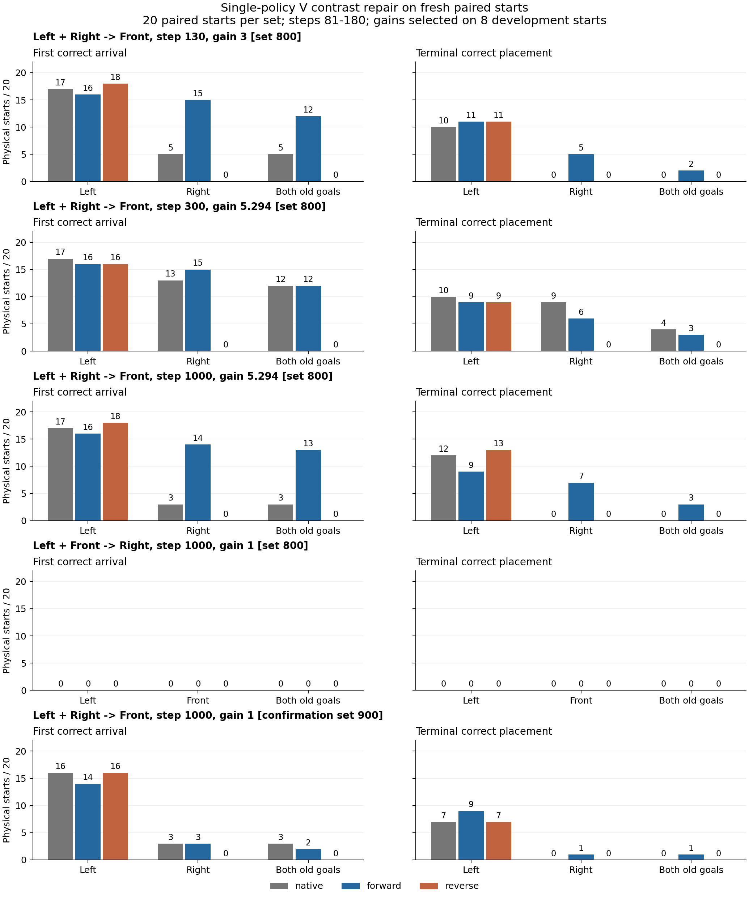

# K25 单模型修复：续训组合、晚期检查点与保守剂量确认

2026-11-22 · SmolVLA／LIBERO Scene2 · 接续 K25-final

本轮实际新增 **1272 个 400 步闭环回合**，另完成一条 Left＋Front→Right 的 1000 步续训。原有 K25-final 的 780 个回合和 120 条固定输入记录已复算一致，不计入新增数。新增结果支持 V 区别修正仍可控制更晚模型的 Right 去向，同时暴露了 Left、最终放置、措辞和学习组合的边界。所有失败回合均保留。

**本轮尚未证实：保留晚期 μ、仅选择统一 V 区别增益，就能在这些扩展条件下无损恢复旧任务。** Right 的恢复有效性与 Left 的保留需要分别验收。

## 1. 检验范围与方法

比较两种学习组合：**Left＋Right→Front** 与 **Left＋Front→Right**。加号表示两条旧任务联合训练，箭头表示随后只训练一个新目标。两个父模型分别为 R1-24000 与 R0-12000，归一化各自继承；旧目标、父模型和归一化同时变化，因此结果检验整套方法的跨组合迁移，不能把差异单独归因于顺序。

Front 线使用同一既有训练轨迹的第 130、300、1000 步。Right 线从合格的 Left＋Front 父模型重新续训：40 条已对齐的 Right 示范、batch 6、学习率 1e-4、warmup 100、种子 20261021，冻结视觉语言骨干，只更新 155 个动作专家及投影参数。第 30、300、1000 步均保存并核对重载张量，训练结束冻结参数哈希保持不变。

真实句子完整输入当前模型 $F_t$。它在同一观察、动作草稿和去噪时刻下，计算三个规范候选响应，用 50 个动作时位、7 个有效维度上的最近残差读出 A、B 或新目标 N。A/B 在 Front 线为 Left/Right，在 Right 线为 Left/Front；最近为 A 取 +1，B 取 −1，N 取 0，正确标签只用于评分。修复从真实句子的原生响应出发：

$$
\mu_t=\frac{v_t(A)+v_t(B)}2,\qquad
\Delta d_{V,t}=\frac{[v_t^{V_{30}}(A)-v_t(A)]-[v_t^{V_{30}}(B)-v_t(B)]}2,
$$

$$
v_{\mathrm{execute}}(q)=v_t(q)+\alpha\hat s_t(q)\Delta d_{V,t},
\qquad \hat s_t\in\{+1,-1,0\}.
$$


$v_t^{V_{30}}$ 指同一个当前模型仅将八张 V 临时恢复为第 30 步后重新计算的响应。历史差只作用于动作专家层 1、3、5、7、9、11、13、15 的八张交叉注意力 V 权重。每个晚期检查点都重新取 **第 30 步→当前步**的差，其他权重继续使用当前模型。第 130 步沿用 K25-final 的原始权重。晚期结果检验同一构造在重新提差后的效果，不代表把原 30→130 补丁原封不动迁移到所有晚期模型。

所有回合由单一模型从复位开始抓取。第 1–80 步原生运行，第 81–180 步允许修正，第 181–400 步回到真实句子的原生控制；每十步重新读出，每次去噪重算区别修正。正反组只翻转注入项符号。父模型另作资格参照，不参与修复回合生成动作。

规范 A/B 在同一输入上获得相反修正，其共同响应在公式中守恒。闭环分叉后观察会不同；改写句的事后平均也不自动等于规范句共同响应。逐值闸门验证 V 局部重算等于实际只替换八张 V 权重、之后权重恢复、新目标探针零注入与原生动作逐值一致。
高精度重组均值守恒；转换回执行精度后，已测闸门的最大均值 RMS 偏差为 **0.00111805**，单位是归一化动作场。

## 2. 数据划分和剂量选择

开发集为八个初态 200–207。主测试集为新生成的 800–819，共 20 个物理初态，只检查复位与几何合法性，未按抓取或搬运成绩筛选。各条件、检查点和措辞使用配对初态与噪声。首达要求抬高超过 3 厘米后，首次连续五步进入唯一目标的水平区域；终态使用第 400 步的 LIBERO 放置成功判据，不额外证明松爪后独立稳定。

开发集候选强度为 1、3、5.294；5.294 沿用原 K25 标定值，没有在新测试初态重标定。按两条旧任务中较低的首达数、成对首达、旧任务终态总数、较小强度依次选择。该规则优化平衡表现，没有强制 Left 不退步。第 300 步直接沿用第 1000 步选出的强度，单独检验时间迁移。

| 开发模型 | 选定 α | 原生 A／B 首达（各 /8） | 选定后 A／B 首达 | 成对首达，原生→修复 |
| --- | ---: | ---: | ---: | ---: |
| lr_front_130 | 3 | 7／2 | 5／5 | 2→3 |
| lr_front_1000 | 5.294 | 5／2 | 6／7 | 2→6 |
| lf_right_1000 | 1 | 0／0 | 0／0 | 0→0 |

Right 续训线三个开发剂量均无旧目标恢复，按固定并列规则取 1 倍；查看该组合正式成绩前，另锁定原 5.294 倍直接迁移对照。之后，看到主集的 Left 代价，设计了第 6 节的独立保守剂量确认，未改写最初结果。

## 3. 同一 Front 训练轨迹的晚期结果

每格为 **首达／终态**，分母均为 20；成对要求同一初态的 Left、Right 各自都正确。这里使用新初态 800–819。原 K25-final 的 600–619 初态上，130 步、5.294 倍延后修正的 Right 为 8／0→20／11，Left 为 17／10→14／9；原统计复算一致，两套初态分别报告。

| Front 续训步与条件 | Left | Right | 成对首达 | 成对终态 |
| --- | ---: | ---: | ---: | ---: |
| 130 · 原生 | 17／10 | 5／0 | 5/20 | 0/20 |
| 130 · 正向 α=3 | 16／11 | 15／5 | 12/20 | 2/20 |
| 130 · 反向 α=3 | 18／11 | 0／0 | 0/20 | 0/20 |
| 130 · 原强度正向 α=5.294 | 15／6 | 18／10 | 15/20 | 3/20 |
| 300 · 原生 | 17／10 | 13／9 | 12/20 | 4/20 |
| 300 · 正向 α=5.294 | 16／9 | 15／6 | 12/20 | 3/20 |
| 300 · 反向 α=5.294 | 16／9 | 0／0 | 0/20 | 0/20 |
| 1000 · 原生 | 17／12 | 3／0 | 3/20 | 0/20 |
| 1000 · 正向 α=5.294 | 16／9 | 14／7 | 13/20 | 3/20 |
| 1000 · 反向 α=5.294 | 18／13 | 0／0 | 0/20 | 0/20 |

原强度在新初态上复现了 Right 恢复及 Left 代价：第 130 步 Right 从 5/20 首达、0/20 终态到 18/20、10/20，Left 从 17/20、10/20 到 15/20、6/20。较小的 3 倍把 Left 终态提高到 11/20，但 Right 终态降为 5/20。它是任务之间的取舍，没有统一占优。

第 300 步 Right 原生已达到 13/20 首达、9/20 终态；修正到 15/20 首达的同时，终态降到 6/20。第 1000 步 Right 从 3/20、0/20 到 14/20、7/20，Left 从 17/20、12/20 到 16/20、9/20。训练步数、读出和首达改善都不能替代最终放置验收。

固定 μ 约束的是同一输入上的去噪速度场。补丁仍覆盖完整动作草稿，积分、裁剪和状态分叉会改变后续控制；本轮没有分通道定位 Left 代价。

| Front 续训步 | 原生 Right→Front 回合 | 正向后真正改到 Right | 正向 Right 首达→反向 Front |
| --- | ---: | ---: | ---: |
| 130 | 10 | 7 | 15／15 |
| 300 | 0 | 0 | 12／15 |
| 1000 | 8 | 5 | 7／14 |

以上正反比较均逐回合核对第 80 步物理与观察签名、首次距离分数完全相同，首次修正系数互为反号。后续观察允许随动作自然分叉。

第 300 步另有 3 个正向 Right 回合反向后未首达，第 1000 步有 7 个。晚期反向归零同时包含错向和未到达，不能把这些未到达都计作 Right→Front。

## 4. 换成 Left＋Front→Right

| 第 1000 步，规范句 | Left 首达／终态 | Front 首达／终态 | 成对首达 | 成对终态 |
| --- | ---: | ---: | ---: | ---: |
| 父模型原生资格参照 | 17／16 | 20／14 | 17/20 | 13/20 |
| 续训模型原生 | 0／0 | 0／0 | 0/20 | 0/20 |
| 正向 α=1 | 0／0 | 0／0 | 0/20 | 0/20 |
| 反向 α=1 | 0／0 | 0／0 | 0/20 | 0/20 |
| 原强度正向 α=5.294 | 0／0 | 0／0 | 0/20 | 0/20 |

同批初态上，父模型的 Left／Front 首达为 17/20、20/20，续训模型听新 Right 的首达／终态为 17／13。因此，旧目标失败与场景本身不可完成不能混为一谈。规范旧句首次读出均正确，所测 V 修正仍未恢复两条旧路线；原强度的结果一并保留，不以较小剂量的阴性结果代替直接迁移检验。

原强度正向组中，Left／Front 分别有 17/20、17/20 检出抓取，分别有 17/20、17/20 先到新 Right，旧目标正确首达均为零。失败包含明确的目标替代。

这限制了该补丁的迁移范围。保留晚期 μ、只加对称 V 区别修正，在新组合上可能受共同偏置、V 方向或抓取状态限制。本轮没有把这些因素进一步隔离，不能据此认定某一因素是唯一原因。

## 5. 未参与参考的改写句

真实输入为 `Move the book to the caddy compartment on the {goal}.`。固定的三条规范句继续作参考，改写完整送入续训模型。两条训练线均从复位自行抓取，第 81–180 步干预。

**Left＋Right→Front，第 1000 步，α=5.294。**

| 条件 | Left 首达／终态 | Right 首达／终态 | 首次读对 Left／Right（各 /20） | 成对首达 |
| --- | ---: | ---: | ---: | ---: |
| 原生 | 14／10 | 5／2 | — | 5/20 |
| 正向 | 11／7 | 9／0 | 20／20 | 6/20 |
| 反向 | 14／9 | 0／0 | 20／20 | 0/20 |

**Left＋Front→Right，第 1000 步，α=1。**

| 条件 | Left 首达／终态 | Front 首达／终态 | 首次读对 Left／Front（各 /20） | 成对首达 |
| --- | ---: | ---: | ---: | ---: |
| 原生 | 0／0 | 0／0 | — | 0/20 |
| 正向 | 0／0 | 0／0 | 20／19 | 0/20 |
| 反向 | 0／0 | 0／0 | 20／19 | 0/20 |

Front 续训线的改写 Right 首次读对 20/20，正向首达只到 9/20，终态为 0/20，低于原生的 2/20。Left 也从 14/20、10/20 降到 11/20、7/20。读出正确没有保证执行成功。规范句参与参考构造，其零距离匹配本身也不能单独当作语言泛化证据。

这组改写 Right 的 20/20 回合在全程检出抓取，19/20 在整个干预窗口每个动作块都读对，仍没有 Right 终态成功。因此，结果不支持把失败全部归于抓取失败或第一次读错。

## 6. 新初态上的保守剂量确认

这是看到 800–819 主集 Left 损失后的后续实验。对第 1000 步 Front 模型，改用开发集内**同时保留 Left 首达和终态、改善 Right 首达且不降低其终态的最小已测剂量**，得到 α=1。选择只读取原八个开发初态；随后生成未看过的 900–919，共 20 个新初态，保持相同窗口与单模型执行，另跑 5.294 倍作同状态对照。

| 确认集 900–919，规范句 | Left 首达／终态 | Right 首达／终态 | 成对首达 | 成对终态 |
| --- | ---: | ---: | ---: | ---: |
| 原生 | 16／7 | 3／0 | 3/20 | 0/20 |
| 保守正向 α=1 | 14／9 | 3／1 | 2/20 | 1/20 |
| 保守反向 α=1 | 16／7 | 0／0 | 0/20 | 0/20 |
| 原强度正向 α=5.294 | 10／4 | 14／7 | 9/20 | 3/20 |

保守强度下，Right 首达／终态从 3／0 到 3／1，Left 从 16／7 到 14／9。Left 逐初态丢失正确首达 2 次、丢失终态成功 1 次；获得的终态成功为 3 次。汇总数量持平也不代表每条轨迹都保留。

这批独立确认初态上，保守强度没有同时达到 Right 首达与终态改善、Left 两个终点均不降低的目标。本轮尚未验证仅靠统一剂量选择就能稳定兼顾两条旧指令。



[图的 PDF 版本](figures/2026-11-22/k25_order_restore.pdf)

## 7. 对方法有效性的结论

1. **单模型 V 区别通路仍有可执行控制力。** 新初态复现第 130 步 Right 恢复；第 1000 步也能提升 Right 首达与终态。相同首次读出下反号使 Right 正确首达归零，支持修正方向参与实际动作控制。
2. **Left、首达和终态需要独立约束。** 平衡首达的开发选择没有自动保留 Left；第 300 步还出现首达改善而终态下降。第 6 节用新确认集直接验收保守强度，未以主集反复调参代替独立验证。
3. **跨学习组合和措辞的普适无损修复尚未成立。** Right 续训组合和晚期改写保留了失败条件；能够读出候选身份，不等于当前响应加这条 V 修正就能放好。

论文可将 K25-final 定位为一条可追溯、可反号、可在当前模型自身动作场上恢复目标控制的机制性修复证据，并用本轮结果界定适用域。后续优先检验无需评分器标签的搬运／落位阶段门控和修正通道约束，分别定位 Left 代价及跨组合失败；继续保持单模型执行。

## 8. 记录、审计与复算

新增回合组成：开发 192、主测试规范句 600、改写 240、跨组合原强度 40、父模型资格 40、保守确认 160，合计 **1272**。主测试与确认集各 20 个物理初态，开发 8 个；同一初态在方法、检查点和措辞间重复使用，不能把回合或控制块总数当成独立样本数。本轮没有独立模型种子的重复。

原生新任务首达／终态为：
lr_front_130：16／2；lr_front_300：17／10；lr_front_1000：18／15；lf_right_1000：17／13（每项 /20）。新任务闭环只单列原生成绩，修复对新目标的零注入由逐值闸门验证。

逐分片检查完整网格、唯一物理初态、文本、窗口、系数、最近参考、终点结构、完成标记与文件哈希；正反配对核对第 80 步签名和首次读出。六项标准库测试覆盖正确网格、重复／缺失回合、错误符号及‘不再去错格’与‘真正改对’的区分。

[完整统计](results/2026-11-22/k25_order_restore/summary.json) · [数据与重跑说明](results/2026-11-22/k25_order_restore/README.md) · [初始方案](results/2026-11-22/k25_order_restore/protocol.json) · [保守确认方案](results/2026-11-22/k25_order_restore/reserve_protocol.json) · [实验入口](../scripts/k25/order_restore.py) · [统计与审计](../scripts/k25/summarize_order_restore.py)

```powershell
python scripts/k25/summarize_order_restore.py select docs/results/2026-11-22/k25_order_restore --check
python scripts/k25/summarize_order_restore.py summary docs/results/2026-11-22/k25_order_restore --check
python -m unittest discover -s tests -p test_k25_order_statistics.py -v
```
