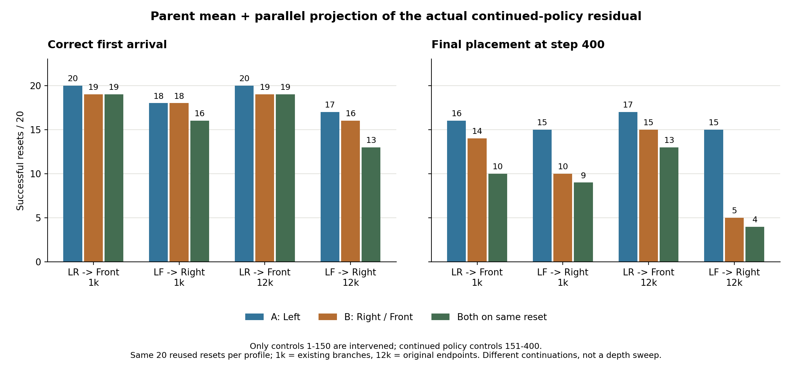

# K25-parallel：旧 μ＋旧轴平行分量的跨学习顺序复现

2026-11-23 · SmolVLA／LIBERO Scene2 · 接续 [K25-mu](K25-mu.md)

本轮只复现组员报告中第一种方法：父模型提供共同响应和旧任务区别轴，续训模型的实际指令残差只提供投影系数。没有追加 V、整段放大、垂直分量、符号替换、反向干预或增益扫描。

**完成160个400步回合；成对首达分别为：LR→Front，既有1000分支 19/20；LF→Right，既有1000分支 16/20；LR→Front，原实验12000终点 19/20；LF→Right，原实验12000终点 13/20。** 全部使用同一批20个既有初态，每个模型条件分别复位执行两句旧指令。以下首达与最终放置分开报告。

## 完整行为结果

每格为 **首达／第400步最终放置，各 /20**。A恒为Left；LR路线的B为Right，LF路线的B为Front。成对要求同一初态的两句均正确。

| 学习路线与模型 | 固定α | A：Left | B：旧任务另一句 | 同初态成对 |
| --- | --- | --- | --- | --- |
| LR→Front，既有1000分支 | 1.246635 | 20／16 | 19／14 | 19／10 |
| LF→Right，既有1000分支 | 1.278009 | 18／15 | 18／10 | 16／9 |
| LR→Front，原实验12000终点 | 2.959000 | 20／17 | 19／15 | 19／13 |
| LF→Right，原实验12000终点 | 2.948584 | 17／15 | 16／5 | 13／4 |

**复现判断：在本批两种顺序、四个既有模型条件上，原方法均恢复了过半成对首达；尚未恢复完整父模型的最终放置水平。** 尤其LF-12000成对首达13/20、终态4/20，对应完整父模型为17/20、13/20；Front单句为16/20首达、5/20终态。因此可以保留其跨两条实际路径的分流效果，不能把它称为普遍、充分的旧任务恢复。

首达判据：书抬高超过3厘米、连续5个控制步进入最早唯一目标格。最终放置采用第400步的LIBERO成功判据。“曾放好”“抓稳”单列，不能代替最终放置。全部失败回合保留在分母。

按组员报告中“成对首达至少过半”的宽松读法，本批为 4/4 个模型条件达到至少10/20；这不是普适恢复或部署成功的标准。两个顺序各只有一个匹配父模型，1000与12000条件也不是四个独立训练种子。

## 究竟复现了什么

记同一当前观察、同一动作草稿x、同一去噪时刻t上的归一化速度场为v。P是该路线学新任务前的完整父模型，F是续训模型；A／B为两句固定规范旧指令，q为完整实际输入。

$$
\mu_P=\frac{v_P(A)+v_P(B)}2,\qquad d_P=\frac{v_P(A)-v_P(B)}2,
$$
$$
\mu_F=\frac{v_F(A)+v_F(B)}2,\qquad r_F(q)=v_F(q)-\mu_F,
$$
$$
c_1(q)=\frac{\langle r_F(q)_{:7},d_{P,:7}\rangle}{\max(\|d_{P,:7}\|^2,10^{-30})},\quad
c(q)=\alpha c_1(q),\quad v_{\rm exec}=\mu_P+c(q)d_P.
$$

内积在50个动作位置×前7维上计算，执行公式却作用于完整32维速度场，再按原流程积分、取前7维、反归一化和裁剪。方向轴是随当前输入变化的50×7速度场区别，不是书架平面里的固定Left→Right向量。

实际调用原始 `k22.py::Lab2.combine2(mode="par")`，没有重写为近似的7维输出。父模型只查询固定A／B，q只输入F；不按真实目标标签强制选择父轴的正负号。规范句下，五次查询版本与原四次查询版本经过64次真实模型逐位一致检查；完整32维、补齐维度和负系数均纳入检查。

**干预从复位开始，限控制步1–150；151–400交还原生F执行同一q。** 不筛选抓取成功快照。这与组员K22复位方案一致；不是之前K25-mu全程1–400方案。初态固定800–819，噪声、场景几何及评分口径沿用已封存记录。

**这是双模型的控制诊断。** P既提供共同背景，也提供完整旧控制方向；F只提供一个标量。成功表明残留旧指令差异沿父轴仍可读并可驱动这套组合控制器，不能据此说F自己重新生成了正确旧路线。

## 增益来源：没有按测试成功率调参

| 模型条件 | α | 来源 |
| --- | --- | --- |
| LR→Front，既有1000分支 | 1.246635199 | 本轮独立开发初态自动标定 |
| LF→Right，既有1000分支 | 1.278009176 | 本轮独立开发初态自动标定 |
| LR→Front，原实验12000终点 | 2.959000000 | 原K14/K21固定2.959 |
| LF→Right，原实验12000终点 | 2.948583603 | 复用原K21开发标定 |

新1000条件完全沿用K21规则：开发初态0–9，由F执行新任务N的160步前缀；在第30、40、…、150步的首个Euler输入测量旧／新区别范数比，共130条记录，取排序后第66项的上中位数，并封顶10。只用范数，不用任务成功率选择α。两条路线共20段开发前缀、3200个控制步，另计于160个测试回合之外。

“不逐线按行为调参”不等于“各线不需要增益”或“一个常数适用全部路线”。原12000的LR沿用历史2.959，不能伪称本轮重新按同一开发数据算出了它。

## 幅度、方向和共同项：可以回答到哪一步

对本轮规范句，$r_F(A)=d_F$、$r_F(B)=-d_F$。在同一个去噪输入上定义
$$
\rho=\frac{\|d_F\|}{\|d_P\|},\qquad
\gamma=\frac{\langle d_F,d_P\rangle}{\|d_F\|\|d_P\|}.
$$
则A的投影系数为 $c_1=\rho\gamma$，B为其相反数；执行的相对父轴幅度为 $\alpha\rho\gamma$。整段放大则同时携带 $\alpha d_{F,\parallel}$ 和 $\alpha d_{F,\perp}$。

因此，同样的α不能保证相同的有效旧方向幅度：范数保留ρ、方向夹角γ、共同背景μP以及后续物理轨迹都参与。范数比标定最多补偿幅度衰减，既不保证修正方向反转，也不保证投影后幅度恰好合适，更不等于闭环最优增益。

这些分解是速度场输出的函数性诊断，不证明μ与d在模型内部独立存储。余弦、投影能量和符号正确率也不是“语义理解保留百分比”。

### 开发标定：与测试行为分开

| 条件 | 旧／新区别范数比中位数 | 区别余弦中位数 | μ漂移／旧区别范数中位数 |
| --- | --- | --- | --- |
| LR→Front，既有1000分支 | 1.247 | 0.845 | 2.358 |
| LF→Right，既有1000分支 | 1.278 | 0.667 | 2.106 |
| LF→Right，原实验12000终点 | 2.949 | 0.420 | 2.818 |

这些数值说明现有分支的衰减、方向和共同项漂移并不相同；不能把2.959从原LR-12000原样移植到LF-1000，再把失败归结为“旧信息完全没了”。1000与12000的续训流不同，开发观察也由各自F的新任务轨迹生成；这不是只改变训练步数的因果时间曲线。各列中位数也不能互相相乘来恢复另一个量的中位数。

一个值得保留的观察是：本轮两条1000分支按相同标定规则得到的α都约1.25，并非一条约1、另一条必然约3。因此，原K15与K25-mu的差异尚不能归结为“LR顺序必须放大、LF顺序无需放大”；终点、续训流和观察轨迹也同时不同。这是对固定2.959适用范围的限制，不是对其历史17/20结果的否定。

### 正式投影轨迹上的描述

下表来自本次干预实际访问的输入，每句20回合×15动作块×10去噪输入＝3000个输入。B的符号已乘−1用于统计，执行时从未强制翻号。表中为输入级中位数，符号正确率不是3000个独立试验；原始逐回合中位数亦保留于summary。

| 条件／句 | 正确符号 | ρ | 有向γ | 有向c₁ | 有向αc₁ | 放大后偏轴范数／旧范数 |
| --- | --- | --- | --- | --- | --- | --- |
| LR→Front，既有1000分支／Left | 100.00% | 0.648 | 0.873 | 0.553 | 0.689 | 0.395 |
| LR→Front，既有1000分支／Right | 100.00% | 0.653 | 0.874 | 0.552 | 0.688 | 0.392 |
| LF→Right，既有1000分支／Left | 100.00% | 0.582 | 0.898 | 0.520 | 0.665 | 0.334 |
| LF→Right，既有1000分支／Front | 100.00% | 0.557 | 0.883 | 0.492 | 0.629 | 0.338 |
| LR→Front，原实验12000终点／Left | 100.00% | 0.366 | 0.769 | 0.277 | 0.819 | 0.670 |
| LR→Front，原实验12000终点／Right | 100.00% | 0.388 | 0.773 | 0.292 | 0.863 | 0.704 |
| LF→Right，原实验12000终点／Left | 100.00% | 0.271 | 0.687 | 0.178 | 0.526 | 0.570 |
| LF→Right，原实验12000终点／Front | 100.00% | 0.273 | 0.625 | 0.164 | 0.482 | 0.598 |

**四个条件、两句共24000个实际去噪输入的符号均正确，仍没有得到满分行为。** LF-12000的Front有4/20首达Left，另有11/20已首达Front却未保住最终放置。这是本批直接观测到的“身份／符号可读，但物理分流与完成任务仍不充分”，不是读出符号错误造成这些失败。它也不自动证明单一幅度原因，因为共同项、完整状态轨迹和交还控制仍会影响行为。

在投影实际轨迹上，LR-1000的A／B未放大c₁中位数约0.553／0.552，LR-12000约0.277／0.292；两者沿旧轴的原始有效幅度不同。LF-12000的放大后B系数中位数仍约0.482，而LF-1000约0.629。范数定标后并未统一沿父轴的有效幅度；这些中位数是输入分布描述，不能据此指定最佳增益。

这里的偏轴成分仅表示相对父模型区别轴正交，不能自动叫“杂音”。它也可能含有对姿态、抬升或放置有用的信息。本轮没有垂直分量、整段放大或符号替换的同窗口对照，不能仅凭投影有效就断言“删掉偏轴成分导致成功”，也不能判定偏轴成分必然有害。

## 为什么K15要放大、K25-mu不放大也能恢复

现有证据支持更谨慎的解释：两者确实恢复了旧任务相关控制，但对应的模型、旧目标组合、归一化、输入轨迹和接手方式不同，不能把17/20与16/20当作只改变一个增益的配对实验。

K15为LR→Front原12000，从已抓稳共同快照接手60步，再交还F；旧μ＋2.959原始残差得到17/20成对首达。K25-mu为LF→Right既有1000，从复位全程替换400步；旧μ＋未放大残差为16/20成对首达、3/20成对最终放置，固定2.959时为3/20、0/20。它说明2.959在该LF条件下有害，不说明增益1是最优或所有LF条件都不需放大。

本轮把两种学习顺序放进同一投影公式和同一150步窗口，并用独立开发范数来定标，补上跨顺序的操作性复现。但这里同时使用父轴，并在新1000条件按原规则更换α；它没有单独隔离“共同项、幅度、偏轴方向”三者各自的因果贡献，也没有测出最优α。因而可以回答“这套带父轴的方法在这些模型上能否工作”，尚不能完整回答“原K15与K25-mu为何必须采用不同最佳增益”。

## 参照资格与可比范围

以下全部复用既有封存回合，本轮没有执行新的对照。完整父模型与1000原生F使用相同20初态、同样的400步评分；它们用于能力和遗忘背景，不能替代本轮所缺少的同窗口消融。

| 路线 | 参照策略 | A首达／终态 | B首达／终态 | 成对首达／终态 |
| --- | --- | --- | --- | --- |
| LR→Front | 完整父模型P | 20／20 | 18／17 | 18／17 |
| LR→Front | 原生F1000 | 17／12 | 3／0 | 3／0 |
| LF→Right | 完整父模型P | 17／16 | 20／14 | 17／13 |
| LF→Right | 原生F1000 | 0／0 | 0／0 | 0／0 |

两个12000终点与对应1000条件的父模型身份一致，但续训流不同：1000来自既有K25／K18分支，12000来自组员原K21／K22终点。不把跨分支差异归因于训练深度。12000在800–819上的原生F本轮没有新测，也不把组员另一批初态的0/20冒充本批基线。

本轮没有新任务保持率、改写句、独立父模型种子、全新物理留出集或反向对照，也未覆盖Right＋Front→Left等其他顺序。不能把本批两种顺序上的结果扩大成“所有学习顺序、所有阶段均可恢复”，也不能声称完全复现了组员7条线／3个任务族。

两种顺序也对应不同旧任务组合和不同父模型；本轮检验的是两条实际学习路径的适用性，不能把它们的差异单独归因于学习顺序。P是已学会两句旧任务的匹配父模型，不是未作任务训练的原始SmolVLA。

## 最终放置、抓取与交还后的损失

| 条件／句 | 首达 | 150步前已首达 | 最终放好 | 曾放好 | 抓稳 | 首达正确但终态丢失 |
| --- | --- | --- | --- | --- | --- | --- |
| LR→Front，既有1000分支/A | 20 | 20 | 16 | 20 | 20 | 4 |
| LR→Front，既有1000分支/B | 19 | 19 | 14 | 14 | 19 | 5 |
| LF→Right，既有1000分支/A | 18 | 18 | 15 | 18 | 18 | 3 |
| LF→Right，既有1000分支/B | 18 | 17 | 10 | 12 | 20 | 8 |
| LR→Front，原实验12000终点/A | 20 | 20 | 17 | 20 | 20 | 3 |
| LR→Front，原实验12000终点/B | 19 | 19 | 15 | 17 | 19 | 4 |
| LF→Right，原实验12000终点/A | 17 | 17 | 15 | 17 | 17 | 2 |
| LF→Right，原实验12000终点/B | 16 | 15 | 5 | 6 | 20 | 11 |

150步前到格与第400步终态不同，交还续训模型后的破坏也会影响最终放置。首达救回不能解释为完整任务已经恢复。此表只描述已记录轨迹，没有追加后段控制实验。

## 证据、核验与交付

[分析计划](results/2026-11-23/k25_parallel/analysis_plan.json) · [锁定协议与模型SHA](results/2026-11-23/k25_parallel/protocol.json) · [逐项汇总](results/2026-11-23/k25_parallel/summary.json) · [证据目录说明](results/2026-11-23/k25_parallel/README.md) · [原始combine2](results/2026-11-23/k25_parallel/history/k22.py)。

160条完整记录逐条重算400步轨迹、首达、抓取和终态，检查40块实际动作哈希、41个状态签名、64次原公式逐位一致门禁、32个完成标记以及权重未变。完整checkpoint文件SHA与每进程155个原训练参数的前后指纹分别保存；后者不是对500个参数重复声称逐一前后哈希。

技术记录：首次启动因独立核验公式的浮点乘除顺序与原函数不一致而停止；保存 3 个中断分片，能读取的完整行 0 条，没有已完成分片。只修正核验的乘除分组，实际原函数、模型、增益和窗口均不变；补丁与前后SHA可逐字节核对。中断尝试另列，不与最终160条重复计数，不因任务表现剔除回合。

本地21项stage1协议检查通过；服务器4项公式检查通过。离线重算与图表核验记录见证据目录。组员报告作为本地阅读材料保留；原文未上传到实验服务器或加入此交付。
