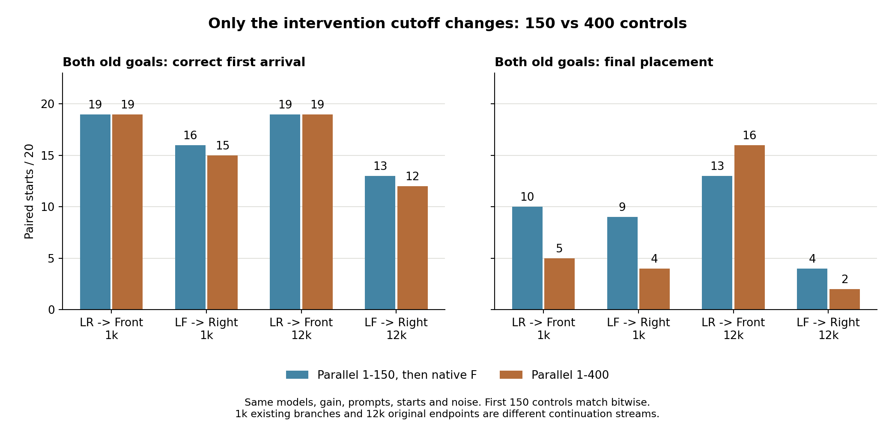
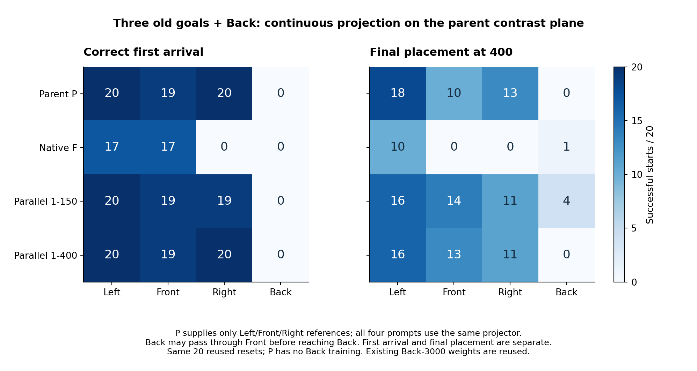

# K25-parallel4：全程投影与四指令训练历史的闭环检验

**2026-11-26新在线复验已完成：** 使用Back原生成功19/20的F4-B24，按请求目标原生首次成功立即结束，重做320回合。短窗／全程parallel的Back为10/20、1/20，四句同初态均成功为8/20、1/20。见[K25-parallel4-correct](K25-parallel4-correct.md)；下文原表继续作为历史口径记录。

**2026-11-25协议更正：以下原表保留为历史几何首达／400步诊断。** 后续主任务采用请求目标原生谓词首次满足即成功结束，不再用额外释放／持续保持门禁否定原生Back能力。新基线F4-B24与重评分说明见[新版报告](K25-Back-LIBERO.md)；几何区域首达不是LIBERO任务成功事件。

2026-11-24 · SmolVLA／LIBERO Scene2 · 接续 [K25-parallel](K25-parallel.md) · [实验计划](K25-parallel4-plan.md)

本轮执行两个已经锁定的实验：一是在原四个模型上只延长parallel至第400步；二是复用K26的三旧任务父模型→Back-3000训练历史，将一条旧区别轴扩展为三旧任务的区别子空间，并对四句都闭环评测。**本轮没有新训练，没有按测试成功率换权重、调增益或增补其他恢复算法。**

完成 **480个400步回合**：160条原模型全程对照＋320条四指令评估，另有10段独立开发标定前缀。160条上一轮150步窗口记录作为封存参照。全部基于同20个既有初态800–819，不是480个独立物理样本，也不是新留出集。

**主要结果：全程parallel只在原LR-12000条件上改善成对终态，另三个原条件下降。四指令训练历史下，三个旧目标同初态均首达，从0/20恢复到18/20或19/20；但新Back没有稳定保留，四句最终都放好只有2/20或0/20。** 两项发现共同限制了“一个投影规则全程恢复全部任务”的解释。

## 一、150步后继续parallel，实际改变了什么

每格为**同初态两句均正确的首达／第400步最终放置，各 /20**。四个模型的权重、增益、规范句、噪声、归一化和原K22函数保持不变；唯一改动是第151–400步继续投影。

| 模型 | 固定α | parallel150后交还F | parallel全程400 | 终态新增／损失 |
| --- | --- | --- | --- | --- |
| LR→Front，既有1000 | 1.246635 | 19／10 | 19／5 | 1／6 |
| LF→Right，既有1000 | 1.278009 | 16／9 | 15／4 | 0／5 |
| LR→Front，原12000 | 2.959000 | 19／13 | 19／16 | 4／1 |
| LF→Right，原12000 | 2.948584 | 13／4 | 12／2 | 0／2 |

**本批全程parallel没有带来统一提升。** LR-12000成对终态由13/20提高到16/20；LR-1000由10降到5，LF-1000由9降到4，LF-12000由4降到2。因此原先终态不足不能统一归咎于“150步后交还原生F”；持续投影在三个既有条件下反而更差。共同响应与区别修正的兼容性还需要按控制阶段和持续时间检验。

**前150步的结果在两种条件下完全相同。** 160个原模型回合的实际动作哈希、状态签名、物体轨迹和投影去噪记录均逐项相同。因此新结果检验的是后250步由谁执行；不能把它解释为前150步抓取或早期路线发生了改善。

| 模型／句 | 150步内首达 | 150步已放好 | 交还F：首达／终态 | 全程：首达／终态 | 全程下150步放好但终态失去 |
| --- | --- | --- | --- | --- | --- |
| LR→Front，既有1000/Left | 20 | 20 | 20／16 | 20／18 | 2 |
| LR→Front，既有1000/Right | 19 | 3 | 19／14 | 19／6 | 0 |
| LF→Right，既有1000/Left | 18 | 17 | 18／15 | 18／14 | 3 |
| LF→Right，既有1000/Front | 17 | 2 | 18／10 | 17／4 | 0 |
| LR→Front，原12000/Left | 20 | 19 | 20／17 | 20／19 | 0 |
| LR→Front，原12000/Right | 19 | 12 | 19／15 | 19／17 | 0 |
| LF→Right，原12000/Left | 17 | 16 | 17／15 | 17／15 | 1 |
| LF→Right，原12000/Front | 15 | 2 | 16／5 | 15／3 | 0 |

不能把“全程执行”预设为更好的控制。上表逐模型列出真实收益和损失；首达后未放好也不能一律叫作已成功后被破坏，真正的150步放好→400步失败另列。新增／损失按配对初态计数，完整初态编号保留于summary。

### 延长后的条件区别信号

下表为全程parallel实际访问的输入。B的统计符号乘−1，执行时没有强制翻号；每个输入不构成新的独立样本。系数为相对父轴的αc₁，表中为各阶段输入的中位数。

| 模型／句 | 前150正确符号 | 后250正确符号 | 前150系数中位数 | 后250系数中位数 |
| --- | --- | --- | --- | --- |
| LR→Front，既有1000/A | 100.00% | 100.00% | 0.689 | 0.854 |
| LR→Front，既有1000/B | 100.00% | 100.00% | 0.688 | 0.650 |
| LF→Right，既有1000/A | 100.00% | 100.00% | 0.665 | 0.709 |
| LF→Right，既有1000/B | 100.00% | 100.00% | 0.629 | 0.739 |
| LR→Front，原12000/A | 100.00% | 100.00% | 0.819 | 0.939 |
| LR→Front，原12000/B | 100.00% | 100.00% | 0.863 | 0.701 |
| LF→Right，原12000/A | 100.00% | 98.82% | 0.526 | 0.332 |
| LF→Right，原12000/B | 100.00% | 100.00% | 0.482 | 0.403 |

后250步除LF-12000的Left为98.82%外，其余各句符号均100%正确，仍出现上述终态损失。读出身份／符号仍在，与持续输出是否适合当前放置阶段，是两件需要分开检验的事。

这些记录用于区分延长后访问的信号分布与早期信号；它们不单独定位控制失败的物理原因。没有增益扫描，不能把某个中位数当作最佳剂量。

## 二、四指令：三个旧任务与新Back逐句验收

模型训练历史为：R1先学Left／Right；K19继续Front并回放旧任务，取原`20261121_replay_full/001000`作为三旧任务父模型P；K26从P用40条对齐Back示范续训3000步，作为F。本轮直接复用原正式终点，未重复训练。P／F仅覆盖155个原训练参数，冻结底座和归一化继承R1；文件SHA、训练完成记录及原代码均已归档。

这里的“四指令”表示训练历史覆盖四个目标。原K26已发现Back曾放好较多、最终保持较弱，且Back常先经过Front；本轮没有预先宣称F已稳定掌握四任务。未改用原独立开发验收未通过的9000步档。

各组均从复位开始，四句都完整运行400步。每格为**单句首达／最终放置，各 /20**；三旧与四句同时成功也按同一物理初态配对。

| 执行方式 | Left | Front | Right | Back | 三旧均首达／终态 | 四句均首达／终态 |
| --- | --- | --- | --- | --- | --- | --- |
| 完整父模型P | 20／18 | 19／10 | 20／13 | 0／0 | 19／6 | 0／0 |
| 续训原生F | 17／10 | 17／0 | 0／0 | 0／1 | 0／0 | 0／0 |
| parallel 1–150→原生F | 20／16 | 19／14 | 19／11 | 0／4 | 18／6 | 0／2 |
| parallel 1–400 | 20／16 | 19／13 | 20／11 | 0／0 | 19／5 | 0／0 |

**三旧任务分流恢复成立，新任务稳定共存尚未成立。** 三旧同时首达由原生F的0/20提高到18/20、19/20，接近完整父模型19/20；旧Right从0/20提高到19/20、20/20。三旧同时终态为6/20、5/20，父模型为6/20。但Back终态只有4/20、0/20，四句终态同时成功只有2/20、0/20，不能只用旧任务恢复成绩概括四指令效果。

P没有接受Back训练，其Back列为未训练参照。原生F行同时给出旧任务遗忘与Back执行基线；parent行则重新核验这批初态上三旧任务的执行资格。所有失败保留在分母，没有按抓取、首达或父模型表现筛掉状态。

### 新Back保留与经过顺序

| 方式 | Back首达 | 先Front后Back | 曾放好Back | 最终Back | 三旧首达且Back终态正确 |
| --- | --- | --- | --- | --- | --- |
| 完整父模型P | 0 | 1 | 2 | 0 | 0 |
| 续训原生F | 0 | 16 | 16 | 1 | 0 |
| parallel 1–150→原生F | 0 | 8 | 8 | 4 | 4 |
| parallel 1–400 | 0 | 1 | 1 | 0 | 0 |

Back原生有16/20曾满足放置判据；parallel150仍有8/20，全程parallel只剩1/20。因此全程投影的局限不仅是原生Back终态基线弱，也包括对已能到达并放对Back的行为缺乏保持。parallel150的终态4/20高于原生1/20，同时曾放好比例下降；新任务也存在首达、曾放好和终态之间的取舍。

“先到Front”与“后来送进Back”不是同一个指标。Back请求需要结合完整顺序和最终判据读；旧Right请求却把书送进Back仍是旧任务错误。因此既报告严格四句均首达，也保留新Back最终完成和三旧首达＋Back终态这项组合描述，不通过更换指标宣称四目标已经稳定共存。

### 同样的150／400时间对照，在四指令上是否成立

| 指令 | 150步内首达（两组相同） | 150步已放好（两组相同） | 150后交还：首达／终态 | 全程：首达／终态 | 终态新增／损失 |
| --- | --- | --- | --- | --- | --- |
| left | 20 | 19 | 20／16 | 20／16 | 0／0 |
| front | 16 | 9 | 19／14 | 19／13 | 3／4 |
| right | 18 | 7 | 19／11 | 20／11 | 0／0 |
| back | 0 | 0 | 0／4 | 0／0 | 0／4 |

四指令的parallel150与parallel400之间也有80条逐句配对，前150步完全相同。合并原模型160条，本轮核验240对完全相同的150步前缀。四指令方法中的增益及子空间定义也保持不变，所以这部分比较同样只改变干预持续时间。

在这条四指令路线上，延长后旧三句同时首达18→19，旧三句终态6→5，Back终态4→0，四句终态2→0；相同早期轨迹之后的收益与损失并不一致。

## 三、从一条旧轴到三旧任务的区别子空间

原两旧任务时长对照继续实际调用未修改的K22 `Lab2.combine2("par")`。四指令部分采用其明确的多旧任务扩展，不把它冒称为未改动的原二任务算法。

$$
O=\{Left,Front,Right\},\quad
\mu_P=\tfrac13\sum_{g\in O}v_P(g),\quad
\mu_F=\tfrac13\sum_{g\in O}v_F(g).
$$
$$
B_{32}=(V_P-\mu_P\mathbf1^T)H,\quad
c=B_7^+\,[v_F(q)-\mu_F]_7,\quad
v_{\mathrm{exec}}=\mu_P+\alpha B_{32}c.
$$

H为固定3×2正交Helmert对比矩阵，B₇是50×7位置展开后的350×2矩阵；同一系数c用于完整32维速度场。每次去噪都重算。使用float64 SVD、固定数值截断rcond=1e−6，记录秩、条件数及投影正交误差。两旧任务时该式退化为原标量平行投影；三旧参考最多张成二维是中心化的代数结果，不是发现模型的任务表征仅有二维。

这里的子空间处于动作生成的速度场响应中，包含未来动作位置、平移、旋转及夹爪等分量，并不是书架XY平面本身。

三旧任务不再对应一个全局正负号：两维系数的坐标依赖所选固定基。参考顺序置换的实现检查要求最终投影保持不变，不把某一维系数的正负直接当成目标身份。

**实际完整q只送给F。** P在修复公式中只查询Left／Front／Right三句固定参考；Back也经过同一套连续投影，没有按真实标签绕回原生F，没有调用K26的离散路由，也没有使用P的Back方向。新任务是否能在这个旧子空间中继续执行，由Back成绩直接验收。

四指令固定增益为 **α=1.634916546**。开发初态0–9由原生F执行Back的160步前缀，在30、40、…、150步首个Euler输入测父／续训三旧中心化响应的Frobenius范数比；130项取上中位数、封顶10。10段开发前缀另计，不用测试成功率选择剂量。原四个二旧模型直接复用上轮增益，无重新标定。

## 四、数值与执行证据

| 投影方式／实际输入句 | 输入数 | 秩2输入数 | 条件数中位数 | 相对残差偏轴比例中位数 | 缩放后投影范数／父中心化范数 |
| --- | --- | --- | --- | --- | --- |
| parallel150/left | 3000 | 3000 | 2.085 | 0.419 | 0.712 |
| parallel150/front | 3000 | 3000 | 1.735 | 0.517 | 0.384 |
| parallel150/right | 3000 | 3000 | 1.898 | 0.502 | 0.491 |
| parallel150/back | 3000 | 3000 | 1.767 | 0.646 | 0.224 |
| parallel400/left | 8000 | 8000 | 2.340 | 0.387 | 0.727 |
| parallel400/front | 8000 | 8000 | 1.970 | 0.648 | 0.305 |
| parallel400/right | 8000 | 8000 | 1.961 | 0.600 | 0.447 |
| parallel400/back | 8000 | 8000 | 2.105 | 0.745 | 0.211 |

偏轴仅指相对这三句父参考的子空间正交，不等于有害噪声；新Back的有效成分也可能在该子空间之外。原生与投影的比较同时改变共同项、方向约束及幅度，不能把变化单独归于“删除偏轴”。两旧和三旧的参考范数定义不同，不能直接跨表按系数大小比较控制强度。

### 同一初态首个去噪输入：从既有记录提取的附加描述

以下仅取parallel150每句第一次去噪的已记录数值。每个初态的观测、动作噪声和时刻相同，尚未随指令分岔；已核验四句的父参考及续训旧参考范数相同。每句20项中位数，不增加仿真或前向查询，也未用于选择模型或增益。

| 实际指令 | 实际残差范数／父中心化范数 | 缩放后投影范数／父中心化范数 | 残差偏轴范数比例 |
| --- | --- | --- | --- |
| left | 0.504 | 0.450 | 0.851 |
| front | 0.325 | 0.287 | 0.842 |
| right | 0.423 | 0.427 | 0.789 |
| back | 0.253 | 0.142 | 0.948 |

新任务不一定表现为相对旧候选均值的“大区别”：若续训的旧句共有响应已偏向Back，实际Back可能接近这个均值。替换共同项、投影区别与保留新任务之间因而存在需要实测的兼容问题。该代数可能性和上表不能单独确证本批Back失败的原因；没有分离共同项与偏轴成分的因果对照。

本轮没有加入四指令条件下的μ-only同窗消融，因此不把完整流程的效果解释为投影的独立或必要贡献。

所有480条记录均保留400步物体／末端轨迹、实际裁剪动作、接触与放置标记，并重算首达、终态及阶段成绩；每条核验40块动作哈希和41个状态签名。52个完成标记、64次原公式逐位门禁、80次四指令真实张量门禁、参数前后指纹及结束文件SHA均纳入审计。

数学实现5项检查通过：两旧退化、三旧自重建、参考顺序置换不变、退化秩与零轴有限，以及无目标标签路由接口。服务器同样通过；仓库21项stage1协议检查通过。数值门禁与离线轨迹核验不能替代行为资格，最终判断仍依据前面的逐句与成组成绩。

## 五、这些实验能回答什么

时长部分通过前缀逐位一致，把“是否在150步前已经不同”排除在该对照之外；可以逐模型判断后250步继续parallel相对于交还F的收益和损失。它不保证持续干预越长越好，也不测最优停止时刻。

四指令部分检验了真实的三旧→第四任务训练历史上的连续投影，并把新Back纳入相同入口和评分。旧任务恢复、新任务完成以及四任务同初态共存必须分别成立；只看三旧恢复不能代表第四任务保留。Back原生执行薄弱也限制对四目标稳定共存的结论。

四指令扩展同时换用了三任务父模型和另一条续训路线，因此不是只改变指令数量的因果实验。这里只有一条三旧→Back路线、一个续训种子、规范句和20个重复使用初态；没有独立新种子、其他四指令顺序、改写句、反向或额外增益扫描。本方法仍依赖父模型共同响应和旧区别空间，不是F自身动作控制已独立恢复的证明。

## 文件与复核入口

[锁定计划](results/2026-11-24/k25_parallel4/analysis_plan.json) · [原模型全程协议](results/2026-11-24/k25_parallel4/full_protocol.json) · [四指令协议](results/2026-11-24/k25_parallel4/four_protocol.json) · [全部统计与配对初态](results/2026-11-24/k25_parallel4/summary.json) · [证据与离线重算说明](results/2026-11-24/k25_parallel4/README.md)。
