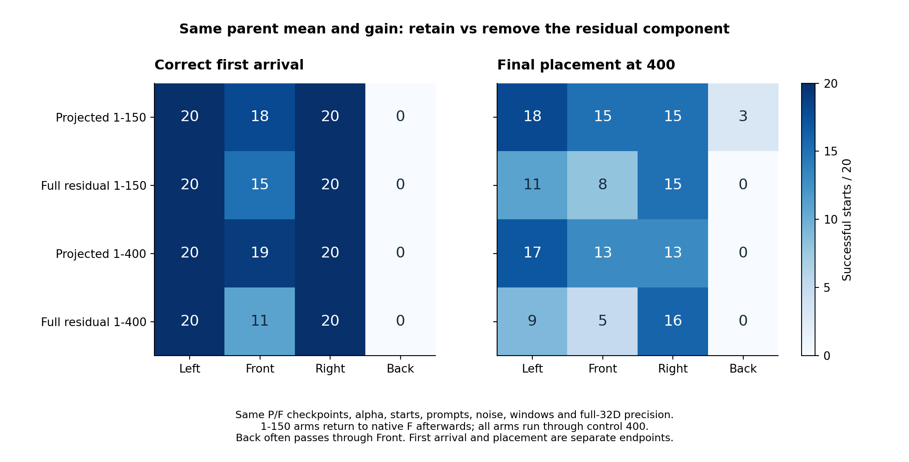
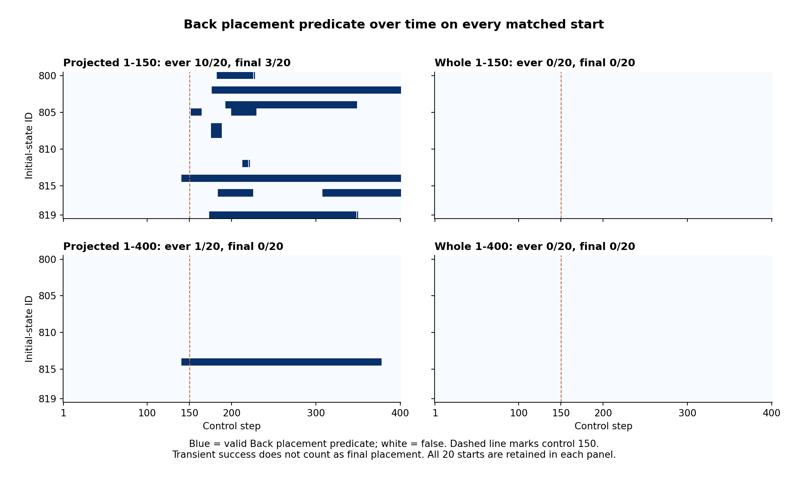
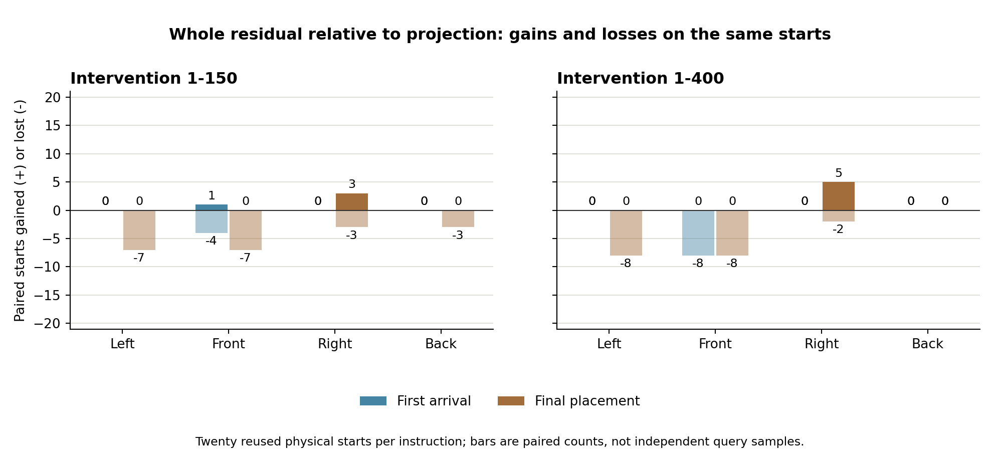

# K25-whole4-new：Back重训后的完整残差与投影对照

2026-11-24 · 接续 [原whole4](K25-whole4.md) 与 [Back重训启动记录](K25-Back-retrain.md)

**2026-11-25主结论更正：Back已达到新采用的LIBERO原生首次成功事件标准。** 该24000步模型登记为**F4-B24**，Back开发20/20、800–819组19/20。旧文的第400步4/20和释放保持低分描述的是示范终点之外的继续执行，不能再作为“Back没学好、缺少达标基线”的依据。训练／模型排查未见足以解释这些差异的实现错误，主要问题为示范在夹持终点结束而原门禁要求额外保持；Back竖立放置比其他目标平放／斜躺对这些后续动作更敏感。原数字及协议记录保留。新主指标是请求目标原生谓词，**不是旧几何首达**。详见[新版说明](K25-Back-LIBERO.md)。

Back重训已完成24000步，北京时间2026-11-24 18:36:45结束，耗时102.9分钟。**开发能力验收未通过**；本轮实际采用第24000步模型。新增260个Back开发验收回合、400个正式同条件评估回合，复用原父模型80个参照回合。所有新评估均从复位跑满400步，没有再训练或增加其他修复方法。

**历史400步诊断：新训练改善了原生Back，但没有通过当时的附加终态门禁；完整残差也没有救回Back。** 在与原实验相同的20个正式初态上，原生Back曾满足16→19/20、最终1→4/20；开发13档最高终态8/20。这些低终态不能再否定Back的原生事件成功。新模型下完整残差两个窗口的Back原生成功和终态均为0/20，Back损失在新口径下仍成立；其他方法结论须按文末新增事件表解释。

**“三旧几何首达已经20/20”不等于三旧原生任务已完成。** 按新原生事件口径，F4-B24的Front为0/20、Right为8/20，旧任务遗忘仍然存在；下文原“首达”表仅表示几何路线诊断，不能据此排除原生目标动作控制的遗忘。

## 1. 原附加终态门禁的历史验收

开发初态640–659使用独立复位随机种子，与正式800–819物理状态不重合。按事前锁定的“从晚到早”顺序检查保存档，首个曾放好及终态均≥16/20的档才标为通过；只看原生Back开发结果，不按旧任务或修复结果选权重。

| 步数 | 正确首达 | 曾放好 | 第150步放好 | 第400步最终放好 |
| --- | --- | --- | --- | --- |
| 24000 | 0 | 20 | 9 | 8 |
| 22000 | 0 | 20 | 8 | 6 |
| 20000 | 0 | 19 | 9 | 6 |
| 18000 | 0 | 18 | 9 | 7 |
| 16000 | 0 | 18 | 9 | 7 |
| 14000 | 0 | 19 | 7 | 3 |
| 12000 | 0 | 19 | 8 | 8 |
| 10000 | 0 | 17 | 7 | 2 |
| 8000 | 0 | 19 | 9 | 8 |
| 6000 | 0 | 19 | 4 | 5 |
| 4000 | 0 | 14 | 6 | 3 |
| 2000 | 0 | 20 | 13 | 6 |
| 1000 | 0 | 19 | 9 | 5 |

**所有检查档均未达到当时的附加终态门槛。** 该历史记录不改写；但按新的原生首次成功标准，24000步开发20/20、另一组19/20，已经可以作为Back达标基线F4-B24。判据变更后不能继续把该模型称为“弱Back未达标基线”，也不把原生成功解释成已验证释放／长时保持。

## 2. 正式同初态逐目标结果

每格为**唯一正确首达／第400步最终放置，各 /20**。三旧成组要求同一初态Left、Front、Right全部正确；四句终态要求四句全部最终放好。1–150组在第151步交回原生F，1–400组全程干预。

| 执行方式 | Left | Front | Right | Back | 三旧首达／终态 | 四句终态 |
| --- | --- | --- | --- | --- | --- | --- |
| 父模型P | 20／18 | 19／10 | 20／13 | 0／0 | 19／6 | 0 |
| 新续训原生F | 20／12 | 20／0 | 20／8 | 0／4 | 20／0 | 0 |
| 1–150 parallel | 20／18 | 18／15 | 20／15 | 0／3 | 18／12 | 2 |
| 1–150 完整残差 | 20／11 | 15／8 | 20／15 | 0／0 | 15／3 | 0 |
| 1–400 parallel | 20／17 | 19／13 | 20／13 | 0／0 | 19／8 | 0 |
| 1–400 完整残差 | 20／9 | 11／5 | 20／16 | 0／0 | 11／3 | 0 |

## 3. Back的阶段成功与保持

曾放好是放置判据任一步为真；最终放好只看第400步。首达按抬升>3cm且连续5步进入唯一区域计分，与放置判据不同。“先Front后Back”使用区域进入顺序，故数量不必等于曾放好。

| 执行方式 | 正确首达 | ≤150曾放好 | 第150步放好 | ≤400曾放好 | 第400步放好 | 先Front后Back |
| --- | --- | --- | --- | --- | --- | --- |
| 父模型P | 0 | 2 | 1 | 2 | 0 | 1 |
| 新续训原生F | 0 | 17 | 9 | 19 | 4 | 19 |
| 1–150 parallel | 0 | 1 | 1 | 10 | 3 | 10 |
| 1–150 完整残差 | 0 | 0 | 0 | 0 | 0 | 0 |
| 1–400 parallel | 0 | 1 | 1 | 1 | 0 | 1 |
| 1–400 完整残差 | 0 | 0 | 0 | 0 | 0 | 0 |

新原生F有17/20在前150步曾放好、9/20在150步仍放好，但最终只剩4/20；这4例在最后50步的放置判据均一直为真。相比原3000步的16/20曾放好、1/20终态，已有改善，但达标所需的稳定完成仍不足。

parallel短窗口的10例Back曾成功，只有初态814在干预期间于第141步首次出现，另9例都在151步交回原生F后首次出现。最终成功是802、814、816。全程parallel只有814曾放好，最终也丢失。不能把短窗口的10例曾成功全部归为投影控制器自身执行出了Back，也不能全部归为交回之后；两段必须分开。

完整残差在两个窗口中均从未满足Back放置判据，且Back抓取均为20/20。因此本轮没有复现原whole4中“补回响应让早期Back曾成功0→3”的收益；它对新模型不构成稳定的Back恢复证据。其Back首达仍为0，经过Front与最终放置仍按不同判据报告。

各方法每个初态最后50步的放置有效比例保留在summary，防止用一帧成功代表持续稳定。ever≤150是原whole4追加的阶段审计，本轮保持同一定义；未用它调增益或挑模型。

## 4. 补回整块被移除响应的配对得失

下表以同窗口parallel为参照，完整残差新增／损失的初态数。每项按20个物理初态配对，去噪输入与控制块不算独立样本。

| 窗口／目标 | 首达新增／损失 | 终态新增／损失 | 曾放好新增／损失 |
| --- | --- | --- | --- |
| 1–150/Left | 0／0 | 0／7 | 0／0 |
| 1–150/Front | 1／4 | 0／7 | 1／5 |
| 1–150/Right | 0／0 | 3／3 | 2／3 |
| 1–150/Back | 0／0 | 0／3 | 0／10 |
| 1–400/Left | 0／0 | 0／8 | 0／0 |
| 1–400/Front | 0／8 | 0／8 | 1／8 |
| 1–400/Right | 0／0 | 5／2 | 5／1 |
| 1–400/Back | 0／0 | 0／0 | 0／1 |

| 窗口 | 三旧首达新增／损失 | 三旧终态新增／损失 |
| --- | --- | --- |
| 1–150 | 1／4 | 1／10 |
| 1–400 | 0／8 | 1／6 |

补回响应后，Left终态在短窗口新增0、损失7，在全程新增0、损失8；Front两个窗口终态均新增0、损失7或8。Front首达失败都属于none，不能强行归为送进另一个格子。Front抓取为parallel20/20、完整残差19/20；其中初态803有抓取差异，因此也不能把Front全部差距仅归于目标方向。

Right短窗口终态两组虽然都是15/20，但有3例新增和3例损失，不能写成逐回合等价；全程则新增5、损失2，净增3，13→16。三旧成组终态短窗口新增1、损失10，12→3；全程新增1、损失6，8→3。被移除部分对不同目标的净作用仍不同，而非一组对所有任务都无用的噪声。

## 5. 与原Back-3000同条件结果对照

下表每格为最终放置数 /20，初态与评分完全相同。新旧训练配置同时改变预算、种子、采样和学习率日程，且为各自模型独立标定增益，因此跨模型表是描述性复验，不能单独归因于某项训练改动。单个新模型内部whole与parallel仍只有是否保留整块被移除响应这一处理差别。

| 模型／窗口 | 方法 | Left终态 | Front终态 | Right终态 | Back曾放好／终态 | 三旧终态 |
| --- | --- | --- | --- | --- | --- | --- |
| 原3000/1–150 | parallel | 16 | 14 | 11 | 8／4 | 6 |
| 原3000/1–150 | 完整残差 | 11 | 8 | 15 | 3／0 | 2 |
| 原3000/1–400 | parallel | 16 | 13 | 11 | 1／0 | 5 |
| 原3000/1–400 | 完整残差 | 12 | 7 | 17 | 3／0 | 3 |
| 新24000/1–150 | parallel | 18 | 15 | 15 | 10／3 | 12 |
| 新24000/1–150 | 完整残差 | 11 | 8 | 15 | 0／0 | 3 |
| 新24000/1–400 | parallel | 17 | 13 | 13 | 1／0 | 8 |
| 新24000/1–400 | 完整残差 | 9 | 5 | 16 | 0／0 | 3 |

| 原生模型 | Back首达 | Back曾放好 | 第150步Back | Back终态 |
| --- | --- | --- | --- | --- |
| 原Back-3000 | 0 | 16 | 12 | 1 |
| 本轮新模型 | 0 | 19 | 9 | 4 |

| 原生模型 | Left首达／终态 | Front首达／终态 | Right首达／终态 | 三旧首达／终态 |
| --- | --- | --- | --- | --- |
| 原Back-3000 | 17／10 | 17／0 | 0／0 | 0／0 |
| 本轮新模型 | 20／12 | 20／0 | 20／8 | 20／0 |

## 6. 方法、增益及可解释范围

仍执行父μ＋αrF(q)与父μ＋αB32·pinv(B7)·rF(q)7。三旧参考固定Left／Front／Right；真实完整指令只进入F，P只查询固定旧参考。新模型两种控制器共用 **α=0.781400847920**；原模型α=1.634916545693。为新F重新按原规则标定：开发初态0–9、原生Back前160步、30至150步首个Euler输入共130项父／新三旧中心化响应范数比，取上中位数封顶10。不按正式成绩挑剂量，不在投影后补做等范数放大。

原parallel4的episode源码保持原样；完整残差仅替换field回调。两组均float64构造完整50×32响应后转原生dtype。投影在50×7上拟合系数，再提升到32维；完整残差保留补齐维度，因此不能将差别只归于执行7维的某个方向或称32维欧氏正交投影。公式及控制解释沿用原whole4报告。

原episode保留了历史profile字符串lfr_back3000；它不参与选权重。本轮实际模型由protocol.models、selected_step及每条记录的checkpoint_step绑定，文件SHA在起止身份记录中核验，不能将历史标签误读成实际仍执行3000步旧模型。

| 真实指令 | 完整残差强度 | 投影强度 | 被移除强度 | 偏轴范数比例 |
| --- | --- | --- | --- | --- |
| Left | 1.008 | 0.505 | 0.828 | 0.870 |
| Front | 0.545 | 0.255 | 0.471 | 0.890 |
| Right | 0.709 | 0.383 | 0.603 | 0.860 |
| Back | 0.490 | 0.199 | 0.450 | 0.927 |

上表为每句20个首次相同输入的中位数，强度以父三旧中心化响应范数归一化。偏轴比例是范数比例，不是语义信息百分比；数值只能辅助解释，是否有功能贡献仍以实际执行的配对结果为准。

这仍是依赖父模型的双模型控制诊断。单个模型内部的对照能识别整块被移除响应的净行为作用，不能逐维判定语义、有害性或必要性；闭环轨迹分岔后观测也随之变化。尤其在原生Back仍不稳时，不能将新任务失败唯一归咎于投影。

本轮增益小于1，是按同一标定原则**缩小**残差，不是套用历史2.959统一放大。不能把所有动作遗忘概括为d变小；同一规范句的首达保持、最终放置失败以及残差的方向／幅度匹配是不同问题。本轮没有µ-only或µF／µP切换对照，因此也没有证明共同响应偏移是唯一病因。

旧固定400步指标下，保留被移除响应对Left／Front和三旧终态整体更差、对全程Right仍有收益。**新原生事件标准下，不能继续以“原生Back基线未学好”解释修复结果：F4-B24原生Back19/20，而完整残差两个窗口仍是0/20。** 新表显示完整残差也能增加部分旧任务原生成功，但会损害Back；是否保留被移除响应仍有目标相关取舍，不能简单断言全部有害或全部必要。四任务持续稳定诊断与四任务原生成功须分开讨论。

## 7. 核验与复现

400个新正式回合和260个开发回合均由原轨迹重算评分，核验动作哈希、复位签名和41条状态签名记录数。新模型两种方法各80对窗口前150步前缀逐位相同（合计160对）；两方法在相同首次输入的投影诊断160对完全相同。80次完整32维公式／回调门禁和80次原投影门禁通过，训练参数前后指纹一致。模型、归一化、源码及28个共享依赖起止身份一致。

完整24000步训练记录逐步核验了采样索引、学习率、有限损失和梯度；全部保存档权重身份核验通过。3项既有完整残差公式检查与21项stage1协议检查通过；离线重算可复现summary。无新训练、措辞、反向或其他恢复算法扩展。

[全部计数与配对初态](results/2026-11-24/k25_whole4_new/summary.json) · [开发选档](results/2026-11-24/k25_whole4_new/selection.json) · [锁定协议](results/2026-11-24/k25_whole4_new/protocol.json) · [原始证据与离线入口](results/2026-11-24/k25_whole4_new/README.md)。

## 8. 新主指标：请求目标原生首次成功

按2026-11-25新协议重评分既有完整轨迹，无新训练、无新回合、无重新标定。首次原生成功后不再扣分；后续在线评估在该步结束。各/20。

|执行方式|Left|Front|Right|Back|三旧成组|四句成组|
|---|---:|---:|---:|---:|---:|---:|
|父模型P|20|15|13|2|11|2|
|F4-B24原生|17|0|8|19|0|0|
|parallel 1–150|20|15|16|10|13|8|
|完整残差 1–150|20|11|15|0|9|0|
|parallel 1–400|20|15|13|1|10|1|
|完整残差 1–400|20|8|17|0|6|0|

此表不能与旧表“几何首达／第400步终态”混读。例如完整残差1–400的Left原生成功是20/20，而旧第400步终态是9/20。原生Back19/20已达新任务门槛；旧任务Front0/20、Right8/20仍有明显遗忘，可继续用F4-B24做恢复实验。详见[新问题总结](K25-Back-LIBERO.md)和[逐回合重评分](results/2026-11-25/k25_native_event/rescore.json)。
