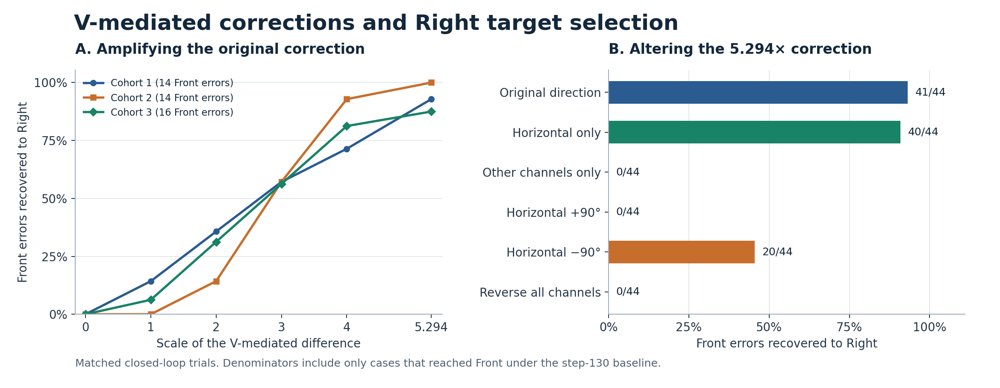

# K25V3-V · V 回滚的动作区别为什么能把书送回右格

2026-11-20 · SmolVLA · R1（Left＋Right）→ Front · 第 30 到 130 步

**K25V3 的 27/28 成立。** 固定第 130 步模型在同一输入上的共同动作 `μ`，只放大 V 回滚在输出端产生的左右区别修正，第三批也能救回 **14/16** 个原来去 Front 的回合。三批合计，原幅度救回 **3/44**，5.294 倍救回 **41/44**。这个有效方向主要来自两句对同一份共有 V 内容变化的不同读取。因此续训改动的是一条能把语言条件变成动作的通路，原幅度只削弱了整体有效区别的一部分。

## 1. 原来的 27/28 怎么得出

原总结的核心成立。第 130 步模型继续执行，另外用一份只有八个交叉注意力 V 投影回到第 30 步的模型计算修正。让两套模型在同一个画面、同一个动作草稿 `x` 和同一个去噪时刻 `t` 下，分别响应 `Left` 和 `Right`。纯 V 回滚让两条指令的速度场变化分别为 `δL`、`δR`，于是从这两份变化分出 `ΔμV` 和 `ΔdV`。

```text
ΔμV = (δL + δR)/2             两句共有的动作变化
ΔdV = (δL − δR)/2             回滚 V 带来的左右动作区别修正

Left  = v130(Left)  + s·ΔdV  = μ130 + (d130 + s·ΔdV)
Right = v130(Right) − s·ΔdV  = μ130 − (d130 + s·ΔdV)
```

所以 `s = 5.294` 放大的是 **V 回滚额外带来的区别修正**。最终速度场仍以第 130 步在当前输入上的 `μ130` 为共同响应。补丁作用在每次去噪的速度场输出，执行过的动作会改变后续画面，因此沿两条实际轨迹重新计算的 μ 可以不同。`5.294` 在八个开发初态上从固定草稿标定。开发集上完整回滚的旧水平轴修正为 **0.30418**，自然 V 回滚只提供 **0.05746**，二者的比值给出这个倍数。 [K25V3 原始结果](K25V3.md) · [原幅度标定](results/2026-11-20/k25v3/v_calibration.json)

| K25V3 原有的 Right 对照 | 第一批 Right 首达 | 第二批 Right 首达 | 从原 Front 改到 Right |
| --- | ---: | ---: | ---: |
| 第 130 步原生 | 2/20 | 1/20 | 两批各有 14 个回合先到 Front |
| 全程原生 V 回滚 | 6/20 | 3/20 | 1/28 |
| 前 60 步只加自然大小的 `ΔdV` | 8/20 | 4/20 | 2/28 |
| 前 60 步将 `ΔdV` 放大 5.294 倍 | **19/20** | **19/20** | **13/14＋14/14＝27/28** |

这 27 个都来自原来先去 Front 的同一初态，首达总数则是 38/40。两批最终在右格放好的分别是 **10/20、9/20**。另外，原生 V 回滚之后，只在前 60 步撤回 V 带来的自然大小区别，两个批次的 Right 首达分别由 **6 到 2**、**3 到 1**。其中三个原来先到右格的回合直接改去 Front。这个反向对照表明，自然幅度的区别已经能影响个别目标选择。 [K25V3 的逐回合转移](results/2026-11-20/k25v3/summary.json)

## 2. 本轮如何把幅度、方向和来源分开

在原有 200–219、400–419 两批之外，用新的复位种子和噪声种子生成 48 个候选。每个候选只按固定 Front12000 抓持前缀是否达到稳定持书条件筛选，再依预先给定的种子顺序取前 20 个。得到第三批 600–619。新批的筛选发生在方向干预和目标评估之前，原来的 5.294 倍直接沿用。每个条件用相同的抓持前缀、物体与目标位置和噪声种子。只在抓持后的前 60 个控制步干预，每十步按实时观察重规划。其余时间使用第 130 步的原生模型。 [新批初态与抓持边界](results/2026-11-20/k25v3_v/holdout.json) · [预定条件和标定量](results/2026-11-20/k25v3_v/plan.json)

1. **幅度。** 在三个批次上对比 `0、1、2、3、4、5.294` 倍。逐初态数原本去 Front 的回合在哪个已测倍数改到 Right。首段用「十步内靠近 Right 的距离减去靠近 Front 的距离」衡量，比较同一初态前后的差。
2. **方向。** 用同样的 `5.294` 和同样的 μ。把整条区别修正取反，或只把其水平两个分量分别旋转 `+90°`、`−90°`，其它维度保持原样。两个旋转对照逐动作位保持归一化速度场的水平范数，检验正确去向是否依赖原方向。另做只留水平分量、只留其它分量。速度场原有 32 维，积分完最终执行前 7 维。
3. **普通区别放大。** 在第三批，对照只把第 130 步原有的 `d130` 增强。取 `d' = d130 + 0.50986·d130`。其加上的部分，在同一开发集上与 `5.294·ΔdV` 有相同的旧水平轴投影中位数 **0.30418**。这样可以看沿旧轴的修正达到近似尺度时，V 的具体方向和直接增强当前模型的指令区别分别表现怎样。
4. **参数层与输出层。** 额外比较前 60 步原生 V 回滚、直接把八张 V 权重按 `W130 + 5.294·(W30−W130)` 外推，以及由外推 V 产生的输出中只保留 `Δd`。输出层的线性放大使用的是自然 V 回滚产生的 `ΔdV`。参数外推要经过后续多层计算，可以同时改变输出的 `μ` 和 `d`。
5. **V 内部来源。** 在八个交叉层，将 V 恢复量分为两句共有的内容变化和两句相反的内容变化。两种情况分别通过原注意力计算传到最后的速度场，再各自提取其诱导的输出区别，并按同一个 `5.294` 放大。这个对照用来区分方向主要来自 V 内容本身对两个句子的不同改动，还是来自两句对共有 V 变化的不同读取。

两句都做了逐值技术检查。`0×` 与原生动作块一致，`1×` 和 `5.294×` 与 K25V3 原实现一致。单独更改动作区别时，公式中的 μ 按同一输入守恒。18 路作业的逐值检查中，低精度转换后 μ 的偏差 RMS 最大为 **0.00075**，按归一化速度场计。

## 3. 固定草稿表明，V 给出了很准的水平修正，但自然力度小

每个物理状态用两条 R1 草稿，各取三个去噪时刻。表中先汇总同一状态的六个输入，再汇总物理状态。水平增益以 R1 的 Left／Right 速度场半差方向为尺，沿该方向的投影越高，表示同一句 Right 对共同搬运动作的右向修正越强。对齐余弦比较的是「自然 V 回滚产生的修正」和「所有权重回到第 30 步产生的修正」。

| 同输入下的区别修正指标 | 八个开发初态 | 第三批 20 个初态 |
| --- | ---: | ---: |
| 不干预时原有水平区别增益 | 0.597 | 0.611 |
| 完整权重回滚的水平增益变化 | +0.3042 | +0.3046 |
| 自然 V 回滚的水平增益变化 | +0.0575 | +0.0542 |
| 自然 V 回滚占完整修正的比例 | **18.9%** | **17.8%** |
| 两种修正的水平向量余弦 | **0.968** | **0.973** |
| 两种修正在七个实际动作维度的向量余弦 | 0.876 | 0.889 |
| 将自然 `ΔdV` 在输出放大 5.294 倍的水平增益变化 | +0.3042 | +0.2869 |
| 放大 `d130` 对照的水平增益变化 | +0.3042 | +0.3115 |
| 直接外推 V 权重的水平增益变化 | +0.3771 | +0.3525 |
| 自然 V 回滚引起的水平 μ 改变量，RMS | 0.0794 | 0.0680 |
| 直接外推 V 权重引起的水平 μ 改变量，RMS | 0.4877 | 0.4159 |

第三批自然 V 修正沿正确水平轴的大小，约为完整修正的六分之一。与此同时，它的水平朝向已很接近完整修正。把归一化速度场的修正平方幅度按实际七维分开，第三批约 **81%** 落在水平两维。这解释了为什么一个看起来很小的 V 变化，沿同一方向放大后可能扭转路线，也给出了水平分量消融要核实的现象。 [逐草稿固定探针](results/2026-11-20/k25v3_v/fixed_third.json)

直接外推 V 权重后，第三批的 `Δd` 水平朝向与自然回滚的余弦仍有 **0.989**，但水平增益比简单把自然 `ΔdV` 放大更大。同时，输出中的 μ 也发生了约 **6.1 倍**的水平变化。由此可以把两种干预区分清楚。输出公式能够固定同一输入下的 μ，直接调 V 权重则会同时调动共同和区别两部分。实际路线和放置效果要分别验收。 [固定速度场对照](results/2026-11-20/k25v3_v/fixed_third.json)

### 方向是怎样通过 V 形成的

在单层固定当前读法 `P_L`、`P_R`，并对齐两个前缀的位置。把回滚 V 的变化写成 `ΔV_L = C + D`、`ΔV_R = C − D`。`C` 是这两个句子的共有内容修正，`D` 是两句不同的修正。注意力的输出变化做半差，得到下面两项。

```text
交叉注意力读出的左右区别修正 = (P_L − P_R)/2 · C + (P_L + P_R)/2 · D
```

第一项揭示了方向的来源。即使给两个句子同样的内容修正 `C`，两句本来就在以不同的比例读画面、语言和状态位置，所以最终拿到的动作修正可以不同。堆叠多层时，前层的写回会进一步影响后层的读取。本轮做的是两条实际干预，再量最终输出的区别。第三批从共有 V 变化得到的增益为 **+0.0547**，与整份 V 的 **+0.0542** 同量级，它们的水平余弦为 **0.9993**。只留下两句不同的 V 修正，增益约 **−0.0004**。因此这条有效方向主要由**共有 V 更新乘上原有的条件读取差**形成。这里的共有 V 位于注意力内部，最终用于机器人速度场的 `μ` 仍按上面的输出公式固定。 [开发集与第三批的来源探针](results/2026-11-20/k25v3_v/summary.json)

## 4. 同样大的修正，为什么能带向不同目标

三批的原方向在 5.294 倍下救回 **41/44** 个原本去 Front 的回合。只留水平两维，仍救回 **40/44**。保留所有其它维度、去掉水平两维，救回数为 **0/44**。因此主要的路线控制力发生在水平搬运阶段。三批只保留水平分量时，最终放好 **31/60**，全分量时为 **29/60**。

将所有分量反号，旧两批分别有 **20/20、19/20** 次先到 Front。水平旋转 `+90°` 时，两批各有 **20/20** 次去 Front。旋转 `−90°` 仍能救回 **14/28**，约为原方向的半数。把第一段动作拆成相对两个候选格的靠近量之后，可以看出这三种路线怎样不同。

| 5.294 倍干预，前两批 | 首段额外靠近 Right，第一批／第二批 | 首段额外靠近 Front，第一批／第二批 | 原 Front 改为先到 Right |
| --- | ---: | ---: | ---: |
| 原方向 | **+10.98 / +12.31 mm** | −1.51 / +1.38 mm | **27/28** |
| 只留水平两维 | **+13.86 / +14.77 mm** | +1.81 / +3.34 mm | **26/28** |
| 水平旋转 `+90°` | +13.54 / +12.90 mm | **+20.70 / +20.25 mm** | 0/28 |
| 水平旋转 `−90°` | −20.87 / −20.32 mm | −26.42 / −26.24 mm | 14/28 |

表中每格是相对同一初态的原生模型多走近多少，单位为毫米，再跨初态取中位数。原方向明显多靠近右格。`+90°` 也能让书多靠近右格，但它向 Front 靠近得更多，最后全都先到 Front。`−90°` 让书对两个格都少靠近，Front 方向削弱更大，所以有一部分回合后来能改去右格。这个对照说明，**目标选择取决于当前动作让哪个候选格占优**。V 的原方向很有效，因为它直接加大向右的动作分量。其它方向也可能通过抑制竞争目标间接改变去向。 [逐回合方向与首段距离](results/2026-11-20/k25v3_v/summary.json)

第三批重复了这项几何差异。`+90°` 让首段额外靠近 Right **13.52 毫米**、靠近 Front **21.70 毫米**，16 个原 Front 中没有改对的。`−90°` 对两格的改变量分别是 **−21.39、−26.86 毫米**，救回 6/16。合并三批，同幅度两种旋转的纠错数分别为 **0/44 和 20/44**。

## 5. 幅度怎样把运动偏移变成错格恢复

第三批的第 130 步模型有 **3/20** 先到右格、**16/20** 先到 Front。只加自然大小的 V 区别后，先到右格是 **4/20**，只改对了一个原 Front 回合。沿用锁定的 5.294 倍，先到右格达 **18/20**，其中 **14 个**来自原 Front。三批合计，先到右格由 **6/60** 到 **56/60**。直接纠正原 Front 是 **41/44**。

| 输出 `ΔdV` 的倍数 | 第一批 Right 首达 | 第二批 Right 首达 | 第三批 Right 首达 | 三批原 Front 改为 Right | 三批 Right 最终放好 |
| --- | ---: | ---: | ---: | ---: | ---: |
| 0 | 2/20 | 1/20 | 3/20 | 0/44 | 0/60 |
| 1 | 8/20 | 4/20 | 4/20 | 3/44 | 0/60 |
| 2 | 11/20 | 6/20 | 9/20 | 12/44 | 4/60 |
| 3 | 14/20 | 13/20 | 13/20 | 25/44 | 9/60 |
| 4 | 16/20 | 18/20 | 17/20 | 36/44 | 13/60 |
| 5.294 | **19/20** | **19/20** | **18/20** | **41/44** | **29/60** |



三个批次的首段领先改善量都随倍数近似成比例。每新增一个自然修正量，头十步里右格相对 Front 的领先量约多 **2.0–2.3 毫米**。原幅度在 **60/60** 个初态都改善了首段的右格相对领先，直接救回的原 Front 却只有 3 个。有些初态离开 Front 路线只需要少量修正，有些还要在后续几次重规划中保持右向优势，因此首达数随力度分批上升。

在 44 个原 Front 中，首次在已测剂量改成 Right 的回合数，按 **1、2、3、4、5.294 倍**依次是 **3、9、13、11、5**，另有 3 个在已测范围内没有先到 Right。已改对的 41 个，在更高的已测档位都保持先到右格。例如初态 616 加到 1 倍就改对，600 需要到 4 倍才首次改对，604 要到 5.294 倍才改对。同一移动方向需要给到多大力度，会随初始位置和随后的重规划而变化。

按原生模型的首段领先量把原 Front 初态一分为二。更偏 Front 的 22 个，首段中位领先是 **−10.20 毫米**，其中 **12 个**在达到 4 倍前一直没有改到 Right。另一半的中位领先是 **−2.82 毫米**，只有 **7 个**如此。这个分组说明，初始路线偏置较强时，通常得加大修正才会换格。

## 6. 有效方向究竟来自哪里，放大了什么

| 第三批 Right，抓持后前 60 步 | 先到 Right | 从原 Front 改到 Right | 最终放好 | 首段 Right 相对 Front 的改善 |
| --- | ---: | ---: | ---: | ---: |
| 第 130 步原生 | 3/20 | — | 0/20 | — |
| 自然 V 原生回滚 | 4/20 | 1/16 | 0/20 | +1.31 mm |
| 只留自然 `ΔdV` | 4/20 | 1/16 | 0/20 | +2.21 mm |
| 放大自然 `ΔdV` 5.294 倍 | **18/20** | **14/16** | 10/20 | **+12.01 mm** |
| 按开发集水平增益匹配，放大第 130 步自己的 `d130` | 17/20 | 13/16 | 11/20 | +10.67 mm |
| 只放大共有 V 变化诱导的 `d` | **18/20** | **14/16** | 10/20 | **+12.17 mm** |
| 只放大两句不同的 V 变化诱导的 `d` | 3/20 | 0/16 | 0/20 | −0.10 mm |
| 直接把八张 V 权重差外推 5.294 倍 | 19/20 | 15/16 | **3/20** | +12.91 mm |
| 权重外推后，只提取其诱导的 `d`，保留原生 μ | **20/20** | **16/16** | **14/20** | +15.87 mm |

**有效方向的主要来源是对共有内容的条件化读取。** 内部只接入两句共有的 V 变化，再取其造成的输出区别，闭环效果接近完整 V 变化。只接入两句不同的 V 变化，20 个初态的首次去向逐个保持一致。这把固定输入里看到的 `P` 和共有 V 的相互作用，接到了实际的首次目标选择。共有 V 变化经过两句话不同的读法，可以产生非常有效的动作区别。

**旧区别的可用方向也留在第 130 步原生输出中。** 只放大该模型自己的 `d130`，第三批也能恢复 13/16 个原 Front。开发集上两种补丁的水平投影校准到相同，第三批实际的投影中位数分别为 **+0.3115** 和 **+0.2869**，动作曲线仍可不同。V 提供了一条能通过真实权重变化定位的有效修正，晚期模型自身也还带着可放大的旧指令控制信号。

**V 可以在参数层改变路线，同时改变搬运和放置。** 直接外推 V 权重已经让 19/20 先到右格，说明即使干预位置放在 V 投影，增大后的这条通路也能改变实际目标。它让输出 μ 的水平改变量扩大约 6.1 倍，最终只有 3/20 放好。取同一次外推产生的 `d` 并保留原生 μ，最终放好升到 14/20，原先成功的三个仍成功，新增 11 个。两者的速度场在同一输入上差的是这次外推诱导的共同响应。自然幅度下也出现同方向的运动效应。只留自然 `ΔdV` 比原生 V 回滚多改善约 **0.95 毫米**的首段领先量，两组正确首达均为 4/20。 [来源拆分、权重外推与终态配对](results/2026-11-20/k25v3_v/summary.json)

### 同一个倍数对 Left 的作用

第三批同一批物理初态分别执行 Left 和 Right。正确号的 5.294 倍使 Left 在首段相对其它目标的领先量增加 **7.99 毫米**，Left 首达却由 **20/20 到 15/20**，另外五次未到任何目标区，最终放好保持 7/20。反号也得到 15/20 的 Left 首达，其中三次先到 Front，首段领先量下降 **9.99 毫米**。两句分别首达正确的同初态数由晚期原生 **3/20** 到正号 **14/20**，反号为 **0/20**。所以这个定标点在恢复 Right 上效果强，也提升了成对分流，同时付出了 Left 首达的代价。同一个倍数下，两条旧任务的可执行范围仍各有大小。 [两条指令的同初态对照](results/2026-11-20/k25v3_v/summary.json)

## 7. 三个问题的结论

1. **V 提供的区别修正能独立改变实际目标选择吗？能。** 固定同一输入上的第 130 步共同响应，只在两句的输出中加减 V 诱导的区别，去向就会改变。自然幅度已经有直接换格的个例，放大到 5.294 倍使 44 个原 Front 中的 **41 个**先到右格。把全向量反号，两批旧样本和第三批总共 **59/60** 次去 Front。这里的独立作用是指在同一个接收网络里，只干预 `d` 也能改变路线。
2. **自然 V 的幅度有限，方向有很强控制力吗？是。** 第三批中，自然 V 提供完整旧轴修正的 **17.8%**，水平修正方向的余弦是 **0.973**。剂量扫描把“慢慢更朝右”和“实际首达开始变对”接了起来。同范数的 `+90°` 修正反而让书明显更朝 Front，`−90°` 主要削弱 Front 的早期优势，因而能间接救回一部分。原方向直接加大向右的运动，效果最大。
3. **自然训练改变量太小，难以抵消晚期偏置，同时仍带有有效方向信息吗？是。** 用真实的第 30→130 步 V 参数差做回滚，取出来的自然大小 `ΔdV` 只救回 **3/44** 个 Front 错格。把这一修正沿原向放大才有大面积恢复。有效方向主要是当前模型对同一份共有 V 改变的两种读法。真实 V 更新对自然错误的作用由原幅度回滚和反向干预衡量，放大结果衡量这条通路所提供的控制能力。

这些结论对应同一条 R1→Front 训练轨迹的第 30–130 步、同一仿真任务和固定抓持后的阶段。三批用于验证初态变化，训练轨迹本身相同。K25V4 另外验证了动作与时间输入及 MLP 也可经由查询和动作写回影响旧选择。V 的结果补足了共享内容怎样被现存的语言条件读成动作方向。 [K25V4 的上游干预](K25V4.md)

## 8. 数据与复算

共新增 **720 个闭环仿真回合**。前两批加跑 320 个 Right，第三批加跑 340 个 Right 和 60 个 Left。同一条件的统计单位是 20 个物理初态。前两批的 0、1、5.294 倍参照直接复用 K25V3 的逐回合原始记录。固定草稿、逐值闸门和抓持筛选另行记录。

- [逐条件及逐初态配对、阈值档位、首段和终态](results/2026-11-20/k25v3_v/summary.json)
- [第三批筛选规则和物理初态](results/2026-11-20/k25v3_v/holdout.json) · [实际倍数和八张 V 权重](results/2026-11-20/k25v3_v/plan.json)
- [采样和锁定脚本](../scripts/k25/v_direction_holdout.py) · [方向干预脚本](../scripts/k25/v_direction_experiment.py) · [核验与汇总](../scripts/k25/summarize_v_direction.py)

```powershell
python scripts/k25/summarize_v_direction.py docs/results/2026-11-20/k25v3_v docs/results
```
