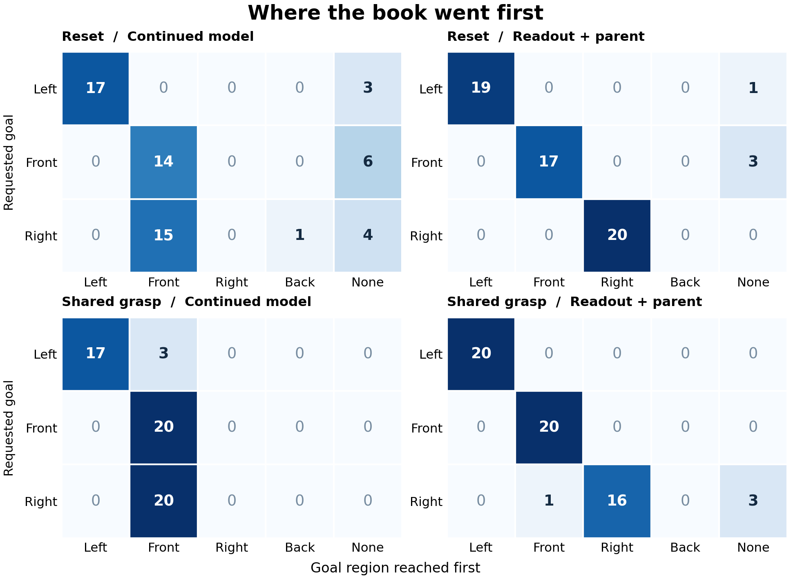

# K26｜用续训模型读出旧指令，用父模型执行

## 1. 要验证的分工

持续学习后，机器人看到「放左」和「放右」，可能都先把书送往最近学过的格子。此前的实验发现，在相同图像、机械臂状态和动作草稿下，两句旧指令在续训模型的动作响应中仍有区别。K26 要检验的是，**这份区别能否独自决定该调哪条旧动作，同时把真正搬书的工作交给仍会执行的父模型**。

这里的「读出」有一个具体操作。`v(q)` 是给定观测、动作草稿和去噪时刻时，模型预测的草稿更新方向。它还要经过采样，才会变成机器臂的实际指令。设当前已知旧目标集合为 $S$，每个目标用一句标准指令 $p_j$ 作参考。续训模型 $F$ 和父模型 $R$ 都依据同一观测和草稿计算下式。

$$
\mu_M(S)=\frac{1}{|S|}\sum_{j\in S}v_M(p_j),\qquad
r(q)=v_F(q)-\mu_F(S),\qquad
d_{R,j}=v_R(p_j)-\mu_R(S).
$$

把续训模型对真实句子 $q$ 的残差 $r(q)$ 与各个父模型区别 $d_{R,j}$ 做余弦比较。夹角最小的区别决定本轮选择。比较使用动作草稿 50 个时位和实际控制的 7 个动作维度。随后父模型负责生成所选分支的动作响应。

$$
\hat j=\arg\max_{j\in S}\cos\big(r(q),d_{R,j}\big),\qquad
v_{\text{execute}}=\mu_R(S)+d_{R,\hat j}=v_R(p_{\hat j}).
$$

可以把它理解为先问续训模型「这句话更像你认识的哪一类旧动作」，再让父模型按这类去搬。读出的强度不会乘进动作。以左右任务为例，父模型的两个区别恰好互为反向，只需看投影符号是正还是负。三条指令则有三个不同方向，各自参与比较。候选集合变了，两个模型各自的共同响应也随之重算。

真实句子会完整送进续训模型。规范句只用来生成参考，评估器知道的正确标签只用于记分或为单独的标签参照指定动作。这种设计让我们可以用全程原生、模型读出、正确标签和故意换分支的结果，区分「读到了什么」和「选中的动作能做到什么」。

## 2. 二选一已经通过闭环验证

K22 让两条旧指令分别在同一个初态运行。「成对首达」要求同一初态下两条指令都先送到自己的格子。7 条模型线、3 个仿真任务族，每线 20 个状态，从复位开始，前 150 个控制步使用读出干预，回合仍走满 400 步。 [K22 第 4 节的逐线结果](K21_K22_生死测试与残差拆解_20261113.md)

| 从复位起执行方式 | 同一初态两句均先到正确目标 |
| --- | ---: |
| 续训模型全程原生 | 0/140 |
| 用旧共同响应，整体放大续训残差 | 61/140 |
| 用旧共同响应，只接旧轴上的连续投影 | 106/140 |
| 按续训模型的符号选择父模型动作 | **110/140** |
| 父模型全程执行，已知旧指令 | 112/140 |

这里的 140 是跨线的描述性合计，部分线用过相同的物理初态。读出组找回了 78.6% 的成对首达，接近父模型在这些回合中能做到的 80.0%。动作路由对旧技能执行水平仍有依赖。

随后把规范句从输入端拿走，改用未参与参考计算的 `Please put the book in the caddy's {target} compartment.`。两条线各 20 个初态、每个初态两条旧指令，四种执行方式共 320 个回合。下表的「纠正」要求**原先去新格的同一个回合，改后先到它自己的旧格**。 [逐回合结果以及三种改写的固定输入探针](results/2026-11-21/k_series_replication/phrasing_summary.json)

| 线路与旧目标 | 两句分别首达正确，原生 → 读出 | 成对首达，原生 → 读出 | 旧句先到新格，原生 → 读出 | 原先去新格且逐回合改对 | 两句最终放好，读出 |
| --- | ---: | ---: | ---: | ---: | ---: |
| R0 → FT4，Left／Front | 0/20、0/20 → **19/20、15/20** | 0/20 → **14/20** | 22/40 → **0/40** | **20/22** | 17/20、9/20 |
| R1 → Front-12000，Left／Right | 3/20、0/20 → **20/20、19/20** | 0/20 → **19/20** | 15/40 → **0/40** | **15/15** | 20/20、11/20 |

两条线的成对首达，用真实标签选同一父模型动作分别得到 18/20、19/20。把模型读出的符号取反，两条线都回到 0/20，书往被换过去的另一个旧格走。路线因此可以由模型读出的分支选择改变。R0 原生的 22 个替代回合中有两个虽然不再去新格，仍未去对旧格，所以 22 个替代消失只算 20 个真正改正。两条线的原生最终放置均为 0/40。

## 3. K26 的多指令扩展

### 用什么模型检验

父模型由已掌握 Left／Right 的 R1 继续训练 Front，同时在 K19 中回放 Left／Right。这里取已归档的 `20261121_replay_full` 第 1000 步，逐条验收它能否先送到三个旧格。K26 从这份父权重出发，只用已对齐的 40 条 Back 示范续训 3000 步。训练种子为 `20261123`，使用同一动作坐标、冻结的视觉语言底座和继承的归一化。模型选定后才进行下述配对评估。 [形成三目标父模型的训练记录](2026-11-11_K19_训练保留与μd机制报告.md) · [Back 续训脚本](../scripts/k26/train_back.py)

### 同一场景，改变候选范围

- **二选一。** Left／Front、Left／Right、Front／Right 分别独立运行。两句的平均只用该对候选计算。
- **三选一。** Left、Front、Right 同时作为旧候选。旧参考提供三个动作方向，测试每个动作块选一次，以及每次去噪都重新选两个版本。反向对照把模型选中的分支按 Left → Front → Right → Left 强制换掉。标签参照在相同窗口直接选择正确的父模型动作。
- **四选一。** Left、Front、Right、Back 一起出现，测试输入用改写句。四个参考方向均在续训模型 $F$ 的输出空间中计算，因为父模型没学过 Back。选到旧格用 $R$ 的规范句生成动作，选到 Back 用 $F$ 的真实句子生成动作。此组检验能否在同一个入口自动选旧执行器或新执行器。它和上一组分别检验「续训残差还能否对上旧方向」与「续训模型能否在自己的坐标里区分四个已知目标」。

### 统一如何记分

使用 Scene2 中固定的 20 个物理初态，编号 600–619。每个条件内每条句子都有 20 次，同一初态和重规划噪声种子在各组配对。复位组从第 1 步开始，前 150 步允许路由。共同抓持组先用一段记录在案的 Front-12000 控制把书抓稳，在还没到任何格子的状态上接手，随后仅有 60 步允许路由。窗口之后让续训模型按真实句子跑到第 400 步。父模型原生参照在对应起点之后全程使用父模型。抓持组回答的是「已经抓稳以后，能否送对地方」。 [固定初态](results/2026-11-20/k25v3_v/holdout.json) · [仿真与配对脚本](../scripts/k26/evaluate_routes.py)

**首达**按搬起的书首次连续五步处于某格的水平区域计分。书相对起始高度须抬高超过 3 厘米，首达也须唯一且正确。**终态**按第 400 步的放置判定计分。另单列旧句先到 Back 的次数和有多少从 Back 改到正确旧格。固定输入探针在同一观测、同一草稿上读两种未参与参考的改写，帮助分清读错和执行失败。每个控制块或去噪时刻都不是新的物理样本，成对和成组的分母均按 20 个初态计算。

## 4. 从复位起，三个旧目标的分流恢复

每格是 20 次中的成功回合数。每条旧句都先到自己的格，才给该初态记一次「三句均首达」。

| 执行方式 | Left 首达／终态 | Front 首达／终态 | Right 首达／终态 | 三句均首达 | 三句终态均成功 |
| --- | ---: | ---: | ---: | ---: | ---: |
| 父模型原生 | 19／18 | 17／12 | 20／15 | 16/20 | 7/20 |
| Back-3000 原生 | 17／9 | 14／0 | 0／0 | 0/20 | 0/20 |
| 三选一路由 | **19／18** | **17／11** | **20／15** | **16/20** | **7/20** |
| 窗口内按真实标签调用父模型 | 19／18 | 17／11 | 20／15 | 16/20 | 7/20 |

三条旧句合计，正确首达从 **31/60 升到 56/60**，最终放好从 **9/60 升到 44/60**。原生 Right 的 20 个回合中，15 个先到 Front，1 个先到 Back，4 个没有唯一首达。三选一把这 **20 个都送到 Right**。这条 3000 步线上，主要被改正的是 **Right → Front**。首达正确的新增回合中，16 个原先明确去了另一格，其余来自原生未首达。

首达记录只写路线的第一段。原生 Right 有 **15/20** 曾经满足 Back 的放置判定、**3/20** 到结束仍在 Back。改用三选一之后，两项都降到 **0/20**。因此同一批回合中，既出现过先去 Front 的错误路线，也出现了真正把书送进最新训练的 Back。

三选一在第一次重规划的 60 个回合都选对了分支，其中 51 个回合在 150 步窗口内每次都选对。按模型读出选分支与按真实标签选分支，逐回合比较，60/60 的首达目标和终态目标都相同。父模型原生在 60 个旧句回合中最终放好 45 个，三选一是 44 个，恢复效果接近父模型自己的水平。

同样从复位运行时，父模型听到 Back 的 20 回合都先去了 Front，Back 终态是 0/20。Back-3000 听到 Back 时有 16 回合先进入 Front 的水平区域，其中 15 个之后进入 Back 区。全程达到过 Back 放置判定的是 14/20，回合结束仍在 Back 的只有 2/20。初期续训已经让模型能把书运到 Back，保持到终态的能力仍弱。评估 Back 学得怎样，要一起看路径、曾经放对和最终放好。

### 长续训如何验收

看到 Back-3000 的复位结果后，从该权重另开一条补验，使用相同 Back 数据和新的 AdamW，保留总步数为 6000 和 9000 的检查点。使用与正式评估分开的 10 个初态 630–639，从复位和共同抓持各跑 10 次 Back。长续训用最早达到复位首达 6/10 或抓稳后首达 7/10 的检查点。核对 Back-3000 的逐段轨迹后，补充一个终态条件。若复位或抓稳后有至少 5/10 最终放好，也进入正式四目标扩展。这项判定在查看长续训成绩前加入，用来容纳先经过 Front 再放进 Back 的路线。若只在抓稳后通过，四目标共存的结果按抓稳后的执行报告。 [续训配置](results/2026-11-21/k26_multigoal/manifest.json) · [训练完成核验](results/2026-11-21/k26_multigoal/COMPLETE.json)

## 5. 抓稳后接手，读出分支仍能改变实际路线

| 执行方式 | Left 首达／终态 | Front 首达／终态 | Right 首达／终态 | 三句均首达 |
| --- | ---: | ---: | ---: | ---: |
| 父模型在接手后全程执行 | 20／16 | 20／13 | 18／5 | 18/20 |
| Back-3000 原生 | 17／12 | 20／0 | 0／0 | 0/20 |
| 每个动作块读一次，三选一 | **20／17** | **20／13** | **16／2** | **16/20** |
| 每次去噪都读，三选一 | 20／17 | 20／13 | 16／2 | 16/20 |
| 窗口内按真实标签调用父模型 | 20／17 | 20／13 | 16／2 | 16/20 |
| 轮换读出的分支，仍由父模型执行 | 0／0 | 2／0 | 0／0 | 0/20 |

抓稳后的 Right 旧句给出了更直接的晚期错误轨迹。原生 **20/20** 先进入 Front 区，随后 **20/20** 曾满足 Back 放置判定，**5/20** 到结束仍在 Back。改用三选一，原先走错的 20 个回合中 **16 个**转为先到 Right，**1 个**仍先到 Front，**3 个**无首达。曾满足 Back 放置判定和终态仍在 Back 都降为 **0/20**。这时原生 Right 从起步到放置都出现目标替代，分工执行确实把书的去向改了回来。

共同抓持后的三个旧目标合计，正确首达从 **37/60 到 56/60**，终态从 **12/60 到 32/60**。四个仍未先到 Right 的失败保留在分母中。

同一 60 步窗口里，按真实标签选父模型动作的对照，与按模型读出执行的 60/60 个回合具有相同的首达目标和终态目标。Right 首达仍是 16/20，最终仍为 2/20。父模型在同一抓持状态下执行到结束，Right 首达 18/20、终态也只有 5/20。抓稳说明书已经拿住，接手时的高度、姿态和可用动作时间仍限制后续。这个对照把问题缩小到了执行侧条件，数据还不能单独归因到某个动作通道。

把同一份模型读出的分支全部轮换一位，60 个旧句回合中有 **57 个**先去了错误目标，原来的三句同时正确从 **16/20 掉到 0/20**。每次去噪重算和每个动作块重算在这里得到相同的汇总成绩。相同父模型给出的动作会按读出的目标改变，目标选择环节因而有直接的闭环因果对照。

图中每行 20 个回合。左列是续训原生，右列是读出后调用父模型。`None` 表示整个回合没有首达区。Front 与 Back 的经过顺序由逐回合的区域进入时间另行核对。

## 6. 三种两两组合都能分流

抓稳后用规范句。每行的两条指令分别运行，每句 20 次。两选一与三选一的各项成绩用相同的初态和相同的模型权重计算。

| 候选旧目标 | 各句首达／终态，两选一 | 两句均首达，原生 | 两句均首达，两选一 | 三选一里这两句均首达 |
| --- | ---: | ---: | ---: | ---: |
| Left／Front | 20／17、20／13 | 17/20 | **20/20** | 20/20 |
| Left／Right | 20／17、16／2 | 0/20 | **16/20** | 16/20 |
| Front／Right | 20／13、16／2 | 0/20 | **16/20** | 16/20 |

在这批规范句上，把第三个候选一起加入，三对成对首达都与各自两选一相同。含 Right 的两对低于 Left／Front，差额和采用真实标签的 Right 对照一致。在同一场景中，方案可以复用一份父模型，靠改变候选集合来应对不同组合。

## 7. 从同样的动作响应里，能否读懂改写

两种改写都只作为真实输入，规范参考句保持 `pick up the book and place it in the {goal} compartment of the caddy`。第一种改写 `Please set the book inside the {goal} compartment of the caddy.` 随主评估跑闭环。第二种 `Move the book to the caddy compartment on the {goal}.` 先做固定输入探针，看到它的读出比第一种好后，再补同一组初态的闭环。第二种改写因此是探索性复验。

下表固定物理观测和噪声，只看每个动作块的第一次查询。每一列测试同一批 20 个初态，三选一共 60 个句子输入，四选一共 80 个。这里的分数指**模型读对分支**。

| 起点与参考 | 规范句 | 改写一 | 改写二 |
| --- | ---: | ---: | ---: |
| 复位，父模型方向三选一 | 60/60 | 21/60 | 21/60 |
| 抓稳，父模型方向三选一 | 60/60 | 41/60 | **60/60** |
| 复位，续训模型方向四选一 | 80/80 | 35/80 | 36/80 |
| 抓稳，续训模型方向四选一 | 80/80 | 56/80 | **76/80** |

抓稳后用改写一询问 Right，按父模型方向比较，19/20 次被读成 Front。用改写二时，20/20 次都被读成 Right。复位时两种改写的读出都明显落后于规范句。候选均值扣掉了规范句平均共有的动作，换一种说法仍可能让残差的位置移动，也会改变它和哪个目标方向更接近。这个固定探针指出哪些句型和阶段需要闭环检验。 [固定输入原始分数](results/2026-11-21/k26_multigoal/probe_0.json)

### 真正执行时，四个候选会发生什么

下表都从同一批共同抓持状态接手。每条指令 20 个回合。三选一给定三个旧候选，四选一把 Back 与三个旧目标一起交给模型判别，再按判别结果调父模型或续训模型。

| 输入和执行方式 | Left 首达／终态 | Front 首达／终态 | Right 首达／终态 | Back 首达／终态 | 三个旧目标均首达 | 四个目标均首达 |
| --- | ---: | ---: | ---: | ---: | ---: | ---: | ---: |
| 改写一，续训原生 | 4／7 | 20／0 | 0／0 | 0／3 | 0/20 | 0/20 |
| 改写一，三选一 | 19／18 | 20／13 | 0／0 |  | 0/20 |  |
| 改写一，四选一 | 20／18 | 20／5 | 1／0 | 0／3 | 1/20 | 0/20 |
| 改写二，续训原生 | 20／11 | 20／0 | 0／0 | 0／4 | 0/20 | 0/20 |
| 改写二，三选一 | 20／18 | 20／14 | **17／5** |  | **17/20** |  |
| 改写二，四选一 | 20／18 | 20／11 | **17／3** | 1／3 | **17/20** | **1/20** |

**改写一的主要损失在读出。** 抓稳后，三选一让全部 Right 回合仍先到 Front。四选一的首次判别，Right 有 13/20 被读成 Back、6/20 被读成 Right，剩下 1 个被读成 Front。最终只有 1/20 先到 Right。Left 本来只有 4/20 先去左，四选一为 20/20，其中原来先去 Front 的 15 个全部改成 Left。相同的候选集合对不同指令的作用可以很不一样。

**改写二的四选一确实纠正了实际替代。** Right 原生 20/20 先到 Front，四选一有 **17 个改到 Right**，2 个仍先到 Front，1 个无首达。Right 期间曾误放 Back 从 **17/20 降到 1/20**。三个旧目标同初态都先送对，从 **0/20 到 17/20**。四个候选的第一次读出一共正确 **76/80**，其中 Left、Front、Right 各 20/20，Back 为 16/20。三选一和四选一恢复了同样多的旧句首达，Right 终态分别为 5/20 和 3/20。

**四选一还能把 Back 分给续训模型，但新任务完成度有限。** 改写二中，原生 Back 有 18/20 曾达到放置判定、4/20 到结束仍在 Back，四选一分别是 12/20 和 3/20。同一个初态上，三个旧格都先送对且 Back 最终放好的有 **2/20**。四句都直接首达为 1/20，四句最终都放好为 0/20。已有的正证据是相同入口仍能恢复三个旧目标的分流。四个目标稳定共存还取决于 Back 本身的执行能力和路由的稳定性。 [逐条件计数与配对转移](results/2026-11-21/k26_multigoal/summary.json)

## 8. Back 长续训的独立验收

每个检查点和起点各跑 10 回合。这些初态只用于判定是否值得把更晚的权重送进正式四选一。

| Back 续训步数 | 复位 Back 首达／曾放对／终态 | 抓稳后 Back 首达／曾放对／终态 |
| --- | ---: | ---: |
| 3000 | 0／8／1 | 0／10／2 |
| 6000 | 0／10／2 | 0／9／1 |
| 9000 | 0／8／1 | 0／10／3 |

6000 步和 9000 步都在资格门槛以下。更长训练有时提高「曾经放对」，终态没有稳定提高。正式四选一保留在完成了全量闭环的 3000 步档。这个结果把 Back 的执行瓶颈单独暴露出来，同时避免拿一个碰巧表现好的状态给长训选模型。初轮 3000 步用了约 14 分钟，后续 6000 步用了约 50 分钟，后者与闭环评估并行。 [独立诊断原始结果](results/2026-11-21/k26_multigoal/back_dev_9000_0.jsonl) · [长续训记录](results/2026-11-21/k26_multigoal/long_COMPLETE.json)

## 9. 可以从 K26 得到什么

**续训模型的动作响应里保留了能决定路线的条件信息。** 以 Right 为例，续训原生的动作会让书经过 Front 并经常送进 Back。扣掉各个候选共有的响应，规范 Right 仍能和父模型的 Right 方向对上。父模型拿到这个选择后供应完整的 Right 动作。保持同一个父模型、只把读出的分支轮换，书又跟着错误分支转向。因而，「识别哪条旧指令」和「把它变成足以让书送对的动作」可以实际拆开检验。

**可以把它作为已知候选的推理恢复方法。** 这批数据从不同二选一组合扩到三旧目标，规范句的旧分流保持在父模型同窗口所能达到的水平。四个候选时，合适的改写也能恢复三个旧目标。最终效果受措辞、如何选候选、父模型在当前状态下的能力和切换窗口影响。方案需要保留能执行旧目标的参考模型，采样时还要用额外查询构造参考响应。当前三选一和四选一来自同一仿真场景、同一组旧技能和一个续训种子，四目标的行为验收还受 Back 终态限制。

本轮共验完 **1300 个闭环回合**，其中正式初态上的配对回合 1240 个，Back 独立诊断 60 个。固定输入探针另有 360 行观测、去噪时刻和句型的组合。两批仿真运行中断后，按原初态、真实输入和噪声种子续跑了缺失项。逐回合核验检查了每个条件的数量、初态、权重校验值、读出分支和计分数据。 [全部统计与逐初态的改对记录](results/2026-11-21/k26_multigoal/summary.json) · [核验脚本](../scripts/k26/summarize_routes.py)
