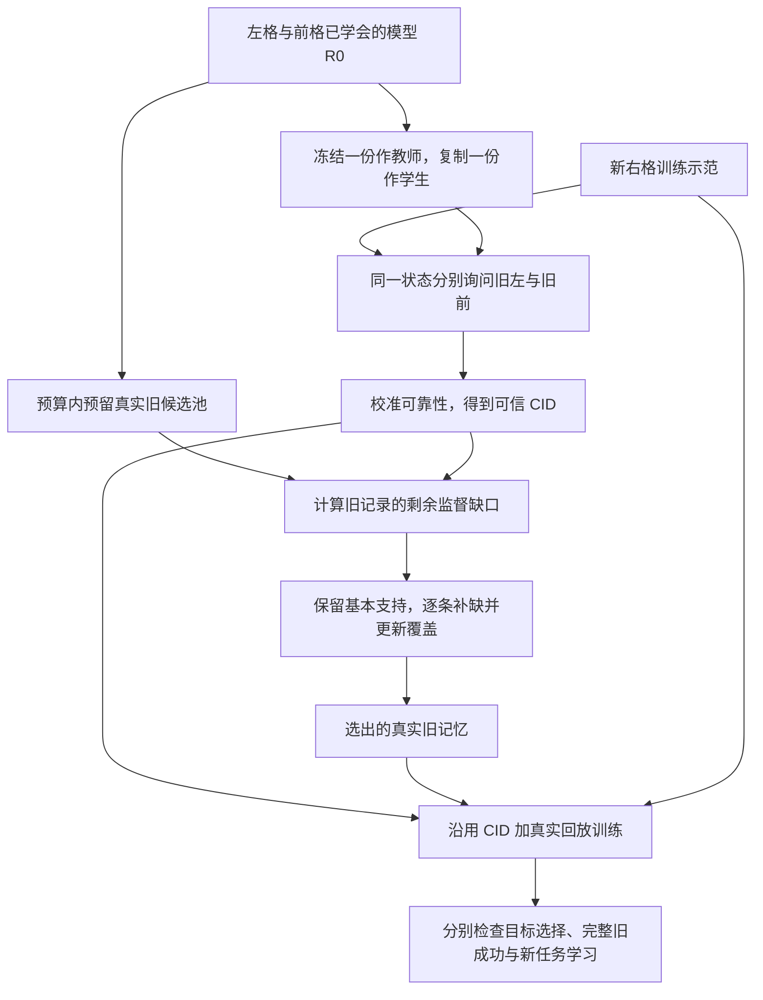

# 回放_v1：根据可信反事实监督的缺口选择真实记忆

日期：2026-10-27。版本：研究方法原型 v1，尚未新增训练或取得本文方法的实验结果。

依据：[10/27 项目交接](../essay/项目交接_默认目标漂移_20261027.md)、[10/27 目标替代成因与回放计划](2026-10-27_目标替代成因与新回放计划.md)，以及文末核对的相关论文。本文只制定方案，不访问或改动正在运行的训练任务。

## 先给导师讲明白：我们准备做什么？

机器人原来会听指令把书放到左格或前格，继续学习右格后，却可能把旧指令也执行成右格。组员的 CID 方法会拿新任务画面问旧模型：“如果现在要求放左格或前格，你会怎么做？”再用这些答案帮助学生复习旧任务。它已经比较稳定地减少了去错目标，但仍有不少回合到了正确位置附近却完不成任务。

我们准备改进的，是**少量真实旧数据应该留什么**。先检查旧模型在新画面上的答案是否可靠，再看这些可靠答案已经复习了哪些旧能力。真实记忆优先留给它教不到的部分，同时保证“听指令去对目标”和“把任务完整做成”都不会被遗漏。选了一条记忆后，重新计算剩下还缺什么，避免四条名额都留成几乎一样的搬运动作。

例如，如果 CID 已经可靠复习了抓取和朝左移动，却没有覆盖左格入口的姿态调整，我们就把更多真实名额留给后者；如果 CID 连旧指令该朝哪里去都教不准，就必须保留真实的分流记录。**不是预先认定只复习方向，也不是把所有阶段机械地平均分配，而是检验哪些真实经验不能被当前监督替代。**

这是一项待验证的方法设想。我们希望得到“缺口可以提前预测，补相应记忆比同预算补别处有效”的证据；不能仅靠一个更复杂的选样分数宣称创新成立。

## 1. 先把已有结果与方法设想分开

### 1.1 已有结果提供了什么线索？

下表来自组员 10/27 交接，均为 SCENE2 种子 1。旧指令共 40 回合，新任务 20 回合。本轮没有独立复跑或核对服务器原始产物。

| 方法 | 每个旧目标的真实记录数 | 改道到新目标 /40，低为好 | 旧任务真正成功 /40，高为好 | 新任务成功 /20 |
|---|---:|---:|---:|---:|
| FT4 | 0 | 37 | 0 | 15 |
| 均匀 ER4 | 4 | 4 | 17 | 未在对应表中列出 |
| DPR4 | 4 | 0 | 6 | 未在对应表中列出 |
| CID | 0 | 0 | 11 | 11 |
| CID＋1 | 1 | 0 | 30 | 13 |
| ER256 | 256 | 0 | 28 | 17 |

需要遵守三个解释边界：

1. **不改道不等于成功。** 还可能没有抓起物体、停在正确格附近，或未满足环境成功条件。
2. **CID＋1 不能普遍称为追平 ER256。** 10/27 复现中，SCENE1-B 的旧成功分别为 5/40 与 28/40，差距明显。
3. **DPR 的失败原因尚未确定。** “只挑决策记录挤掉执行记录”是合理假设，还需检查实际选点、重复程度和失败轨迹。

较早的 10/26 汇报给出 DPR4 目标选对 32/40、均匀 ER4 为 26/40；10/27 没有重新列出 DPR 的这个数值。目标中心重算可能改变分类，正式比较必须统一重算，不能跨版本混成一张已确认的结果表。

### 1.2 本文不预设的结论

- 抓取、抬升、放下虽然名称相同，左／前／右任务的局部状态与控制要求未必相同。
- 新右格仍练抓取，不自动证明旧左／前条件下的抓取完全保持。
- 目标可能在抓取前的动作块中就体现；“看见开始横向移动的时刻”不等于唯一应回放的时刻。
- 仅后半段回放较差，只能说明那套选样不足，不能单独证明决策必然发生在前半段。
- 输出响应受损不等于已经定位了某个语言读取模块。

## 2. 当前方法究竟改进什么？

### 2.1 一条可检验的研究命题

> **真实记忆的价值取决于当前反事实监督已可靠覆盖的旧控制约束；只强调指令差异或只强调阶段均衡，都可能错配记忆。**

这里的“控制约束”通俗地说，就是“在这类状态、收到这条指令时，应该产生什么合适动作”。它既包括目的地选择，也包括抓取衔接、搬运和目标附近调整。

方法尝试把三个判断分开：

| 判断 | 问题 | 不能混同的说法 |
|---|---|---|
| 物理可行性 | 从这个状态还能完成旧目标吗？ | 可行不等于教师会做 |
| 教师可靠性 | 教师是否擅长从这里完成这条旧指令？ | 教师会做不等于覆盖了全部旧技能 |
| 监督可替代性 | 当前 CID 是否已提供足以替代某条真实记忆的监督？ | 图像相近或动作差异大，都不直接等于可替代／不可替代 |

### 2.2 对已有缺点的对应改进

| 已有问题 | v1 的处理 |
|---|---|
| CID 把教师输出当作答案，未必知道哪些状态不可靠 | 先校准教师能力，区分原始 CID 与可信 CID |
| 只用视觉近邻判断覆盖，可能背景一样但控制不同 | 同旧指令、相近控制状态下，再检查动作监督的相容性 |
| DPR 高分记录可能集中在少数状态 | 保留基本功能支持，每选一条更新剩余覆盖，抑制重复 |
| 只保护目标选择，完整执行下降 | 将基本执行阶段与指令响应敏感状态分别检查，不能互相挤空 |
| 固定阶段均分不知道 CID 已复习了什么 | 基本支持之外的名额，由可信 CID 后的剩余缺口决定 |
| 只看改道下降，可能其实是不抓了 | 同时报目标、完整旧成功、新成功及分阶段失败 |

### 2.3 贡献归属与创新边界

| 内容 | 来源／定位 |
|---|---|
| 新状态配旧指令，由冻结 R0 生成伪动作，即 CID | 组员已有方案；最新交接已不将其视为全新蒸馏原理 |
| CID 与每目标少量真实旧记录混合，如 CID＋1 | 组员已有扩展 |
| 按教师换指令后的输出差异选旧记录，即 DPR | 组员已有先导方案 |
| 教师能力边界与监督可替代性分开建模 | 本文新增的研究设想 |
| 根据可信 CID 后的选择／执行缺口分配真实记忆 | 本文拟验证的核心增量 |
| 阶段底线、去重复、相似度、贪心覆盖 | 借鉴的实现组件，本身不作为独立创新 |

**最值得争取的贡献是可预测的规律：同一批真实记忆的收益，是否会随可信 CID 的来源与覆盖范围改变。** 下面的覆盖公式和选样器只是检验这个命题的工具，不是新定理。

## 3. 完整流程：左、前模型继续学右格



这是一套训练数据组织与记忆选择方案。第一版沿用核验后的 CID 训练损失，不额外加入元学习、虚拟梯度更新或新的动作生成网络。

## 4. 输入、数据权限和功能标签

### 4.1 起点与参数更新

起点 R0 应先通过旧左／前任务能力检查。原本不会做的回合不能直接算作新增遗忘；同时保留全部回合成功率，避免只报告筛选后的容易子集。

教师整份冻结；学生沿用现有训练配置。根据当前项目设定，VLM 冻结，动作侧及实际配置允许的投影参数更新。实施前导出可训练参数清单，不能只凭“动作专家训练”这句概括遗漏 state/action 等投影，也不默认改成 LoRA 或全参数微调。

### 4.2 一条真实记录是什么？

记为 `i = (z_i, l_i, A_i, mask_i, source_i)`：

- `z_i`：模型实际需要的图像、机器人状态及必要历史；
- `l_i`：真实旧指令；
- `A_i`：原示范动作块；
- `mask_i`：动作块有效位置；
- `source_i`：轨迹编号、时刻和功能标签等来源信息。

当前配置输出 50 步、实际执行前 10 步，实施时从配置读取。抓取前记录的动作块可能包含后续分流，不能只按当前截图判定它“只教抓取”。

### 4.3 候选池不能事后扩张

旧阶段结束时预留有限候选池 C，左右目标都要有支持。看到右格数据后，只能在 C 内选择最终记忆 M。不能查看正式失败后，再读取此前已丢弃的完整旧视频。

若研究另一种“任务边界仍能访问全部旧数据再压缩”的协议，应单独列实验，并给基线同样权限。

### 4.4 两种标签分开使用

**基本阶段标签：** 首版采用粗粒度的接近／抓取、抓稳／搬运、目标附近调整。依据物体与夹爪状态等事件定义，不机械切视频前三分之一、后半段，也不强制把松爪作为所有任务的成功条件。

**指令响应敏感标签：** 在同一状态上，教师面对旧左／前指令的动作块有稳定差异。这类记录用于检查条件分流支持，可以与基本阶段重叠；它不等于已证明的因果决策时刻。

比较教师响应时固定完整输入、预处理、动作生成初始噪声等条件；若比较 flow 响应，还要固定动作草稿与 flow 时间。不要把随机采样差异算成语言作用。评分使用的动作形式和归一化规则必须记入配置。

## 5. 第一步：判断哪些 CID 可以信任

### 5.1 生成方式沿用组员 CID

对右格训练状态 z，分别用教师 T 查询旧左／前指令，得到伪动作块。保留原指令与对应教师答案，不把右格真实动作直接改标签冒充左格监督。

实施前先核对 CID 源码：教师采样伪动作后做原生动作训练，与直接匹配师生 flow 响应是两种实现。本文首版按组员汇报的“伪动作记录”解释；若实际实现不同，需要同步修改数据和覆盖定义。

### 5.2 开发阶段测教师能力

从新任务训练／开发资料中选择少量完整模拟器快照，恢复物体、机器人、夹爪及必要状态，再让 R0 分别执行旧指令。只有图像无法保证恢复出同一物理起点。

首先检查恢复连续性，再统计教师能否完成对应旧目标。尽可能让首段执行与被审查的缓存伪动作前缀一致，记录动作噪声和执行长度。

一个起步预算示例为：8 个快照 × 2 条旧指令 × 2 次执行，共 32 次开发执行；如果有明显差异，再在独立状态上确认。这个规模只找信号，不能把少量成功直接写成精确概率，更不能用同一批状态同时调规则与证明泛化。

**完整闭环成功衡量教师能力，不证明缓存的整段 50 步每一步都正确。** 当前实际执行的只是前缀，未执行的远期动作仍可能不可靠。

### 5.3 正式选样使用可校准的便宜代理

定义 `q(z,l)` 为教师可靠性估计，输入只使用声明允许的图像、机器人状态和粗阶段信息。首版尝试少量阈值的保守规则或小型线性模型，不训练大型可靠性网络。

旧状态支持距离、预测稳定性可以作为特征，但都不是正确性的证明。规则及阈值在开发资料上确定，拟合与验证按来源轨迹、物理初态或独立快照组划分，不能把同一轨迹的相邻帧随机拆到两组。在未参与拟合的独立状态组上检查排序与分组差异。

若代理有效，按锁定阈值得到可信集合 Q。若代理无效，分别报告“不过滤 CID”与“用实际执行结果筛选的参考上界”，不宣称已经获得免费的可靠性判断。模拟器特权信息与额外执行成本必须单列。

## 6. 第二步：可信 CID 能否替代一条真实记录？

### 6.1 可靠不等于可替代

教师会从桌面中央完成左格，不代表 CID 已覆盖左格入口的接触调整。教师从两个不同状态都能成功，也不代表两处动作可以直接互换。

因此，对真实旧记录 i，只在**同一旧指令、基本控制状态相近**的可信 CID 中寻找支持。不能因为背景相同，就判定真实记录冗余。

### 6.2 一个可实现、可替换的覆盖代理

用以下形式表示初始覆盖：

\[
c_i^{\mathrm{CID}}
=\max_{j\in Q:\,l_j=l_i}
q_j\,k_s(z_i,z_j)\,k_a(A_i,\widehat A_j).
\]

其中：

- `k_s`：状态相似度，结合冻结视觉特征、标准化机器人状态和粗阶段；
- `k_a`：在状态已经足够接近时，检查动作监督是否相容；
- `q_j`：相应旧指令下教师可靠性；
- 同指令集合为空时，覆盖记为 0，而不是对空集求最近距离。

通俗解释：只有“老师的答案可信、当前情况相近、教的动作也相容”同时得到支持，才认为这条真实记录**可能**已被部分覆盖。

**这只是待校验的代理，不是真实记忆收益，也不是任务成功概率。** 高分的替代性必须通过后面的同预算训练与干预实验检验。

### 6.3 相似度的首版实现

状态侧使用固定教师的视觉特征与按训练统计标准化的机器人状态。先用粗阶段及状态距离排除明显不相近的配对，再计算动作相似度，避免直接比较完全不同起点的绝对动作。

动作侧先核实实际输出坐标、单位、有效维度与 mask；不能把 action 前两维或 flow 速度张量直接解释成世界坐标的左右方向。首版可用归一化的原生动作距离，并分别检查实际执行前缀和完整动作块的相容性。阈值由开发资料锁定。

为了让首版可直接实现，可先固定为下面的原型：

```text
视觉差异 = 1 - 两个冻结视觉特征的余弦相似度
状态差异 = 按固定训练标准差归一化后，机器人状态差的均方值
状态距离 = (视觉差异 + 状态差异) / 2

不同粗阶段，或状态距离超过开发阈值：状态相似度 = 0
否则：状态相似度 = exp(-状态距离 / 状态尺度)

动作前缀距离 = 两动作块前 h 步的归一化均方差
完整动作距离 = 两动作块全部共同有效位置的归一化均方差
动作相似度 = min(exp(-动作前缀距离 / 动作尺度),
                  exp(-完整动作距离 / 动作尺度))
```

`h` 读取实际执行步数，当前为 10；没有共同有效位置时，动作相似度记为 0。比较前统一动作坐标、padding 和有效维度，归一化统计固定来自训练资料，不从测试集重新估计。上式保守地要求近期和较远动作都相容，目的是避免仅因当前都在抓取，就误判后续目标动作也被覆盖。它不改变训练动作块长度。

状态阈值、状态尺度、动作尺度在独立开发资料上锁定，只允许预登记的小型候选比较，不使用正式测试成功率反复搜索。上述公式是本原型的明确设计选择，不是已经验证的物理等价标准；也不声称优于其他距离定义。

多种不同动作都可能正确，绝对动作距离也会受起点影响。因此，必须同时保留“只用状态”和“状态＋动作”的对照。若动作项无预测力，就删除该项；若状态距离也无预测力，就不把此覆盖代理包装为已建立的控制等价关系。

新右格真实示范不直接算作旧左／前覆盖。跨指令共享技能可能迁移，但须另有证据；首版保守地只把相应旧条件的可信 CID 计入上述覆盖。

## 7. 第三步：保住必要功能，再逐条补剩余缺口

### 7.1 为什么不用“分数最高的四条”？

四个最高缺口或最高 DPR 分数，可能是同一条轨迹的四个相邻时刻。我们希望第二条记忆补第一条没教到的内容，而不是重复第一条。

定义已选真实记忆集合为 M，候选记录 i 当前的覆盖为：

\[
c_i(M)=\max\left(c_i^{\mathrm{CID}},\max_{m\in M}k(i,m)\right).
\]

`k(i,m)` 是同指令下真实记录间的状态／动作支持代理，采用与前面一致的规则。选入一条真实记忆后，附近相似记录的缺口会下降。

### 7.2 默认保守版：最低支持＋剩余覆盖增益

对每个旧目标单独选择 K 条，首版流程如下：

1. 对候选池已有的基本阶段，先各留至少一条真实记录，用预锁的阶段与去重复规则确定这些共同底线记录，不依赖 CID 缺口分数。这是代理可能出错时的真实监督底线，不保证只靠一条就能保住该阶段。
2. 若已有可靠、稳定的指令响应敏感组，而前面选中的记录没有覆盖它，则在剩余名额中按固定规则补一条。标签无法可靠建立时，不制造“已找到分流点”的结论。基本阶段和敏感组底线在核心选样对照间使用相同记录 ID。
3. 剩余名额逐条选择，让可信 CID 与当前真实记忆共同覆盖到更多尚未覆盖的旧记录；每选一条，更新覆盖再选下一条。

若 K 小于必要组数，预先锁定优先级并报告漏掉的组，不能声称实现了完整功能底线。若一个阶段在候选池中就不存在，选样器也无法凭空恢复。

K＝4 时，三阶段底线可能只剩一个自由名额，再加分流支持后甚至没有自由名额。因此 K＝4 主要检查流程与大信号；**K＝16 才更适合检验剩余名额是否随 CID 覆盖而合理变化。** 若共同底线已占满 K，或不同选择器输出相同记录 ID，就不重复训练两组；直接报告无自由度，并在预算允许时用 K＝16 检验。不把几乎由配额决定的四条选样当成强自适应证据。

### 7.3 剩余覆盖增益如何计算？

为避免长阶段因为记录多而占满预算，把每个基本阶段、以及经验证存在的指令响应敏感组记作 g；各组内部先平均覆盖，再对组平均：

\[
F(M)=\frac{1}{|\mathcal G|}\sum_{g\in\mathcal G}
\frac{1}{|C_g|}\sum_{i\in C_g}c_i(M).
\]

剩余名额每次选择：

\[
m^*=\arg\max_{m\in C\setminus M}
\big[F(M\cup\{m\})-F(M)\big].
\]

阶段组与敏感组可重叠，配置中公开成员及归一化方式；敏感组不存在时不计入。这个目标是覆盖启发式，不是成功率下界，也不声称求得最优记忆。

**贪心覆盖本身是已有工具。本文要检验的是可信条件监督下的覆盖定义是否有用，而不是给这个优化器另起名字就算创新。**

### 7.4 对相邻帧与动作块做去重复

使用轨迹编号、时刻、状态和有效动作块检查重复。相邻记录的 50 步动作块可能大量重叠，重复惩罚应参考实际有效区间。

不机械禁止所有相邻帧：关键接触事件前后虽相邻，也可能提供不同约束。优先用更新后的覆盖增益抑制冗余，再报告选中记录的轨迹数、阶段分布和动作块重叠程度。

### 7.5 选择器伪代码

```text
输入：旧候选池 C、同一版本的 CID 及 q、每目标额度 K

按旧指令分别处理：
    计算每条候选的可信 CID 覆盖 c_CID
    M = 空集
    对每个实际存在的基本阶段，按预锁优先级处理：
        若 |M| >= K：停止添加底线，记录未覆盖组
        按共同底线规则从该阶段选择一条记录，加入 M
        更新候选池所有记录的当前覆盖
    如果存在已验证的指令响应敏感组，且 M 未覆盖它：
        在 K 允许时按共同底线规则补一条，更新覆盖
        否则记录未覆盖，不超出 K
    当 |M| < K 且仍有候选时：
        选择使 F(M) 增加最多的记录
        加入 M，更新覆盖
    输出 M 及每次选择的增益、阶段、来源与重复程度
```

阶段底线顺序与并列分数处理预先固定，使用同一随机种子复现。候选不足时不复制记录假装达到 K；记录实际独立样本数。相似度可按指令分块计算，不需要保存整个大矩阵，临时保留的筛选数据仍计入声明的预算。

## 8. 一个完整的通俗例子

以下是假设，不是实验结果。左格候选池有这些记录：

| 记录 | 内容 | 可信 CID 已覆盖多少？ | 初步用途 |
|---|---|---|---|
| A | 桌面接近与抓取 | 较多 | 保留最低支持，不大量重复 |
| B | 抓稳后开始向左 | 一部分 | 保护旧指令对应的分流 |
| C | 靠近左格入口 | 很少 | 补旧目标局部控制 |
| D | 左格入口另一种调整姿态 | 很少，且与 C 有差异 | 补另一种执行情况 |
| E | 与 C 几乎相同的相邻记录 | 很少，但与 C 重复 | 选 C 后，新增价值降低 |

每目标 K＝4 时，可能选出 A、B、C、D。不是因为规定“抓取一条、分流一条、放置两条”，而是底线支持与剩余覆盖更新共同导致这个结果。

如果换一批自然产生的新状态后，CID 已能可靠教 C、D，却不能教 B，那么真实记忆的优先级应改变。**若优先级始终只跟阶段走、不随可信 CID 改变，这套方法可能只是阶段均衡的复杂实现。**

还有一种可能：CID 覆盖广且可靠，随便几条真实记录已经够用。此时方法应承认没有明显选样优势。

## 9. 第四步：学生如何实际训练？

选样结束后，沿用原训练骨架：每步 4 条新右格真实记录，加左／前各 1 个旧监督槽位。

每个旧槽位独立以 50% 概率使用相应旧指令的可信 CID，50% 使用选出的真实记忆；该比例继承组员混合方案，第一版不新增自适应权重。

```text
某一步：4 条真实右格＋1 条真实左格＋1 条 CID 前格
另一步：4 条真实右格＋1 条 CID 左格＋1 条真实前格
也可能：两个旧槽位都取真记录，或都取伪记录
```

所有记录按核验后的原生训练目标计算损失，保留当前匹配口径，例如汇报中的总损失除以 6。选样评分不变成一条额外的“朝左”损失；真实记录继续使用其原指令和真实动作。

若某旧指令没有可信伪标签，预先规定该指令的伪槽位回退到真实记忆；同一可信 CID 版本的随机、均衡与缺口选样组采用同一规则，记录实际真／伪使用比例。该回退涉及监督来源变化，必须单列，不能混入“纯选样增益”。

教师、优化器、新数据流、训练步数和总旧槽位权重在选样对照间保持一致。部署只运行学生，教师与额外环境访问属于训练／分析成本。

## 10. 为什么它可能同时改善选目标与完成任务？

对“目标选对包含成功”的指标定义，有：

\[
P(\text{成功})=P(\text{目标选对})\,P(\text{成功}\mid\text{目标选对}).
\]

DPR 可能提高第一项，却因执行支持不足降低第二项。v1 不把全部预算给高指令差异记录，而是保留必要功能支持，再补可信 CID 的剩余缺口。

| 补充的监督 | 合理预期 | 不能据此宣称 |
|---|---|---|
| 合法共同状态下的旧条件分流 | 减少改道、提高目的地正确率 | 已定位语言读取模块 |
| 抓取到搬运的衔接状态 | 减少抓起后失稳或动作接不上 | 共同技能一定完全保留 |
| 旧目标附近的调整 | 提高目标选对后的完成率 | 已解释目标替代本身 |
| 不同初态、姿态的互补记录 | 提高跨状态稳健性 | 已解决未见偏离状态的恢复 |

若学生偏离后仍无法恢复，成功轨迹候选池可能没有必要的纠错状态。这时只重选旧记录未必足够；后续可研究额外恢复监督，但须单列环境与教师成本。v1 不把它与首版选样同时引入。

## 11. 最小实验：每次解释一个改动

### 11.1 先验收，后启动

先等待并核对组员正在进行的 CID 指令类型消融，检查“旧条件监督”是否有超出通用约束的作用。即使支持，也不能证明可靠性与覆盖代理已经成立。

同时核对 CID 与 DPR 源码、可训练参数、动作表示、成功判据、目标分类中心和候选池权限。仅从交接描述不能确认 DPR 的具体评分公式。

### 11.2 核心对照

各组使用同一个候选池、相同 K 和训练预算。组号只用于本文。

| 组别 | CID | 真实记忆选择 | 要回答的问题 |
|---|---|---|---|
| A0 | 原始 CID | 随机 | 现有混合方案参照 |
| A1 | 可信 CID | 与 A0 同一组随机记忆 | 可靠性筛选本身有无帮助？ |
| A2 | 与 A1 完全相同 | 共同底线＋剩余额度阶段均衡／去重复 | 简单功能覆盖是否已经足够？ |
| A3 | 与 A1 完全相同 | 共同底线＋剩余额度 DPR／去重复 | 是否只需重点保护指令差异？ |
| A4 | 与 A1 完全相同 | 共同底线＋剩余额度可信覆盖缺口选择 | CID 条件化补缺是否有额外作用？ |

A2、A3、A4 的共同底线同时包含适用的基本阶段与指令响应敏感组，核心确认实验固定这些记录 ID。它们只在剩余名额的分配规则上不同；不能让 A4 额外多一个分流底线后，把收益归因于覆盖评分。

可靠性无有效代理时，先把各组选样的 CID 固定为同一个未筛选版本，并明确这只验证选样部分。此对照中可把 q 统一设为 1，表示“未做可靠性校准”，不能解释为教师百分之百可靠；不能把未完成的筛选步骤写成已实施。

最小先导优先比较 A2 与 A4，K＝4 先离线检查流程与选点是否真的不同，随后优先用有自由名额的 K＝16 检验分配是否有效。最多先新增两个诊断训练，有信号再补完整因素对照、独立种子与另一任务族。先导减少组数不等于论文可以省略关键基线。

纯 ER4、DPR4、CID 与 ER256 用作背景。证明选样收益必须与相同 CID、相同 K 的方法比较，不能拿 CID＋4 赢 CID＋1 就归功选样。

### 11.3 有信号后，最少拆开三件事

- 可靠性：原始与可信 CID，真实记忆固定。
- 覆盖定义：纯状态相似，与状态＋动作相容性比较。
- 分配作用：可信覆盖补缺，与同底线的均衡／DPR 比较；检查去掉基本支持是否重现“保目标、丢执行”。

基础组未出现稳定信号前，不展开大量超参数和全部组合。后续增加 Memory Anchors、MIR 等同权限强基线；适配时不满足原论文关键条件的，标注为借鉴变体。

## 12. 什么证据才能支持创新主张？

### 12.1 提前预测，而不是事后解释

在适应训练与正式测试前锁定缺口评分、所选记忆和预期主要改善的错误类型。检验它是否超出阶段、视觉距离、旧损失和 DPR 分数的预测力。

### 12.2 对应缺口的补充确实更有效

同数量真实记录，补预判缺口应比补已被可信 CID 覆盖的记录带来更大增益。若只是任何真实数据都有效，不能支持特定的可替代性解释。

### 12.3 核心确认：记忆价值是否随监督来源改变？

在自然产生的新任务数据中寻找两组 CID 来源 Q_A、Q_B，其可靠覆盖范围不同；不是人为删去某条旧指令来制造缺失。

准备同大小真实记忆 M_A、M_B，并在不知道后续结果前锁定预测：

| CID 的可靠覆盖 | 补 M_A | 补 M_B |
|---|---|---|
| Q_A 已覆盖能力 A，较少覆盖 B | 预期较冗余 | 预期增益更大 |
| Q_B 已覆盖能力 B，较少覆盖 A | 预期增益更大 | 预期较冗余 |

每个来源增加自己的 CID-only 参照，比较加真实记忆带来的增益，而非不同来源的绝对成功率。匹配 CID 数量、旧指令曝光、阶段组成、新数据和训练预算；若来源差异只能由阶段分布解释，不能声称超越了阶段均衡。

这个确认实验最多涉及两来源×两记忆加两条 CID-only，共六个分支，**不是首轮必须全跑**。只有前面的代理和选样出现信号才值得投入。若找不到自然、可复验的覆盖差异，应如实收窄研究命题。

## 13. 指标与资源怎样报告？

### 13.1 效果至少同时报告五项

1. 旧指令改道到新目标的次数。
2. 旧目标选对次数：成功与到正确区域但未完成分别列出。
3. 旧任务环境成功率，以及父模型原本成功子集的保留率。
4. 目标选对后的完成比例、抓取／搬运／目标附近调整等失败分布。
5. 新任务成功率与学习曲线，防止用学不好新任务换保留旧任务。

沿用统一“曾成功／首次到达”主口径，同时保留终止状态作补充诊断；不把示范成功后停止录制引起的后续动作当成新增遗忘。固定目标中心与分类规则，用新物理初态确认；推理噪声种子不是独立物理初态，也不是独立训练复验。

### 13.2 数据预算

首版沿用 64 MiB 共同保留预算：真实候选池、选中记忆、CID 标签、筛选特征与索引实际共存时的峰值都计入。候选池不能先免费存每目标 256 条，再额外叠加 CID 缓存。

教师 checkpoint、教师生成／可靠性查询次数、模拟器执行次数、选样时间与训练卡时单列。64 MiB 指声明的保留数据预算，不是声称整个模型或进程只占这些内存。

同时做两种比较：相同真实 K 比选样质量；相同总字节比资源效率。没有 CID 缓存的方法可以用节约的空间保存更多真实数据。各方法获得相同的访问上限，不强称实际计算量完全相等。

两张 3090 是两份独立 24 GB 显存，当前任务结束且资源获分配后才排新训练。时长按现有日志实测，不承诺固定小时数。

## 14. 相似工作与必须承认的重叠

以下是与本方法最直接的原始来源，不构成“已证明不存在其他相似工作”。

| 工作 | 已有内容 | 本文必须增加的证据 |
|---|---|---|
| [Learning without Forgetting](https://arxiv.org/abs/1606.09282) | 在新数据上保持旧模型响应 | 不能把教师保持本身当原创；需验证旧条件的可靠支持与替代性 |
| [Hybrid Memory Replay](https://arxiv.org/html/2410.15372v1)，尤其 §4.3 | 给定合成数据，选择互补的真实样本 | “真实补伪数据”已有；新增应是闭环教师能力边界及其对记忆收益的可检验预测 |
| [RIFAR v3](https://arxiv.org/html/2610.03079v3)，§3.3—3.4 | 生成回放可靠性检查与适应后动作漂移优先 | “过滤可靠数据＋优先易忘记录”已有；本文需区分可靠性与旧监督可替代性 |
| [Memory Anchors](https://arxiv.org/html/2608.26545v1)，§4 | 从表示重叠且动作冲突区域选择旧经验 | 需超过冲突选样，解释同一真实记忆为何随可信 CID 覆盖而改变收益 |
| [PHASER](https://arxiv.org/html/2606.03598v2)，§2.2—2.3 | 基本阶段支持与多模态干扰路由 | 阶段底线不是原创；需超过同预算阶段均衡与路由 |
| [MIR](https://arxiv.org/abs/1908.04742) | 按预计受新更新影响的程度检索记忆 | 若只有一般遗忘评分，独立空间有限 |
| [GCR](https://openaccess.thecvf.com/content/CVPR2022/html/Tiwari_GCR_Gradient_Coreset_Based_Replay_Buffer_Selection_for_Continual_Learning_CVPR_2022_paper.html) | 梯度匹配的回放子集选择 | 覆盖优化与子集选择已有基础，不把换一个优化器当新原理 |
| [DAgger](https://proceedings.mlr.press/v15/ross11a.html) | 面向策略诱导状态分布补充监督 | 若未来加入偏离后的恢复示范，要承认该思想及新增环境成本 |

**目前不能保证这一组合已达到顶会所需的独立创新。** 如果只表现为 q 筛选、阶段均衡和贪心选择的拼接，应定位为工程改进；只有额外发现可复验、可预测的条件化监督边界，才有更强的研究主张。

## 15. 实施顺序与收窄条件

| 阶段 | 工作 | 继续条件 |
|---|---|---|
| 0：验收 | 阅读现有 CID 消融；核对源码、指标与可训练参数；列出 DPR 选点 | 现有差异可复核，数据与评测口径一致 |
| 1：低成本诊断 | 检查阶段与动作块重复；开发教师可靠性；检查覆盖代理 | 可靠性或覆盖确有可预测信号 |
| 2：最小实现 | 离线计算覆盖、动态选样；K4 做流程检查，K16 看分配 | 缺口选样优于相同 CID 的简单阶段均衡，而非只赢 FT4 |
| 3：确认 | 独立适应种子、另一任务族、新初态；必要时独立获得 R0 | 旧完成改善且新学习可接受，效果有重复性 |
| 4：研究确认 | 自然来源的记忆价值交叉与强近邻方法比较 | 可替代性解释超出简单阶段／距离／冲突分数 |

两位同学可分别负责“教师可靠性与失败分类”和“预算、覆盖代理与选样实现”。第一轮只新增一个选择器，不同时改网络、损失、评测中心和训练配方。

出现以下结果时应收窄：

- q 无法在独立状态上预测教师行为：停止声称已建立便宜的可靠性筛选。
- 覆盖代理不能预测错误或补记忆收益：放弃“覆盖分数就是记忆价值”的解释。
- 阶段均衡与本文同样好：报告阶段覆盖即可，不强称条件化选样创新。
- 改道减少只是因为不抓了，或旧成功提高以新任务明显退化为代价：没有实现预期保留与适应。
- 收益依赖更大候选池、更多旧数据访问或额外未披露的模拟器监督：不能宣称同资源优势。
- 只有某一个种子成立：作为先导信号，继续确认或如实报告不稳定性。

## 16. 最后再用一段话讲明白当前版本

**组员的 CID 是让旧老师在新画面上继续回答旧指令，DPR 是专挑换指令后答案差异大的旧记录。回放_v1 保留这两者带来的线索，但先检查老师是否可靠，再检查它教的内容是否已经替代了某些真实旧监督。真实记忆先保证必要操作与条件分流有支持，剩下的名额逐条补尚未覆盖的缺口，选完一条再算下一条，避免重复。学生训练仍沿用 CID＋真实回放，最终同时检验去对目标、完整做成旧任务和学会新任务。**

期望结论是“可信监督来源决定哪些真实记忆更有用，并能据此改善同预算的旧新折中”。如果实验只能证明简单阶段补充有效，就按这一较窄结论报告，而不把尚未成立的创新写成既成事实。
