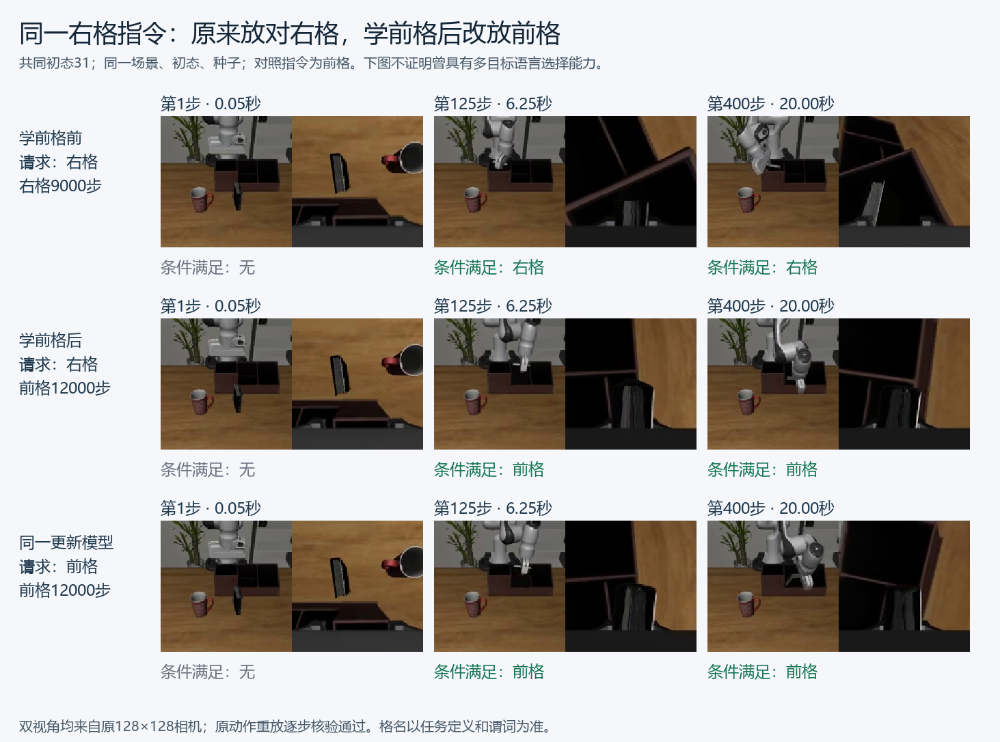
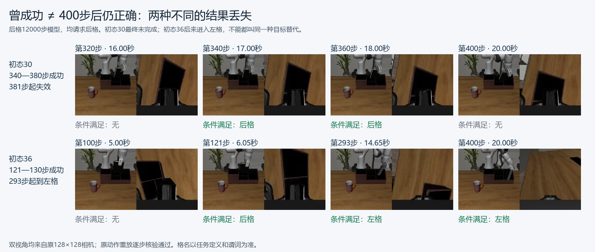
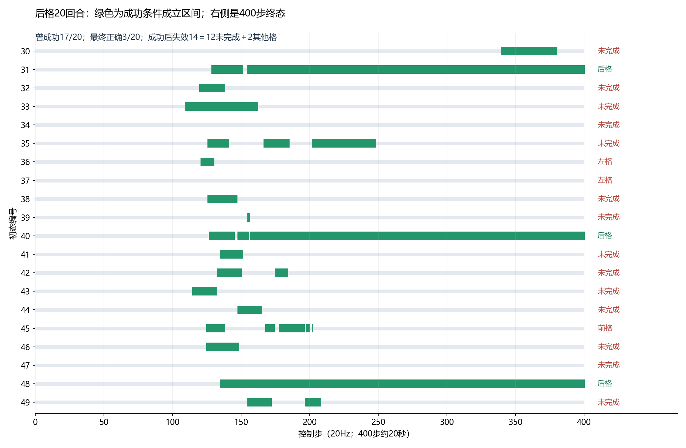

# 实验记录

本文件收录对研究判断有直接价值、具备明确设置和原始证据的已完成实验。有意义的负结果同样保留；每次记录区分实际观察和可以支持的结论。

最新双目标候选结果见**E006**：联合训练12000步开发左格最终19/20、前格16/20，同初态两条都正确15/20；40回合中未观察到达到其他格判据的目标替代。用户已指定据此开[右格顺序适应探索分支](docs/2026-10-23_双目标12000到右格_顺序学习与目标替代.md)，它不改变原R0未通过联合门槛的状态。

**先看视频：** [并排播放与通俗图解](docs/results/2026-10-23/visual_cases/视频解读.html)；本文末尾“E004／E005视频复核”含关键帧、录像和20回合时间线。[下一步实验计划](docs/2026-10-23_下一步实验计划_双目标起点与机制诊断.md)单独列出待执行步骤。HTML播放器可本地打开；Markdown阅读器不支持视频时，使用各段的MP4链接。

## E001｜单任务左格起点与四指令目标偏置

**日期：2026-10-22。结论：成功建立左格操作起点；换成前／右／后指令时，模型仍明显倾向左格。尚不能把这一现象称为持续学习遗忘。**

### 设置

- 模型：SmolVLA，从服务器原始 `smolvla_base` 出发；冻结VLM，训练动作专家及相关投影。
- 训练：只使用左格40条示范，另留10条验证；正确时序配对，4840训练帧、1214验证帧。归一化只来自左格训练数据。
- batch6、学习率1e-4、warmup100，最多6000步；chunk50、flow10、执行10步，20Hz。
- 预先固定1000／3000／6000步候选，仅按左格开发初态0—9终态正确至少8/10选择第一个达标点。实际开发成绩分别2/10、0/10、10/10，故冻结6000步。
- 冻结模型在初态30—39上评估前／左／右／后，每条10回合，共40回合，每回合400步。四指令及训练前后模型的状态、场景和推理种子逐项一致。
- 训练前基座同样评估40回合，使用相同左格训练统计。累计成功补充口径复用原轨迹，没有重复刷分。

### 结果

| 请求指令 | 请求目标曾成功 | 请求目标最终正确 | 最终在左格 | 最终未完成 |
|---|---:|---:|---:|---:|
| 前格 | 0/10 | 0/10 | 8/10（错误目标） | 2/10 |
| 左格 | **10/10** | **9/10** | 9/10（正确目标） | 1/10 |
| 右格 | 0/10 | 0/10 | 8/10（错误目标） | 2/10 |
| 后格 | 0/10 | 0/10 | 7/10（错误目标） | 3/10 |

- 前／右／后30回合，首次满足的目标谓词全部是左格，且从未满足请求目标；其中23/30（76.7%）最终仍在左格，另7回合最终未完成。
- 同初态左格控制最终成功的9个初态上，另三条指令23/27（85.2%）最终在错误左格；失败也保留在分母。
- 训练前基座四条指令均0/10，40回合都未到达任一目标。
- 本轮总评估110回合：训练前40、三个候选开发共30、冻结模型四指令40。完整流程36分03秒，正常结束。

### 研究意义与限制

操作能力和正确目标选择可以分开：模型能把书放进左格，但换目标词并没有让它正确完成其他目标；多数失败体现为可识别的错目标行为。由此获得可用于下一步顺序训练的单旧任务起点。

其他三个目标没有进入本轮训练，基座对照也没有成功，所以其0/10不能称为遗忘。单目标高成功率不证明模型获得了多目标指令分辨能力；目前也没有定位语言表征、跨模态融合或动作专家中的因果损伤。仅一个种子、10个探测初态，谓词成立不单独保证松爪放稳。

### 可追溯证据

- 实验运行：`single_left_20261022_01`；源码：`6c9adc00a82cd713226bf06159218ac51130fb88`。
- 冻结模型：服务器 `/home/lzx/cl_binding/outputs/r0/single_left_20261022_01/checkpoints/006000`。
- [完整实验说明](docs/2026-10-22_单任务起点与四指令探测.md)。
- [四指令逐回合记录](docs/results/2026-10-22/single_left_v1/adapted_episodes.jsonl)、[训练前对照记录](docs/results/2026-10-22/single_left_v1/base_episodes.jsonl)。
- [原始运行汇总](docs/results/2026-10-22/single_left_v1/run_summary.json)、[目标矩阵](docs/results/2026-10-22/single_left_v1/instruction_comparison.json)、[累计成功统计](docs/results/2026-10-22/single_left_v1/benchmark_followup_summary.json)。
- [逐回合重算与文件哈希核验](docs/results/2026-10-22/single_left_v1/final_result_verification.json)。

## E002｜左格→右格顺序微调：旧技能严重损失，新任务尚未稳定学会

**日期：2026-10-22。结论：旧左格过程成功从20/20降至0/20，其中7/20最终转向新右格，13/20最终未完成；新右格从0/20提高到9/20。观察到了部分目标替代，但不是“新任务已稳定学会、旧任务主要被替代”的干净案例。**

### 设置与有效性

- 从E001冻结的左格6000步模型开始，纯顺序微调右格6000步，不加回放、不加蒸馏。仅右格40条训练（5577帧）、10条验证（1488帧）；全量配对核验通过。
- 继承左格的状态／动作归一化，冻结VLM、更新动作专家及相关投影；重新建立优化器／调度器，batch6、lr1e-4、warmup100，其余控制设置沿用E001。
- 固定+6000步终点，不根据新旧任务成绩挑模型。6000条训练更新均连续、loss和梯度有限；6个检查点保存／重载均通过，冻结参数不变。
- 训练前后各评估四条指令，每条20回合、每回合400步，共160回合。初态30—49，全部80组跨模型条件及同初态四指令的状态、XML、种子一致。
- 其中30—39沿用E001探测初态，40—49新增；训练前重跑的前10初态40回合与E001逐项一致，不把这些重复回合当作新增独立初态。

### 正确任务成功率

| 指令 | 训练前曾成功 | 训练前最终正确 | 训练后曾成功 | 训练后最终正确 |
|---|---:|---:|---:|---:|
| 前格 | 0/20 | 0/20 | 0/20 | 0/20 |
| **左格（旧任务）** | **20/20（100%）** | **19/20（95%）** | **0/20（0%）** | **0/20（0%）** |
| **右格（新任务）** | **0/20（0%）** | **0/20（0%）** | **9/20（45%）** | **9/20（45%）** |
| 后格 | 0/20 | 0/20 | 0/20 | 0/20 |

新右格有45个百分点学习增益，但未达到预先设定的16/20描述性高成功率门槛。即使看“过程中曾成功”，也只有9/20；不是单纯继续动作后破坏结果导致的低分。

### 训练后实际去了哪里

| 请求指令 | 最终在右格 | 最终未完成 |
|---|---:|---:|
| 前格 | 8/20（错误目标） | 12/20 |
| 左格 | **7/20（错误目标）** | **13/20** |
| 右格 | 9/20（正确目标） | 11/20 |
| 后格 | 6/20（错误目标） | 14/20 |

旧左格20个初态训练前都曾成功，训练后全部不再成功。其具体损失为：

- **7回合最终满足新右格目标**，是明确的行为层目标替代，占旧任务全部20回合的35%。
- 另1回合曾先到右格，最终又失去该状态；其余12回合没有到达任何目标。因此13个终态未完成不能全部归为同一种错误，更不能把全部20个旧任务失败都写成目标替代。
- 探索性地只看“训练后右格指令确实成功”的9个相同初态：换回左格指令，仍无一完成左格，6/9最终在右格、3/9未完成，7/9曾先到右格。它说明部分错误不能只用“该初态完全无法操作”解释；这是事后条件诊断，不替代全20回合结果，也不证明具体信息路径受损。

### 研究判断

1. **比E001更直接的旧技能损失证据。** 这里左格确实曾经会做，随后纯右格适应后在相同状态上失效，符合单旧任务保持受损的行为判据。
2. **损伤是混合的。** 部分旧指令转成新目标，同时大量回合未完成；当前应保留“目标偏置＋操作能力损伤／其他未完成原因并存”的解释，尚未分清每个未完成回合的机制。
3. **新任务质量仍是瓶颈。** 右格45%不足以成为后续机制或缓解方法的稳定终点。当前结果值得保留，但不能据此宣布主假设已充分验证，也不能确定加步数就能解决。
4. **尚未解释原因。** VLM冻结且归一化行为未变，排除了“本轮更新了语言编码器权重”及“切换归一化”这两种解释；仍未定位动作专家／投影中的具体损伤路径，单目标起点也未证明此前具有多目标指令分辨能力。

下一步优先核对右格学习质量，例如做同预算、同归一化的右格单任务初始化对照，以区分右格本身的学习难度与左格起点的顺序干扰；再决定预算／学习率调整及复现。该初始化对照尚未执行；随后只增加右格步数的实验另记为E003，不覆盖本节成绩。

### 完成情况与证据

右格6000步训练本体用时25分24秒。原流程在训练后误把部分单元素计数统计的存储形状变化当成归一化变化，因而在终点评估前停止；该失败记录保留。修复后核对了统计数值、配置、真实预处理及反归一化输出完全一致，使用原冻结终点补评，没有重训或改变训练预算。补评于21:33:47开始、**21:41:18完成**，用时7分31秒，两个评估进程均正常退出。

- 运行：`left_then_right_20261022_01`；训练源码 `2b0022d5e34b1b2c191c88c2ed8b4c8a039997c8`；补评源码 `c078cc2fa14233cdbe48222d52ee6a604f5d8fc5`。
- 模型：服务器 `/home/lzx/cl_binding/outputs/sequential/left_then_right_20261022_01/checkpoints/006000`；原左格检查点保留。
- [完整协议与中断修复说明](docs/2026-10-22_左格到右格顺序训练_20回合协议.md)。
- [训练前80回合](docs/results/2026-10-22/left_then_right_v1/before_episodes.jsonl)、[训练后80回合](docs/results/2026-10-22/left_then_right_v1/after_episodes.jsonl)、[配对比较](docs/results/2026-10-22/left_then_right_v1/sequential_comparison.json)。
- [补评完成汇总](docs/results/2026-10-22/left_then_right_v1/evaluation_followup_summary.json)、[完成标记](docs/results/2026-10-22/left_then_right_v1/EVALUATION_COMPLETE.json)、[原始失败汇总](docs/results/2026-10-22/left_then_right_v1/run_summary_original.json)。
- [归一化行为验证](docs/results/2026-10-22/left_then_right_v1/normalization_verification.json)、[训练与6个检查点核验](docs/results/2026-10-22/left_then_right_v1/training_trace_verification.json)、[逐回合独立重算](docs/results/2026-10-22/left_then_right_v1/result_verification.json)、[来源及哈希](docs/results/2026-10-22/left_then_right_v1/export_manifest.json)。

本轮仅一个训练种子、20个探测初态；条件子集尤其小。所有比例均是本轮观察值，不是总体概率或多种子研究结论。

## E003｜右格续训至9000步：新任务提高，旧指令更常转向新目标

**日期：2026-10-22。结论：增加训练步数在本轮有效，右格配对成功率由9/20提高到15/20（45%→75%）；旧左格仍0/20，但最终执行右格由7/20增加到14/20。目标替代成为旧任务失败的主要终态类型；尚未解释具体损伤路径，也未达到配对组80%高成功率。**

### 设置与选点

- 从E002右格6000步检查点完整恢复模型、优化器、调度器及随机状态；学习率1e-4、右格40条训练、原左格归一化、冻结范围及控制参数均不变，无回放／蒸馏。
- 固定候选为右格累计9000／12000／15000／18000步，仅看右格开发初态0—19，每次20回合；第一个曾成功和终态正确都至少16/20的候选冻结，不用旧任务或配对成绩选点。
- 6000步开发为6/20，9000步为19/20，两种成功口径均相同。故首个候选9000步即达标，没有继续筛选12000／15000／18000步。
- 训练和开发并行，门槛确认时训练已继续前进，实际在10001步保存后停止；**最终评估始终使用冻结的9000步模型**，不是10001步。选定模型较E002多训练3000步，实际执行额外4001次更新。
- 四指令各20回合，初态30—49、400步；复用E002原左格起点及右格6000步的两组80回合。三模型全部80个条件的状态、XML、种子逐项一致。

### 成功率：三个模型对照

下表为最终正确完成请求目标；9000步模型各指令的过程曾成功数也与其终态正确数相同。

| 请求指令 | 原左格起点 | 右格6000步 | 右格9000步 |
|---|---:|---:|---:|
| 前格 | 0/20 | 0/20 | 0/20 |
| **左格（旧任务）** | **19/20（95%）** | **0/20** | **0/20** |
| **右格（新任务）** | **0/20** | **9/20（45%）** | **15/20（75%）** |
| 后格 | 0/20 | 0/20 | 0/20 |

- 新右格提高30个百分点，500步窗口训练loss从6000步末0.1767降至9000步末0.1462。增加预算在这一种子和探测组上有实际收益，不能据此认定欠训练是所有失败的唯一成因。
- 配对并非逐状态全部变好：原右格9个成功状态保住8个，新增7个成功，1个原成功状态退化，4个状态两个模型都失败。
- 开发19/20（95%）与配对15/20（75%）是不同场景组的成绩。后者仍低于16/20，不能把开发达标写成独立资格合格，或宣称稳定达到95%。

### 旧任务如何失败

| 指令 | 9000步模型最终在右格 | 最终未完成 |
|---|---:|---:|
| 前格 | 15/20（错误目标） | 5/20 |
| **左格** | **14/20（错误目标）** | **6/20** |
| 右格 | 15/20（正确目标） | 5/20 |
| 后格 | 13/20（错误目标） | 7/20 |

原左格起点20个初态都曾正确完成左格；9000步模型全部不再完成左格，其中14个首次及最终目标均为右格，另外6个从未到达任何目标。相比E002的7个错右格、13个未完成，增加右格训练后，旧任务损失没有恢复，但其行为更多体现为执行新目标。

探索性地只看9000步模型能够按右格指令成功的15个初态：换回左格指令，13/15（86.7%）最终执行右格，2/15未完成，0/15完成左格。它进一步说明多数这类错误不能只用“该状态没有操作能力”解释；这是事后条件诊断，主结果仍保留全20个初态，不作路径损伤的因果证明。

### 研究判断与下一步约束

1. **可以继续研究目标替代。** 在更充分学习右格后，旧左格成功仍归零，而且70%的旧指令最终完成新右格，比E002的混合损伤更接近希望研究的行为现象。
2. **不能写成所有失败都属于目标选择损伤。** 旧指令仍有6/20未完成，新右格仍有5/20失败，尚未完成逐阶段操作原因的归因。
3. **单旧任务起点的结论边界不变。** 本轮支持曾会做的左格技能在顺序训练后转成新目标，仍未证明起点曾具有同场景多目标语言分辨能力，也未发现或修复具体信息传递路径。
4. **先复现及补对照，不追着已看过的配对组挑分。** 保留9000步为本轮预定规则选中的模型；10001步虽已保存，但未用其配对成绩挑替代模型。本轮结束后没有启动额外训练。

### 时间、样本与证据

22:04:18启动，**22:28:52完成**，流程24分32秒；续训本体16分30秒，原定预算因首个候选达标而提前停止。全部阶段退出码为0，连续训练日志及保存／重载核验通过，归一化不变。

实际新增120回合：6000步开发20、9000步开发20、9000步四指令80。旧两模型160回合直接复用，不重复计算为新增回合。开发0—19与配对30—49分开；10—19本轮转为开发用途，20—29仍未使用。配对组已在E002看过，不称全新测试集。本轮仍仅一个训练种子，比例是小样本观察，尚无多种子稳健性结论。

- 运行：`right_continue_20261022_01`；源码 `409b35e1aeed0016ff84bb4778eed13467796bcb`。
- 模型：服务器 `/home/lzx/cl_binding/outputs/sequential/left_then_right_20261022_01/checkpoints/009000`。
- [完整续训计划](docs/2026-10-22_右格续训与重新评估.md)、[运行汇总](docs/results/2026-10-22/right_continue_v1/run_summary.json)、[完成标记](docs/results/2026-10-22/right_continue_v1/COMPLETE.json)。
- [6000步开发记录](docs/results/2026-10-22/right_continue_v1/dev_006000_episodes.jsonl)、[9000步开发记录](docs/results/2026-10-22/right_continue_v1/dev_009000_episodes.jsonl)、[9000步四指令80回合](docs/results/2026-10-22/right_continue_v1/episodes.jsonl)。
- [与原左格比较](docs/results/2026-10-22/right_continue_v1/comparison_to_original_left.json)、[与右格6000步比较](docs/results/2026-10-22/right_continue_v1/comparison_to_right6000.json)、[三模型逐回合独立重算](docs/results/2026-10-22/right_continue_v1/result_verification.json)。
- [恢复核验](docs/results/2026-10-22/right_continue_v1/resume_verification.json)、[训练及检查点核验](docs/results/2026-10-22/right_continue_v1/training_trace_verification.json)、[来源与模型哈希](docs/results/2026-10-22/right_continue_v1/export_manifest.json)。

## E004｜左→右→前：新前格学成，旧右格转向新目标

**日期：2026-10-23，11:55:16完成。结论：前格固定12000步后，前格过程成功19/20、最终正确16/20；旧右格从15/20降至0/20。此前右格成功的15个初态中，12个最终执行前格、3个未完成，支持旧技能损失伴随最新目标替代。左格此前已为0，不能再算本阶段新增遗忘。**

### 设置与完整性

- 起点为E003按开发规则选中的右格9000步，未使用实际训练末尾的10001步。继承权重及最初左格归一化，任务切换时重建优化器／调度器；无回放、无蒸馏，冻结VLM，更新动作专家及相关投影。
- 本阶段仅训练前格40条示范，另10条验证，6097／1435帧；batch6、lr1e-4、warmup100及控制配置沿用此前。固定12000步终点，不按开发或配对成绩选点。
- 新增四指令各20回合，共80；初态30—49、400步。与缓存原左格和右格9000步的160回合逐项比较，全部80组条件的初态、场景XML、推理种子、控制步数一致。
- 训练12000步连续，loss／梯度全部有限；3000／6000／9000／12000四次保存和重载均通过，重载输出差为0，冻结权重未变，归一化继承核验通过。训练本体53分06秒，两个评估进程首次即正常结束，无运行错误重试。

### 成绩与实际目标

“曾成功”表示400步内至少一次满足请求目标；“最终正确”表示400步结束时仍满足。两者均保留，不把到达后被破坏的回合称为从未完成。

| 请求指令 | 右格9000步：最终正确 | 前格12000步：曾成功 | 前格12000步：最终正确 | 最终实际在前格 | 最终未完成 |
|---|---:|---:|---:|---:|---:|
| **前格（本次新任务）** | 0/20 | **19/20（95%）** | **16/20（80%）** | 16/20（正确） | 4/20 |
| 左格 | 0/20 | 0/20 | 0/20 | 16/20（错误） | 4/20 |
| **右格（本次有效旧任务）** | **15/20（75%）** | **0/20** | **0/20** | **17/20（错误）** | 3/20 |
| 后格（此时未训练） | 0/20 | 0/20 | 0/20 | 15/20（错误） | 5/20 |

前格19个过程中成功的回合里，3个最终失去成功状态；另1个始终没有完成前格，合计4个终态未完成。三条已训练过指令合计曾成功19/60、最终正确16/60；这表示接触过三个任务，不表示同时学会三个任务。后格仅作额外指令诊断，不计入三任务保持汇总，也不算遗忘。

### 本阶段新增遗忘的分母

- **全20个右格指令**：训练后17个最终到前格、3个未完成，右格正确为0。
- **此前右格成功的15个初态**：15个全部失去成功，其中14个首先到达前格，12个最终仍在前格，3个最终未完成。这一组才是本阶段“已获得右格技能丢失”的直接配对分母；不能把全20组的17个错前格写成“原先成功15个中17个被替代”。
- **左格立即前一阶段已0/20**：错误终点由右格偏置转为前格偏置，不能再记为本阶段新发生的左格成功损失。相对最初左格起点的累计损失单独留在历史比较文件。

### 能支持什么、还缺什么

1. 同一顺序链中已观察到“左技能→偏右”和“右技能→偏前”，最新目标偏置随任务切换而变化；本轮旧右格失败以新前格终态替代为主，同时保留未完成回合。它不只是成功率下降的描述，但尚不是具体信息通路的解释。
2. 新前格在本轮配对组达到最终80%，但该组已在此前实验使用；没有运行首次未使用的资格初态20—29，也没有多种子复现，不能称为独立资格通过或稳定总体成功率。
3. **仍未证明“已获得的多目标语言选择能力衰退”。** 原左模型只会左、右模型只会右、当前只会前，尚无同一模型同时按两条指令成功的共同起点。当前可称单旧技能保持受损及最新目标偏置；不能排除目标专用运动策略被覆盖，也未证明目标信息仍然可读。
4. 完成已授权的后格阶段后，机制研究的首要缺口仍是建立同场景双目标合格起点，并设置不适应／普通回放等对照；不通过继续刷当前配对组选择更好终点。

### 证据

- 运行：`four_task_20261023_01/stage3_front`；源码 `16eab1328b7480700a647d1131b7370422aae9fb`。整段流程10:52:46启动，三任务阶段11:55:16完成；本节不代表后格阶段完成。
- 模型：服务器 `/home/lzx/cl_binding/outputs/sequential/four_task_20261023_01/stage3_front/checkpoints/012000`。
- [固定计划与验收](docs/2026-10-23_四任务顺序训练与早晨验收.md)、[阶段完成标记](docs/results/2026-10-23/four_task_sequence_v1/stage3_front/COMPLETE.json)、[80回合原始记录](docs/results/2026-10-23/four_task_sequence_v1/stage3_front/episodes.jsonl)、[成功率和目标矩阵](docs/results/2026-10-23/four_task_sequence_v1/stage3_front/summary.json)。
- [立即前后比较](docs/results/2026-10-23/four_task_sequence_v1/stage3_front/comparison_to_previous.json)、[相对获得阶段比较](docs/results/2026-10-23/four_task_sequence_v1/stage3_front/comparison_to_acquisition.json)、[三模型逐回合独立重算](docs/results/2026-10-23/four_task_sequence_v1/stage3_front/result_verification.json)。
- [训练连续性及四个检查点核验](docs/results/2026-10-23/four_task_sequence_v1/stage3_front/training_trace_verification.json)、[数据时序核验](docs/results/2026-10-23/four_task_sequence_v1/stage3_front/alignment_verification.json)、[20份服务器原始文件来源和SHA256](docs/results/2026-10-23/four_task_sequence_v1/stage3_front/export_manifest.json)。

## E005｜左→右→前→后：后格能到达，但成功状态维持不稳

**日期：2026-10-23，12:53:27完成。结论：后格固定12000步后，过程成功17/20（85%），最终正确仅3/20（15%）；14个回合曾满足后格成功条件，随后又失去该状态。旧前格过程19/20、终态16/20均降到0，且首次到后格的偏置明显，但终态多为未完成，不能概括为所有失败都最终执行后格。**

### 设置

- 从E004前格12000步原终点继续，仅训练后格40条示范，另10条验证；继承最初左格归一化，重建优化器／调度器。模型冻结范围、batch6、lr1e-4及控制配置不变，无回放、无蒸馏。
- 按预定计划完整训练12000步，固定终点，不根据前格或后格成绩增减预算。训练本体50分01秒，12000步连续、loss和梯度有限；冻结权重及归一化不变，最终检查点严格重载通过。
- 新增四指令各20回合，共80；初态30—49、每回合固定400控制步，与原左格、右格9000步、前格12000步共四个模型的80组条件全部一致。评估首次完成，两个进程退出码均为0。
- 评估在过程中满足成功条件后仍执行至400步，所以分别报告“至少一次成功”和“最终仍正确”。成功谓词短暂成立不单独保证已松爪并放稳，不能只用85%或15%描述全部能力。

### 四阶段终态成绩

下表均为每指令20回合的最终正确次数。前／后12000是各新任务自身的步数，不是整条链的累计步数。

| 模型阶段 | 左格 | 右格 | 前格 | 后格 |
|---|---:|---:|---:|---:|
| 原左格6000步 | 19/20 | 0/20 | 0/20 | 0/20 |
| →右格9000步 | 0/20 | 15/20 | 0/20 | 0/20 |
| →前格12000步 | 0/20 | 0/20 | 16/20 | 0/20 |
| **→后格12000步** | **1/20** | **0/20** | **0/20** | **3/20** |

### 后格阶段具体行为

| 请求指令 | 请求目标曾成功 | 请求目标最终正确 | 首次到后格 | 最终在后格 | 最终在其他格 | 最终未完成 |
|---|---:|---:|---:|---:|---|---:|
| 前格 | 0/20 | 0/20 | 17/20 | 4/20（错误） | 0 | 16/20 |
| 左格 | 2/20 | 1/20 | 17/20 | 6/20（错误） | 左格1/20（正确） | 13/20 |
| 右格 | 0/20 | 0/20 | 18/20 | 5/20（错误） | 左格2/20（错误） | 13/20 |
| **后格（新任务）** | **17/20** | **3/20** | **17/20** | **3/20（正确）** | 前格1/20、左格2/20（错误） | **14/20** |

“14个成功后失效”和“14个最终未完成”是两项不同统计，不能直接认定是同一批回合；前者按曾成功后最终不正确计算，后者只看终态分类。实际对应关系可用原始80回合及轨迹追溯。

旧前格有两种有效分母：此前**曾成功的19个初态**全部失去前格成功，其中16个首次到后格、4个最终后格、15个最终未完成；此前**终态正确的16个初态**也全部失去终态正确，其中4个最终后格、12个未完成。不能把全20组的17次首次后格当成原19个成功回合里的计数。左／右在E004已0，本次不重复算新增遗忘；左格2次过程、1次终态的零星回升，不足以声称旧能力恢复。

### 判断与下一步

1. **任务切换后向最新目标偏移的现象再次出现，但结果保持比E004差。** 本轮旧前格首次偏向后格明显，最终更多是未完成；目标偏置与后续成功状态丢失并存，不能只报一个“目标替代率”。
2. **后格尚未达到稳定新任务终点。** 17/20说明多数状态能满足一次成功条件，3/20说明持续执行后很难维持。当前不能断言是训练步数不够，也不能把85%宣称为稳定掌握。
3. **先复核已有逐步轨迹和视频，再决定是否续训。** 重点看首次成功前后：是否仍夹持、继续搬动、松爪失稳、再次抓取或碰撞。这些是待验证候选，不是已发现根因；必要时额外报告首次成功时间和成功后保持时长，保留原400步主结果。仅因终态低分继续加步数，未必针对真正问题。
4. **核心研究缺口仍未补齐。** 整条链没有一个模型同时高成功地区分两个已训练指令；能证明单旧技能丢失和最新目标偏置，尚不能证明已经具备的多目标语言选择能力衰退，也没有证明或修复目标信息传递路径。机制与回放方法研究应先建立合格双目标起点。

本轮为一个训练种子和20个重复使用的探测初态，四条指令在同状态上相关；80回合不等于80个独立场景。没有多种子复现、独立资格或普通ER公平对照。

### 完成情况与证据

完整前／后两阶段于10:52:46—12:53:27运行，合计**2小时00分41秒**；两次各12000步，共新增24000步和160次模型回合，缓存原左格／右格160回合只复用、不重复计算。十个数据／核验／训练／评估子进程全部退出0，全局完成标记和证据包均已生成。训练及评估均已结束，没有自动追加训练。

- 运行：`four_task_20261023_01`；源码 `16eab1328b7480700a647d1131b7370422aae9fb`。
- 模型：服务器 `/home/lzx/cl_binding/outputs/sequential/four_task_20261023_01/stage4_back/checkpoints/012000`。
- [全流程完成标记](docs/results/2026-10-23/four_task_sequence_v1/COMPLETE.json)、[原始运行汇总与实际命令](docs/results/2026-10-23/four_task_sequence_v1/run_summary.json)、[自动生成阶段报告](docs/results/2026-10-23/four_task_sequence_v1/report.md)。
- [后格阶段80回合](docs/results/2026-10-23/four_task_sequence_v1/stage4_back/episodes.jsonl)、[成功率及目标矩阵](docs/results/2026-10-23/four_task_sequence_v1/stage4_back/summary.json)、[立即前后比较](docs/results/2026-10-23/four_task_sequence_v1/stage4_back/comparison_to_previous.json)、[相对各任务获得阶段比较](docs/results/2026-10-23/four_task_sequence_v1/stage4_back/comparison_to_acquisition.json)。
- [四模型逐回合独立重算](docs/results/2026-10-23/four_task_sequence_v1/result_verification.json)、[30份原始来源文件SHA256](docs/results/2026-10-23/four_task_sequence_v1/evidence_manifest.json)、[后格数据时序核验](docs/results/2026-10-23/four_task_sequence_v1/stage4_back/alignment_verification.json)、[后格训练完成](docs/results/2026-10-23/four_task_sequence_v1/training/stage4_back/training_finished_012000.json)。

完整视频和逐步大日志保留服务器各阶段`eval1_part0/`、`eval1_part1/`。首次归档只有小文件证据；随后按要求取回精选录像并完成以下可视化复核，未下载模型、示范或权重。

## E004／E005视频复核：目标变了，与成功后又弄坏了，是两种问题

**通俗解释：第一类是“让它放右格，它原来会，学了前格后却改放前格”；第二类是“它曾经把书送到要求的后格，但继续动作后，结束时又不对了”。当前两类都出现了，应分别统计，不能把所有失败都归为语言目标替代。** 本节是既有实验的可视化与轨迹复核，没有新增训练或模型评估回合，不改变E004／E005成绩。

### 1. 同一指令、同一初态：原来放右，学前格后改放前

选初态31，固定右格指令，seed为20261052，前后初态与场景哈希完全相同：

| 视频 | 请求目标 | 首次满足的目标 | 400步终态 | 说明 |
|---|---|---|---|---|
| 学前格前：右格9000步 | 右格 | 第110步到右格 | 右格正确 | 证明这一初态原来确实会 |
| 学前格后：前格12000步 | 右格 | 第118步到前格 | 前格，错误 | 原旧指令转向本次新目标 |
| 同一更新模型，换前格指令 | 前格 | 第116步到前格 | 前格正确 | 说明当前模型有执行前格的能力 |

<video controls preload="metadata" width="512" src="docs/results/2026-10-23/visual_cases/before_right31/replay.mp4"></video>
<video controls preload="metadata" width="512" src="docs/results/2026-10-23/visual_cases/after_right31/replay.mp4"></video>

[播放训练前：右指令→右格](docs/results/2026-10-23/visual_cases/before_right31/replay.mp4) · [播放训练后：右指令→前格](docs/results/2026-10-23/visual_cases/after_right31/replay.mp4) · [播放新前格指令对照](docs/results/2026-10-23/visual_cases/after_front31/replay.mp4) · [打开并排同步播放器](docs/results/2026-10-23/visual_cases/视频解读.html)。

这是12个“此前右格成功、此后最终到前格”配对中的一个展示例，选择依据和全量分母已公开，不拿单个视频代替总体统计。不能用初态30做这组遗忘证据，因为旧右格模型在30本来就没成功。当前案例支持行为层目标替代；起点仍未同时掌握两个目标，不因此宣称原本完整的多目标语言选择通路已经损坏。

### 2. 为什么曾成功多，最终正确少：视频能看到两种结果丢失

**两个指标考的不是同一件事。** 曾成功看400步内是否至少一次满足目标条件；最终正确看第400步那一刻是否仍满足。当前`ignore_done=True`，达到成功后不会自动停止。任务定义只要求书满足对应格的`In`条件，没有另外要求松爪、静止并持续保持；因此短暂达到成功不等于完成了可靠放置。终态正确本身也不能单独证明已经松爪。

| 案例 | 指令和模型 | 轨迹事实 | 应怎样解释 |
|---|---|---|---|
| 初态30 | 后格指令，后格12000步 | 第340—380步后格条件成立，381步起失效，最终未完成 | 成功状态没有保持住；没有到其他格的证据，不叫后格→别格替代 |
| 初态36 | 同上 | 第121—130步后格条件成立，131步失效；293步起满足左格，最终左格 | 先到要求目标，后续动作又使结果改变；不能仅凭最终左格认定一开始就选错目标 |

<video controls preload="metadata" width="512" src="docs/results/2026-10-23/visual_cases/back30/replay.mp4"></video>
<video controls preload="metadata" width="512" src="docs/results/2026-10-23/visual_cases/back36/replay.mp4"></video>

[播放初态30：曾成功→未完成](docs/results/2026-10-23/visual_cases/back30/replay.mp4) · [播放初态36：曾成功→左格](docs/results/2026-10-23/visual_cases/back36/replay.mp4) · [服务器当时直接保存的初态30原录像（5fps）](docs/results/2026-10-23/visual_cases/original_back30_5fps.mp4)。补录为20fps、400帧，约20秒；原5fps录像只有第1、5、9…397步，不能将视频帧号当控制步。

### 3. 全20回合时间线：不是只挑失败视频

20回合中，17次曾成功，3次最终正确；14次曾成功后失效＝12次最终未完成＋2次最终其他格。另一方面，14次最终未完成＝上述12次＋2次从未成功。这解释了此前两个“14”为什么不是同一组回合。初态39只满足2个控制步，约0.10秒；只报曾成功会掩盖这种短暂到达。

另一个已核实的线索：17条曾成功轨迹中，16条从首次成功到结束的夹爪控制量始终为正。视频中初态30在成功前后仍伴随夹爪／书的运动，后续继续移动与成功条件丢失相邻。**这些支持优先检查释放、接触与结束阶段控制；尚未证明某一种原因解释全部14个失效。** 正向控制量不是物体接触或可靠释放的传感器，而且最终正确的回合也有这种命令，不能单靠它判定失败。

可复查：[20回合逐条时间统计](docs/results/2026-10-23/visual_cases/back20_temporal_diagnostics.json)、[初态30完整时间线](docs/results/2026-10-23/visual_cases/back30/timeline.json)、[初态36完整时间线](docs/results/2026-10-23/visual_cases/back36/timeline.json)、[服务器实际成功谓词核对](docs/results/2026-10-23/visual_cases/success_predicate_audit.json)。实际`In`检查接触与包含关系，没有另查松爪或静止。

### 4. 当前是怎样微调的，为什么没用LoRA

**当前是冻结整个VLM、直接微调动作专家和相关投影；不是LoRA，也不是整个VLA全量微调。** 实际可训练参数为99,880,992，包含动作专家、状态投影、动作输入／输出投影和时间MLP。配置中`use_peft=false`、`train_expert_only=true`；训练器只把`requires_grad`参数交给AdamW，并断言VLM不参与更新。若称“全量”，只能限定为这些可训练模块的原参数直接更新，不能写成整个VLA全量训练。

当前沿用SmolVLA原生expert-only设置，目的是先得到简单、可复现的顺序微调基线，不同时引入LoRA层位置、rank等变量。现训练PyTorch峰值分配约3.1GiB，尚无必须靠LoRA才能在3090运行的证据。**这不是LoRA优劣实验；没有证明它不合适，也没有证明它能防遗忘。** 下一轮起点和基础对照跑通后，再从同一R0增加动作专家LoRA消融，仍冻结VLM，比较新任务学习与旧任务保持。

依据：[实际可训练参数名单](docs/results/2026-10-23/visual_cases/trainable_parameters.json)、[模型配置](docs/results/2026-10-23/four_task_sequence_v1/stage3_front/checkpoint_config.json)、[训练器](scripts/stage1_r0_train.py)、[VLM冻结实现](third_party/lerobot/src/lerobot/policies/smolvla/smolvlm_with_expert.py)。

### 5. 录像来源及下一步

原评估只默认保存每指令初态30的视频，其他初态保存全部动作。为展示可信前后对照，从服务器原控制序列重放初态31及36：沿用原初态、XML、种子、全部400个已执行动作，没有模型重新推理。五段重放每一步目标判据均一致，末端／夹爪／记录物体位置最大误差均为**0**；本节不增加模型评估样本，不覆盖原统计。

重放代码：[stage1_replay_evidence.py](scripts/stage1_replay_evidence.py)；图解生成：[stage1_visual_report.py](scripts/stage1_visual_report.py)；[视频来源与SHA256](docs/results/2026-10-23/visual_cases/media_manifest.json)、[独立图解核验](docs/results/2026-10-23/visual_cases/visual_verification.json)、[训练前重放验证](docs/results/2026-10-23/visual_cases/before_right31/replay_verification.json)、[训练后重放验证](docs/results/2026-10-23/visual_cases/after_right31/replay_verification.json)。只把约1MB量级的精选视频纳入记录，模型与数据仍在服务器。

下一步按[双目标起点与机制诊断计划](docs/2026-10-23_下一步实验计划_双目标起点与机制诊断.md)推进：先补清结束阶段控制问题，再建立“同场景左／前两条指令都能成功”的共同起点；通过后比较右格FT／普通回放，确有残留选择损伤再研究通路与原回放／蒸馏候选。本轮没有启动新训练。

## E006｜左＋前联合12000步候选：能区分两条指令，未见目标替代，尚未正式合格

**日期：2026-10-23。结论：在开发初态0—19，左格曾成功／最终正确均19/20，前格曾成功17/20、最终正确16/20。同初态两条指令都最终正确15/20；没有任何回合在过程中或终态满足其他格的成功判据。当前不足之处是未完成和一次成功后失效，不是已经观察到的左／前互换或新目标替代。**

### 设置与结果

从原始`smolvla_base`联合训练左／前各40条示范，验证各10条；训练集10937帧、验证2649帧，时序为观测预测下一动作。归一化只取联合旧训练集。每批左3＋前3，lr1e-4，冻结VLM、直接更新动作专家及相关投影，无LoRA、无回放、无蒸馏。

预定开发候选6000／12000／18000，逐候选暂停训练评估，不达标则完整状态续训。本节记录**已经完成的12000步候选开发评估**，不是将整个采集流程改称合格。两条指令各20回合，共40；每对使用相同物理初态、场景XML、推理种子和400步时限。

| 请求指令 | 请求目标曾成功 | 请求目标最终正确 | 过程中到过其他格 | 最终其他格 | 最终未完成 |
|---|---:|---:|---:|---:|---:|
| 左格 | 19/20（95%） | 19/20（95%） | 0/20 | 0/20 | 1/20 |
| 前格 | 17/20（85%） | 16/20（80%） | 0/20 | 0/20 | 4/20 |

- 左格失败初态5：全程未满足任何格的成功判据。
- 前格失败初态4、10、11：全程未满足任何格判据；初态13在第139步曾满足前格，随后失效，终态未完成，没有到其他格。
- 同初态两条都曾成功16/20；两条都最终正确15/20。左和前失败落在不同初态，不能把各自95%和80%当成共同成功也达到80%。
- 6000步候选的左／前最终正确为15/20、8/20，共同6/20；到12000步有明显改善，但预设共同门槛16/20仍差1个。后续18000步是原计划继续，不回写本节分数。

### 可以支持的判断

1. 同一模型在15个共同物理初态下能按左／前两条指令分别成功，比单任务起点提供了更直接的条件目标选择能力证据。
2. 这40个开发回合没有观察到**可由实际目标判据确认的目标替代**；未完成回合是否曾试图去错误方向，仍需动作轨迹／视频，不能仅凭没进错格就证明所有内部选择均正确。
3. 其中前格一次先成功后失效属于结果保持损失，不是到另一格的替代。成功谓词本身也不保证已松爪放稳。
4. **该候选未通过正式联合门槛。** 它是被看过开发成绩后由用户指定的探索起点，不能覆盖原候选选择规则、声称独立资格通过，或把随后探索结论直接当正式方法实验。

### 来源与后续用途

- 原采集运行：`dual_left_front_20261023_01`；源码`addd9028e2529061fd3cc27905f95496acc3b559`。
- 本节模型：服务器`/home/lzx/cl_binding/outputs/r0/dual_left_front_20261023_01/checkpoints/012000`；模型SHA256为`15df8ed2839c281ba5d55b411b43a15177013b4d12b0e5cb98baefdcd60313f7`。
- 12000步检查点重载差0，冻结参数不变，继承／联合归一化核验通过；6000步后的续训恢复优化器、调度器及随机状态。
- [开发40回合原始记录](docs/results/2026-10-23/dual_left_front_progress_v1/development_012000/episodes.jsonl)、[开发汇总](docs/results/2026-10-23/dual_left_front_progress_v1/development_012000/summary.json)、[候选逐回合重算及来源哈希](docs/results/2026-10-23/dual_left_front_progress_v1/progress_verification.json)、[原采集协议](docs/2026-10-23_左前双目标R0启动与验收.md)。

按本次用户要求，从这个12000步检查点顺序学习右格并做固定前后配对，见[下一轮执行协议](docs/2026-10-23_双目标12000到右格_顺序学习与目标替代.md)。保留该父检查点，训练前在20—39重新测左／前／右各20次作为实际保持分母，不能拿本节开发分数替代新一轮前测。该后续训练的开始／完成与新结果另行记录，本节不预填。
